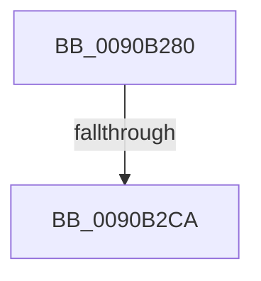

# ExpWnfResolveScopeInstance

- RVA: `0x0090B280`–`0x0090B2DA` (길이 `90` bytes)
- VA: `0x000000014090B280`
- 실행 섹션: `PAGE`
- PDB 이름 있음: `예`; PDB Function 태그: `예`
- unwind 정보 RVA: `0x00089130`
- 디코드: `25`개 명령, `90/90` bytes 표시
- 미해석 바이트: `0` (있으면 어셈블리에 `.byte`로 보존)

> 이 문서는 커널 이미지의 기계어와 PDB 기호를 분석해 생성했습니다. 4번과 5번은 함수 원형과 자료형을 바이너리 사용 방식에서 추정한 C 해석이며 원본 소스 복구 결과는 아닙니다.

## 1. Dependencies

- 직접 호출 지점: **2**; 고유 호출 대상: **2**
- 직접 호출자로 확인된 함수: **7**
- RIP 상대 이미지 참조: **0**

### Outgoing calls
- `0x0090B2CA` → [HalAdjustResourceList](../../text/48/HalAdjustResourceList_function_0048FDC0.md) (function, `0x0048FDC0`)
- `0x0090B2D2` → [PsGetServerSiloGlobals](../../text/22/PsGetServerSiloGlobals_function_002250A0.md) (function, `0x002250A0`)

### Direct callers
- [ExpNtDeleteWnfStateData](../7C/ExpNtDeleteWnfStateData_function_007CF1A8.md) at `0x007CF383`
- [NtCreateWnfStateName](../8B/NtCreateWnfStateName_function_008BE2B0.md) at `0x008BE4CE`
- [NtDeleteWnfStateName](NtDeleteWnfStateName_function_00908E60.md) at `0x00908F65`
- [NtQueryWnfStateData](NtQueryWnfStateData_function_00909DF0.md) at `0x0090A28E`
- [ExpNtUpdateWnfStateData](ExpNtUpdateWnfStateData_function_0090A7A0.md) at `0x0090ABAF`
- [ExpWnfSubscribeWnfStateChange](../9D/ExpWnfSubscribeWnfStateChange_function_009D4D0C.md) at `0x009D4E1B`
- [NtQueryWnfStateNameInformation](../9E/NtQueryWnfStateNameInformation_function_009EBD20.md) at `0x009EBEFF`

### Static image references
- 디코드된 RIP-relative 메모리 참조가 없습니다.

## 2. Other-region calls and transfers

- 다른 실행 섹션으로 향하는 call: **2**
  - `0x0090B2CA` → [HalAdjustResourceList](../../text/48/HalAdjustResourceList_function_0048FDC0.md) (`PAGE` → `.text`)
  - `0x0090B2D2` → [PsGetServerSiloGlobals](../../text/22/PsGetServerSiloGlobals_function_002250A0.md) (`PAGE` → `.text`)
- call이 아닌 외부 분기/꼬리 이동: **1**
  - `0x0090B2C4` → [sub_0090B427](Unknown_function_0090B427.md) (`tail-transfer`)

## 3. Assembly (complete function range)

```asm
0090B280  4C 89 44 24 18                  mov qword ptr [rsp + 0x18], r8
0090B285  48 89 54 24 10                  mov qword ptr [rsp + 0x10], rdx
0090B28A  48 89 4C 24 08                  mov qword ptr [rsp + 8], rcx
0090B28F  55                              push rbp
0090B290  53                              push rbx
0090B291  57                              push rdi
0090B292  41 54                           push r12
0090B294  41 56                           push r14
0090B296  41 57                           push r15
0090B298  48 8B EC                        mov rbp, rsp
0090B29B  48 83 EC 78                     sub rsp, 0x78
0090B29F  65 48 8B 04 25 88 01 00 00      mov rax, qword ptr gs:[0x188]
0090B2A8  33 C9                           xor ecx, ecx
0090B2AA  4D 63 F9                        movsxd r15, r9d
0090B2AD  49 8B F8                        mov rdi, r8
0090B2B0  48 8B DA                        mov rbx, rdx
0090B2B3  48 89 4D D8                     mov qword ptr [rbp - 0x28], rcx
0090B2B7  48 89 4D C8                     mov qword ptr [rbp - 0x38], rcx
0090B2BB  44 8B E1                        mov r12d, ecx
0090B2BE  38 88 32 02 00 00               cmp byte ptr [rax + 0x232], cl
0090B2C4  0F 85 5D 01 00 00               jne 0x14090b427
0090B2CA  E8 F1 4A B8 FF                  call 0x14048fdc0
0090B2CF  48 8B C8                        mov rcx, rax
0090B2D2  E8 C9 9D 91 FF                  call 0x1402250a0
0090B2D7  4C 8B F0                        mov r14, rax
```

## 4. C-style interpretation (structured pseudocode)

```c
__int64 __fastcall ExpWnfResolveScopeInstance(__int64 a1, __int64 a2, __int64 a3, int a4)
{
    __int64 result;
    __int64 v_rsp;
    unsigned __int64 v_stack_m58;
    unsigned __int64 v_stack_m68;
    unsigned __int64 v_stack_p10;
    unsigned __int64 v_stack_p18;
    unsigned __int64 v_stack_p8;

    v_stack_p18 = a3;
    v_stack_p10 = a2;
    v_stack_p8 = a1;
    v_rsp = (v_rsp) - (120);
    a1 = 0;
    v_stack_m58 = 0;
    v_stack_m68 = 0;
    result = HalAdjustResourceList(a1, a2, a3, a4);
    result = PsGetServerSiloGlobals(result, a2, a3, a4);
    return result;
}
```

## 5. (Beta) C Style

```c
int64_t ExpWnfResolveScopeInstance(int64_t Arg1, int64_t Arg2, int64_t Arg3, int32_t Arg4)
{
    int64_t result;
    int64_t local_rsp;
    uint64_t v_stack_m58;
    uint64_t v_stack_m68;
    uint64_t v_stack_p10;
    uint64_t v_stack_p18;
    uint64_t v_stack_p8;

    v_stack_p18 = Arg3;
    v_stack_p10 = Arg2;
    v_stack_p8 = Arg1;
    local_rsp = (local_rsp) - (120);
    Arg1 = 0;
    v_stack_m58 = 0;
    v_stack_m68 = 0;
    result = HalAdjustResourceList(Arg1, Arg2, Arg3, Arg4);
    result = PsGetServerSiloGlobals(result, Arg2, Arg3, Arg4);
    return result;
}
```

## 6. Execution-region graph

[열기: 2D/3D 그래프와 함수 탐색 컨트롤 패널](../../../control-panel.html?section=page&rva=0x0090B280&view=graph)

- 2D 그래프는 위에서 아래로 흐르고, 3D 그래프는 빈 공간을 드래그해 회전합니다. Shift+드래그는 이동, 휠은 확대·축소, 함수 노드 선택은 대상 보고서 이동입니다.

### Static fallback


