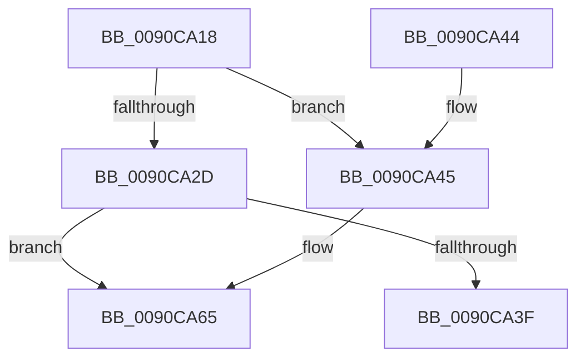

# ExpWnfValidateKernelCallbackEnvironment

- RVA: `0x0090CA18`–`0x0090CA8B` (길이 `115` bytes)
- VA: `0x000000014090CA18`
- 실행 섹션: `PAGE`
- PDB 이름 있음: `예`; PDB Function 태그: `아니요`
- unwind 정보 RVA: `0x000892C8`
- 디코드: `26`개 명령, `115/115` bytes 표시
- 미해석 바이트: `0` (있으면 어셈블리에 `.byte`로 보존)

> 이 문서는 커널 이미지의 기계어와 PDB 기호를 분석해 생성했습니다. 4번과 5번은 함수 원형과 자료형을 바이너리 사용 방식에서 추정한 C 해석이며 원본 소스 복구 결과는 아닙니다.

## 1. Dependencies

- 직접 호출 지점: **2**; 고유 호출 대상: **1**
- 직접 호출자로 확인된 함수: **1**
- RIP 상대 이미지 참조: **0**

### Outgoing calls
- `0x0090CA5F` → [KeBugCheckEx](../../text/4F/KeBugCheckEx_function_004FD660.md) (function, `0x004FD660`)
- `0x0090CA85` → [KeBugCheckEx](../../text/4F/KeBugCheckEx_function_004FD660.md) (function, `0x004FD660`)

### Direct callers
- [ExpWnfDispatchKernelSubscription](ExpWnfDispatchKernelSubscription_function_0090C520.md) at `0x0090C784`

### Static image references
- 디코드된 RIP-relative 메모리 참조가 없습니다.

## 2. Other-region calls and transfers

- 다른 실행 섹션으로 향하는 call: **2**
  - `0x0090CA5F` → [KeBugCheckEx](../../text/4F/KeBugCheckEx_function_004FD660.md) (`PAGE` → `.text`)
  - `0x0090CA85` → [KeBugCheckEx](../../text/4F/KeBugCheckEx_function_004FD660.md) (`PAGE` → `.text`)
- 별도 외부 분기/꼬리 이동을 확인하지 못했습니다.

## 3. Assembly (complete function range)

```asm
0090CA18  48 83 EC 38                     sub rsp, 0x38
0090CA1C  65 48 8B 14 25 88 01 00 00      mov rdx, qword ptr gs:[0x188]
0090CA25  44 0F 20 C0                     mov rax, cr8
0090CA29  84 C0                           test al, al
0090CA2B  75 18                           jne 0x14090ca45
0090CA2D  65 48 8B 04 25 88 01 00 00      mov rax, qword ptr gs:[0x188]
0090CA36  80 B8 4A 02 00 00 01            cmp byte ptr [rax + 0x24a], 1
0090CA3D  74 26                           je 0x14090ca65
0090CA3F  48 83 C4 38                     add rsp, 0x38
0090CA43  C3                              ret
0090CA44  CC                              int3
0090CA45  44 0F 20 C0                     mov rax, cr8
0090CA49  4C 8B 49 58                     mov r9, qword ptr [rcx + 0x58]
0090CA4D  48 8B 51 50                     mov rdx, qword ptr [rcx + 0x50]
0090CA51  48 89 4C 24 20                  mov qword ptr [rsp + 0x20], rcx
0090CA56  B9 E1 00 00 00                  mov ecx, 0xe1
0090CA5B  44 0F B6 C0                     movzx r8d, al
0090CA5F  E8 FC 0B BF FF                  call 0x1404fd660
0090CA64  CC                              int3
0090CA65  44 0F B6 8A 4A 02 00 00         movzx r9d, byte ptr [rdx + 0x24a]
0090CA6D  B9 05 00 00 00                  mov ecx, 5
0090CA72  4C 8B 82 B8 00 00 00            mov r8, qword ptr [rdx + 0xb8]
0090CA79  48 89 54 24 20                  mov qword ptr [rsp + 0x20], rdx
0090CA7E  48 8B 92 20 02 00 00            mov rdx, qword ptr [rdx + 0x220]
0090CA85  E8 D6 0B BF FF                  call 0x1404fd660
0090CA8A  CC                              int3
```

## 4. C-style interpretation (structured pseudocode)

```c
__int64 __fastcall ExpWnfValidateKernelCallbackEnvironment(__int64 a1)
{
    __int64 result;
    __int64 v_rsp;
    unsigned __int64 v_stack_p20;

    v_rsp = (v_rsp) - (56);
    if ((unsigned __int8)(v_cr8) != 0) goto loc_0090CA45;
    if ((*(unsigned __int8 *)(*(unsigned __int64 *)(gs_base + (0 + 392)) + 586)) == 1) goto loc_0090CA65;
    v_rsp = (v_rsp) + (56);
    return *(unsigned __int64 *)(gs_base + (0 + 392));
loc_0090CA45:
    v_stack_p20 = a1;
    result = KeBugCheckEx(225, *(unsigned __int64 *)(a1 + 80), (unsigned __int8)(v_cr8), *(unsigned __int64 *)(a1 + 88));
loc_0090CA65:
    v_stack_p20 = *(unsigned __int64 *)(a1 + 80);
    result = KeBugCheckEx(5, *(unsigned __int64 *)(*(unsigned __int64 *)(a1 + 80) + 544), *(unsigned __int64 *)(*(unsigned __int64 *)(a1 + 80) + 184), *(unsigned __int8 *)(*(unsigned __int64 *)(a1 + 80) + 586));
    return result;
}
```

## 5. (Beta) C Style

```c
int64_t ExpWnfValidateKernelCallbackEnvironment(void *Arg1)
{
    uint8_t *arg1 = (uint8_t *)Arg1;

    int64_t result;
    int64_t local_rsp;
    uint64_t v_stack_p20;

    local_rsp = (local_rsp) - (56);
    if ((uint8_t)(v_cr8) != 0) goto loc_0090CA45;
    if ((*(uint8_t *)(*(uint64_t *)(gs_base + (0 + 0x188)) + 0x24A)) == 1) goto loc_0090CA65;
    local_rsp = (local_rsp) + (56);
    return *(uint64_t *)(gs_base + (0 + 0x188));
loc_0090CA45:
    v_stack_p20 = Arg1;
    result = KeBugCheckEx(225, *(uint64_t *)(arg1 + 0x50), (uint8_t)(v_cr8), *(uint64_t *)(arg1 + 0x58));
loc_0090CA65:
    v_stack_p20 = *(uint64_t *)(arg1 + 0x50);
    result = KeBugCheckEx(5, *(uint64_t *)(*(uint64_t *)(arg1 + 0x50) + 0x220), *(uint64_t *)(*(uint64_t *)(arg1 + 0x50) + 0xB8), *(uint8_t *)(*(uint64_t *)(arg1 + 0x50) + 0x24A));
    return result;
}
```

### 관측된 메모리 오프셋

구조체 형식이 확인되지 않은 접근은 인자 기준의 오프셋으로만 기록했습니다.

| 기준 인자 | 오프셋 표현 | 폭 (bit) | 접근 |
|---|---:|---:|---|
| `Arg1` | `+ 0x50` | `64` | `R` |
| `Arg1` | `+ 0x58` | `64` | `R` |

## 6. Execution-region graph

[열기: 2D/3D 그래프와 함수 탐색 컨트롤 패널](../../../control-panel.html?section=page&rva=0x0090CA18&view=graph)

- 2D 그래프는 위에서 아래로 흐르고, 3D 그래프는 빈 공간을 드래그해 회전합니다. Shift+드래그는 이동, 휠은 확대·축소, 함수 노드 선택은 대상 보고서 이동입니다.

### Static fallback


