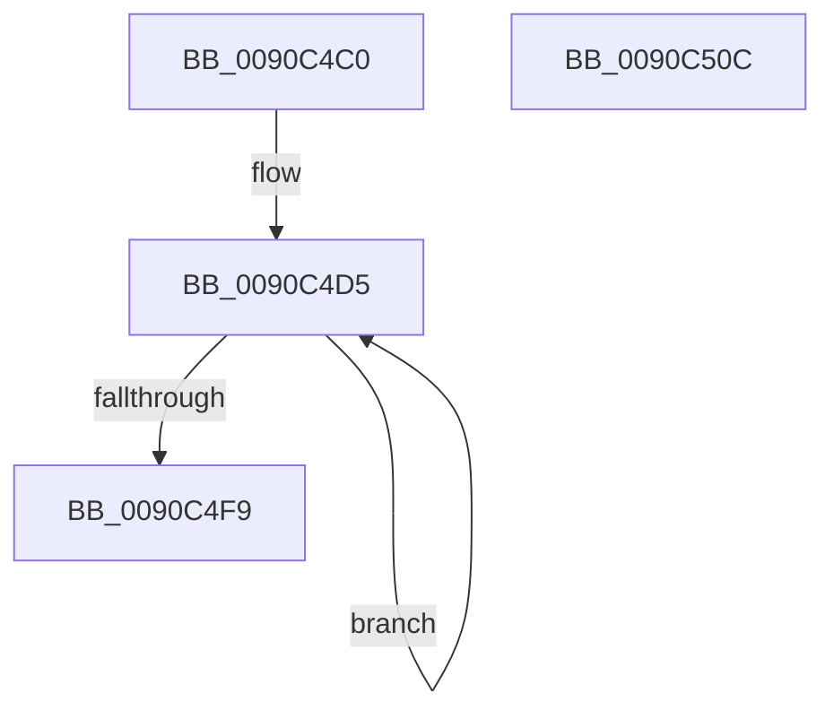

# ExpWnfWorkItemRoutine

- RVA: `0x0090C4C0`–`0x0090C50D` (길이 `77` bytes)
- VA: `0x000000014090C4C0`
- 실행 섹션: `PAGE`
- PDB 이름 있음: `예`; PDB Function 태그: `아니요`
- unwind 정보 RVA: `0x0005C788`
- 디코드: `17`개 명령, `77/77` bytes 표시
- 미해석 바이트: `0` (있으면 어셈블리에 `.byte`로 보존)

> 이 문서는 커널 이미지의 기계어와 PDB 기호를 분석해 생성했습니다. 4번과 5번은 함수 원형과 자료형을 바이너리 사용 방식에서 추정한 C 해석이며 원본 소스 복구 결과는 아닙니다.

## 1. Dependencies

- 직접 호출 지점: **2**; 고유 호출 대상: **2**
- 직접 호출자로 확인된 함수: **0**
- RIP 상대 이미지 참조: **1**

### Outgoing calls
- `0x0090C4E1` → [ExpWnfDispatchKernelSubscription](ExpWnfDispatchKernelSubscription_function_0090C520.md) (function, `0x0090C520`)
- `0x0090C502` → [KeLeaveCriticalRegionThread](../../text/25/KeLeaveCriticalRegionThread_function_0025EFF0.md) (function, `0x0025EFF0`)

### Direct callers
- 이 함수 시작 RVA로 연결되는 직접 call은 확인되지 않았습니다. 간접 호출은 완전히 역산할 수 없습니다.

### Static image references
- `0x0090C4D5` → RVA `0x00FD9B98` (`PAGEDATA`; read)

## 2. Other-region calls and transfers

- 다른 실행 섹션으로 향하는 call: **1**
  - `0x0090C502` → [KeLeaveCriticalRegionThread](../../text/25/KeLeaveCriticalRegionThread_function_0025EFF0.md) (`PAGE` → `.text`)
- 별도 외부 분기/꼬리 이동을 확인하지 못했습니다.

## 3. Assembly (complete function range)

```asm
0090C4C0  48 83 EC 28                     sub rsp, 0x28
0090C4C4  65 48 8B 04 25 88 01 00 00      mov rax, qword ptr gs:[0x188]
0090C4CD  66 FF 88 E4 01 00 00            dec word ptr [rax + 0x1e4]
0090C4D4  90                              nop
0090C4D5  48 8B 05 BC D6 6C 00            mov rax, qword ptr [rip + 0x6cd6bc]
0090C4DC  F0 83 60 28 FD                  lock and dword ptr [rax + 0x28], 0xfffffffd
0090C4E1  E8 3A 00 00 00                  call 0x14090c520
0090C4E6  48 8B 0D AB D6 6C 00            mov rcx, qword ptr [rip + 0x6cd6ab]
0090C4ED  33 D2                           xor edx, edx
0090C4EF  8D 42 01                        lea eax, [rdx + 1]
0090C4F2  F0 0F B1 51 28                  lock cmpxchg dword ptr [rcx + 0x28], edx
0090C4F7  75 DC                           jne 0x14090c4d5
0090C4F9  65 48 8B 0C 25 88 01 00 00      mov rcx, qword ptr gs:[0x188]
0090C502  E8 E9 2A 95 FF                  call 0x14025eff0
0090C507  48 83 C4 28                     add rsp, 0x28
0090C50B  C3                              ret
0090C50C  CC                              int3
```

## 4. C-style interpretation (structured pseudocode)

```c
__int64 __fastcall ExpWnfWorkItemRoutine(__int64 a1, int a2)
{
    __int64 result;
    __int64 v_rsp;

    v_rsp = (v_rsp) - (40);
loc_0090C4D5:
    result = ExpWnfDispatchKernelSubscription(a1, a2, a3, a4);
    a2 = 0;
    if (condition_is_not_equal) goto loc_0090C4D5;
    result = KeLeaveCriticalRegionThread(*(unsigned __int64 *)(gs_base + (0 + 392)), a2, a3, a4);
    v_rsp = (v_rsp) + (40);
    return result;
}
```

## 5. (Beta) C Style

```c
int64_t ExpWnfWorkItemRoutine(int64_t Arg1, int32_t Arg2)
{
    int64_t result;
    int64_t local_rsp;

    local_rsp = (local_rsp) - (40);
loc_0090C4D5:
    result = ExpWnfDispatchKernelSubscription(Arg1, Arg2, a3, a4);
    Arg2 = 0;
    if (condition_is_not_equal) goto loc_0090C4D5;
    result = KeLeaveCriticalRegionThread(*(uint64_t *)(gs_base + (0 + 0x188)), Arg2, a3, a4);
    local_rsp = (local_rsp) + (40);
    return result;
}
```

## 6. Execution-region graph

[열기: 2D/3D 그래프와 함수 탐색 컨트롤 패널](../../../control-panel.html?section=page&rva=0x0090C4C0&view=graph)

- 2D 그래프는 위에서 아래로 흐르고, 3D 그래프는 빈 공간을 드래그해 회전합니다. Shift+드래그는 이동, 휠은 확대·축소, 함수 노드 선택은 대상 보고서 이동입니다.

### Static fallback


