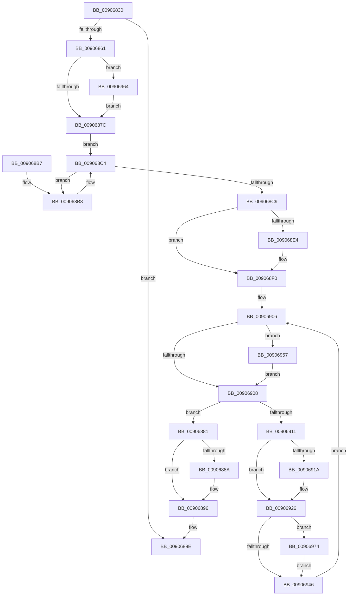

# IoCancelThreadIo

- RVA: `0x00906830`–`0x0090697B` (길이 `331` bytes)
- VA: `0x0000000140906830`
- 실행 섹션: `PAGE`
- PDB 이름 있음: `예`; PDB Function 태그: `아니요`
- unwind 정보 RVA: `0x00088D00`
- 디코드: `86`개 명령, `331/331` bytes 표시
- 미해석 바이트: `0` (있으면 어셈블리에 `.byte`로 보존)

> 이 문서는 커널 이미지의 기계어와 PDB 기호를 분석해 생성했습니다. 4번과 5번은 함수 원형과 자료형을 바이너리 사용 방식에서 추정한 C 해석이며 원본 소스 복구 결과는 아닙니다.

## 1. Dependencies

- 직접 호출 지점: **8**; 고유 호출 대상: **5**
- 직접 호출자로 확인된 함수: **1**
- RIP 상대 이미지 참조: **2**

### Outgoing calls
- `0x00906891` → [KiLowerIrqlProcessIrqlFlags](../../text/4F/KiLowerIrqlProcessIrqlFlags_function_004F5698.md) (function, `0x004F5698`)
- `0x009068BC` → [IoCancelIrp](../../text/27/IoCancelIrp_function_002720E0.md) (function, `0x002720E0`)
- `0x009068EB` → [KiLowerIrqlProcessIrqlFlags](../../text/4F/KiLowerIrqlProcessIrqlFlags_function_004F5698.md) (function, `0x004F5698`)
- `0x00906921` → [KiLowerIrqlProcessIrqlFlags](../../text/4F/KiLowerIrqlProcessIrqlFlags_function_004F5698.md) (function, `0x004F5698`)
- `0x00906937` → [KeDelayExecutionThread](../../text/20/KeDelayExecutionThread_function_00209550.md) (function, `0x00209550`)
- `0x0090695D` → [KiRaiseIrqlProcessIrqlFlags](../../text/4F/KiRaiseIrqlProcessIrqlFlags_function_004F56FC.md) (function, `0x004F56FC`)
- `0x0090696A` → [KiRaiseIrqlProcessIrqlFlags](../../text/4F/KiRaiseIrqlProcessIrqlFlags_function_004F56FC.md) (function, `0x004F56FC`)
- `0x00906974` → [IopDisassociateThreadIrp](../../text/59/IopDisassociateThreadIrp_function_0059708C.md) (function, `0x0059708C`)

### Direct callers
- [PspExitThread](PspExitThread_function_00905F60.md) at `0x009062A0`

### Static image references
- `0x0090686F` → RVA `0x00FC6D20` (`ALMOSTRO`; read)
- `0x009068C9` → RVA `0x00E660FC` (`.data`; read)

## 2. Other-region calls and transfers

- 다른 실행 섹션으로 향하는 call: **8**
  - `0x00906891` → [KiLowerIrqlProcessIrqlFlags](../../text/4F/KiLowerIrqlProcessIrqlFlags_function_004F5698.md) (`PAGE` → `.text`)
  - `0x009068BC` → [IoCancelIrp](../../text/27/IoCancelIrp_function_002720E0.md) (`PAGE` → `.text`)
  - `0x009068EB` → [KiLowerIrqlProcessIrqlFlags](../../text/4F/KiLowerIrqlProcessIrqlFlags_function_004F5698.md) (`PAGE` → `.text`)
  - `0x00906921` → [KiLowerIrqlProcessIrqlFlags](../../text/4F/KiLowerIrqlProcessIrqlFlags_function_004F5698.md) (`PAGE` → `.text`)
  - `0x00906937` → [KeDelayExecutionThread](../../text/20/KeDelayExecutionThread_function_00209550.md) (`PAGE` → `.text`)
  - `0x0090695D` → [KiRaiseIrqlProcessIrqlFlags](../../text/4F/KiRaiseIrqlProcessIrqlFlags_function_004F56FC.md) (`PAGE` → `.text`)
  - `0x0090696A` → [KiRaiseIrqlProcessIrqlFlags](../../text/4F/KiRaiseIrqlProcessIrqlFlags_function_004F56FC.md) (`PAGE` → `.text`)
  - `0x00906974` → [IopDisassociateThreadIrp](../../text/59/IopDisassociateThreadIrp_function_0059708C.md) (`PAGE` → `.text`)
- 별도 외부 분기/꼬리 이동을 확인하지 못했습니다.

## 3. Assembly (complete function range)

```asm
00906830  48 8B C4                        mov rax, rsp
00906833  48 89 58 10                     mov qword ptr [rax + 0x10], rbx
00906837  48 89 68 18                     mov qword ptr [rax + 0x18], rbp
0090683B  48 89 70 20                     mov qword ptr [rax + 0x20], rsi
0090683F  48 89 48 08                     mov qword ptr [rax + 8], rcx
00906843  57                              push rdi
00906844  41 54                           push r12
00906846  41 56                           push r14
00906848  48 83 EC 20                     sub rsp, 0x20
0090684C  65 48 8B 1C 25 88 01 00 00      mov rbx, qword ptr gs:[0x188]
00906855  48 81 C3 40 05 00 00            add rbx, 0x540
0090685C  48 39 1B                        cmp qword ptr [rbx], rbx
0090685F  74 3D                           je 0x14090689e
00906861  44 0F 20 C6                     mov rsi, cr8
00906865  41 BC 01 00 00 00               mov r12d, 1
0090686B  45 0F 22 C4                     mov cr8, r12
0090686F  83 3D AA 04 6C 00 00            cmp dword ptr [rip + 0x6c04aa], 0
00906876  0F 85 E8 00 00 00               jne 0x140906964
0090687C  48 8B 3B                        mov rdi, qword ptr [rbx]
0090687F  EB 43                           jmp 0x1409068c4
00906881  83 3D 98 04 6C 00 00            cmp dword ptr [rip + 0x6c0498], 0
00906888  74 0C                           je 0x140906896
0090688A  44 0F 20 C1                     mov rcx, cr8
0090688E  40 8A D7                        mov dl, dil
00906891  E8 02 EE BE FF                  call 0x1404f5698
00906896  40 0F B6 C7                     movzx eax, dil
0090689A  44 0F 22 C0                     mov cr8, rax
0090689E  48 8B 5C 24 48                  mov rbx, qword ptr [rsp + 0x48]
009068A3  48 8B 6C 24 50                  mov rbp, qword ptr [rsp + 0x50]
009068A8  48 8B 74 24 58                  mov rsi, qword ptr [rsp + 0x58]
009068AD  48 83 C4 20                     add rsp, 0x20
009068B1  41 5E                           pop r14
009068B3  41 5C                           pop r12
009068B5  5F                              pop rdi
009068B6  C3                              ret
009068B7  CC                              int3
009068B8  48 8D 4F E0                     lea rcx, [rdi - 0x20]
009068BC  E8 1F B8 96 FF                  call 0x1402720e0
009068C1  48 8B 3F                        mov rdi, qword ptr [rdi]
009068C4  48 3B DF                        cmp rbx, rdi
009068C7  75 EF                           jne 0x1409068b8
009068C9  44 6B 35 2B F8 55 00 64         imul r14d, dword ptr [rip + 0x55f82b], 0x64
009068D1  33 ED                           xor ebp, ebp
009068D3  39 2D 47 04 6C 00               cmp dword ptr [rip + 0x6c0447], ebp
009068D9  48 C7 44 24 40 60 79 FE FF      mov qword ptr [rsp + 0x40], 0xfffffffffffe7960
009068E2  74 0C                           je 0x1409068f0
009068E4  44 0F 20 C1                     mov rcx, cr8
009068E8  40 8A D6                        mov dl, sil
009068EB  E8 A8 ED BE FF                  call 0x1404f5698
009068F0  40 0F B6 C6                     movzx eax, sil
009068F4  44 0F 22 C0                     mov cr8, rax
009068F8  44 0F 20 C7                     mov rdi, cr8
009068FC  45 0F 22 C4                     mov cr8, r12
00906900  39 2D 1A 04 6C 00               cmp dword ptr [rip + 0x6c041a], ebp
00906906  75 4F                           jne 0x140906957
00906908  48 39 1B                        cmp qword ptr [rbx], rbx
0090690B  0F 84 70 FF FF FF               je 0x140906881
00906911  83 3D 08 04 6C 00 00            cmp dword ptr [rip + 0x6c0408], 0
00906918  74 0C                           je 0x140906926
0090691A  44 0F 20 C1                     mov rcx, cr8
0090691E  40 8A D7                        mov dl, dil
00906921  E8 72 ED BE FF                  call 0x1404f5698
00906926  40 0F B6 C7                     movzx eax, dil
0090692A  44 0F 22 C0                     mov cr8, rax
0090692E  4C 8D 44 24 40                  lea r8, [rsp + 0x40]
00906933  33 D2                           xor edx, edx
00906935  33 C9                           xor ecx, ecx
00906937  E8 14 2C 90 FF                  call 0x140209550
0090693C  8B C5                           mov eax, ebp
0090693E  41 03 EC                        add ebp, r12d
00906941  41 3B C6                        cmp eax, r14d
00906944  77 2E                           ja 0x140906974
00906946  44 0F 20 C7                     mov rdi, cr8
0090694A  45 0F 22 C4                     mov cr8, r12
0090694E  83 3D CB 03 6C 00 00            cmp dword ptr [rip + 0x6c03cb], 0
00906955  EB AF                           jmp 0x140906906
00906957  41 8A D4                        mov dl, r12b
0090695A  40 8A CF                        mov cl, dil
0090695D  E8 9A ED BE FF                  call 0x1404f56fc
00906962  EB A4                           jmp 0x140906908
00906964  41 8A D4                        mov dl, r12b
00906967  40 8A CE                        mov cl, sil
0090696A  E8 8D ED BE FF                  call 0x1404f56fc
0090696F  E9 08 FF FF FF                  jmp 0x14090687c
00906974  E8 13 07 C9 FF                  call 0x14059708c
00906979  EB CB                           jmp 0x140906946
```

## 4. C-style interpretation (structured pseudocode)

```c
__int64 __fastcall IoCancelThreadIo(__int64 a1)
{
    __int64 result;
    __int64 v_r14;
    __int64 v_rbp;
    __int64 v_rbx;
    __int64 v_rsp;
    unsigned __int64 v_stack_p10;
    unsigned __int64 v_stack_p18;
    unsigned __int64 v_stack_p20;
    unsigned __int64 v_stack_p40;

    *(unsigned __int64 *)(v_rsp + 16) = v_rbx;
    *(unsigned __int64 *)(v_rsp + 24) = v_rbp;
    *(unsigned __int64 *)(v_rsp + 32) = v_rsi;
    *(unsigned __int64 *)(v_rsp + 8) = a1;
    v_rsp = (v_rsp) - (32);
    v_rbx = (*(unsigned __int64 *)(gs_base + (0 + 392))) + (0x540ULL);
    if ((*(unsigned __int64 *)(v_rbx)) == v_rbx) goto loc_0090689E;
    if ((*(unsigned int *)(v_rip + 7079082)) != 0) goto loc_00906964;
loc_0090687C:
    goto loc_009068C4;
loc_00906881:
    result = v_rsp;
    if ((*(unsigned int *)(v_rip + 7079064)) != 0) {
        a1 = 1;
        a2 = (unsigned __int8)(*(unsigned __int64 *)(v_rbx));
        result = KiLowerIrqlProcessIrqlFlags(a1, a2, a3, a4);
    }
loc_0090689E:
    v_rsp = (v_rsp) + (32);
    return (unsigned __int8)(*(unsigned __int64 *)(v_rbx));
loc_009068B8:
    result = IoCancelIrp(*(unsigned __int64 *)(v_rbx) - 32, a2, a3, a4);
loc_009068C4:
    if (v_stack_p10 != (*(unsigned __int64 *)(*(unsigned __int64 *)(v_rbx)))) goto loc_009068B8;
    v_r14 = (unsigned int)((v_r14) * (*(unsigned int *)(v_rip + 5634091)));
    v_rbp = 0;
    v_stack_p40 = 0xFFFFFFFFFFFE7960ULL;
    if ((*(unsigned int *)(v_rip + 7078983)) != 0) {
        a1 = (unsigned __int8)(*(unsigned __int64 *)(v_rbx));
        a2 = (unsigned __int8)(v_stack_p20);
        result = KiLowerIrqlProcessIrqlFlags(a1, a2, a3, a4);
    }
loc_00906906:
    if ((*(unsigned int *)(v_rip + 7078938)) != 0) goto loc_00906957;
loc_00906908:
    if ((*(unsigned __int64 *)(v_stack_p10)) == v_stack_p10) goto loc_00906881;
    result = (unsigned __int8)(v_stack_p20);
    if ((*(unsigned int *)(v_rip + 7078920)) != 0) {
        a1 = 1;
        a2 = (unsigned __int8)((unsigned __int8)(v_stack_p20));
        result = KiLowerIrqlProcessIrqlFlags(a1, a2, a3, a4);
    }
    a2 = 0;
    a1 = 0;
    result = KeDelayExecutionThread(a1, a2, v_stack_p40, a4);
    v_rbp = (unsigned int)((v_rbp) + (1));
    if (0 > ((unsigned int)(v_r14))) goto loc_00906974;
loc_00906946:
    goto loc_00906906;
loc_00906957:
    result = KiRaiseIrqlProcessIrqlFlags((unsigned __int8)((unsigned __int8)((unsigned __int8)(v_stack_p20))), 1, v_stack_p40, a4);
    goto loc_00906908;
loc_00906964:
    result = KiRaiseIrqlProcessIrqlFlags((unsigned __int8)(v_stack_p20), 1, v_stack_p40, a4);
    goto loc_0090687C;
loc_00906974:
    result = IopDisassociateThreadIrp((unsigned __int8)(v_stack_p20), 1, v_stack_p40, a4);
    goto loc_00906946;
}
```

## 5. (Beta) C Style

```c
int64_t IoCancelThreadIo(int64_t Arg1)
{
    int64_t result;
    int64_t local_r14;
    int64_t local_rbp;
    int64_t local_rbx;
    int64_t local_rsp;
    uint64_t v_stack_p10;
    uint64_t v_stack_p18;
    uint64_t v_stack_p20;
    uint64_t v_stack_p40;

    *(uint64_t *)(local_rsp + 0x10) = local_rbx;
    *(uint64_t *)(local_rsp + 0x18) = local_rbp;
    *(uint64_t *)(local_rsp + 0x20) = local_rsi;
    *(uint64_t *)(local_rsp + 0x8) = Arg1;
    local_rsp = (local_rsp) - (32);
    local_rbx = (*(uint64_t *)(gs_base + (0 + 0x188))) + (0x540ULL);
    if ((*(uint64_t *)(local_rbx)) == local_rbx) goto loc_0090689E;
    if ((*(uint32_t *)(v_rip + 0x6C04AA)) != 0) goto loc_00906964;
loc_0090687C:
    goto loc_009068C4;
loc_00906881:
    result = local_rsp;
    if ((*(uint32_t *)(v_rip + 0x6C0498)) != 0) {
        Arg1 = 1;
        a2 = (uint8_t)(*(uint64_t *)(local_rbx));
        result = KiLowerIrqlProcessIrqlFlags(Arg1, a2, a3, a4);
    }
loc_0090689E:
    local_rsp = (local_rsp) + (32);
    return (uint8_t)(*(uint64_t *)(local_rbx));
loc_009068B8:
    result = IoCancelIrp(*(uint64_t *)(local_rbx) - 32, a2, a3, a4);
loc_009068C4:
    if (v_stack_p10 != (*(uint64_t *)(*(uint64_t *)(local_rbx)))) goto loc_009068B8;
    local_r14 = (uint32_t)((local_r14) * (*(uint32_t *)(v_rip + 0x55F82B)));
    local_rbp = 0;
    v_stack_p40 = 0xFFFFFFFFFFFE7960ULL;
    if ((*(uint32_t *)(v_rip + 0x6C0447)) != 0) {
        Arg1 = (uint8_t)(*(uint64_t *)(local_rbx));
        a2 = (uint8_t)(v_stack_p20);
        result = KiLowerIrqlProcessIrqlFlags(Arg1, a2, a3, a4);
    }
loc_00906906:
    if ((*(uint32_t *)(v_rip + 0x6C041A)) != 0) goto loc_00906957;
loc_00906908:
    if ((*(uint64_t *)(v_stack_p10)) == v_stack_p10) goto loc_00906881;
    result = (uint8_t)(v_stack_p20);
    if ((*(uint32_t *)(v_rip + 0x6C0408)) != 0) {
        Arg1 = 1;
        a2 = (uint8_t)((uint8_t)(v_stack_p20));
        result = KiLowerIrqlProcessIrqlFlags(Arg1, a2, a3, a4);
    }
    a2 = 0;
    Arg1 = 0;
    result = KeDelayExecutionThread(Arg1, a2, v_stack_p40, a4);
    local_rbp = (uint32_t)((local_rbp) + (1));
    if (0 > ((uint32_t)(local_r14))) goto loc_00906974;
loc_00906946:
    goto loc_00906906;
loc_00906957:
    result = KiRaiseIrqlProcessIrqlFlags((uint8_t)((uint8_t)((uint8_t)(v_stack_p20))), 1, v_stack_p40, a4);
    goto loc_00906908;
loc_00906964:
    result = KiRaiseIrqlProcessIrqlFlags((uint8_t)(v_stack_p20), 1, v_stack_p40, a4);
    goto loc_0090687C;
loc_00906974:
    result = IopDisassociateThreadIrp((uint8_t)(v_stack_p20), 1, v_stack_p40, a4);
    goto loc_00906946;
}
```

## 6. Execution-region graph

[열기: 2D/3D 그래프와 함수 탐색 컨트롤 패널](../../../control-panel.html?section=page&rva=0x00906830&view=graph)

- 2D 그래프는 위에서 아래로 흐르고, 3D 그래프는 빈 공간을 드래그해 회전합니다. Shift+드래그는 이동, 휠은 확대·축소, 함수 노드 선택은 대상 보고서 이동입니다.

### Static fallback


