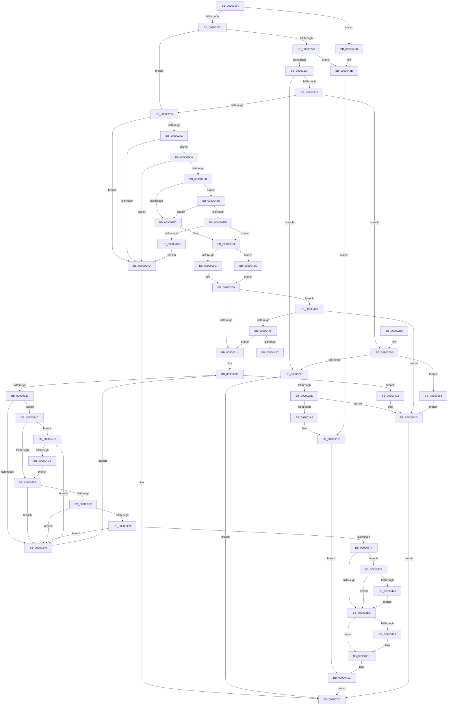

# IoConnectInterruptEx

- RVA: `0x009001F0`–`0x009004DD` (길이 `749` bytes)
- VA: `0x00000001409001F0`
- 실행 섹션: `PAGE`
- PDB 이름 있음: `예`; PDB Function 태그: `예`
- unwind 정보 RVA: `0x00088494`
- 디코드: `195`개 명령, `749/749` bytes 표시
- 미해석 바이트: `0` (있으면 어셈블리에 `.byte`로 보존)

> 이 문서는 커널 이미지의 기계어와 PDB 기호를 분석해 생성했습니다. 4번과 5번은 함수 원형과 자료형을 바이너리 사용 방식에서 추정한 C 해석이며 원본 소스 복구 결과는 아닙니다.

## 1. Dependencies

- 직접 호출 지점: **9**; 고유 호출 대상: **7**
- 직접 호출자로 확인된 함수: **2**
- RIP 상대 이미지 참조: **0**

### Outgoing calls
- `0x00900294` → [IopConnectMessageBasedInterrupt](IopConnectMessageBasedInterrupt_function_0090124C.md) (function, `0x0090124C`)
- `0x009002C8` → [IopConnectLineBasedInterrupt](../8F/IopConnectLineBasedInterrupt_function_008FFE64.md) (function, `0x008FFE64`)
- `0x00900307` → [IopGetInterruptConnectionData](IopGetInterruptConnectionData_function_009004E4.md) (function, `0x009004E4`)
- `0x0090031E` → [memset](../../text/6C/memset_function_006C6C40.md) (function, `0x006C6C40`)
- `0x009003F8` → [IopConnectInterrupt](IopConnectInterrupt_function_00900B40.md) (function, `0x00900B40`)
- `0x00900417` → [ExFreePoolWithTag](../../poolcode/B8/ExFreePoolWithTag_function_00B82870.md) (function, `0x00B82870`)
- `0x00900428` → [ExFreePoolWithTag](../../poolcode/B8/ExFreePoolWithTag_function_00B82870.md) (function, `0x00B82870`)
- `0x00900485` → [KeBugCheckEx](../../text/4F/KeBugCheckEx_function_004FD660.md) (function, `0x004FD660`)
- `0x009004AB` → [IopConnectLineBasedInterrupt](../8F/IopConnectLineBasedInterrupt_function_008FFE64.md) (function, `0x008FFE64`)

### Direct callers
- [HalpInterruptConnect](../../text/54/HalpInterruptConnect_function_005426F8.md) at `0x005428BD`
- [DifIoConnectInterruptExWrapper](../../text/62/DifIoConnectInterruptExWrapper_function_00628780.md) at `0x0062884D`

### Static image references
- 디코드된 RIP-relative 메모리 참조가 없습니다.

## 2. Other-region calls and transfers

- 다른 실행 섹션으로 향하는 call: **4**
  - `0x0090031E` → [memset](../../text/6C/memset_function_006C6C40.md) (`PAGE` → `.text`)
  - `0x00900417` → [ExFreePoolWithTag](../../poolcode/B8/ExFreePoolWithTag_function_00B82870.md) (`PAGE` → `POOLCODE`)
  - `0x00900428` → [ExFreePoolWithTag](../../poolcode/B8/ExFreePoolWithTag_function_00B82870.md) (`PAGE` → `POOLCODE`)
  - `0x00900485` → [KeBugCheckEx](../../text/4F/KeBugCheckEx_function_004FD660.md) (`PAGE` → `.text`)
- call이 아닌 외부 분기/꼬리 이동: **1**
  - `0x00900457` → [sub_00B2000C](../B2/Unknown_function_00B2000C.md) (`tail-transfer`)

## 3. Assembly (complete function range)

```asm
009001F0  48 89 5C 24 08                  mov qword ptr [rsp + 8], rbx
009001F5  55                              push rbp
009001F6  56                              push rsi
009001F7  57                              push rdi
009001F8  48 8D 6C 24 B9                  lea rbp, [rsp - 0x47]
009001FD  48 81 EC D0 00 00 00            sub rsp, 0xd0
00900204  48 83 65 6F 00                  and qword ptr [rbp + 0x6f], 0
00900209  48 8B D9                        mov rbx, rcx
0090020C  48 83 65 77 00                  and qword ptr [rbp + 0x77], 0
00900211  44 0F 20 C0                     mov rax, cr8
00900215  84 C0                           test al, al
00900217  0F 85 4E 02 00 00               jne 0x14090046b
0090021D  8B 09                           mov ecx, dword ptr [rcx]
0090021F  8B C1                           mov eax, ecx
00900221  83 E8 01                        sub eax, 1
00900224  74 13                           je 0x140900239
00900226  83 E8 01                        sub eax, 1
00900229  0F 84 5C 02 00 00               je 0x14090048b
0090022F  83 E8 01                        sub eax, 1
00900232  74 3B                           je 0x14090026f
00900234  83 E8 01                        sub eax, 1
00900237  75 2D                           jne 0x140900266
00900239  4C 8B 43 08                     mov r8, qword ptr [rbx + 8]
0090023D  4D 85 C0                        test r8, r8
00900240  74 0B                           je 0x14090024d
00900242  48 83 7B 18 00                  cmp qword ptr [rbx + 0x18], 0
00900247  0F 85 8D 00 00 00               jne 0x1409002da
0090024D  B8 0D 00 00 C0                  mov eax, 0xc000000d
00900252  48 8B 9C 24 F0 00 00 00         mov rbx, qword ptr [rsp + 0xf0]
0090025A  48 81 C4 D0 00 00 00            add rsp, 0xd0
00900261  5F                              pop rdi
00900262  5E                              pop rsi
00900263  5D                              pop rbp
00900264  C3                              ret
00900265  CC                              int3
00900266  83 F8 01                        cmp eax, 1
00900269  0F 85 F4 01 00 00               jne 0x140900463
0090026F  8A 43 30                        mov al, byte ptr [rbx + 0x30]
00900272  4C 8B 4B 18                     mov r9, qword ptr [rbx + 0x18]
00900276  4C 8B 43 10                     mov r8, qword ptr [rbx + 0x10]
0090027A  48 8B 53 08                     mov rdx, qword ptr [rbx + 8]
0090027E  88 44 24 30                     mov byte ptr [rsp + 0x30], al
00900282  48 8B 43 28                     mov rax, qword ptr [rbx + 0x28]
00900286  48 89 44 24 28                  mov qword ptr [rsp + 0x28], rax
0090028B  48 8B 43 20                     mov rax, qword ptr [rbx + 0x20]
0090028F  48 89 44 24 20                  mov qword ptr [rsp + 0x20], rax
00900294  E8 B3 0F 00 00                  call 0x14090124c
00900299  85 C0                           test eax, eax
0090029B  79 B5                           jns 0x140900252
0090029D  48 83 7B 38 00                  cmp qword ptr [rbx + 0x38], 0
009002A2  0F 84 85 01 00 00               je 0x14090042d
009002A8  8A 43 30                        mov al, byte ptr [rbx + 0x30]
009002AB  4C 8B 4B 20                     mov r9, qword ptr [rbx + 0x20]
009002AF  4C 8B 43 38                     mov r8, qword ptr [rbx + 0x38]
009002B3  48 8B 53 10                     mov rdx, qword ptr [rbx + 0x10]
009002B7  48 8B 4B 08                     mov rcx, qword ptr [rbx + 8]
009002BB  88 44 24 28                     mov byte ptr [rsp + 0x28], al
009002BF  48 8B 43 28                     mov rax, qword ptr [rbx + 0x28]
009002C3  48 89 44 24 20                  mov qword ptr [rsp + 0x20], rax
009002C8  E8 97 FB FF FF                  call 0x1408ffe64
009002CD  C7 03 02 00 00 00               mov dword ptr [rbx], 2
009002D3  8B F0                           mov esi, eax
009002D5  E9 42 01 00 00                  jmp 0x14090041c
009002DA  8A 43 30                        mov al, byte ptr [rbx + 0x30]
009002DD  8A 53 38                        mov dl, byte ptr [rbx + 0x38]
009002E0  3A C2                           cmp al, dl
009002E2  0F 82 65 FF FF FF               jb 0x14090024d
009002E8  84 C0                           test al, al
009002EA  0F 84 C5 01 00 00               je 0x1409004b5
009002F0  40 32 FF                        xor dil, dil
009002F3  83 F9 04                        cmp ecx, 4
009002F6  0F 85 60 01 00 00               jne 0x14090045c
009002FC  0F B7 73 48                     movzx esi, word ptr [rbx + 0x48]
00900300  48 8D 55 6F                     lea rdx, [rbp + 0x6f]
00900304  49 8B C8                        mov rcx, r8
00900307  E8 D8 01 00 00                  call 0x1409004e4
0090030C  85 C0                           test eax, eax
0090030E  0F 88 36 01 00 00               js 0x14090044a
00900314  33 D2                           xor edx, edx
00900316  48 8D 4D EB                     lea rcx, [rbp - 0x15]
0090031A  44 8D 42 5C                     lea r8d, [rdx + 0x5c]
0090031E  E8 1D 69 DC FF                  call 0x1406c6c40
00900323  48 8B 7D 6F                     mov rdi, qword ptr [rbp + 0x6f]
00900327  83 65 E7 00                     and dword ptr [rbp - 0x19], 0
0090032B  33 D2                           xor edx, edx
0090032D  44 8B 07                        mov r8d, dword ptr [rdi]
00900330  41 3B D0                        cmp edx, r8d
00900333  0F 83 EA 00 00 00               jae 0x140900423
00900339  8B C2                           mov eax, edx
0090033B  48 6B C8 58                     imul rcx, rax, 0x58
0090033F  8B 43 34                        mov eax, dword ptr [rbx + 0x34]
00900342  39 44 39 0C                     cmp dword ptr [rcx + rdi + 0xc], eax
00900346  74 04                           je 0x14090034c
00900348  FF C2                           inc edx
0090034A  EB E4                           jmp 0x140900330
0090034C  8A 43 38                        mov al, byte ptr [rbx + 0x38]
0090034F  38 44 39 10                     cmp byte ptr [rcx + rdi + 0x10], al
00900353  0F 85 77 01 00 00               jne 0x1409004d0
00900359  8B 43 3C                        mov eax, dword ptr [rbx + 0x3c]
0090035C  39 44 39 18                     cmp dword ptr [rcx + rdi + 0x18], eax
00900360  75 E6                           jne 0x140900348
00900362  66 39 74 39 28                  cmp word ptr [rcx + rdi + 0x28], si
00900367  75 DF                           jne 0x140900348
00900369  48 8B 43 40                     mov rax, qword ptr [rbx + 0x40]
0090036D  48 39 44 39 20                  cmp qword ptr [rcx + rdi + 0x20], rax
00900372  75 D4                           jne 0x140900348
00900374  0F 10 44 39 18                  movups xmm0, xmmword ptr [rcx + rdi + 0x18]
00900379  C7 45 E7 01 00 00 00            mov dword ptr [rbp - 0x19], 1
00900380  0F 10 54 39 08                  movups xmm2, xmmword ptr [rcx + rdi + 8]
00900385  0F 10 4C 39 28                  movups xmm1, xmmword ptr [rcx + rdi + 0x28]
0090038A  0F 11 45 FF                     movups xmmword ptr [rbp - 1], xmm0
0090038E  0F 10 44 39 38                  movups xmm0, xmmword ptr [rcx + rdi + 0x38]
00900393  0F 11 4D 0F                     movups xmmword ptr [rbp + 0xf], xmm1
00900397  0F 10 4C 39 48                  movups xmm1, xmmword ptr [rcx + rdi + 0x48]
0090039C  66 0F 7E D0                     movd eax, xmm2
009003A0  0F 11 45 1F                     movups xmmword ptr [rbp + 0x1f], xmm0
009003A4  F2 0F 10 44 39 58               movsd xmm0, qword ptr [rcx + rdi + 0x58]
009003AA  F2 0F 11 45 3F                  movsd qword ptr [rbp + 0x3f], xmm0
009003AF  0F 11 55 EF                     movups xmmword ptr [rbp - 0x11], xmm2
009003B3  0F 11 4D 2F                     movups xmmword ptr [rbp + 0x2f], xmm1
009003B7  85 C0                           test eax, eax
009003B9  74 7C                           je 0x140900437
009003BB  4C 8B 43 18                     mov r8, qword ptr [rbx + 0x18]
009003BF  48 8D 45 E7                     lea rax, [rbp - 0x19]
009003C3  48 8B 53 08                     mov rdx, qword ptr [rbx + 8]
009003C7  48 8D 4D 77                     lea rcx, [rbp + 0x77]
009003CB  48 89 44 24 50                  mov qword ptr [rsp + 0x50], rax
009003D0  45 33 C9                        xor r9d, r9d
009003D3  8A 43 32                        mov al, byte ptr [rbx + 0x32]
009003D6  88 44 24 40                     mov byte ptr [rsp + 0x40], al
009003DA  8A 43 30                        mov al, byte ptr [rbx + 0x30]
009003DD  88 44 24 38                     mov byte ptr [rsp + 0x38], al
009003E1  48 8B 43 28                     mov rax, qword ptr [rbx + 0x28]
009003E5  48 89 44 24 30                  mov qword ptr [rsp + 0x30], rax
009003EA  48 8B 43 20                     mov rax, qword ptr [rbx + 0x20]
009003EE  83 64 24 28 00                  and dword ptr [rsp + 0x28], 0
009003F3  48 89 44 24 20                  mov qword ptr [rsp + 0x20], rax
009003F8  E8 43 07 00 00                  call 0x140900b40
009003FD  8B F0                           mov esi, eax
009003FF  85 C0                           test eax, eax
00900401  78 0F                           js 0x140900412
00900403  48 8B 43 10                     mov rax, qword ptr [rbx + 0x10]
00900407  48 8B 55 77                     mov rdx, qword ptr [rbp + 0x77]
0090040B  48 83 C2 70                     add rdx, 0x70
0090040F  48 89 10                        mov qword ptr [rax], rdx
00900412  33 D2                           xor edx, edx
00900414  48 8B CF                        mov rcx, rdi
00900417  E8 54 24 28 00                  call 0x140b82870
0090041C  8B C6                           mov eax, esi
0090041E  E9 2F FE FF FF                  jmp 0x140900252
00900423  33 D2                           xor edx, edx
00900425  48 8B CF                        mov rcx, rdi
00900428  E8 43 24 28 00                  call 0x140b82870
0090042D  B8 BB 00 00 C0                  mov eax, 0xc00000bb
00900432  E9 1B FE FF FF                  jmp 0x140900252
00900437  F6 45 2B 01                     test byte ptr [rbp + 0x2b], 1
0090043B  0F 84 7A FF FF FF               je 0x1409003bb
00900441  C6 43 32 01                     mov byte ptr [rbx + 0x32], 1
00900445  E9 71 FF FF FF                  jmp 0x1409003bb
0090044A  40 84 FF                        test dil, dil
0090044D  75 DE                           jne 0x14090042d
0090044F  85 C0                           test eax, eax
00900451  0F 89 BD FE FF FF               jns 0x140900314
00900457  E9 B0 FB 21 00                  jmp 0x140b2000c
0090045C  33 F6                           xor esi, esi
0090045E  E9 9D FE FF FF                  jmp 0x140900300
00900463  C7 03 03 00 00 00               mov dword ptr [rbx], 3
00900469  EB C2                           jmp 0x14090042d
0090046B  44 0F 20 C0                     mov rax, cr8
0090046F  48 83 64 24 20 00               and qword ptr [rsp + 0x20], 0
00900475  45 33 C9                        xor r9d, r9d
00900478  44 0F B6 C0                     movzx r8d, al
0090047C  B9 21 01 00 00                  mov ecx, 0x121
00900481  41 8D 51 01                     lea edx, [r9 + 1]
00900485  E8 D6 D1 BF FF                  call 0x1404fd660
0090048A  CC                              int3
0090048B  8A 43 30                        mov al, byte ptr [rbx + 0x30]
0090048E  4C 8B 4B 20                     mov r9, qword ptr [rbx + 0x20]
00900492  4C 8B 43 18                     mov r8, qword ptr [rbx + 0x18]
00900496  48 8B 53 10                     mov rdx, qword ptr [rbx + 0x10]
0090049A  48 8B 4B 08                     mov rcx, qword ptr [rbx + 8]
0090049E  88 44 24 28                     mov byte ptr [rsp + 0x28], al
009004A2  48 8B 43 28                     mov rax, qword ptr [rbx + 0x28]
009004A6  48 89 44 24 20                  mov qword ptr [rsp + 0x20], rax
009004AB  E8 B4 F9 FF FF                  call 0x1408ffe64
009004B0  E9 1E FE FF FF                  jmp 0x1409002d3
009004B5  84 D2                           test dl, dl
009004B7  0F 85 33 FE FF FF               jne 0x1409002f0
009004BD  48 83 7B 28 00                  cmp qword ptr [rbx + 0x28], 0
009004C2  40 B7 01                        mov dil, 1
009004C5  0F 84 28 FE FF FF               je 0x1409002f3
009004CB  E9 7D FD FF FF                  jmp 0x14090024d
009004D0  84 C0                           test al, al
009004D2  0F 85 70 FE FF FF               jne 0x140900348
009004D8  E9 7C FE FF FF                  jmp 0x140900359
```

## 4. C-style interpretation (structured pseudocode)

```c
__int64 __fastcall IoConnectInterruptEx(__int64 a1)
{
    __int64 result;
    __int64 v_rdi;
    __int64 v_rsi;
    __int64 v_rsp;
    unsigned __int64 v_stack_m20;
    unsigned __int64 v_stack_m30;
    unsigned __int8 v_stack_m34;
    unsigned __int64 v_stack_m40;
    unsigned __int64 v_stack_m50;
    unsigned __int64 v_stack_m5F;
    unsigned __int64 v_stack_m60;
    unsigned __int64 v_stack_m70;
    unsigned __int64 v_stack_m74;
    unsigned int v_stack_m78;
    unsigned __int64 v_stack_p10;
    unsigned __int64 v_stack_p18;
    unsigned __int64 v_stack_p20;
    unsigned __int64 v_stack_p28;
    unsigned __int8 v_stack_p30;
    unsigned __int8 v_stack_p38;
    unsigned __int8 v_stack_p40;
    unsigned __int64 v_stack_p50;
    unsigned __int64 v_stack_p8;

    v_stack_p8 = v_rbx;
    v_rsp = (v_rsp) - (208);
    if ((unsigned __int8)(v_cr8) != 0) goto loc_0090046B;
    result = (unsigned int)(((unsigned int)((unsigned int)((unsigned int)(*(unsigned int *)(a1))))) - (1));
    if (condition_is_equal) goto loc_00900239;
    result = (unsigned int)((result) - (1));
    if (condition_is_equal) goto loc_0090048B;
    result = (unsigned int)((result) - (1));
    if (condition_is_equal) goto loc_0090026F;
    result = (unsigned int)((result) - (1));
    if (condition_is_not_equal) goto loc_00900266;
loc_00900239:
    if (*(unsigned __int64 *)(a1 + 8) == 0) goto loc_0090024D;
    if ((*(unsigned __int64 *)(a1 + 24)) != 0) goto loc_009002DA;
loc_0090024D:
loc_00900252:
    v_rsp = (v_rsp) + (208);
    return (unsigned int)(0xC000000DULL);
loc_00900266:
    if (((unsigned int)((unsigned int)(0xC000000DULL))) != 1) goto loc_00900463;
loc_0090026F:
    v_stack_p30 = (unsigned __int8)(*(unsigned __int8 *)(v_stack_p8 + 48));
    v_stack_p28 = *(unsigned __int64 *)(v_stack_p8 + 40);
    v_stack_p20 = *(unsigned __int64 *)(v_stack_p8 + 32);
    result = IopConnectMessageBasedInterrupt((unsigned int)(*(unsigned int *)(a1)), *(unsigned __int64 *)(v_stack_p8 + 8), *(unsigned __int64 *)(v_stack_p8 + 16), *(unsigned __int64 *)(v_stack_p8 + 24));
    if (!sign_flag) goto loc_00900252;
    if ((*(unsigned __int64 *)(v_stack_p8 + 56)) == 0) goto loc_0090042D;
    v_stack_p28 = (unsigned __int8)(*(unsigned __int8 *)(v_stack_p8 + 48));
    v_stack_p20 = *(unsigned __int64 *)(v_stack_p8 + 40);
    result = IopConnectLineBasedInterrupt(*(unsigned __int64 *)(v_stack_p8 + 8), *(unsigned __int64 *)(v_stack_p8 + 16), *(unsigned __int64 *)(v_stack_p8 + 56), *(unsigned __int64 *)(v_stack_p8 + 32));
    *(unsigned int *)(v_stack_p8) = 2;
loc_009002D3:
    goto loc_0090041C;
loc_009002DA:
    if (((unsigned __int8)(*(unsigned __int8 *)(v_stack_p8 + 48))) < ((unsigned __int8)(*(unsigned __int8 *)(v_stack_p8 + 56)))) goto loc_0090024D;
    if ((unsigned __int8)(*(unsigned __int8 *)(v_stack_p8 + 48)) == 0) goto loc_009004B5;
loc_009002F0:
    v_rdi = 0;
loc_009002F3:
    if (((unsigned int)(*(unsigned __int64 *)(v_stack_p8 + 8))) != 4) goto loc_0090045C;
loc_00900300:
    result = IopGetInterruptConnectionData(*(unsigned __int64 *)(v_stack_p8 + 56), v_stack_p10, *(unsigned __int64 *)(v_stack_p8 + 56), *(unsigned __int64 *)(v_stack_p8 + 32));
    if (sign_flag) goto loc_0090044A;
loc_00900314:
    a2 = 0;
    result = memset(v_stack_m74, a2, a2 + 92, *(unsigned __int64 *)(v_stack_p8 + 32));
    a2 = 0;
loc_00900330:
    if (0 >= ((unsigned int)((unsigned int)(*(unsigned int *)(v_stack_p10))))) goto loc_00900423;
    a1 = (v_stack_m74) * (0);
    if ((*(unsigned int *)(a1 + v_stack_p10 * 1 + 12)) == ((unsigned int)((unsigned int)(*(unsigned int *)(v_stack_p8 + 52))))) goto loc_0090034C;
loc_00900348:
    a2 = (unsigned int)((a2) + 1);
    goto loc_00900330;
loc_0090034C:
    if ((*(unsigned __int8 *)(a1 + v_stack_p10 * 1 + 16)) != ((unsigned __int8)(*(unsigned __int8 *)(v_stack_p8 + 56)))) goto loc_009004D0;
loc_00900359:
    if ((*(unsigned int *)(a1 + v_stack_p10 * 1 + 24)) != ((unsigned int)((unsigned int)(*(unsigned int *)(v_stack_p8 + 60))))) goto loc_00900348;
    if ((*(unsigned __int16 *)(a1 + v_stack_p10 * 1 + 40)) != ((unsigned __int16)(*(unsigned __int16 *)(v_stack_p8 + 72)))) goto loc_00900348;
    if ((*(unsigned __int64 *)(a1 + v_stack_p10 * 1 + 32)) != (*(unsigned __int64 *)(v_stack_p8 + 64))) goto loc_00900348;
    v_stack_m78 = 1;
    v_stack_m60 = v_xmm0;
    v_stack_m50 = v_xmm1;
    v_stack_m40 = v_xmm0;
    v_stack_m20 = v_xmm0;
    v_stack_m70 = v_xmm2;
    v_stack_m30 = v_xmm1;
    if ((unsigned int)(*(unsigned __int64 *)(v_stack_p8 + 64)) == 0) goto loc_00900437;
loc_009003BB:
    v_stack_p50 = v_stack_m78;
    a4 = 0;
    v_stack_p40 = (unsigned __int8)(*(unsigned __int8 *)(v_stack_p8 + 50));
    v_stack_p38 = (unsigned __int8)(*(unsigned __int8 *)(v_stack_p8 + 48));
    v_stack_p30 = *(unsigned __int64 *)(v_stack_p8 + 40);
    v_stack_p20 = *(unsigned __int64 *)(v_stack_p8 + 32);
    result = IopConnectInterrupt(v_stack_p18, *(unsigned __int64 *)(v_stack_p8 + 8), *(unsigned __int64 *)(v_stack_p8 + 24), a4);
    if (!(sign_flag)) {
        result = *(unsigned __int64 *)(v_stack_p8 + 16);
        a2 = v_stack_p18;
        a2 = (a2) + (112);
        *(unsigned __int64 *)(result) = a2;
    }
    a2 = 0;
    result = ExFreePoolWithTag(v_stack_p10, a2, *(unsigned __int64 *)(v_stack_p8 + 24), a4);
loc_0090041C:
    goto loc_00900252;
loc_00900423:
    a2 = 0;
    result = ExFreePoolWithTag(v_stack_p10, a2, *(unsigned __int64 *)(v_stack_p8 + 24), a4);
loc_0090042D:
    goto loc_00900252;
loc_00900437:
    if (((v_stack_m34) & (1)) == 0) goto loc_009003BB;
    *(unsigned __int8 *)(v_stack_p8 + 50) = 1;
    goto loc_009003BB;
loc_0090044A:
    if ((unsigned __int8)(v_stack_p10) != 0) goto loc_0090042D;
    if (!sign_flag) goto loc_00900314;
loc_0090045C:
    v_rsi = 0;
    goto loc_00900300;
loc_00900463:
    *(unsigned int *)(v_stack_p8) = 3;
    goto loc_0090042D;
loc_0090046B:
    a4 = 0;
    result = KeBugCheckEx(289, a4 + 1, (unsigned __int8)(v_cr8), a4);
loc_0090048B:
    v_stack_p28 = (unsigned __int8)(*(unsigned __int8 *)(v_stack_p8 + 48));
    v_stack_p20 = *(unsigned __int64 *)(v_stack_p8 + 40);
    result = IopConnectLineBasedInterrupt(*(unsigned __int64 *)(v_stack_p8 + 8), *(unsigned __int64 *)(v_stack_p8 + 16), *(unsigned __int64 *)(v_stack_p8 + 24), *(unsigned __int64 *)(v_stack_p8 + 32));
    goto loc_009002D3;
loc_009004B5:
    if ((unsigned __int8)(*(unsigned __int64 *)(v_stack_p8 + 16)) != 0) goto loc_009002F0;
    if ((*(unsigned __int64 *)(v_stack_p8 + 40)) == 0) goto loc_009002F3;
    goto loc_0090024D;
loc_009004D0:
    if ((unsigned __int8)(result) != 0) goto loc_00900348;
    goto loc_00900359;
}
```

## 5. (Beta) C Style

```c
int64_t IoConnectInterruptEx(void *Arg1)
{
    uint8_t *arg1 = (uint8_t *)Arg1;

    int64_t result;
    int64_t local_rdi;
    int64_t local_rsi;
    int64_t local_rsp;
    uint64_t v_stack_m20;
    uint64_t v_stack_m30;
    uint8_t v_stack_m34;
    uint64_t v_stack_m40;
    uint64_t v_stack_m50;
    uint64_t v_stack_m5F;
    uint64_t v_stack_m60;
    uint64_t v_stack_m70;
    uint64_t v_stack_m74;
    uint32_t v_stack_m78;
    uint64_t v_stack_p10;
    uint64_t v_stack_p18;
    uint64_t v_stack_p20;
    uint64_t v_stack_p28;
    uint8_t v_stack_p30;
    uint8_t v_stack_p38;
    uint8_t v_stack_p40;
    uint64_t v_stack_p50;
    uint64_t v_stack_p8;

    v_stack_p8 = local_rbx;
    local_rsp = (local_rsp) - (208);
    if ((uint8_t)(v_cr8) != 0) goto loc_0090046B;
    result = (uint32_t)(((uint32_t)((uint32_t)((uint32_t)(*(uint32_t *)(arg1))))) - (1));
    if (condition_is_equal) goto loc_00900239;
    result = (uint32_t)((result) - (1));
    if (condition_is_equal) goto loc_0090048B;
    result = (uint32_t)((result) - (1));
    if (condition_is_equal) goto loc_0090026F;
    result = (uint32_t)((result) - (1));
    if (condition_is_not_equal) goto loc_00900266;
loc_00900239:
    if (*(uint64_t *)(arg1 + 0x8) == 0) goto loc_0090024D;
    if ((*(uint64_t *)(arg1 + 0x18)) != 0) goto loc_009002DA;
loc_0090024D:
loc_00900252:
    local_rsp = (local_rsp) + (208);
    return (uint32_t)(0xC000000DULL);
loc_00900266:
    if (((uint32_t)((uint32_t)(0xC000000DULL))) != 1) goto loc_00900463;
loc_0090026F:
    v_stack_p30 = (uint8_t)(*(uint8_t *)(v_stack_p8 + 0x30));
    v_stack_p28 = *(uint64_t *)(v_stack_p8 + 0x28);
    v_stack_p20 = *(uint64_t *)(v_stack_p8 + 0x20);
    result = IopConnectMessageBasedInterrupt((uint32_t)(*(uint32_t *)(arg1)), *(uint64_t *)(v_stack_p8 + 0x8), *(uint64_t *)(v_stack_p8 + 0x10), *(uint64_t *)(v_stack_p8 + 0x18));
    if (!sign_flag) goto loc_00900252;
    if ((*(uint64_t *)(v_stack_p8 + 0x38)) == 0) goto loc_0090042D;
    v_stack_p28 = (uint8_t)(*(uint8_t *)(v_stack_p8 + 0x30));
    v_stack_p20 = *(uint64_t *)(v_stack_p8 + 0x28);
    result = IopConnectLineBasedInterrupt(*(uint64_t *)(v_stack_p8 + 0x8), *(uint64_t *)(v_stack_p8 + 0x10), *(uint64_t *)(v_stack_p8 + 0x38), *(uint64_t *)(v_stack_p8 + 0x20));
    *(uint32_t *)(v_stack_p8) = 2;
loc_009002D3:
    goto loc_0090041C;
loc_009002DA:
    if (((uint8_t)(*(uint8_t *)(v_stack_p8 + 0x30))) < ((uint8_t)(*(uint8_t *)(v_stack_p8 + 0x38)))) goto loc_0090024D;
    if ((uint8_t)(*(uint8_t *)(v_stack_p8 + 0x30)) == 0) goto loc_009004B5;
loc_009002F0:
    local_rdi = 0;
loc_009002F3:
    if (((uint32_t)(*(uint64_t *)(v_stack_p8 + 0x8))) != 4) goto loc_0090045C;
loc_00900300:
    result = IopGetInterruptConnectionData(*(uint64_t *)(v_stack_p8 + 0x38), v_stack_p10, *(uint64_t *)(v_stack_p8 + 0x38), *(uint64_t *)(v_stack_p8 + 0x20));
    if (sign_flag) goto loc_0090044A;
loc_00900314:
    a2 = 0;
    result = memset(v_stack_m74, a2, a2 + 92, *(uint64_t *)(v_stack_p8 + 0x20));
    a2 = 0;
loc_00900330:
    if (0 >= ((uint32_t)((uint32_t)(*(uint32_t *)(v_stack_p10))))) goto loc_00900423;
    Arg1 = (v_stack_m74) * (0);
    if ((*(uint32_t *)(arg1 + v_stack_p10 * 1 + 0xC)) == ((uint32_t)((uint32_t)(*(uint32_t *)(v_stack_p8 + 0x34))))) goto loc_0090034C;
loc_00900348:
    a2 = (uint32_t)((a2) + 1);
    goto loc_00900330;
loc_0090034C:
    if ((*(uint8_t *)(arg1 + v_stack_p10 * 1 + 0x10)) != ((uint8_t)(*(uint8_t *)(v_stack_p8 + 0x38)))) goto loc_009004D0;
loc_00900359:
    if ((*(uint32_t *)(arg1 + v_stack_p10 * 1 + 0x18)) != ((uint32_t)((uint32_t)(*(uint32_t *)(v_stack_p8 + 0x3C))))) goto loc_00900348;
    if ((*(uint16_t *)(arg1 + v_stack_p10 * 1 + 0x28)) != ((uint16_t)(*(uint16_t *)(v_stack_p8 + 0x48)))) goto loc_00900348;
    if ((*(uint64_t *)(arg1 + v_stack_p10 * 1 + 0x20)) != (*(uint64_t *)(v_stack_p8 + 0x40))) goto loc_00900348;
    v_stack_m78 = 1;
    v_stack_m60 = v_xmm0;
    v_stack_m50 = v_xmm1;
    v_stack_m40 = v_xmm0;
    v_stack_m20 = v_xmm0;
    v_stack_m70 = v_xmm2;
    v_stack_m30 = v_xmm1;
    if ((uint32_t)(*(uint64_t *)(v_stack_p8 + 0x40)) == 0) goto loc_00900437;
loc_009003BB:
    v_stack_p50 = v_stack_m78;
    a4 = 0;
    v_stack_p40 = (uint8_t)(*(uint8_t *)(v_stack_p8 + 0x32));
    v_stack_p38 = (uint8_t)(*(uint8_t *)(v_stack_p8 + 0x30));
    v_stack_p30 = *(uint64_t *)(v_stack_p8 + 0x28);
    v_stack_p20 = *(uint64_t *)(v_stack_p8 + 0x20);
    result = IopConnectInterrupt(v_stack_p18, *(uint64_t *)(v_stack_p8 + 0x8), *(uint64_t *)(v_stack_p8 + 0x18), a4);
    if (!(sign_flag)) {
        result = *(uint64_t *)(v_stack_p8 + 0x10);
        a2 = v_stack_p18;
        a2 = (a2) + (112);
        *(uint64_t *)(result) = a2;
    }
    a2 = 0;
    result = ExFreePoolWithTag(v_stack_p10, a2, *(uint64_t *)(v_stack_p8 + 0x18), a4);
loc_0090041C:
    goto loc_00900252;
loc_00900423:
    a2 = 0;
    result = ExFreePoolWithTag(v_stack_p10, a2, *(uint64_t *)(v_stack_p8 + 0x18), a4);
loc_0090042D:
    goto loc_00900252;
loc_00900437:
    if (((v_stack_m34) & (1)) == 0) goto loc_009003BB;
    *(uint8_t *)(v_stack_p8 + 0x32) = 1;
    goto loc_009003BB;
loc_0090044A:
    if ((uint8_t)(v_stack_p10) != 0) goto loc_0090042D;
    if (!sign_flag) goto loc_00900314;
loc_0090045C:
    local_rsi = 0;
    goto loc_00900300;
loc_00900463:
    *(uint32_t *)(v_stack_p8) = 3;
    goto loc_0090042D;
loc_0090046B:
    a4 = 0;
    result = KeBugCheckEx(289, a4 + 1, (uint8_t)(v_cr8), a4);
loc_0090048B:
    v_stack_p28 = (uint8_t)(*(uint8_t *)(v_stack_p8 + 0x30));
    v_stack_p20 = *(uint64_t *)(v_stack_p8 + 0x28);
    result = IopConnectLineBasedInterrupt(*(uint64_t *)(v_stack_p8 + 0x8), *(uint64_t *)(v_stack_p8 + 0x10), *(uint64_t *)(v_stack_p8 + 0x18), *(uint64_t *)(v_stack_p8 + 0x20));
    goto loc_009002D3;
loc_009004B5:
    if ((uint8_t)(*(uint64_t *)(v_stack_p8 + 0x10)) != 0) goto loc_009002F0;
    if ((*(uint64_t *)(v_stack_p8 + 0x28)) == 0) goto loc_009002F3;
    goto loc_0090024D;
loc_009004D0:
    if ((uint8_t)(result) != 0) goto loc_00900348;
    goto loc_00900359;
}
```

### 관측된 메모리 오프셋

구조체 형식이 확인되지 않은 접근은 인자 기준의 오프셋으로만 기록했습니다.

| 기준 인자 | 오프셋 표현 | 폭 (bit) | 접근 |
|---|---:|---:|---|
| `Arg1` | `+ 0x0` | `32` | `R` |
| `Arg1` | `+ 0x0` | `32` | `W` |
| `Arg1` | `+ 0x8` | `64` | `R` |
| `Arg1` | `+ 0x10` | `64` | `R` |
| `Arg1` | `+ 0x18` | `64` | `R` |
| `Arg1` | `+ 0x20` | `64` | `R` |
| `Arg1` | `+ 0x28` | `64` | `R` |
| `Arg1` | `+ 0x30` | `8` | `R` |
| `Arg1` | `+ 0x32` | `8` | `R` |
| `Arg1` | `+ 0x32` | `8` | `W` |
| `Arg1` | `+ 0x34` | `32` | `R` |
| `Arg1` | `+ 0x38` | `8` | `R` |
| `Arg1` | `+ 0x38` | `64` | `R` |
| `Arg1` | `+ 0x3C` | `32` | `R` |
| `Arg1` | `+ 0x40` | `64` | `R` |
| `Arg1` | `+ 0x48` | `16` | `R` |

## 6. Execution-region graph

[열기: 2D/3D 그래프와 함수 탐색 컨트롤 패널](../../../control-panel.html?section=page&rva=0x009001F0&view=graph)

- 2D 그래프는 위에서 아래로 흐르고, 3D 그래프는 빈 공간을 드래그해 회전합니다. Shift+드래그는 이동, 휠은 확대·축소, 함수 노드 선택은 대상 보고서 이동입니다.

### Static fallback


