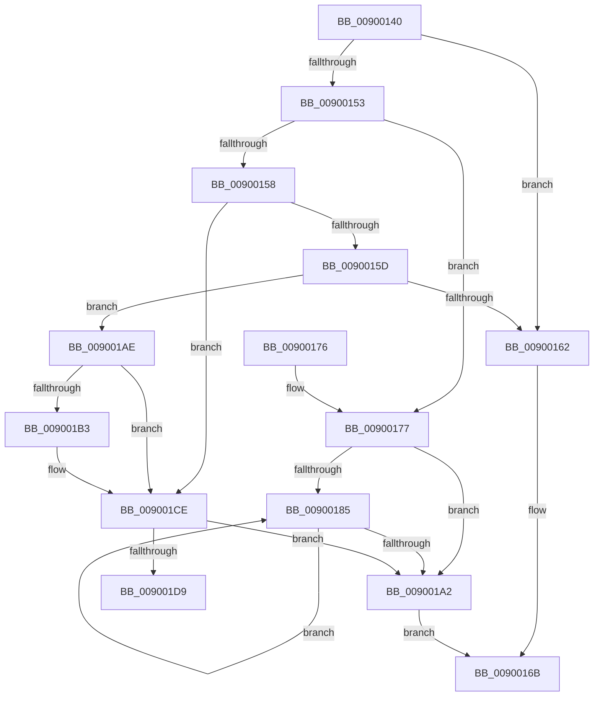

# IoDisconnectInterruptEx

- RVA: `0x00900140`–`0x009001DE` (길이 `158` bytes)
- VA: `0x0000000140900140`
- 실행 섹션: `PAGE`
- PDB 이름 있음: `예`; PDB Function 태그: `예`
- unwind 정보 RVA: `0x00088474`
- 디코드: `50`개 명령, `158/158` bytes 표시
- 미해석 바이트: `0` (있으면 어셈블리에 `.byte`로 보존)

> 이 문서는 커널 이미지의 기계어와 PDB 기호를 분석해 생성했습니다. 4번과 5번은 함수 원형과 자료형을 바이너리 사용 방식에서 추정한 C 해석이며 원본 소스 복구 결과는 아닙니다.

## 1. Dependencies

- 직접 호출 지점: **4**; 고유 호출 대상: **3**
- 직접 호출자로 확인된 함수: **1**
- RIP 상대 이미지 참조: **0**

### Outgoing calls
- `0x00900166` → [IoDisconnectInterrupt](IoDisconnectInterrupt_function_00900890.md) (function, `0x00900890`)
- `0x00900193` → [IoDisconnectInterrupt](IoDisconnectInterrupt_function_00900890.md) (function, `0x00900890`)
- `0x009001A7` → [ExFreePoolWithTag](../../poolcode/B8/ExFreePoolWithTag_function_00B82870.md) (function, `0x00B82870`)
- `0x009001C8` → [KeBugCheckEx](../../text/4F/KeBugCheckEx_function_004FD660.md) (function, `0x004FD660`)

### Direct callers
- [DifIoDisconnectInterruptExWrapper](../../text/62/DifIoDisconnectInterruptExWrapper_function_0062A050.md) at `0x0062A116`

### Static image references
- 디코드된 RIP-relative 메모리 참조가 없습니다.

## 2. Other-region calls and transfers

- 다른 실행 섹션으로 향하는 call: **2**
  - `0x009001A7` → [ExFreePoolWithTag](../../poolcode/B8/ExFreePoolWithTag_function_00B82870.md) (`PAGE` → `POOLCODE`)
  - `0x009001C8` → [KeBugCheckEx](../../text/4F/KeBugCheckEx_function_004FD660.md) (`PAGE` → `.text`)
- call이 아닌 외부 분기/꼬리 이동: **1**
  - `0x009001D9` → [sub_00B1FFEC](../B1/Unknown_function_00B1FFEC.md) (`tail-transfer`)

## 3. Assembly (complete function range)

```asm
00900140  48 89 5C 24 08                  mov qword ptr [rsp + 8], rbx
00900145  57                              push rdi
00900146  48 83 EC 30                     sub rsp, 0x30
0090014A  8B 11                           mov edx, dword ptr [rcx]
0090014C  8B C2                           mov eax, edx
0090014E  83 E8 01                        sub eax, 1
00900151  74 0F                           je 0x140900162
00900153  83 E8 01                        sub eax, 1
00900156  74 1F                           je 0x140900177
00900158  83 E8 01                        sub eax, 1
0090015B  74 71                           je 0x1409001ce
0090015D  83 E8 01                        sub eax, 1
00900160  75 4C                           jne 0x1409001ae
00900162  48 8B 49 08                     mov rcx, qword ptr [rcx + 8]
00900166  E8 25 07 00 00                  call 0x140900890
0090016B  48 8B 5C 24 40                  mov rbx, qword ptr [rsp + 0x40]
00900170  48 83 C4 30                     add rsp, 0x30
00900174  5F                              pop rdi
00900175  C3                              ret
00900176  CC                              int3
00900177  48 8B 79 08                     mov rdi, qword ptr [rcx + 8]
0090017B  33 DB                           xor ebx, ebx
0090017D  39 9F 24 01 00 00               cmp dword ptr [rdi + 0x124], ebx
00900183  76 1D                           jbe 0x1409001a2
00900185  8B C3                           mov eax, ebx
00900187  48 8B 8C C7 28 01 00 00         mov rcx, qword ptr [rdi + rax*8 + 0x128]
0090018F  48 83 C1 70                     add rcx, 0x70
00900193  E8 F8 06 00 00                  call 0x140900890
00900198  FF C3                           inc ebx
0090019A  3B 9F 24 01 00 00               cmp ebx, dword ptr [rdi + 0x124]
009001A0  72 E3                           jb 0x140900185
009001A2  33 D2                           xor edx, edx
009001A4  48 8B CF                        mov rcx, rdi
009001A7  E8 C4 26 28 00                  call 0x140b82870
009001AC  EB BD                           jmp 0x14090016b
009001AE  83 F8 01                        cmp eax, 1
009001B1  74 1B                           je 0x1409001ce
009001B3  33 DB                           xor ebx, ebx
009001B5  4C 8B C2                        mov r8, rdx
009001B8  45 33 C9                        xor r9d, r9d
009001BB  48 89 5C 24 20                  mov qword ptr [rsp + 0x20], rbx
009001C0  B9 CA 00 00 00                  mov ecx, 0xca
009001C5  8D 53 09                        lea edx, [rbx + 9]
009001C8  E8 93 D4 BF FF                  call 0x1404fd660
009001CD  CC                              int3
009001CE  48 8B 79 08                     mov rdi, qword ptr [rcx + 8]
009001D2  33 DB                           xor ebx, ebx
009001D4  39 5F 04                        cmp dword ptr [rdi + 4], ebx
009001D7  76 C9                           jbe 0x1409001a2
009001D9  E9 0E FE 21 00                  jmp 0x140b1ffec
```

## 4. C-style interpretation (structured pseudocode)

```c
__int64 __fastcall IoDisconnectInterruptEx(__int64 a1, __int64 a2, __int64 a3, int a4)
{
    __int64 result;
    __int64 v_rbx;
    __int64 v_rsp;
    unsigned __int64 v_stack_p20;
    unsigned __int64 v_stack_p8;

    v_stack_p8 = v_rbx;
    v_rsp = (v_rsp) - (48);
    result = (unsigned int)(((unsigned int)((unsigned int)((unsigned int)(*(unsigned int *)(a1))))) - (1));
    if (condition_is_equal) goto loc_00900162;
    result = (unsigned int)((result) - (1));
    if (condition_is_equal) goto loc_00900177;
    result = (unsigned int)((result) - (1));
    if (condition_is_equal) goto loc_009001CE;
    result = (unsigned int)((result) - (1));
    if (condition_is_not_equal) goto loc_009001AE;
loc_00900162:
    result = IoDisconnectInterrupt(*(unsigned __int64 *)(a1 + 8), (unsigned int)(*(unsigned int *)(a1)), a3, a4);
loc_0090016B:
    v_rsp = (v_rsp) + (48);
    return result;
loc_00900177:
    v_rbx = 0;
    if ((*(unsigned int *)(*(unsigned __int64 *)(*(unsigned __int64 *)(a1 + 8) + 8) + 292)) <= 0) goto loc_009001A2;
loc_00900185:
    a1 = (*(unsigned __int64 *)(*(unsigned __int64 *)(*(unsigned __int64 *)(a1 + 8) + 8) + 0 * 8 + 296)) + (112);
    result = IoDisconnectInterrupt(a1, (unsigned int)(*(unsigned int *)(a1)), a3, a4);
    v_rbx = (unsigned int)((v_rbx) + 1);
    if (((unsigned int)(v_rbx)) < (*(unsigned int *)(*(unsigned __int64 *)(*(unsigned __int64 *)(a1 + 8) + 8) + 292))) goto loc_00900185;
loc_009001A2:
    a2 = 0;
    result = ExFreePoolWithTag(*(unsigned __int64 *)(*(unsigned __int64 *)(a1 + 8) + 8), a2, a3, a4);
    goto loc_0090016B;
loc_009001AE:
    if (((unsigned int)(result)) != 1) {
        v_rbx = 0;
        a3 = 0;
        a4 = 0;
        v_stack_p20 = 0;
        a1 = 202;
        a2 = v_rbx + 9;
        result = KeBugCheckEx(a1, a2, a3, a4);
    }
    v_rbx = 0;
    if ((*(unsigned int *)(*(unsigned __int64 *)(a1 + 8) + 4)) <= 0) goto loc_009001A2;
}
```

## 5. (Beta) C Style

```c
int64_t IoDisconnectInterruptEx(void *Arg1, int64_t Arg2, int64_t Arg3, int32_t Arg4)
{
    uint8_t *arg1 = (uint8_t *)Arg1;

    int64_t result;
    int64_t local_rbx;
    int64_t local_rsp;
    uint64_t v_stack_p20;
    uint64_t v_stack_p8;

    v_stack_p8 = local_rbx;
    local_rsp = (local_rsp) - (48);
    result = (uint32_t)(((uint32_t)((uint32_t)((uint32_t)(*(uint32_t *)(arg1))))) - (1));
    if (condition_is_equal) goto loc_00900162;
    result = (uint32_t)((result) - (1));
    if (condition_is_equal) goto loc_00900177;
    result = (uint32_t)((result) - (1));
    if (condition_is_equal) goto loc_009001CE;
    result = (uint32_t)((result) - (1));
    if (condition_is_not_equal) goto loc_009001AE;
loc_00900162:
    result = IoDisconnectInterrupt(*(uint64_t *)(arg1 + 0x8), (uint32_t)(*(uint32_t *)(arg1)), Arg3, Arg4);
loc_0090016B:
    local_rsp = (local_rsp) + (48);
    return result;
loc_00900177:
    local_rbx = 0;
    if ((*(uint32_t *)(*(uint64_t *)(*(uint64_t *)(arg1 + 0x8) + 0x8) + 0x124)) <= 0) goto loc_009001A2;
loc_00900185:
    Arg1 = (*(uint64_t *)(*(uint64_t *)(*(uint64_t *)(arg1 + 0x8) + 0x8) + 0x0 * 8 + 0x128)) + (112);
    result = IoDisconnectInterrupt(Arg1, (uint32_t)(*(uint32_t *)(arg1)), Arg3, Arg4);
    local_rbx = (uint32_t)((local_rbx) + 1);
    if (((uint32_t)(local_rbx)) < (*(uint32_t *)(*(uint64_t *)(*(uint64_t *)(arg1 + 0x8) + 0x8) + 0x124))) goto loc_00900185;
loc_009001A2:
    Arg2 = 0;
    result = ExFreePoolWithTag(*(uint64_t *)(*(uint64_t *)(arg1 + 0x8) + 0x8), Arg2, Arg3, Arg4);
    goto loc_0090016B;
loc_009001AE:
    if (((uint32_t)(result)) != 1) {
        local_rbx = 0;
        Arg3 = 0;
        Arg4 = 0;
        v_stack_p20 = 0;
        Arg1 = 202;
        Arg2 = local_rbx + 9;
        result = KeBugCheckEx(Arg1, Arg2, Arg3, Arg4);
    }
    local_rbx = 0;
    if ((*(uint32_t *)(*(uint64_t *)(arg1 + 0x8) + 0x4)) <= 0) goto loc_009001A2;
}
```

### 관측된 메모리 오프셋

구조체 형식이 확인되지 않은 접근은 인자 기준의 오프셋으로만 기록했습니다.

| 기준 인자 | 오프셋 표현 | 폭 (bit) | 접근 |
|---|---:|---:|---|
| `Arg1` | `+ 0x0` | `32` | `R` |
| `Arg1` | `+ 0x8` | `64` | `R` |

## 6. Execution-region graph

[열기: 2D/3D 그래프와 함수 탐색 컨트롤 패널](../../../control-panel.html?section=page&rva=0x00900140&view=graph)

- 2D 그래프는 위에서 아래로 흐르고, 3D 그래프는 빈 공간을 드래그해 회전합니다. Shift+드래그는 이동, 휠은 확대·축소, 함수 노드 선택은 대상 보고서 이동입니다.

### Static fallback


