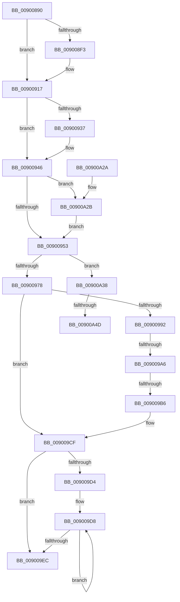

# IoDisconnectInterrupt

- RVA: `0x00900890`–`0x00900A59` (길이 `457` bytes)
- VA: `0x0000000140900890`
- 실행 섹션: `PAGE`
- PDB 이름 있음: `예`; PDB Function 태그: `예`
- unwind 정보 RVA: `0x00088514`
- 디코드: `106`개 명령, `457/457` bytes 표시
- 미해석 바이트: `0` (있으면 어셈블리에 `.byte`로 보존)

> 이 문서는 커널 이미지의 기계어와 PDB 기호를 분석해 생성했습니다. 4번과 5번은 함수 원형과 자료형을 바이너리 사용 방식에서 추정한 C 해석이며 원본 소스 복구 결과는 아닙니다.

## 1. Dependencies

- 직접 호출 지점: **14**; 고유 호출 대상: **14**
- 직접 호출자로 확인된 함수: **5**
- RIP 상대 이미지 참조: **0**

### Outgoing calls
- `0x009008BD` → [memset](../../text/6C/memset_function_006C6C40.md) (function, `0x006C6C40`)
- `0x009008C9` → [KeRemoveQueueDpc](../../text/46/KeRemoveQueueDpc_function_0046CDA0.md) (function, `0x0046CDA0`)
- `0x009008D7` → [IopInitializeActiveConnectBlock](IopInitializeActiveConnectBlock_function_00901138.md) (function, `0x00901138`)
- `0x00900912` → [KeWaitForSingleObject](../../text/20/KeWaitForSingleObject_function_0020E6B0.md) (function, `0x0020E6B0`)
- `0x00900928` → [KeDisconnectInterrupt](../../text/2D/KeDisconnectInterrupt_function_002D3588.md) (function, `0x002D3588`)
- `0x0090093C` → [KeSetEvent](../../text/33/KeSetEvent_function_0033F310.md) (function, `0x0033F310`)
- `0x00900941` → [KeLeaveCriticalRegion](../../text/25/KeLeaveCriticalRegion_function_0025D8B0.md) (function, `0x0025D8B0`)
- `0x00900981` → [KeLeaveCriticalRegionThread](../../text/25/KeLeaveCriticalRegionThread_function_0025EFF0.md) (function, `0x0025EFF0`)
- `0x009009CA` → [ObfDereferenceObjectWithTag](../../text/2F/ObfDereferenceObjectWithTag_function_002F78E0.md) (function, `0x002F78E0`)
- `0x009009DB` → [KeFreeInterrupt](../../text/4A/KeFreeInterrupt_function_004A3BAC.md) (function, `0x004A3BAC`)
- `0x009009F1` → [IopDestroyActiveConnectBlock](IopDestroyActiveConnectBlock_function_00900FE8.md) (function, `0x00900FE8`)
- `0x009009FC` → [ExFreePoolWithTag](../../poolcode/B8/ExFreePoolWithTag_function_00B82870.md) (function, `0x00B82870`)
- `0x00900A03` → [PnpTraceInterruptConnection](PnpTraceInterruptConnection_function_00900A60.md) (function, `0x00900A60`)
- `0x00900A2E` → [IopDestroyPassiveInterruptBlock](../70/IopDestroyPassiveInterruptBlock_function_007059F0.md) (function, `0x007059F0`)

### Direct callers
- [DifIoDisconnectInterruptWrapper](../../text/62/DifIoDisconnectInterruptWrapper_function_0062A1B0.md) at `0x0062A276`
- [IoDisconnectInterruptEx](IoDisconnectInterruptEx_function_00900140.md) at `0x00900166`
- [IoDisconnectInterruptEx](IoDisconnectInterruptEx_function_00900140.md) at `0x00900193`
- [sub_00B1FFC6](../B1/Unknown_function_00B1FFC6.md) at `0x00B1FFCD`
- [sub_00B1FFEC](../B1/Unknown_function_00B1FFEC.md) at `0x00B1FFFA`
- [sub_00B203FA](../B2/Unknown_function_00B203FA.md) at `0x00B205CD`

### Static image references
- 디코드된 RIP-relative 메모리 참조가 없습니다.

## 2. Other-region calls and transfers

- 다른 실행 섹션으로 향하는 call: **10**
  - `0x009008BD` → [memset](../../text/6C/memset_function_006C6C40.md) (`PAGE` → `.text`)
  - `0x009008C9` → [KeRemoveQueueDpc](../../text/46/KeRemoveQueueDpc_function_0046CDA0.md) (`PAGE` → `.text`)
  - `0x00900912` → [KeWaitForSingleObject](../../text/20/KeWaitForSingleObject_function_0020E6B0.md) (`PAGE` → `.text`)
  - `0x00900928` → [KeDisconnectInterrupt](../../text/2D/KeDisconnectInterrupt_function_002D3588.md) (`PAGE` → `.text`)
  - `0x0090093C` → [KeSetEvent](../../text/33/KeSetEvent_function_0033F310.md) (`PAGE` → `.text`)
  - `0x00900941` → [KeLeaveCriticalRegion](../../text/25/KeLeaveCriticalRegion_function_0025D8B0.md) (`PAGE` → `.text`)
  - `0x00900981` → [KeLeaveCriticalRegionThread](../../text/25/KeLeaveCriticalRegionThread_function_0025EFF0.md) (`PAGE` → `.text`)
  - `0x009009CA` → [ObfDereferenceObjectWithTag](../../text/2F/ObfDereferenceObjectWithTag_function_002F78E0.md) (`PAGE` → `.text`)
  - `0x009009DB` → [KeFreeInterrupt](../../text/4A/KeFreeInterrupt_function_004A3BAC.md) (`PAGE` → `.text`)
  - `0x009009FC` → [ExFreePoolWithTag](../../poolcode/B8/ExFreePoolWithTag_function_00B82870.md) (`PAGE` → `POOLCODE`)
- call이 아닌 외부 분기/꼬리 이동: **4**
  - `0x009009A0` → [sub_00B20160 + 0x44](../B2/Unknown_function_00B20160.md) (`tail-transfer`)
  - `0x009009B0` → [sub_00B20160 + 0x44](../B2/Unknown_function_00B20160.md) (`tail-transfer`)
  - `0x00900A47` → [sub_00B20160 + 0x25](../B2/Unknown_function_00B20160.md) (`tail-transfer`)
  - `0x00900A54` → [sub_00B20160](../B2/Unknown_function_00B20160.md) (`tail-transfer`)

## 3. Assembly (complete function range)

```asm
00900890  48 8B C4                        mov rax, rsp
00900893  48 89 58 08                     mov qword ptr [rax + 8], rbx
00900897  48 89 68 10                     mov qword ptr [rax + 0x10], rbp
0090089B  48 89 70 18                     mov qword ptr [rax + 0x18], rsi
0090089F  48 89 78 20                     mov qword ptr [rax + 0x20], rdi
009008A3  41 54                           push r12
009008A5  41 56                           push r14
009008A7  41 57                           push r15
009008A9  48 81 EC 80 00 00 00            sub rsp, 0x80
009008B0  33 D2                           xor edx, edx
009008B2  48 8B F9                        mov rdi, rcx
009008B5  48 8D 48 98                     lea rcx, [rax - 0x68]
009008B9  44 8D 42 50                     lea r8d, [rdx + 0x50]
009008BD  E8 7E 63 DC FF                  call 0x1406c6c40
009008C2  48 8D 8F 40 01 00 00            lea rcx, [rdi + 0x140]
009008C9  E8 D2 C4 B6 FF                  call 0x14046cda0
009008CE  48 8D 54 24 30                  lea rdx, [rsp + 0x30]
009008D3  48 8D 4F A0                     lea rcx, [rdi - 0x60]
009008D7  E8 5C 08 00 00                  call 0x140901138
009008DC  48 8B 4C 24 48                  mov rcx, qword ptr [rsp + 0x48]
009008E1  41 83 CC FF                     or r12d, 0xffffffff
009008E5  F3 48 0F B8 6F 98               popcnt rbp, qword ptr [rdi - 0x68]
009008EB  45 33 F6                        xor r14d, r14d
009008EE  48 85 C9                        test rcx, rcx
009008F1  74 24                           je 0x140900917
009008F3  65 48 8B 04 25 88 01 00 00      mov rax, qword ptr gs:[0x188]
009008FC  45 33 C9                        xor r9d, r9d
009008FF  45 33 C0                        xor r8d, r8d
00900902  4C 89 74 24 20                  mov qword ptr [rsp + 0x20], r14
00900907  33 D2                           xor edx, edx
00900909  66 44 01 A0 E4 01 00 00         add word ptr [rax + 0x1e4], r12w
00900911  90                              nop
00900912  E8 99 DD 90 FF                  call 0x14020e6b0
00900917  48 8D B7 88 01 00 00            lea rsi, [rdi + 0x188]
0090091E  40 8A D5                        mov dl, bpl
00900921  48 8B CE                        mov rcx, rsi
00900924  4C 8D 47 A0                     lea r8, [rdi - 0x60]
00900928  E8 5B 2C 9D FF                  call 0x1402d3588
0090092D  48 8B 4C 24 48                  mov rcx, qword ptr [rsp + 0x48]
00900932  48 85 C9                        test rcx, rcx
00900935  74 0F                           je 0x140900946
00900937  45 33 C0                        xor r8d, r8d
0090093A  33 D2                           xor edx, edx
0090093C  E8 CF E9 A3 FF                  call 0x14033f310
00900941  E8 6A CF 95 FF                  call 0x14025d8b0
00900946  44 38 B7 20 01 00 00            cmp byte ptr [rdi + 0x120], r14b
0090094D  0F 85 D8 00 00 00               jne 0x140900a2b
00900953  65 48 8B 04 25 88 01 00 00      mov rax, qword ptr gs:[0x188]
0090095C  41 BF 01 00 00 00               mov r15d, 1
00900962  66 44 01 A0 E4 01 00 00         add word ptr [rax + 0x1e4], r12w
0090096A  90                              nop
0090096B  44 38 B7 20 01 00 00            cmp byte ptr [rdi + 0x120], r14b
00900972  0F 85 C0 00 00 00               jne 0x140900a38
00900978  65 48 8B 0C 25 88 01 00 00      mov rcx, qword ptr gs:[0x188]
00900981  E8 6A E6 95 FF                  call 0x14025eff0
00900986  48 8B 9F 80 01 00 00            mov rbx, qword ptr [rdi + 0x180]
0090098D  48 85 DB                        test rbx, rbx
00900990  74 3D                           je 0x1409009cf
00900992  48 8B 8B 38 01 00 00            mov rcx, qword ptr [rbx + 0x138]
00900999  48 8B 41 28                     mov rax, qword ptr [rcx + 0x28]
0090099D  48 85 C0                        test rax, rax
009009A0  0F 84 FE F7 21 00               je 0x140b201a4
009009A6  F7 80 8C 01 00 00 00 00 02 00   test dword ptr [rax + 0x18c], 0x20000
009009B0  0F 85 EE F7 21 00               jne 0x140b201a4
009009B6  F0 44 01 61 60                  lock add dword ptr [rcx + 0x60], r12d
009009BB  BA 50 6E 70 54                  mov edx, 0x54706e50
009009C0  4C 89 B7 80 01 00 00            mov qword ptr [rdi + 0x180], r14
009009C7  48 8B CB                        mov rcx, rbx
009009CA  E8 11 6F 9F FF                  call 0x1402f78e0
009009CF  40 84 ED                        test bpl, bpl
009009D2  7E 18                           jle 0x1409009ec
009009D4  40 0F B6 DD                     movzx ebx, bpl
009009D8  48 8B 0E                        mov rcx, qword ptr [rsi]
009009DB  E8 CC 31 BA FF                  call 0x1404a3bac
009009E0  4C 89 36                        mov qword ptr [rsi], r14
009009E3  48 8D 76 08                     lea rsi, [rsi + 8]
009009E7  49 2B DF                        sub rbx, r15
009009EA  75 EC                           jne 0x1409009d8
009009EC  48 8D 4C 24 30                  lea rcx, [rsp + 0x30]
009009F1  E8 F2 05 00 00                  call 0x140900fe8
009009F6  33 D2                           xor edx, edx
009009F8  48 8D 4F 90                     lea rcx, [rdi - 0x70]
009009FC  E8 6F 1E 28 00                  call 0x140b82870
00900A01  33 C9                           xor ecx, ecx
00900A03  E8 58 00 00 00                  call 0x140900a60
00900A08  4C 8D 9C 24 80 00 00 00         lea r11, [rsp + 0x80]
00900A10  49 8B 5B 20                     mov rbx, qword ptr [r11 + 0x20]
00900A14  49 8B 6B 28                     mov rbp, qword ptr [r11 + 0x28]
00900A18  49 8B 73 30                     mov rsi, qword ptr [r11 + 0x30]
00900A1C  49 8B 7B 38                     mov rdi, qword ptr [r11 + 0x38]
00900A20  49 8B E3                        mov rsp, r11
00900A23  41 5F                           pop r15
00900A25  41 5E                           pop r14
00900A27  41 5C                           pop r12
00900A29  C3                              ret
00900A2A  CC                              int3
00900A2B  8B 4F AC                        mov ecx, dword ptr [rdi - 0x54]
00900A2E  E8 BD 4F E0 FF                  call 0x1407059f0
00900A33  E9 1B FF FF FF                  jmp 0x140900953
00900A38  65 4C 8B 14 25 88 01 00 00      mov r10, qword ptr gs:[0x188]
00900A41  41 8A D6                        mov dl, r14b
00900A44  40 84 ED                        test bpl, bpl
00900A47  0F 8E 38 F7 21 00               jle 0x140b20185
00900A4D  4C 8B C6                        mov r8, rsi
00900A50  44 0F B6 CD                     movzx r9d, bpl
00900A54  E9 07 F7 21 00                  jmp 0x140b20160
```

## 4. C-style interpretation (structured pseudocode)

```c
__int64 __fastcall IoDisconnectInterrupt(__int64 a1, int a2, __int64 a3, int a4)
{
    __int64 result;
    __int64 v_r12;
    __int64 v_r14;
    __int64 v_rbx;
    __int64 v_rsp;
    unsigned __int64 v_stack_m18;
    unsigned __int64 v_stack_m50;
    unsigned __int64 v_stack_m68;
    unsigned __int64 v_stack_m78;

    *(unsigned __int64 *)(v_rsp + 8) = v_rbx;
    *(unsigned __int64 *)(v_rsp + 16) = v_rbp;
    *(unsigned __int64 *)(v_rsp + 24) = v_rsi;
    *(unsigned __int64 *)(v_rsp + 32) = v_rdi;
    v_rsp = (v_rsp) - (128);
    a2 = 0;
    result = memset(v_rsp - 104, a2, a2 + 80, a4);
    result = KeRemoveQueueDpc(a1 + 320, a2, a2 + 80, a4);
    result = IopInitializeActiveConnectBlock(a1 - 96, v_stack_m68, a2 + 80, a4);
    v_r12 = (unsigned int)((v_r12) | (0xFFFFFFFFULL));
    v_r14 = 0;
    if (v_stack_m50 != 0) {
        result = *(unsigned __int64 *)(gs_base + (0 + 392));
        a4 = 0;
        a3 = 0;
        v_stack_m78 = 0;
        a2 = 0;
        result = KeWaitForSingleObject(v_stack_m50, a2, a3, a4);
    }
    result = KeDisconnectInterrupt(a1 + 392, (unsigned __int8)(v_rbp), a1 - 96, a4);
    if (v_stack_m50 != 0) {
        a3 = 0;
        a2 = 0;
        result = KeSetEvent(v_stack_m50, a2, a3, a4);
        result = KeLeaveCriticalRegion(v_stack_m50, a2, a3, a4);
    }
    if ((*(unsigned __int8 *)(a1 + 288)) != 0) goto loc_00900A2B;
loc_00900953:
    if ((*(unsigned __int8 *)(a1 + 288)) != 0) goto loc_00900A38;
    result = KeLeaveCriticalRegionThread(*(unsigned __int64 *)(gs_base + (0 + 392)), a2, a3, a4);
    if (*(unsigned __int64 *)(a1 + 384) == 0) goto loc_009009CF;
    *(unsigned __int64 *)(a1 + 384) = 0;
    result = ObfDereferenceObjectWithTag(*(unsigned __int64 *)(a1 + 384), (unsigned int)(0x54706E50ULL), a3, a4);
loc_009009CF:
    if (condition_is_less_or_equal) goto loc_009009EC;
loc_009009D8:
    result = KeFreeInterrupt(*(unsigned __int64 *)(a1 + 392), (unsigned int)(0x54706E50ULL), a3, a4);
    *(unsigned __int64 *)(a1 + 392) = 0;
    v_rbx = ((unsigned __int8)(v_rbp)) - (1);
    if (condition_is_not_equal) goto loc_009009D8;
loc_009009EC:
    result = IopDestroyActiveConnectBlock(v_stack_m68, (unsigned int)(0x54706E50ULL), a3, a4);
    a2 = 0;
    result = ExFreePoolWithTag(a1 - 112, a2, a3, a4);
    a1 = 0;
    result = PnpTraceInterruptConnection(a1, a2, a3, a4);
    return result;
loc_00900A2B:
    result = IopDestroyPassiveInterruptBlock((unsigned int)(*(unsigned int *)(*(unsigned __int64 *)(v_stack_m18 + 56) - 84)), a2, a3, a4);
    goto loc_00900953;
loc_00900A38:
}
```

## 5. (Beta) C Style

```c
int64_t IoDisconnectInterrupt(void *Arg1, int32_t Arg2, int64_t Arg3, int32_t Arg4)
{
    uint8_t *arg1 = (uint8_t *)Arg1;

    int64_t result;
    int64_t local_r12;
    int64_t local_r14;
    int64_t local_rbx;
    int64_t local_rsp;
    uint64_t v_stack_m18;
    uint64_t v_stack_m50;
    uint64_t v_stack_m68;
    uint64_t v_stack_m78;

    *(uint64_t *)(local_rsp + 0x8) = local_rbx;
    *(uint64_t *)(local_rsp + 0x10) = local_rbp;
    *(uint64_t *)(local_rsp + 0x18) = local_rsi;
    *(uint64_t *)(local_rsp + 0x20) = local_rdi;
    local_rsp = (local_rsp) - (128);
    Arg2 = 0;
    result = memset(local_rsp - 104, Arg2, Arg2 + 80, Arg4);
    result = KeRemoveQueueDpc(Arg1 + 320, Arg2, Arg2 + 80, Arg4);
    result = IopInitializeActiveConnectBlock(Arg1 - 96, v_stack_m68, Arg2 + 80, Arg4);
    local_r12 = (uint32_t)((local_r12) | (0xFFFFFFFFULL));
    local_r14 = 0;
    if (v_stack_m50 != 0) {
        result = *(uint64_t *)(gs_base + (0 + 0x188));
        Arg4 = 0;
        Arg3 = 0;
        v_stack_m78 = 0;
        Arg2 = 0;
        result = KeWaitForSingleObject(v_stack_m50, Arg2, Arg3, Arg4);
    }
    result = KeDisconnectInterrupt(Arg1 + 392, (uint8_t)(local_rbp), Arg1 - 96, Arg4);
    if (v_stack_m50 != 0) {
        Arg3 = 0;
        Arg2 = 0;
        result = KeSetEvent(v_stack_m50, Arg2, Arg3, Arg4);
        result = KeLeaveCriticalRegion(v_stack_m50, Arg2, Arg3, Arg4);
    }
    if ((*(uint8_t *)(arg1 + 0x120)) != 0) goto loc_00900A2B;
loc_00900953:
    if ((*(uint8_t *)(arg1 + 0x120)) != 0) goto loc_00900A38;
    result = KeLeaveCriticalRegionThread(*(uint64_t *)(gs_base + (0 + 0x188)), Arg2, Arg3, Arg4);
    if (*(uint64_t *)(arg1 + 0x180) == 0) goto loc_009009CF;
    *(uint64_t *)(arg1 + 0x180) = 0;
    result = ObfDereferenceObjectWithTag(*(uint64_t *)(arg1 + 0x180), (uint32_t)(0x54706E50ULL), Arg3, Arg4);
loc_009009CF:
    if (condition_is_less_or_equal) goto loc_009009EC;
loc_009009D8:
    result = KeFreeInterrupt(*(uint64_t *)(arg1 + 0x188), (uint32_t)(0x54706E50ULL), Arg3, Arg4);
    *(uint64_t *)(arg1 + 0x188) = 0;
    local_rbx = ((uint8_t)(local_rbp)) - (1);
    if (condition_is_not_equal) goto loc_009009D8;
loc_009009EC:
    result = IopDestroyActiveConnectBlock(v_stack_m68, (uint32_t)(0x54706E50ULL), Arg3, Arg4);
    Arg2 = 0;
    result = ExFreePoolWithTag(Arg1 - 112, Arg2, Arg3, Arg4);
    Arg1 = 0;
    result = PnpTraceInterruptConnection(Arg1, Arg2, Arg3, Arg4);
    return result;
loc_00900A2B:
    result = IopDestroyPassiveInterruptBlock((uint32_t)(*(uint32_t *)(*(uint64_t *)(v_stack_m18 + 0x38) - 0x54)), Arg2, Arg3, Arg4);
    goto loc_00900953;
loc_00900A38:
}
```

### 관측된 메모리 오프셋

구조체 형식이 확인되지 않은 접근은 인자 기준의 오프셋으로만 기록했습니다.

| 기준 인자 | 오프셋 표현 | 폭 (bit) | 접근 |
|---|---:|---:|---|
| `Arg1` | `- 0x70` | `64` | `R` |
| `Arg1` | `- 0x68` | `64` | `R` |
| `Arg1` | `- 0x60` | `64` | `R` |
| `Arg1` | `- 0x54` | `32` | `R` |
| `Arg1` | `+ 0x0` | `64` | `R` |
| `Arg1` | `+ 0x0` | `64` | `W` |
| `Arg1` | `+ 0x8` | `64` | `R` |
| `Arg1` | `+ 0x120` | `8` | `R` |
| `Arg1` | `+ 0x140` | `64` | `R` |
| `Arg1` | `+ 0x180` | `64` | `R` |
| `Arg1` | `+ 0x180` | `64` | `W` |
| `Arg1` | `+ 0x188` | `64` | `R` |

## 6. Execution-region graph

[열기: 2D/3D 그래프와 함수 탐색 컨트롤 패널](../../../control-panel.html?section=page&rva=0x00900890&view=graph)

- 2D 그래프는 위에서 아래로 흐르고, 3D 그래프는 빈 공간을 드래그해 회전합니다. Shift+드래그는 이동, 휠은 확대·축소, 함수 노드 선택은 대상 보고서 이동입니다.

### Static fallback


