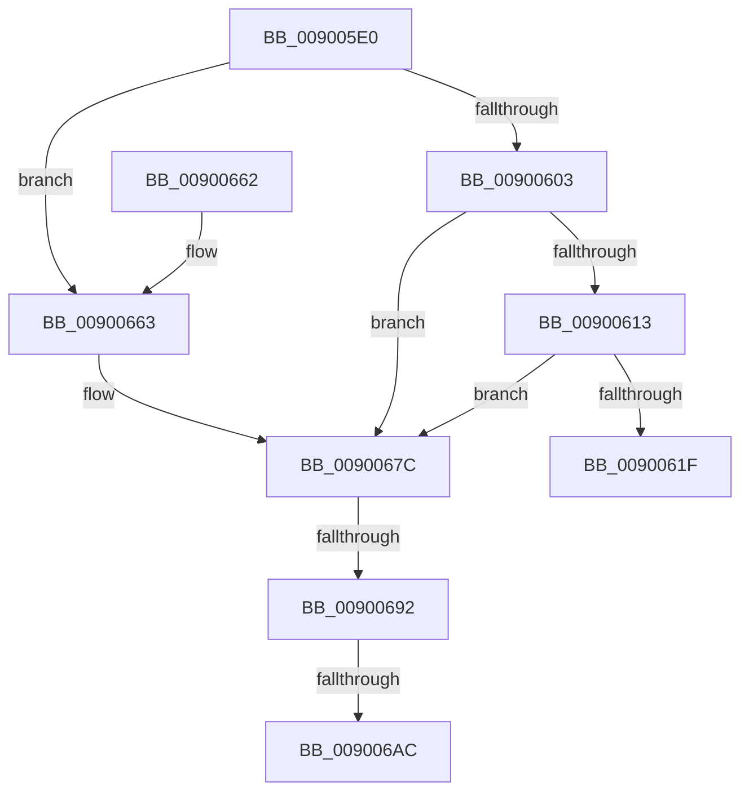

# IoGetDevicePropertyData

- RVA: `0x009005E0`–`0x009006CA` (길이 `234` bytes)
- VA: `0x00000001409005E0`
- 실행 섹션: `PAGE`
- PDB 이름 있음: `예`; PDB Function 태그: `예`
- unwind 정보 RVA: `0x000878D0`
- 디코드: `59`개 명령, `234/234` bytes 표시
- 미해석 바이트: `0` (있으면 어셈블리에 `.byte`로 보존)

> 이 문서는 커널 이미지의 기계어와 PDB 기호를 분석해 생성했습니다. 4번과 5번은 함수 원형과 자료형을 바이너리 사용 방식에서 추정한 C 해석이며 원본 소스 복구 결과는 아닙니다.

## 1. Dependencies

- 직접 호출 지점: **6**; 고유 호출 대상: **3**
- 직접 호출자로 확인된 함수: **10**
- RIP 상대 이미지 참조: **0**

### Outgoing calls
- `0x00900648` → [PnpGetDevicePropertyData](PnpGetDevicePropertyData_function_009006D0.md) (function, `0x009006D0`)
- `0x00900676` → [KeBugCheckEx](../../text/4F/KeBugCheckEx_function_004FD660.md) (function, `0x004FD660`)
- `0x00900680` → [IoAddTriageDumpDataBlock](../../text/42/IoAddTriageDumpDataBlock_function_00428374.md) (function, `0x00428374`)
- `0x00900696` → [IoAddTriageDumpDataBlock](../../text/42/IoAddTriageDumpDataBlock_function_00428374.md) (function, `0x00428374`)
- `0x009006AE` → [IoAddTriageDumpDataBlock](../../text/42/IoAddTriageDumpDataBlock_function_00428374.md) (function, `0x00428374`)
- `0x009006BF` → [IoAddTriageDumpDataBlock](../../text/42/IoAddTriageDumpDataBlock_function_00428374.md) (function, `0x00428374`)

### Direct callers
- [PopFxBuildDripsBlockingDeviceList](../../text/49/PopFxBuildDripsBlockingDeviceList_function_0049B5B0.md) at `0x0049B7A8`
- [PopFxBuildDripsBlockingDeviceList](../../text/49/PopFxBuildDripsBlockingDeviceList_function_0049B5B0.md) at `0x0049B7F0`
- [PopFxIsDevicePotentialDripsConstraint](../../text/4A/PopFxIsDevicePotentialDripsConstraint_function_004A5D34.md) at `0x004A5E58`
- [PopFxQueryBiosDeviceName](../../text/4B/PopFxQueryBiosDeviceName_function_004B035C.md) at `0x004B03A5`
- [PopFxQueryBiosDeviceName](../../text/4B/PopFxQueryBiosDeviceName_function_004B035C.md) at `0x004B0429`
- [HalpAreDriversDmarCompatible](../../text/53/HalpAreDriversDmarCompatible_function_0053F3E0.md) at `0x0053F423`
- [HalpIommuDeviceGetDomainTypes](../../text/54/HalpIommuDeviceGetDomainTypes_function_0054F538.md) at `0x0054F5A8`
- [PnprIsMemoryDevice](../73/PnprIsMemoryDevice_function_00739DF0.md) at `0x00739E6A`
- [PnprIsProcessorDevice](../73/PnprIsProcessorDevice_function_00739EA8.md) at `0x00739F42`
- [PnprIsProcessorDevice](../73/PnprIsProcessorDevice_function_00739EA8.md) at `0x00739F8F`
- [IopGetSessionIdFromPDO](../8F/IopGetSessionIdFromPDO_function_008FFDD8.md) at `0x008FFE4C`
- [IopGetInterruptConnectionData](IopGetInterruptConnectionData_function_009004E4.md) at `0x0090052F`
- [IopGetInterruptConnectionData](IopGetInterruptConnectionData_function_009004E4.md) at `0x0090058F`
- [VfGetDmaAdapter](../../pagevrfy/B9/VfGetDmaAdapter_function_00B96930.md) at `0x00B96A79`

### Static image references
- 디코드된 RIP-relative 메모리 참조가 없습니다.

## 2. Other-region calls and transfers

- 다른 실행 섹션으로 향하는 call: **5**
  - `0x00900676` → [KeBugCheckEx](../../text/4F/KeBugCheckEx_function_004FD660.md) (`PAGE` → `.text`)
  - `0x00900680` → [IoAddTriageDumpDataBlock](../../text/42/IoAddTriageDumpDataBlock_function_00428374.md) (`PAGE` → `.text`)
  - `0x00900696` → [IoAddTriageDumpDataBlock](../../text/42/IoAddTriageDumpDataBlock_function_00428374.md) (`PAGE` → `.text`)
  - `0x009006AE` → [IoAddTriageDumpDataBlock](../../text/42/IoAddTriageDumpDataBlock_function_00428374.md) (`PAGE` → `.text`)
  - `0x009006BF` → [IoAddTriageDumpDataBlock](../../text/42/IoAddTriageDumpDataBlock_function_00428374.md) (`PAGE` → `.text`)
- call이 아닌 외부 분기/꼬리 이동: **3**
  - `0x0090068C` → [sub_00B20070](../B2/Unknown_function_00B20070.md) (`tail-transfer`)
  - `0x009006A6` → [sub_00B20070](../B2/Unknown_function_00B20070.md) (`tail-transfer`)
  - `0x009006C5` → [sub_00B20070](../B2/Unknown_function_00B20070.md) (`tail-transfer`)

## 3. Assembly (complete function range)

```asm
009005E0  4C 8B DC                        mov r11, rsp
009005E3  49 89 5B 08                     mov qword ptr [r11 + 8], rbx
009005E7  49 89 6B 10                     mov qword ptr [r11 + 0x10], rbp
009005EB  49 89 73 18                     mov qword ptr [r11 + 0x18], rsi
009005EF  57                              push rdi
009005F0  48 83 EC 40                     sub rsp, 0x40
009005F4  33 F6                           xor esi, esi
009005F6  48 8B D9                        mov rbx, rcx
009005F9  BD 02 00 00 00                  mov ebp, 2
009005FE  48 85 C9                        test rcx, rcx
00900601  74 60                           je 0x140900663
00900603  48 8B 81 38 01 00 00            mov rax, qword ptr [rcx + 0x138]
0090060A  48 8B 40 28                     mov rax, qword ptr [rax + 0x28]
0090060E  48 85 C0                        test rax, rax
00900611  74 69                           je 0x14090067c
00900613  F7 80 8C 01 00 00 00 00 02 00   test dword ptr [rax + 0x18c], 0x20000
0090061D  75 5D                           jne 0x14090067c
0090061F  48 8B 84 24 88 00 00 00         mov rax, qword ptr [rsp + 0x88]
00900627  49 89 43 F0                     mov qword ptr [r11 - 0x10], rax
0090062B  48 8B 84 24 80 00 00 00         mov rax, qword ptr [rsp + 0x80]
00900633  49 89 43 E8                     mov qword ptr [r11 - 0x18], rax
00900637  48 8B 44 24 78                  mov rax, qword ptr [rsp + 0x78]
0090063C  49 89 43 E0                     mov qword ptr [r11 - 0x20], rax
00900640  8B 44 24 70                     mov eax, dword ptr [rsp + 0x70]
00900644  89 44 24 20                     mov dword ptr [rsp + 0x20], eax
00900648  E8 83 00 00 00                  call 0x1409006d0
0090064D  48 8B 5C 24 50                  mov rbx, qword ptr [rsp + 0x50]
00900652  48 8B 6C 24 58                  mov rbp, qword ptr [rsp + 0x58]
00900657  48 8B 74 24 60                  mov rsi, qword ptr [rsp + 0x60]
0090065C  48 83 C4 40                     add rsp, 0x40
00900660  5F                              pop rdi
00900661  C3                              ret
00900662  CC                              int3
00900663  45 33 C9                        xor r9d, r9d
00900666  48 89 74 24 20                  mov qword ptr [rsp + 0x20], rsi
0090066B  4C 8B C3                        mov r8, rbx
0090066E  48 8B D5                        mov rdx, rbp
00900671  B9 CA 00 00 00                  mov ecx, 0xca
00900676  E8 E5 CF BF FF                  call 0x1404fd660
0090067B  CC                              int3
0090067C  0F B7 51 02                     movzx edx, word ptr [rcx + 2]
00900680  E8 EF 7C B2 FF                  call 0x140428374
00900685  48 8B 4B 08                     mov rcx, qword ptr [rbx + 8]
00900689  48 85 C9                        test rcx, rcx
0090068C  0F 84 DE F9 21 00               je 0x140b20070
00900692  0F BF 51 02                     movsx edx, word ptr [rcx + 2]
00900696  E8 D9 7C B2 FF                  call 0x140428374
0090069B  48 8B 4B 08                     mov rcx, qword ptr [rbx + 8]
0090069F  48 83 C1 38                     add rcx, 0x38
009006A3  66 39 31                        cmp word ptr [rcx], si
009006A6  0F 84 C4 F9 21 00               je 0x140b20070
009006AC  8B D5                           mov edx, ebp
009006AE  E8 C1 7C B2 FF                  call 0x140428374
009006B3  48 8B 4B 08                     mov rcx, qword ptr [rbx + 8]
009006B7  0F B7 51 38                     movzx edx, word ptr [rcx + 0x38]
009006BB  48 8B 49 40                     mov rcx, qword ptr [rcx + 0x40]
009006BF  E8 B0 7C B2 FF                  call 0x140428374
009006C4  90                              nop
009006C5  E9 A6 F9 21 00                  jmp 0x140b20070
```

## 4. C-style interpretation (structured pseudocode)

```c
__int64 __fastcall IoGetDevicePropertyData(__int64 a1, __int64 a2, __int64 a3, int a4, unsigned int a5, __int64 a6, __int64 a7, __int64 a8)
{
    __int64 result;
    __int64 v_rsi;
    __int64 v_rsp;
    unsigned int v_stack_m28;
    unsigned __int64 v_stack_p10;
    unsigned __int64 v_stack_p18;
    unsigned __int64 v_stack_p20;
    unsigned __int64 v_stack_p8;

    *(unsigned __int64 *)(v_rsp + 8) = v_rbx;
    *(unsigned __int64 *)(v_rsp + 16) = v_rbp;
    *(unsigned __int64 *)(v_rsp + 24) = v_rsi;
    v_rsp = (v_rsp) - (64);
    v_rsi = 0;
    if (a1 == 0) goto loc_00900663;
    if (*(unsigned __int64 *)(*(unsigned __int64 *)(a1 + 312) + 40) == 0) goto loc_0090067C;
    if (((*(unsigned int *)(*(unsigned __int64 *)(*(unsigned __int64 *)(a1 + 312) + 40) + 396)) & (0x20000ULL)) != 0) goto loc_0090067C;
    *(unsigned __int64 *)(v_rsp - 16) = a8;
    *(unsigned __int64 *)(v_rsp - 24) = a7;
    *(unsigned __int64 *)(v_rsp - 32) = a6;
    v_stack_m28 = (unsigned int)((unsigned int)(a5));
    result = PnpGetDevicePropertyData(a1, a2, a3, a4);
    v_rsp = (v_rsp) + (64);
    return result;
loc_00900663:
    a4 = 0;
    v_stack_p20 = v_stack_p18;
    result = KeBugCheckEx(202, v_stack_p10, v_stack_p8, a4);
loc_0090067C:
    result = IoAddTriageDumpDataBlock(202, *(unsigned __int16 *)(202 + 2), v_stack_p8, a4);
    result = IoAddTriageDumpDataBlock(*(unsigned __int64 *)(v_stack_p8 + 8), (__int16)(*(unsigned __int16 *)(*(unsigned __int64 *)(v_stack_p8 + 8) + 2)), v_stack_p8, a4);
    a1 = (*(unsigned __int64 *)(v_stack_p8 + 8)) + (56);
    result = IoAddTriageDumpDataBlock(a1, (unsigned int)((unsigned int)(v_stack_p10)), v_stack_p8, a4);
    result = IoAddTriageDumpDataBlock(*(unsigned __int64 *)(*(unsigned __int64 *)(v_stack_p8 + 8) + 64), *(unsigned __int16 *)(*(unsigned __int64 *)(v_stack_p8 + 8) + 56), v_stack_p8, a4);
}
```

## 5. (Beta) C Style

```c
int64_t IoGetDevicePropertyData(void *Arg1, int64_t Arg2, int64_t Arg3, int32_t Arg4, uint32_t Arg5, int64_t Arg6, int64_t Arg7, int64_t Arg8)
{
    uint8_t *arg1 = (uint8_t *)Arg1;

    int64_t result;
    int64_t local_rsi;
    int64_t local_rsp;
    uint32_t v_stack_m28;
    uint64_t v_stack_p10;
    uint64_t v_stack_p18;
    uint64_t v_stack_p20;
    uint64_t v_stack_p8;

    *(uint64_t *)(local_rsp + 0x8) = local_rbx;
    *(uint64_t *)(local_rsp + 0x10) = local_rbp;
    *(uint64_t *)(local_rsp + 0x18) = local_rsi;
    local_rsp = (local_rsp) - (64);
    local_rsi = 0;
    if (Arg1 == NULL) goto loc_00900663;
    if (*(uint64_t *)(*(uint64_t *)(arg1 + 0x138) + 0x28) == 0) goto loc_0090067C;
    if (((*(uint32_t *)(*(uint64_t *)(*(uint64_t *)(arg1 + 0x138) + 0x28) + 0x18C)) & (0x20000ULL)) != 0) goto loc_0090067C;
    *(uint64_t *)(local_rsp - 0x10) = Arg8;
    *(uint64_t *)(local_rsp - 0x18) = Arg7;
    *(uint64_t *)(local_rsp - 0x20) = Arg6;
    v_stack_m28 = (uint32_t)((uint32_t)(Arg5));
    result = PnpGetDevicePropertyData(Arg1, Arg2, Arg3, Arg4);
    local_rsp = (local_rsp) + (64);
    return result;
loc_00900663:
    Arg4 = 0;
    v_stack_p20 = v_stack_p18;
    result = KeBugCheckEx(202, v_stack_p10, v_stack_p8, Arg4);
loc_0090067C:
    result = IoAddTriageDumpDataBlock(202, *(uint16_t *)(202 + 0x2), v_stack_p8, Arg4);
    result = IoAddTriageDumpDataBlock(*(uint64_t *)(v_stack_p8 + 0x8), (int16_t)(*(uint16_t *)(*(uint64_t *)(v_stack_p8 + 0x8) + 0x2)), v_stack_p8, Arg4);
    Arg1 = (*(uint64_t *)(v_stack_p8 + 0x8)) + (56);
    result = IoAddTriageDumpDataBlock(Arg1, (uint32_t)((uint32_t)(v_stack_p10)), v_stack_p8, Arg4);
    result = IoAddTriageDumpDataBlock(*(uint64_t *)(*(uint64_t *)(v_stack_p8 + 0x8) + 0x40), *(uint16_t *)(*(uint64_t *)(v_stack_p8 + 0x8) + 0x38), v_stack_p8, Arg4);
}
```

### 관측된 메모리 오프셋

구조체 형식이 확인되지 않은 접근은 인자 기준의 오프셋으로만 기록했습니다.

| 기준 인자 | 오프셋 표현 | 폭 (bit) | 접근 |
|---|---:|---:|---|
| `Arg1` | `+ 0x8` | `64` | `R` |

## 6. Execution-region graph

[열기: 2D/3D 그래프와 함수 탐색 컨트롤 패널](../../../control-panel.html?section=page&rva=0x009005E0&view=graph)

- 2D 그래프는 위에서 아래로 흐르고, 3D 그래프는 빈 공간을 드래그해 회전합니다. Shift+드래그는 이동, 휠은 확대·축소, 함수 노드 선택은 대상 보고서 이동입니다.

### Static fallback


