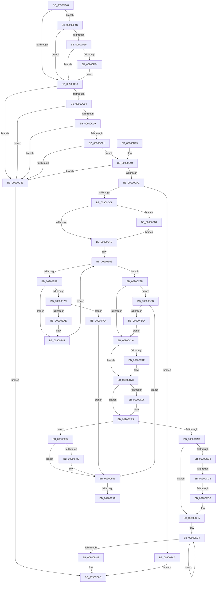

# IopConnectInterrupt

- RVA: `0x00900B40`–`0x00900FE2` (길이 `1,186` bytes)
- VA: `0x0000000140900B40`
- 실행 섹션: `PAGE`
- PDB 이름 있음: `예`; PDB Function 태그: `예`
- unwind 정보 RVA: `0x0008855C`
- 디코드: `290`개 명령, `1,186/1,186` bytes 표시
- 미해석 바이트: `0` (있으면 어셈블리에 `.byte`로 보존)

> 이 문서는 커널 이미지의 기계어와 PDB 기호를 분석해 생성했습니다. 4번과 5번은 함수 원형과 자료형을 바이너리 사용 방식에서 추정한 C 해석이며 원본 소스 복구 결과는 아닙니다.

## 1. Dependencies

- 직접 호출 지점: **19**; 고유 호출 대상: **18**
- 직접 호출자로 확인된 함수: **4**
- RIP 상대 이미지 참조: **2**

### Outgoing calls
- `0x00900B79` → [memset](../../text/6C/memset_function_006C6C40.md) (function, `0x006C6C40`)
- `0x00900BA1` → [IopInitializeActiveConnectBlock](IopInitializeActiveConnectBlock_function_00901138.md) (function, `0x00901138`)
- `0x00900BF9` → [KeQueryActiveGroupCount](../../text/48/KeQueryActiveGroupCount_function_0048C600.md) (function, `0x0048C600`)
- `0x00900C6E` → [KeWaitForSingleObject](../../text/20/KeWaitForSingleObject_function_0020E6B0.md) (function, `0x0020E6B0`)
- `0x00900C83` → [KeConnectInterrupt](../../text/2D/KeConnectInterrupt_function_002D3D5C.md) (function, `0x002D3D5C`)
- `0x00900C9B` → [KeSetEvent](../../text/33/KeSetEvent_function_0033F310.md) (function, `0x0033F310`)
- `0x00900CA0` → [KeLeaveCriticalRegion](../../text/25/KeLeaveCriticalRegion_function_0025D8B0.md) (function, `0x0025D8B0`)
- `0x00900CDE` → [ObfReferenceObjectWithTag](../../text/21/ObfReferenceObjectWithTag_function_00210710.md) (function, `0x00210710`)
- `0x00900D68` → [PnpTraceInterruptConnection](PnpTraceInterruptConnection_function_00900A60.md) (function, `0x00900A60`)
- `0x00900D71` → [IopDestroyActiveConnectBlock](IopDestroyActiveConnectBlock_function_00900FE8.md) (function, `0x00900FE8`)
- `0x00900DB8` → [ExAllocatePool2](../../poolcode/B8/ExAllocatePool2_function_00B820F0.md) (function, `0x00B820F0`)
- `0x00900DD5` → [KeInitializeDpc](../../text/45/KeInitializeDpc_function_0045BBD0.md) (function, `0x0045BBD0`)
- `0x00900E83` → [KeGetProcessorIndexFromNumber](../../text/2D/KeGetProcessorIndexFromNumber_function_002DD2D0.md) (function, `0x002DD2D0`)
- `0x00900E9C` → [KeAllocateInterrupt](../../text/49/KeAllocateInterrupt_function_00493F50.md) (function, `0x00493F50`)
- `0x00900EB9` → [memset](../../text/6C/memset_function_006C6C40.md) (function, `0x006C6C40`)
- `0x00900F24` → [KeInitializeInterruptEx](../../text/48/KeInitializeInterruptEx_function_00488664.md) (function, `0x00488664`)
- `0x00900F58` → [guard_dispatch_icall](../../text/6B/guard_dispatch_icall_function_006BAAD0.md) (function, `0x006BAAD0`)
- `0x00900F8C` → [IopDestroyPassiveInterruptBlock](../70/IopDestroyPassiveInterruptBlock_function_007059F0.md) (function, `0x007059F0`)
- `0x00900FD2` → [IopAllocatePassiveInterruptBlock](../AC/IopAllocatePassiveInterruptBlock_function_00AC2BE0.md) (function, `0x00AC2BE0`)

### Direct callers
- [IopConnectInterruptFullySpecified](../72/IopConnectInterruptFullySpecified_function_007273E8.md) at `0x00727531`
- [IopConnectLineBasedInterrupt](../8F/IopConnectLineBasedInterrupt_function_008FFE64.md) at `0x008FFFEB`
- [IoConnectInterruptEx](IoConnectInterruptEx_function_009001F0.md) at `0x009003F8`
- [sub_00B203FA](../B2/Unknown_function_00B203FA.md) at `0x00B204F7`

### Static image references
- `0x00900BBB` → RVA `0x00000000` (`image boundary/outside`; read)
- `0x00900F4C` → RVA `0x00E009E0` (`.data`; read)

## 2. Other-region calls and transfers

- 다른 실행 섹션으로 향하는 call: **14**
  - `0x00900B79` → [memset](../../text/6C/memset_function_006C6C40.md) (`PAGE` → `.text`)
  - `0x00900BF9` → [KeQueryActiveGroupCount](../../text/48/KeQueryActiveGroupCount_function_0048C600.md) (`PAGE` → `.text`)
  - `0x00900C6E` → [KeWaitForSingleObject](../../text/20/KeWaitForSingleObject_function_0020E6B0.md) (`PAGE` → `.text`)
  - `0x00900C83` → [KeConnectInterrupt](../../text/2D/KeConnectInterrupt_function_002D3D5C.md) (`PAGE` → `.text`)
  - `0x00900C9B` → [KeSetEvent](../../text/33/KeSetEvent_function_0033F310.md) (`PAGE` → `.text`)
  - `0x00900CA0` → [KeLeaveCriticalRegion](../../text/25/KeLeaveCriticalRegion_function_0025D8B0.md) (`PAGE` → `.text`)
  - `0x00900CDE` → [ObfReferenceObjectWithTag](../../text/21/ObfReferenceObjectWithTag_function_00210710.md) (`PAGE` → `.text`)
  - `0x00900DB8` → [ExAllocatePool2](../../poolcode/B8/ExAllocatePool2_function_00B820F0.md) (`PAGE` → `POOLCODE`)
  - `0x00900DD5` → [KeInitializeDpc](../../text/45/KeInitializeDpc_function_0045BBD0.md) (`PAGE` → `.text`)
  - `0x00900E83` → [KeGetProcessorIndexFromNumber](../../text/2D/KeGetProcessorIndexFromNumber_function_002DD2D0.md) (`PAGE` → `.text`)
  - `0x00900E9C` → [KeAllocateInterrupt](../../text/49/KeAllocateInterrupt_function_00493F50.md) (`PAGE` → `.text`)
  - `0x00900EB9` → [memset](../../text/6C/memset_function_006C6C40.md) (`PAGE` → `.text`)
  - `0x00900F24` → [KeInitializeInterruptEx](../../text/48/KeInitializeInterruptEx_function_00488664.md) (`PAGE` → `.text`)
  - `0x00900F58` → [guard_dispatch_icall](../../text/6B/guard_dispatch_icall_function_006BAAD0.md) (`PAGE` → `.text`)
- call이 아닌 외부 분기/꼬리 이동: **4**
  - `0x00900CC0` → [sub_00B202BA + 0x2A](../B2/Unknown_function_00B202BA.md) (`tail-transfer`)
  - `0x00900CD0` → [sub_00B202BA + 0x2A](../B2/Unknown_function_00B202BA.md) (`tail-transfer`)
  - `0x00900F94` → [sub_00B202BA + 0x17](../B2/Unknown_function_00B202BA.md) (`tail-transfer`)
  - `0x00900FA5` → [sub_00B202BA](../B2/Unknown_function_00B202BA.md) (`tail-transfer`)

## 3. Assembly (complete function range)

```asm
00900B40  48 8B C4                        mov rax, rsp
00900B43  48 89 58 10                     mov qword ptr [rax + 0x10], rbx
00900B47  4C 89 48 20                     mov qword ptr [rax + 0x20], r9
00900B4B  4C 89 40 18                     mov qword ptr [rax + 0x18], r8
00900B4F  48 89 48 08                     mov qword ptr [rax + 8], rcx
00900B53  55                              push rbp
00900B54  56                              push rsi
00900B55  57                              push rdi
00900B56  41 54                           push r12
00900B58  41 55                           push r13
00900B5A  41 56                           push r14
00900B5C  41 57                           push r15
00900B5E  48 8D 68 B8                     lea rbp, [rax - 0x48]
00900B62  48 81 EC 10 01 00 00            sub rsp, 0x110
00900B69  48 8B FA                        mov rdi, rdx
00900B6C  48 8B D9                        mov rbx, rcx
00900B6F  33 D2                           xor edx, edx
00900B71  48 8D 4D C0                     lea rcx, [rbp - 0x40]
00900B75  44 8D 42 50                     lea r8d, [rdx + 0x50]
00900B79  E8 C2 60 DC FF                  call 0x1406c6c40
00900B7E  45 33 ED                        xor r13d, r13d
00900B81  48 8D 55 C0                     lea rdx, [rbp - 0x40]
00900B85  4C 89 2B                        mov qword ptr [rbx], r13
00900B88  48 8B 9D A0 00 00 00            mov rbx, qword ptr [rbp + 0xa0]
00900B8F  48 8B CB                        mov rcx, rbx
00900B92  44 89 6D 80                     mov dword ptr [rbp - 0x80], r13d
00900B96  44 88 AD 98 00 00 00            mov byte ptr [rbp + 0x98], r13b
00900B9D  4C 89 6D A8                     mov qword ptr [rbp - 0x58], r13
00900BA1  E8 92 05 00 00                  call 0x140901138
00900BA6  8B 43 0C                        mov eax, dword ptr [rbx + 0xc]
00900BA9  0F 10 43 20                     movups xmm0, xmmword ptr [rbx + 0x20]
00900BAD  8B 73 18                        mov esi, dword ptr [rbx + 0x18]
00900BB0  89 45 88                        mov dword ptr [rbp - 0x78], eax
00900BB3  66 0F C5 C0 04                  pextrw eax, xmm0, 4
00900BB8  89 75 84                        mov dword ptr [rbp - 0x7c], esi
00900BBB  48 8D 35 3E F4 6F FF            lea rsi, [rip - 0x900bc2]
00900BC2  0F 11 45 90                     movups xmmword ptr [rbp - 0x70], xmm0
00900BC6  0F B7 C0                        movzx eax, ax
00900BC9  48 8B 84 C6 28 71 FC 00         mov rax, qword ptr [rsi + rax*8 + 0xfc7128]
00900BD1  48 21 45 90                     and qword ptr [rbp - 0x70], rax
00900BD5  8A 43 10                        mov al, byte ptr [rbx + 0x10]
00900BD8  88 85 A0 00 00 00               mov byte ptr [rbp + 0xa0], al
00900BDE  44 39 6B 08                     cmp dword ptr [rbx + 8], r13d
00900BE2  0F 84 64 03 00 00               je 0x140900f4c
00900BE8  44 8A A5 88 00 00 00            mov r12b, byte ptr [rbp + 0x88]
00900BEF  45 84 E4                        test r12b, r12b
00900BF2  0F 94 85 88 00 00 00            sete byte ptr [rbp + 0x88]
00900BF9  E8 02 BA B8 FF                  call 0x14048c600
00900BFE  66 39 45 98                     cmp word ptr [rbp - 0x68], ax
00900C02  73 2F                           jae 0x140900c33
00900C04  0F B7 45 98                     movzx eax, word ptr [rbp - 0x68]
00900C08  48 8B 8C C6 28 71 FC 00         mov rcx, qword ptr [rsi + rax*8 + 0xfc7128]
00900C10  4C 8B 7D 90                     mov r15, qword ptr [rbp - 0x70]
00900C14  4D 85 FF                        test r15, r15
00900C17  74 1A                           je 0x140900c33
00900C19  49 23 CF                        and rcx, r15
00900C1C  49 3B CF                        cmp rcx, r15
00900C1F  75 12                           jne 0x140900c33
00900C21  0F B7 45 9A                     movzx eax, word ptr [rbp - 0x66]
00900C25  66 0B 45 9C                     or ax, word ptr [rbp - 0x64]
00900C29  66 0B 45 9E                     or ax, word ptr [rbp - 0x62]
00900C2D  0F 84 61 01 00 00               je 0x140900d94
00900C33  BB 0D 00 00 C0                  mov ebx, 0xc000000d
00900C38  E9 30 01 00 00                  jmp 0x140900d6d
00900C3D  45 84 E4                        test r12b, r12b
00900C40  0F 84 85 03 00 00               je 0x140900fcb
00900C46  48 8B 4D D8                     mov rcx, qword ptr [rbp - 0x28]
00900C4A  48 85 C9                        test rcx, rcx
00900C4D  74 24                           je 0x140900c73
00900C4F  65 48 8B 04 25 88 01 00 00      mov rax, qword ptr gs:[0x188]
00900C58  45 33 C9                        xor r9d, r9d
00900C5B  48 83 64 24 20 00               and qword ptr [rsp + 0x20], 0
00900C61  45 33 C0                        xor r8d, r8d
00900C64  33 D2                           xor edx, edx
00900C66  66 FF 88 E4 01 00 00            dec word ptr [rax + 0x1e4]
00900C6D  90                              nop
00900C6E  E8 3D DA 90 FF                  call 0x14020e6b0
00900C73  4C 8D BE F8 01 00 00            lea r15, [rsi + 0x1f8]
00900C7A  4D 8B C5                        mov r8, r13
00900C7D  49 8B CF                        mov rcx, r15
00900C80  41 8A D6                        mov dl, r14b
00900C83  E8 D4 30 9D FF                  call 0x1402d3d5c
00900C88  48 8B 4D D8                     mov rcx, qword ptr [rbp - 0x28]
00900C8C  45 33 ED                        xor r13d, r13d
00900C8F  8B D8                           mov ebx, eax
00900C91  48 85 C9                        test rcx, rcx
00900C94  74 0F                           je 0x140900ca5
00900C96  45 33 C0                        xor r8d, r8d
00900C99  33 D2                           xor edx, edx
00900C9B  E8 70 E6 A3 FF                  call 0x14033f310
00900CA0  E8 0B CC 95 FF                  call 0x14025d8b0
00900CA5  85 DB                           test ebx, ebx
00900CA7  0F 88 D7 02 00 00               js 0x140900f84
00900CAD  48 85 FF                        test rdi, rdi
00900CB0  74 43                           je 0x140900cf5
00900CB2  48 8B 87 38 01 00 00            mov rax, qword ptr [rdi + 0x138]
00900CB9  48 8B 40 28                     mov rax, qword ptr [rax + 0x28]
00900CBD  48 85 C0                        test rax, rax
00900CC0  0F 84 1E F6 21 00               je 0x140b202e4
00900CC6  F7 80 8C 01 00 00 00 00 02 00   test dword ptr [rax + 0x18c], 0x20000
00900CD0  0F 85 0E F6 21 00               jne 0x140b202e4
00900CD6  BA 50 6E 70 54                  mov edx, 0x54706e50
00900CDB  48 8B CF                        mov rcx, rdi
00900CDE  E8 2D FA 90 FF                  call 0x140210710
00900CE3  48 89 BE F0 01 00 00            mov qword ptr [rsi + 0x1f0], rdi
00900CEA  48 8B 87 38 01 00 00            mov rax, qword ptr [rdi + 0x138]
00900CF1  F0 FF 40 60                     lock inc dword ptr [rax + 0x60]
00900CF5  49 8B 07                        mov rax, qword ptr [r15]
00900CF8  48 8D 56 70                     lea rdx, [rsi + 0x70]
00900CFC  BB 02 00 00 00                  mov ebx, 2
00900D01  8D 4B 7E                        lea ecx, [rbx + 0x7e]
00900D04  0F 10 00                        movups xmm0, xmmword ptr [rax]
00900D07  0F 11 02                        movups xmmword ptr [rdx], xmm0
00900D0A  0F 10 48 10                     movups xmm1, xmmword ptr [rax + 0x10]
00900D0E  0F 11 4A 10                     movups xmmword ptr [rdx + 0x10], xmm1
00900D12  0F 10 40 20                     movups xmm0, xmmword ptr [rax + 0x20]
00900D16  0F 11 42 20                     movups xmmword ptr [rdx + 0x20], xmm0
00900D1A  0F 10 48 30                     movups xmm1, xmmword ptr [rax + 0x30]
00900D1E  0F 11 4A 30                     movups xmmword ptr [rdx + 0x30], xmm1
00900D22  0F 10 40 40                     movups xmm0, xmmword ptr [rax + 0x40]
00900D26  0F 11 42 40                     movups xmmword ptr [rdx + 0x40], xmm0
00900D2A  0F 10 48 50                     movups xmm1, xmmword ptr [rax + 0x50]
00900D2E  0F 11 4A 50                     movups xmmword ptr [rdx + 0x50], xmm1
00900D32  0F 10 40 60                     movups xmm0, xmmword ptr [rax + 0x60]
00900D36  0F 11 42 60                     movups xmmword ptr [rdx + 0x60], xmm0
00900D3A  48 03 D1                        add rdx, rcx
00900D3D  0F 10 48 70                     movups xmm1, xmmword ptr [rax + 0x70]
00900D41  48 03 C1                        add rax, rcx
00900D44  0F 11 4A F0                     movups xmmword ptr [rdx - 0x10], xmm1
00900D48  48 83 EB 01                     sub rbx, 1
00900D4C  75 B6                           jne 0x140900d04
00900D4E  0F 10 00                        movups xmm0, xmmword ptr [rax]
00900D51  B1 01                           mov cl, 1
00900D53  41 8B DD                        mov ebx, r13d
00900D56  0F 11 02                        movups xmmword ptr [rdx], xmm0
00900D59  0F 10 48 10                     movups xmm1, xmmword ptr [rax + 0x10]
00900D5D  48 8B 45 50                     mov rax, qword ptr [rbp + 0x50]
00900D61  0F 11 4A 10                     movups xmmword ptr [rdx + 0x10], xmm1
00900D65  48 89 30                        mov qword ptr [rax], rsi
00900D68  E8 F3 FC FF FF                  call 0x140900a60
00900D6D  48 8D 4D C0                     lea rcx, [rbp - 0x40]
00900D71  E8 72 02 00 00                  call 0x140900fe8
00900D76  8B C3                           mov eax, ebx
00900D78  48 8B 9C 24 58 01 00 00         mov rbx, qword ptr [rsp + 0x158]
00900D80  48 81 C4 10 01 00 00            add rsp, 0x110
00900D87  41 5F                           pop r15
00900D89  41 5E                           pop r14
00900D8B  41 5D                           pop r13
00900D8D  41 5C                           pop r12
00900D8F  5F                              pop rdi
00900D90  5E                              pop rsi
00900D91  5D                              pop rbp
00900D92  C3                              ret
00900D93  CC                              int3
00900D94  F3 4D 0F B8 F7                  popcnt r14, r15
00900D99  45 84 F6                        test r14b, r14b
00900D9C  0F 84 91 FE FF FF               je 0x140900c33
00900DA2  41 0F BE C6                     movsx eax, r14b
00900DA6  B9 40 00 00 00                  mov ecx, 0x40
00900DAB  41 B8 49 6F 69 6E               mov r8d, 0x6e696f49
00900DB1  8D 14 C5 F8 01 00 00            lea edx, [rax*8 + 0x1f8]
00900DB8  E8 33 13 28 00                  call 0x140b820f0
00900DBD  48 8B F0                        mov rsi, rax
00900DC0  48 85 C0                        test rax, rax
00900DC3  0F 84 E1 01 00 00               je 0x140900faa
00900DC9  48 8D 88 B0 01 00 00            lea rcx, [rax + 0x1b0]
00900DD0  45 33 C0                        xor r8d, r8d
00900DD3  33 D2                           xor edx, edx
00900DD5  E8 F6 AD B5 FF                  call 0x14045bbd0
00900DDA  0F 28 03                        movaps xmm0, xmmword ptr [rbx]
00900DDD  4C 8D 6E 10                     lea r13, [rsi + 0x10]
00900DE1  8B 45 84                        mov eax, dword ptr [rbp - 0x7c]
00900DE4  48 8B CE                        mov rcx, rsi
00900DE7  41 0F 11 45 00                  movups xmmword ptr [r13], xmm0
00900DEC  0F 28 4B 10                     movaps xmm1, xmmword ptr [rbx + 0x10]
00900DF0  41 0F 11 4D 10                  movups xmmword ptr [r13 + 0x10], xmm1
00900DF5  0F 28 43 20                     movaps xmm0, xmmword ptr [rbx + 0x20]
00900DF9  41 0F 11 45 20                  movups xmmword ptr [r13 + 0x20], xmm0
00900DFE  0F 28 4B 30                     movaps xmm1, xmmword ptr [rbx + 0x30]
00900E02  41 0F 11 4D 30                  movups xmmword ptr [r13 + 0x30], xmm1
00900E07  0F 28 43 40                     movaps xmm0, xmmword ptr [rbx + 0x40]
00900E0B  41 0F 11 45 40                  movups xmmword ptr [r13 + 0x40], xmm0
00900E10  0F 28 4B 50                     movaps xmm1, xmmword ptr [rbx + 0x50]
00900E14  0F 10 45 90                     movups xmm0, xmmword ptr [rbp - 0x70]
00900E18  41 0F 11 4D 50                  movups xmmword ptr [r13 + 0x50], xmm1
00900E1D  89 46 28                        mov dword ptr [rsi + 0x28], eax
00900E20  48 8B 85 80 00 00 00            mov rax, qword ptr [rbp + 0x80]
00900E27  48 85 C0                        test rax, rax
00900E2A  F3 0F 7F 46 30                  movdqu xmmword ptr [rsi + 0x30], xmm0
00900E2F  48 0F 45 C8                     cmovne rcx, rax
00900E33  8A 85 88 00 00 00               mov al, byte ptr [rbp + 0x88]
00900E39  88 86 90 01 00 00               mov byte ptr [rsi + 0x190], al
00900E3F  48 89 4D B8                     mov qword ptr [rbp - 0x48], rcx
00900E43  45 84 E4                        test r12b, r12b
00900E46  0F 84 68 01 00 00               je 0x140900fb4
00900E4C  0F B7 45 98                     movzx eax, word ptr [rbp - 0x68]
00900E50  32 C9                           xor cl, cl
00900E52  66 89 45 80                     mov word ptr [rbp - 0x80], ax
00900E56  32 DB                           xor bl, bl
00900E58  88 8D 88 00 00 00               mov byte ptr [rbp + 0x88], cl
00900E5E  4C 89 7E 08                     mov qword ptr [rsi + 8], r15
00900E62  C6 45 83 00                     mov byte ptr [rbp - 0x7d], 0
00900E66  41 3A CE                        cmp cl, r14b
00900E69  0F 8D CE FD FF FF               jge 0x140900c3d
00900E6F  0F B6 C3                        movzx eax, bl
00900E72  49 0F A3 C7                     bt r15, rax
00900E76  0F 83 C9 00 00 00               jae 0x140900f45
00900E7C  48 8D 4D 80                     lea rcx, [rbp - 0x80]
00900E80  88 5D 82                        mov byte ptr [rbp - 0x7e], bl
00900E83  E8 48 C4 9D FF                  call 0x1402dd2d0
00900E88  8B C8                           mov ecx, eax
00900E8A  89 45 A0                        mov dword ptr [rbp - 0x60], eax
00900E8D  48 8D 05 6C F1 6F FF            lea rax, [rip - 0x900e94]
00900E94  48 8B 8C C8 40 8C FC 00         mov rcx, qword ptr [rax + rcx*8 + 0xfc8c40]
00900E9C  E8 AF 30 B9 FF                  call 0x140493f50
00900EA1  48 89 45 B0                     mov qword ptr [rbp - 0x50], rax
00900EA5  48 85 C0                        test rax, rax
00900EA8  0F 84 16 01 00 00               je 0x140900fc4
00900EAE  33 D2                           xor edx, edx
00900EB0  41 B8 20 01 00 00               mov r8d, 0x120
00900EB6  48 8B C8                        mov rcx, rax
00900EB9  E8 82 5D DC FF                  call 0x1406c6c40
00900EBE  8A 85 98 00 00 00               mov al, byte ptr [rbp + 0x98]
00900EC4  4C 8B 4D 70                     mov r9, qword ptr [rbp + 0x70]
00900EC8  4C 8B 45 68                     mov r8, qword ptr [rbp + 0x68]
00900ECC  48 8B 55 60                     mov rdx, qword ptr [rbp + 0x60]
00900ED0  48 8B 4D B0                     mov rcx, qword ptr [rbp - 0x50]
00900ED4  4C 89 6C 24 78                  mov qword ptr [rsp + 0x78], r13
00900ED9  88 44 24 70                     mov byte ptr [rsp + 0x70], al
00900EDD  8B 45 A0                        mov eax, dword ptr [rbp - 0x60]
00900EE0  89 44 24 60                     mov dword ptr [rsp + 0x60], eax
00900EE4  8A 85 90 00 00 00               mov al, byte ptr [rbp + 0x90]
00900EEA  88 44 24 58                     mov byte ptr [rsp + 0x58], al
00900EEE  8B 45 84                        mov eax, dword ptr [rbp - 0x7c]
00900EF1  89 44 24 50                     mov dword ptr [rsp + 0x50], eax
00900EF5  8A 85 A0 00 00 00               mov al, byte ptr [rbp + 0xa0]
00900EFB  44 88 64 24 48                  mov byte ptr [rsp + 0x48], r12b
00900F00  88 44 24 40                     mov byte ptr [rsp + 0x40], al
00900F04  8B 45 88                        mov eax, dword ptr [rbp - 0x78]
00900F07  89 44 24 38                     mov dword ptr [rsp + 0x38], eax
00900F0B  48 8B 45 A8                     mov rax, qword ptr [rbp - 0x58]
00900F0F  48 89 44 24 30                  mov qword ptr [rsp + 0x30], rax
00900F14  48 8B 45 B8                     mov rax, qword ptr [rbp - 0x48]
00900F18  48 89 44 24 28                  mov qword ptr [rsp + 0x28], rax
00900F1D  8B 45 78                        mov eax, dword ptr [rbp + 0x78]
00900F20  89 44 24 20                     mov dword ptr [rsp + 0x20], eax
00900F24  E8 3B 77 B8 FF                  call 0x140488664
00900F29  48 0F BE 8D 88 00 00 00         movsx rcx, byte ptr [rbp + 0x88]
00900F31  48 8B 55 B0                     mov rdx, qword ptr [rbp - 0x50]
00900F35  48 89 94 CE F8 01 00 00         mov qword ptr [rsi + rcx*8 + 0x1f8], rdx
00900F3D  FE C1                           inc cl
00900F3F  88 8D 88 00 00 00               mov byte ptr [rbp + 0x88], cl
00900F45  FE C3                           inc bl
00900F47  E9 1A FF FF FF                  jmp 0x140900e66
00900F4C  48 8B 05 8D FA 4F 00            mov rax, qword ptr [rip + 0x4ffa8d]
00900F53  33 C9                           xor ecx, ecx
00900F55  8B 53 40                        mov edx, dword ptr [rbx + 0x40]
00900F58  E8 73 9B DB FF                  call 0x1406baad0
00900F5D  84 C0                           test al, al
00900F5F  0F 85 83 FC FF FF               jne 0x140900be8
00900F65  8B 43 14                        mov eax, dword ptr [rbx + 0x14]
00900F68  83 E8 03                        sub eax, 3
00900F6B  83 F8 01                        cmp eax, 1
00900F6E  0F 87 74 FC FF FF               ja 0x140900be8
00900F74  C6 85 98 00 00 00 01            mov byte ptr [rbp + 0x98], 1
00900F7B  44 89 6D 84                     mov dword ptr [rbp - 0x7c], r13d
00900F7F  E9 64 FC FF FF                  jmp 0x140900be8
00900F84  45 84 E4                        test r12b, r12b
00900F87  75 08                           jne 0x140900f91
00900F89  8B 4D 88                        mov ecx, dword ptr [rbp - 0x78]
00900F8C  E8 5F 4A E0 FF                  call 0x1407059f0
00900F91  45 84 F6                        test r14b, r14b
00900F94  0F 8E 37 F3 21 00               jle 0x140b202d1
00900F9A  48 8D BE F8 01 00 00            lea rdi, [rsi + 0x1f8]
00900FA1  45 0F B6 F6                     movzx r14d, r14b
00900FA5  E9 10 F3 21 00                  jmp 0x140b202ba
00900FAA  BB 9A 00 00 C0                  mov ebx, 0xc000009a
00900FAF  E9 B9 FD FF FF                  jmp 0x140900d6d
00900FB4  48 8D 86 98 01 00 00            lea rax, [rsi + 0x198]
00900FBB  48 89 45 A8                     mov qword ptr [rbp - 0x58], rax
00900FBF  E9 88 FE FF FF                  jmp 0x140900e4c
00900FC4  BB 9A 00 00 C0                  mov ebx, 0xc000009a
00900FC9  EB C6                           jmp 0x140900f91
00900FCB  48 8D 55 90                     lea rdx, [rbp - 0x70]
00900FCF  49 8B CD                        mov rcx, r13
00900FD2  E8 09 1C 1C 00                  call 0x140ac2be0
00900FD7  8B D8                           mov ebx, eax
00900FD9  85 C0                           test eax, eax
00900FDB  78 B4                           js 0x140900f91
00900FDD  E9 64 FC FF FF                  jmp 0x140900c46
```

## 4. C-style interpretation (structured pseudocode)

```c
__int64 __fastcall IopConnectInterrupt(__int64 a1, __int64 a2, __int64 a3, __int64 a4)
{
    __int64 result;
    __int64 v_r13;
    __int64 v_rbx;
    __int64 v_rsp;
    unsigned __int64 v_stack_m128;
    unsigned __int64 v_stack_p10;
    unsigned int v_stack_p20;
    unsigned __int64 v_stack_p28;
    unsigned __int64 v_stack_p30;
    unsigned int v_stack_p38;
    unsigned __int8 v_stack_p40;
    unsigned __int8 v_stack_p48;
    unsigned int v_stack_p50;
    unsigned __int8 v_stack_p58;
    unsigned int v_stack_p60;
    unsigned __int8 v_stack_p70;
    unsigned __int64 v_stack_p78;

    *(unsigned __int64 *)(v_rsp + 16) = v_rbx;
    *(unsigned __int64 *)(v_rsp + 32) = a4;
    *(unsigned __int64 *)(v_rsp + 24) = a3;
    *(unsigned __int64 *)(v_rsp + 8) = a1;
    v_rsp = (v_rsp) - (272);
    a2 = 0;
    result = memset(v_rsp - 72 - 64, a2, a2 + 80, a4);
    v_r13 = 0;
    *(unsigned __int64 *)(a1) = 0;
    *(unsigned int *)(v_rsp - 72 - 128) = 0;
    *(unsigned __int8 *)(v_rsp - 72 + 152) = 0;
    *(unsigned __int64 *)(v_rsp - 72 - 88) = 0;
    result = IopInitializeActiveConnectBlock(*(unsigned __int64 *)(v_rsp - 72 + 160), v_rsp - 72 - 64, a2 + 80, a4);
    *(unsigned int *)(v_rsp - 72 - 120) = (unsigned int)((unsigned int)(*(unsigned int *)(*(unsigned __int64 *)(v_rsp - 72 + 160) + 12)));
    *(unsigned int *)(v_rsp - 72 - 124) = (unsigned int)((unsigned int)(*(unsigned int *)(*(unsigned __int64 *)(v_rsp - 72 + 160) + 24)));
    *(unsigned __int64 *)(v_rsp - 72 - 112) = v_xmm0;
    *(unsigned __int8 *)(v_rsp - 72 + 160) = (unsigned __int8)(*(unsigned __int8 *)(*(unsigned __int64 *)(v_rsp - 72 + 160) + 16));
    if ((*(unsigned int *)(*(unsigned __int64 *)(v_rsp - 72 + 160) + 8)) == 0) goto loc_00900F4C;
loc_00900BE8:
    result = KeQueryActiveGroupCount(*(unsigned __int64 *)(v_rsp - 72 + 160), v_rsp - 72 - 64, a2 + 80, a4);
    if ((*(unsigned __int16 *)(v_rsp - 72 - 104)) >= ((unsigned __int16)(result))) goto loc_00900C33;
    if (*(unsigned __int64 *)(v_rsp - 72 - 112) == 0) goto loc_00900C33;
    a1 = (*(unsigned __int64 *)(v_rip - 9440194 + *(unsigned __int16 *)(v_rsp - 72 - 104) * 8 + 16544040)) & (*(unsigned __int64 *)(v_rsp - 72 - 112));
    if (a1 != (*(unsigned __int64 *)(v_rsp - 72 - 112))) goto loc_00900C33;
    result = (unsigned __int16)((*(unsigned __int16 *)(v_rsp - 72 - 102)) | (*(unsigned __int16 *)(v_rsp - 72 - 100)));
    result = (unsigned __int16)((result) | (*(unsigned __int16 *)(v_rsp - 72 - 98)));
    if (condition_is_equal) goto loc_00900D94;
loc_00900C33:
    goto loc_00900D6D;
loc_00900C3D:
    if ((unsigned __int8)(*(unsigned __int8 *)(v_rsp - 72 + 136)) == 0) goto loc_00900FCB;
loc_00900C46:
    if (*(unsigned __int64 *)(v_rsp - 72 - 40) != 0) {
        result = *(unsigned __int64 *)(gs_base + (0 + 392));
        a4 = 0;
        a3 = 0;
        a2 = 0;
        result = KeWaitForSingleObject(*(unsigned __int64 *)(v_rsp - 72 - 40), a2, a3, a4);
    }
    result = KeConnectInterrupt(v_rip - 9440194 + 504, (unsigned __int8)(v_r14), 0, a4);
    v_r13 = 0;
    if (*(unsigned __int64 *)(v_rsp - 72 - 40) != 0) {
        a3 = 0;
        a2 = 0;
        result = KeSetEvent(*(unsigned __int64 *)(v_rsp - 72 - 40), a2, a3, a4);
        result = KeLeaveCriticalRegion(*(unsigned __int64 *)(v_rsp - 72 - 40), a2, a3, a4);
    }
    if (sign_flag) goto loc_00900F84;
    if (0 == 0) goto loc_00900CF5;
    result = ObfReferenceObjectWithTag(0, (unsigned int)(0x54706E50ULL), a3, a4);
    *(unsigned __int64 *)(v_rip - 9440194 + 496) = 0;
loc_00900CF5:
loc_00900D04:
    *(unsigned __int64 *)(v_rip - 9440194 + 112) = v_xmm0;
    *(unsigned __int64 *)(v_rip - 9440194 + 112 + 16) = v_xmm1;
    *(unsigned __int64 *)(v_rip - 9440194 + 112 + 32) = v_xmm0;
    *(unsigned __int64 *)(v_rip - 9440194 + 112 + 48) = v_xmm1;
    *(unsigned __int64 *)(v_rip - 9440194 + 112 + 64) = v_xmm0;
    *(unsigned __int64 *)(v_rip - 9440194 + 112 + 80) = v_xmm1;
    *(unsigned __int64 *)(v_rip - 9440194 + 112 + 96) = v_xmm0;
    a2 = (v_rip - 9440194 + 112) + (2 + 126);
    result = (*(unsigned __int64 *)(v_rip - 9440194 + 504)) + (2 + 126);
    *(unsigned __int64 *)(a2 - 16) = v_xmm1;
    v_rbx = (2) - (1);
    if (condition_is_not_equal) goto loc_00900D04;
    *(unsigned __int64 *)(a2) = v_xmm0;
    *(unsigned __int64 *)(a2 + 16) = v_xmm1;
    *(unsigned __int64 *)(*(unsigned __int64 *)(v_rsp - 72 + 80)) = v_rip - 9440194;
    result = PnpTraceInterruptConnection(1, a2, a3, a4);
loc_00900D6D:
    result = IopDestroyActiveConnectBlock(v_rsp - 72 - 64, a2, a3, a4);
    v_rsp = (v_rsp) + (272);
    return 0;
loc_00900D94:
    if ((unsigned __int8)(v_r14) == 0) goto loc_00900C33;
    result = ExAllocatePool2(64, (__int8)((unsigned __int8)(v_r14)) * 8 + 504, (unsigned int)(0x6E696F49ULL), a4);
    if (result == 0) goto loc_00900FAA;
    a3 = 0;
    a2 = 0;
    result = KeInitializeDpc(result + 432, a2, a3, a4);
    *(unsigned __int64 *)(result + 16) = v_xmm0;
    *(unsigned __int64 *)(result + 16 + 16) = v_xmm1;
    *(unsigned __int64 *)(result + 16 + 32) = v_xmm0;
    *(unsigned __int64 *)(result + 16 + 48) = v_xmm1;
    *(unsigned __int64 *)(result + 16 + 64) = v_xmm0;
    *(unsigned __int64 *)(result + 16 + 80) = v_xmm1;
    *(unsigned int *)(result + 40) = (unsigned int)((unsigned int)(*(unsigned int *)(v_rsp - 72 - 124)));
    *(unsigned __int64 *)(result + 48) = v_xmm0;
    a1 = result;
    if (*(unsigned __int64 *)(v_rsp - 72 + 128) != 0) { a1 = *(unsigned __int64 *)(v_rsp - 72 + 128); }
    *(unsigned __int8 *)(result + 400) = (unsigned __int8)(*(unsigned __int8 *)(v_rsp - 72 + 136));
    *(unsigned __int64 *)(v_rsp - 72 - 72) = a1;
    if ((unsigned __int8)(*(unsigned __int8 *)(v_rsp - 72 + 136)) == 0) goto loc_00900FB4;
loc_00900E4C:
    a1 = 0;
    *(unsigned __int16 *)(v_rsp - 72 - 128) = (unsigned __int16)(*(unsigned __int16 *)(v_rsp - 72 - 104));
    v_rbx = 0;
    *(unsigned __int8 *)(v_rsp - 72 + 136) = 0;
    *(unsigned __int64 *)(result + 8) = v_rip - 9440194 + 504;
    *(unsigned __int8 *)(v_rsp - 72 - 125) = 0;
loc_00900E66:
    if (0 >= ((unsigned __int8)(v_r14))) goto loc_00900C3D;
    if (0 >= ((unsigned __int8)(v_r14))) goto loc_00900F45;
    *(unsigned __int8 *)(v_rsp - 72 - 126) = 0;
    result = KeGetProcessorIndexFromNumber(v_rsp - 72 - 128, a2, a3, a4);
    *(unsigned int *)(v_rsp - 72 - 96) = (unsigned int)(result);
    result = KeAllocateInterrupt(*(unsigned __int64 *)(v_rip - 9440916 + (unsigned int)((unsigned int)(result)) * 8 + 16550976), a2, a3, a4);
    *(unsigned __int64 *)(v_rsp - 72 - 80) = result;
    if (result == 0) goto loc_00900FC4;
    a2 = 0;
    result = memset(result, a2, 288, a4);
    v_stack_p78 = result + 16;
    v_stack_p70 = (unsigned __int8)(*(unsigned __int8 *)(v_rsp - 72 + 152));
    v_stack_p60 = (unsigned int)((unsigned int)(*(unsigned int *)(v_rsp - 72 - 96)));
    v_stack_p58 = (unsigned __int8)(*(unsigned __int8 *)(v_rsp - 72 + 144));
    v_stack_p50 = (unsigned int)((unsigned int)(*(unsigned int *)(v_rsp - 72 - 124)));
    v_stack_p48 = (unsigned __int8)(*(unsigned __int8 *)(v_rsp - 72 + 136));
    v_stack_p40 = (unsigned __int8)(*(unsigned __int8 *)(v_rsp - 72 + 160));
    v_stack_p38 = (unsigned int)((unsigned int)(*(unsigned int *)(v_rsp - 72 - 120)));
    v_stack_p30 = *(unsigned __int64 *)(v_rsp - 72 - 88);
    v_stack_p28 = *(unsigned __int64 *)(v_rsp - 72 - 72);
    v_stack_p20 = (unsigned int)((unsigned int)(*(unsigned int *)(v_rsp - 72 + 120)));
    result = KeInitializeInterruptEx(*(unsigned __int64 *)(v_rsp - 72 - 80), *(unsigned __int64 *)(v_rsp - 72 + 96), *(unsigned __int64 *)(v_rsp - 72 + 104), *(unsigned __int64 *)(v_rsp - 72 + 112));
    *(unsigned __int64 *)(result + (__int8)(*(unsigned __int8 *)(v_rsp - 72 + 136)) * 8 + 504) = *(unsigned __int64 *)(v_rsp - 72 - 80);
    a1 = (unsigned __int8)(((__int8)(*(unsigned __int8 *)(v_rsp - 72 + 136))) + 1);
    *(unsigned __int8 *)(v_rsp - 72 + 136) = (unsigned __int8)(a1);
loc_00900F45:
    v_rbx = (unsigned __int8)((v_rbx) + 1);
    goto loc_00900E66;
loc_00900F4C:
    a1 = 0;
    result = guard_dispatch_icall(a1, (unsigned int)(*(unsigned int *)(v_rbx + 64)), *(unsigned __int64 *)(v_rsp - 72 + 104), *(unsigned __int64 *)(v_rsp - 72 + 112));
    if ((unsigned __int8)(result) != 0) goto loc_00900BE8;
    result = (unsigned int)(((unsigned int)(*(unsigned int *)(v_rbx + 20))) - (3));
    if (((unsigned int)(result)) > 1) goto loc_00900BE8;
    *(unsigned __int8 *)(v_rsp - 72 + 152) = 1;
    *(unsigned int *)(v_rsp - 72 - 124) = (unsigned int)(result + 16);
    goto loc_00900BE8;
loc_00900F84:
    if ((unsigned __int8)(*(unsigned __int8 *)(v_rsp - 72 + 136)) == 0) {
        a1 = *(unsigned int *)(v_rsp - 72 - 120);
        result = IopDestroyPassiveInterruptBlock(a1, (unsigned int)(*(unsigned int *)(v_rbx + 64)), *(unsigned __int64 *)(v_rsp - 72 + 104), *(unsigned __int64 *)(v_rsp - 72 + 112));
    }
loc_00900FAA:
    goto loc_00900D6D;
loc_00900FB4:
    *(unsigned __int64 *)(v_rsp - 72 - 88) = result + 408;
    goto loc_00900E4C;
loc_00900FC4:
    goto loc_00900F91;
loc_00900FCB:
    result = IopAllocatePassiveInterruptBlock(result + 16, v_rsp - 72 - 112, *(unsigned __int64 *)(v_rsp - 72 + 104), *(unsigned __int64 *)(v_rsp - 72 + 112));
    if (sign_flag) goto loc_00900F91;
    goto loc_00900C46;
}
```

## 5. (Beta) C Style

```c
int64_t IopConnectInterrupt(void *Arg1, int64_t Arg2, int64_t Arg3, int64_t Arg4)
{
    uint8_t *arg1 = (uint8_t *)Arg1;

    int64_t result;
    int64_t local_r13;
    int64_t local_rbx;
    int64_t local_rsp;
    uint64_t v_stack_m128;
    uint64_t v_stack_p10;
    uint32_t v_stack_p20;
    uint64_t v_stack_p28;
    uint64_t v_stack_p30;
    uint32_t v_stack_p38;
    uint8_t v_stack_p40;
    uint8_t v_stack_p48;
    uint32_t v_stack_p50;
    uint8_t v_stack_p58;
    uint32_t v_stack_p60;
    uint8_t v_stack_p70;
    uint64_t v_stack_p78;

    *(uint64_t *)(local_rsp + 0x10) = local_rbx;
    *(uint64_t *)(local_rsp + 0x20) = Arg4;
    *(uint64_t *)(local_rsp + 0x18) = Arg3;
    *(void **)(local_rsp + 0x8) = Arg1;
    local_rsp = (local_rsp) - (272);
    Arg2 = 0;
    result = memset(local_rsp - 72 - 64, Arg2, Arg2 + 80, Arg4);
    local_r13 = 0;
    *(uint64_t *)(arg1) = 0;
    *(uint32_t *)(local_rsp - 0x48 - 0x80) = 0;
    *(uint8_t *)(local_rsp - 0x48 + 0x98) = 0;
    *(uint64_t *)(local_rsp - 0x48 - 0x58) = 0;
    result = IopInitializeActiveConnectBlock(*(uint64_t *)(local_rsp - 0x48 + 0xA0), local_rsp - 72 - 64, Arg2 + 80, Arg4);
    *(uint32_t *)(local_rsp - 0x48 - 0x78) = (uint32_t)((uint32_t)(*(uint32_t *)(*(uint64_t *)(local_rsp - 0x48 + 0xA0) + 0xC)));
    *(uint32_t *)(local_rsp - 0x48 - 0x7C) = (uint32_t)((uint32_t)(*(uint32_t *)(*(uint64_t *)(local_rsp - 0x48 + 0xA0) + 0x18)));
    *(uint64_t *)(local_rsp - 0x48 - 0x70) = v_xmm0;
    *(uint8_t *)(local_rsp - 0x48 + 0xA0) = (uint8_t)(*(uint8_t *)(*(uint64_t *)(local_rsp - 0x48 + 0xA0) + 0x10));
    if ((*(uint32_t *)(*(uint64_t *)(local_rsp - 0x48 + 0xA0) + 0x8)) == 0) goto loc_00900F4C;
loc_00900BE8:
    result = KeQueryActiveGroupCount(*(uint64_t *)(local_rsp - 0x48 + 0xA0), local_rsp - 72 - 64, Arg2 + 80, Arg4);
    if ((*(uint16_t *)(local_rsp - 0x48 - 0x68)) >= ((uint16_t)(result))) goto loc_00900C33;
    if (*(uint64_t *)(local_rsp - 0x48 - 0x70) == 0) goto loc_00900C33;
    Arg1 = (*(uint64_t *)(v_rip - 0x900BC2 + *(uint16_t *)(local_rsp - 0x48 - 0x68) * 8 + 0xFC7128)) & (*(uint64_t *)(local_rsp - 0x48 - 0x70));
    if (Arg1 != (*(uint64_t *)(local_rsp - 0x48 - 0x70))) goto loc_00900C33;
    result = (uint16_t)((*(uint16_t *)(local_rsp - 0x48 - 0x66)) | (*(uint16_t *)(local_rsp - 0x48 - 0x64)));
    result = (uint16_t)((result) | (*(uint16_t *)(local_rsp - 0x48 - 0x62)));
    if (condition_is_equal) goto loc_00900D94;
loc_00900C33:
    goto loc_00900D6D;
loc_00900C3D:
    if ((uint8_t)(*(uint8_t *)(local_rsp - 0x48 + 0x88)) == 0) goto loc_00900FCB;
loc_00900C46:
    if (*(uint64_t *)(local_rsp - 0x48 - 0x28) != 0) {
        result = *(uint64_t *)(gs_base + (0 + 0x188));
        Arg4 = 0;
        Arg3 = 0;
        Arg2 = 0;
        result = KeWaitForSingleObject(*(uint64_t *)(local_rsp - 0x48 - 0x28), Arg2, Arg3, Arg4);
    }
    result = KeConnectInterrupt(v_rip - 9440194 + 504, (uint8_t)(local_r14), 0, Arg4);
    local_r13 = 0;
    if (*(uint64_t *)(local_rsp - 0x48 - 0x28) != 0) {
        Arg3 = 0;
        Arg2 = 0;
        result = KeSetEvent(*(uint64_t *)(local_rsp - 0x48 - 0x28), Arg2, Arg3, Arg4);
        result = KeLeaveCriticalRegion(*(uint64_t *)(local_rsp - 0x48 - 0x28), Arg2, Arg3, Arg4);
    }
    if (sign_flag) goto loc_00900F84;
    if (0 == 0) goto loc_00900CF5;
    result = ObfReferenceObjectWithTag(0, (uint32_t)(0x54706E50ULL), Arg3, Arg4);
    *(uint64_t *)(v_rip - 0x900BC2 + 0x1F0) = 0;
loc_00900CF5:
loc_00900D04:
    *(uint64_t *)(v_rip - 0x900BC2 + 0x70) = v_xmm0;
    *(uint64_t *)(v_rip - 0x900BC2 + 0x70 + 0x10) = v_xmm1;
    *(uint64_t *)(v_rip - 0x900BC2 + 0x70 + 0x20) = v_xmm0;
    *(uint64_t *)(v_rip - 0x900BC2 + 0x70 + 0x30) = v_xmm1;
    *(uint64_t *)(v_rip - 0x900BC2 + 0x70 + 0x40) = v_xmm0;
    *(uint64_t *)(v_rip - 0x900BC2 + 0x70 + 0x50) = v_xmm1;
    *(uint64_t *)(v_rip - 0x900BC2 + 0x70 + 0x60) = v_xmm0;
    Arg2 = (v_rip - 9440194 + 112) + (2 + 126);
    result = (*(uint64_t *)(v_rip - 0x900BC2 + 0x1F8)) + (2 + 126);
    *(uint64_t *)(Arg2 - 0x10) = v_xmm1;
    local_rbx = (2) - (1);
    if (condition_is_not_equal) goto loc_00900D04;
    *(uint64_t *)(Arg2) = v_xmm0;
    *(uint64_t *)(Arg2 + 0x10) = v_xmm1;
    *(uint64_t *)(*(uint64_t *)(local_rsp - 0x48 + 0x50)) = v_rip - 9440194;
    result = PnpTraceInterruptConnection(1, Arg2, Arg3, Arg4);
loc_00900D6D:
    result = IopDestroyActiveConnectBlock(local_rsp - 72 - 64, Arg2, Arg3, Arg4);
    local_rsp = (local_rsp) + (272);
    return 0;
loc_00900D94:
    if ((uint8_t)(local_r14) == 0) goto loc_00900C33;
    result = ExAllocatePool2(64, (int8_t)((uint8_t)(local_r14)) * 8 + 504, (uint32_t)(0x6E696F49ULL), Arg4);
    if (result == 0) goto loc_00900FAA;
    Arg3 = 0;
    Arg2 = 0;
    result = KeInitializeDpc(result + 432, Arg2, Arg3, Arg4);
    *(uint64_t *)(result + 0x10) = v_xmm0;
    *(uint64_t *)(result + 0x10 + 0x10) = v_xmm1;
    *(uint64_t *)(result + 0x10 + 0x20) = v_xmm0;
    *(uint64_t *)(result + 0x10 + 0x30) = v_xmm1;
    *(uint64_t *)(result + 0x10 + 0x40) = v_xmm0;
    *(uint64_t *)(result + 0x10 + 0x50) = v_xmm1;
    *(uint32_t *)(result + 0x28) = (uint32_t)((uint32_t)(*(uint32_t *)(local_rsp - 0x48 - 0x7C)));
    *(uint64_t *)(result + 0x30) = v_xmm0;
    Arg1 = result;
    if (*(uint64_t *)(local_rsp - 0x48 + 0x80) != 0) { Arg1 = *(uint64_t *)(local_rsp - 0x48 + 0x80); }
    *(uint8_t *)(result + 0x190) = (uint8_t)(*(uint8_t *)(local_rsp - 0x48 + 0x88));
    *(void **)(local_rsp - 0x48 - 0x48) = Arg1;
    if ((uint8_t)(*(uint8_t *)(local_rsp - 0x48 + 0x88)) == 0) goto loc_00900FB4;
loc_00900E4C:
    Arg1 = 0;
    *(uint16_t *)(local_rsp - 0x48 - 0x80) = (uint16_t)(*(uint16_t *)(local_rsp - 0x48 - 0x68));
    local_rbx = 0;
    *(uint8_t *)(local_rsp - 0x48 + 0x88) = 0;
    *(uint64_t *)(result + 0x8) = v_rip - 9440194 + 504;
    *(uint8_t *)(local_rsp - 0x48 - 0x7D) = 0;
loc_00900E66:
    if (0 >= ((uint8_t)(local_r14))) goto loc_00900C3D;
    if (0 >= ((uint8_t)(local_r14))) goto loc_00900F45;
    *(uint8_t *)(local_rsp - 0x48 - 0x7E) = 0;
    result = KeGetProcessorIndexFromNumber(local_rsp - 72 - 128, Arg2, Arg3, Arg4);
    *(uint32_t *)(local_rsp - 0x48 - 0x60) = (uint32_t)(result);
    result = KeAllocateInterrupt(*(uint64_t *)(v_rip - 0x900E94 + (uint32_t)((uint32_t)(result)) * 8 + 0xFC8C40), Arg2, Arg3, Arg4);
    *(uint64_t *)(local_rsp - 0x48 - 0x50) = result;
    if (result == 0) goto loc_00900FC4;
    Arg2 = 0;
    result = memset(result, Arg2, 288, Arg4);
    v_stack_p78 = result + 16;
    v_stack_p70 = (uint8_t)(*(uint8_t *)(local_rsp - 0x48 + 0x98));
    v_stack_p60 = (uint32_t)((uint32_t)(*(uint32_t *)(local_rsp - 0x48 - 0x60)));
    v_stack_p58 = (uint8_t)(*(uint8_t *)(local_rsp - 0x48 + 0x90));
    v_stack_p50 = (uint32_t)((uint32_t)(*(uint32_t *)(local_rsp - 0x48 - 0x7C)));
    v_stack_p48 = (uint8_t)(*(uint8_t *)(local_rsp - 0x48 + 0x88));
    v_stack_p40 = (uint8_t)(*(uint8_t *)(local_rsp - 0x48 + 0xA0));
    v_stack_p38 = (uint32_t)((uint32_t)(*(uint32_t *)(local_rsp - 0x48 - 0x78)));
    v_stack_p30 = *(uint64_t *)(local_rsp - 0x48 - 0x58);
    v_stack_p28 = *(uint64_t *)(local_rsp - 0x48 - 0x48);
    v_stack_p20 = (uint32_t)((uint32_t)(*(uint32_t *)(local_rsp - 0x48 + 0x78)));
    result = KeInitializeInterruptEx(*(uint64_t *)(local_rsp - 0x48 - 0x50), *(uint64_t *)(local_rsp - 0x48 + 0x60), *(uint64_t *)(local_rsp - 0x48 + 0x68), *(uint64_t *)(local_rsp - 0x48 + 0x70));
    *(uint64_t *)(result + (int8_t)(*(uint8_t *)(local_rsp - 0x48 + 0x88)) * 8 + 0x1F8) = *(uint64_t *)(local_rsp - 0x48 - 0x50);
    Arg1 = (uint8_t)(((int8_t)(*(uint8_t *)(local_rsp - 0x48 + 0x88))) + 1);
    *(uint8_t *)(local_rsp - 0x48 + 0x88) = (uint8_t)(Arg1);
loc_00900F45:
    local_rbx = (uint8_t)((local_rbx) + 1);
    goto loc_00900E66;
loc_00900F4C:
    Arg1 = 0;
    result = guard_dispatch_icall(Arg1, (uint32_t)(*(uint32_t *)(local_rbx + 0x40)), *(uint64_t *)(local_rsp - 0x48 + 0x68), *(uint64_t *)(local_rsp - 0x48 + 0x70));
    if ((uint8_t)(result) != 0) goto loc_00900BE8;
    result = (uint32_t)(((uint32_t)(*(uint32_t *)(local_rbx + 0x14))) - (3));
    if (((uint32_t)(result)) > 1) goto loc_00900BE8;
    *(uint8_t *)(local_rsp - 0x48 + 0x98) = 1;
    *(uint32_t *)(local_rsp - 0x48 - 0x7C) = (uint32_t)(result + 16);
    goto loc_00900BE8;
loc_00900F84:
    if ((uint8_t)(*(uint8_t *)(local_rsp - 0x48 + 0x88)) == 0) {
        Arg1 = *(uint32_t *)(local_rsp - 0x48 - 0x78);
        result = IopDestroyPassiveInterruptBlock(Arg1, (uint32_t)(*(uint32_t *)(local_rbx + 0x40)), *(uint64_t *)(local_rsp - 0x48 + 0x68), *(uint64_t *)(local_rsp - 0x48 + 0x70));
    }
loc_00900FAA:
    goto loc_00900D6D;
loc_00900FB4:
    *(uint64_t *)(local_rsp - 0x48 - 0x58) = result + 408;
    goto loc_00900E4C;
loc_00900FC4:
    goto loc_00900F91;
loc_00900FCB:
    result = IopAllocatePassiveInterruptBlock(result + 16, local_rsp - 72 - 112, *(uint64_t *)(local_rsp - 0x48 + 0x68), *(uint64_t *)(local_rsp - 0x48 + 0x70));
    if (sign_flag) goto loc_00900F91;
    goto loc_00900C46;
}
```

### 관측된 메모리 오프셋

구조체 형식이 확인되지 않은 접근은 인자 기준의 오프셋으로만 기록했습니다.

| 기준 인자 | 오프셋 표현 | 폭 (bit) | 접근 |
|---|---:|---:|---|
| `Arg1` | `+ 0x0` | `64` | `W` |

## 6. Execution-region graph

[열기: 2D/3D 그래프와 함수 탐색 컨트롤 패널](../../../control-panel.html?section=page&rva=0x00900B40&view=graph)

- 2D 그래프는 위에서 아래로 흐르고, 3D 그래프는 빈 공간을 드래그해 회전합니다. Shift+드래그는 이동, 휠은 확대·축소, 함수 노드 선택은 대상 보고서 이동입니다.

### Static fallback


