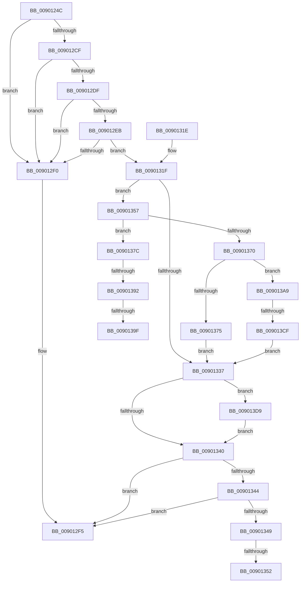

# IopConnectMessageBasedInterrupt

- RVA: `0x0090124C`–`0x009013E8` (길이 `412` bytes)
- VA: `0x000000014090124C`
- 실행 섹션: `PAGE`
- PDB 이름 있음: `예`; PDB Function 태그: `예`
- unwind 정보 RVA: `0x000885C0`
- 디코드: `115`개 명령, `412/412` bytes 표시
- 미해석 바이트: `0` (있으면 어셈블리에 `.byte`로 보존)

> 이 문서는 커널 이미지의 기계어와 PDB 기호를 분석해 생성했습니다. 4번과 5번은 함수 원형과 자료형을 바이너리 사용 방식에서 추정한 C 해석이며 원본 소스 복구 결과는 아닙니다.

## 1. Dependencies

- 직접 호출 지점: **5**; 고유 호출 대상: **5**
- 직접 호출자로 확인된 함수: **1**
- RIP 상대 이미지 참조: **1**

### Outgoing calls
- `0x009012C5` → [memset](../../text/6C/memset_function_006C6C40.md) (function, `0x006C6C40`)
- `0x009012FE` → [_security_check_cookie](../../text/6A/_security_check_cookie_function_006AC640.md) (function, `0x006AC640`)
- `0x00901327` → [IopGetInterruptConnectionData](IopGetInterruptConnectionData_function_009004E4.md) (function, `0x009004E4`)
- `0x009013BE` → [ExAllocatePool2](../../poolcode/B8/ExAllocatePool2_function_00B820F0.md) (function, `0x00B820F0`)
- `0x009013DE` → [ExFreePoolWithTag](../../poolcode/B8/ExFreePoolWithTag_function_00B82870.md) (function, `0x00B82870`)

### Direct callers
- [IoConnectInterruptEx](IoConnectInterruptEx_function_009001F0.md) at `0x00900294`

### Static image references
- `0x00901268` → RVA `0x00E0A740` (`.data`; read)

## 2. Other-region calls and transfers

- 다른 실행 섹션으로 향하는 call: **4**
  - `0x009012C5` → [memset](../../text/6C/memset_function_006C6C40.md) (`PAGE` → `.text`)
  - `0x009012FE` → [_security_check_cookie](../../text/6A/_security_check_cookie_function_006AC640.md) (`PAGE` → `.text`)
  - `0x009013BE` → [ExAllocatePool2](../../poolcode/B8/ExAllocatePool2_function_00B820F0.md) (`PAGE` → `POOLCODE`)
  - `0x009013DE` → [ExFreePoolWithTag](../../poolcode/B8/ExFreePoolWithTag_function_00B82870.md) (`PAGE` → `POOLCODE`)
- call이 아닌 외부 분기/꼬리 이동: **6**
  - `0x0090134C` → [sub_00B203FA + 0x1C5](../B2/Unknown_function_00B203FA.md) (`tail-transfer`)
  - `0x00901352` → [sub_00B203FA + 0x1DF](../B2/Unknown_function_00B203FA.md) (`tail-transfer`)
  - `0x0090138C` → [sub_00B203FA + 0x32](../B2/Unknown_function_00B203FA.md) (`tail-transfer`)
  - `0x00901399` → [sub_00B203FA](../B2/Unknown_function_00B203FA.md) (`tail-transfer`)
  - `0x009013A4` → [sub_00B203FA + 0x32](../B2/Unknown_function_00B203FA.md) (`tail-transfer`)
  - `0x009013C9` → [sub_00B203FA + 0x39](../B2/Unknown_function_00B203FA.md) (`tail-transfer`)

## 3. Assembly (complete function range)

```asm
0090124C  48 89 5C 24 08                  mov qword ptr [rsp + 8], rbx
00901251  55                              push rbp
00901252  56                              push rsi
00901253  57                              push rdi
00901254  41 54                           push r12
00901256  41 55                           push r13
00901258  41 56                           push r14
0090125A  41 57                           push r15
0090125C  48 8D 6C 24 C0                  lea rbp, [rsp - 0x40]
00901261  48 81 EC 40 01 00 00            sub rsp, 0x140
00901268  48 8B 05 D1 94 50 00            mov rax, qword ptr [rip + 0x5094d1]
0090126F  48 33 C4                        xor rax, rsp
00901272  48 89 45 30                     mov qword ptr [rbp + 0x30], rax
00901276  33 DB                           xor ebx, ebx
00901278  4C 89 45 88                     mov qword ptr [rbp - 0x78], r8
0090127C  0F 57 C0                        xorps xmm0, xmm0
0090127F  48 89 55 80                     mov qword ptr [rbp - 0x80], rdx
00901283  44 8B F9                        mov r15d, ecx
00901286  49 89 18                        mov qword ptr [r8], rbx
00901289  33 C9                           xor ecx, ecx
0090128B  4C 89 4C 24 78                  mov qword ptr [rsp + 0x78], r9
00901290  48 8B FA                        mov rdi, rdx
00901293  89 4D C0                        mov dword ptr [rbp - 0x40], ecx
00901296  44 8D 43 60                     lea r8d, [rbx + 0x60]
0090129A  48 89 5C 24 70                  mov qword ptr [rsp + 0x70], rbx
0090129F  33 D2                           xor edx, edx
009012A1  48 89 5C 24 68                  mov qword ptr [rsp + 0x68], rbx
009012A6  48 8D 4D D0                     lea rcx, [rbp - 0x30]
009012AA  88 5C 24 60                     mov byte ptr [rsp + 0x60], bl
009012AE  4D 8B E1                        mov r12, r9
009012B1  44 8B F3                        mov r14d, ebx
009012B4  0F 11 45 90                     movups xmmword ptr [rbp - 0x70], xmm0
009012B8  8B F3                           mov esi, ebx
009012BA  44 8A EB                        mov r13b, bl
009012BD  0F 11 45 A0                     movups xmmword ptr [rbp - 0x60], xmm0
009012C1  0F 11 45 B0                     movups xmmword ptr [rbp - 0x50], xmm0
009012C5  E8 76 59 DC FF                  call 0x1406c6c40
009012CA  48 85 FF                        test rdi, rdi
009012CD  74 21                           je 0x1409012f0
009012CF  48 8B 87 38 01 00 00            mov rax, qword ptr [rdi + 0x138]
009012D6  48 8B 40 28                     mov rax, qword ptr [rax + 0x28]
009012DA  48 85 C0                        test rax, rax
009012DD  74 11                           je 0x1409012f0
009012DF  F7 80 8C 01 00 00 00 00 02 00   test dword ptr [rax + 0x18c], 0x20000
009012E9  75 05                           jne 0x1409012f0
009012EB  4D 85 E4                        test r12, r12
009012EE  75 2F                           jne 0x14090131f
009012F0  BF 0D 00 00 C0                  mov edi, 0xc000000d
009012F5  8B C7                           mov eax, edi
009012F7  48 8B 4D 30                     mov rcx, qword ptr [rbp + 0x30]
009012FB  48 33 CC                        xor rcx, rsp
009012FE  E8 3D B3 DA FF                  call 0x1406ac640
00901303  48 8B 9C 24 80 01 00 00         mov rbx, qword ptr [rsp + 0x180]
0090130B  48 81 C4 40 01 00 00            add rsp, 0x140
00901312  41 5F                           pop r15
00901314  41 5E                           pop r14
00901316  41 5D                           pop r13
00901318  41 5C                           pop r12
0090131A  5F                              pop rdi
0090131B  5E                              pop rsi
0090131C  5D                              pop rbp
0090131D  C3                              ret
0090131E  CC                              int3
0090131F  48 8D 54 24 68                  lea rdx, [rsp + 0x68]
00901324  48 8B CF                        mov rcx, rdi
00901327  E8 B8 F1 FF FF                  call 0x1409004e4
0090132C  4C 8B 64 24 68                  mov r12, qword ptr [rsp + 0x68]
00901331  8B F8                           mov edi, eax
00901333  85 C0                           test eax, eax
00901335  79 20                           jns 0x140901357
00901337  4D 85 E4                        test r12, r12
0090133A  0F 85 99 00 00 00               jne 0x1409013d9
00901340  85 FF                           test edi, edi
00901342  79 B1                           jns 0x1409012f5
00901344  48 85 F6                        test rsi, rsi
00901347  74 AC                           je 0x1409012f5
00901349  39 5E 04                        cmp dword ptr [rsi + 4], ebx
0090134C  0F 87 6D F2 21 00               ja 0x140b205bf
00901352  E9 82 F2 21 00                  jmp 0x140b205d9
00901357  45 8B 0C 24                     mov r9d, dword ptr [r12]
0090135B  8B CB                           mov ecx, ebx
0090135D  44 8A 85 B0 00 00 00            mov r8b, byte ptr [rbp + 0xb0]
00901364  4C 8B 95 A8 00 00 00            mov r10, qword ptr [rbp + 0xa8]
0090136B  41 3B C9                        cmp ecx, r9d
0090136E  72 0C                           jb 0x14090137c
00901370  45 85 F6                        test r14d, r14d
00901373  75 34                           jne 0x1409013a9
00901375  BF 0D 00 00 C0                  mov edi, 0xc000000d
0090137A  EB BB                           jmp 0x140901337
0090137C  8B C1                           mov eax, ecx
0090137E  48 6B D0 58                     imul rdx, rax, 0x58
00901382  42 8B 44 22 08                  mov eax, dword ptr [rdx + r12 + 8]
00901387  FF C8                           dec eax
00901389  83 F8 02                        cmp eax, 2
0090138C  0F 87 9A F0 21 00               ja 0x140b2042c
00901392  41 FF C6                        inc r14d
00901395  41 83 FF 05                     cmp r15d, 5
00901399  0F 85 5B F0 21 00               jne 0x140b203fa
0090139F  C6 44 24 60 01                  mov byte ptr [rsp + 0x60], 1
009013A4  E9 83 F0 21 00                  jmp 0x140b2042c
009013A9  43 8D 14 76                     lea edx, [r14 + r14*2]
009013AD  B9 40 00 00 00                  mov ecx, 0x40
009013B2  C1 E2 04                        shl edx, 4
009013B5  41 B8 49 6F 69 6E               mov r8d, 0x6e696f49
009013BB  83 C2 08                        add edx, 8
009013BE  E8 2D 0D 28 00                  call 0x140b820f0
009013C3  48 8B F0                        mov rsi, rax
009013C6  48 85 C0                        test rax, rax
009013C9  0F 85 64 F0 21 00               jne 0x140b20433
009013CF  BF 9A 00 00 C0                  mov edi, 0xc000009a
009013D4  E9 5E FF FF FF                  jmp 0x140901337
009013D9  33 D2                           xor edx, edx
009013DB  49 8B CC                        mov rcx, r12
009013DE  E8 8D 14 28 00                  call 0x140b82870
009013E3  E9 58 FF FF FF                  jmp 0x140901340
```

## 4. C-style interpretation (structured pseudocode)

```c
__int64 __fastcall IopConnectMessageBasedInterrupt(int a1, __int64 a2, __int64 a3, __int64 a4, __int64 a5, __int64 a6, unsigned __int8 a7)
{
    __int64 result;
    __int64 v_r14;
    __int64 v_rbx;
    __int64 v_rsp;
    unsigned __int64 v_stack_m100;
    unsigned __int64 v_stack_m108;
    unsigned __int64 v_stack_m110;
    unsigned __int8 v_stack_m118;
    unsigned __int64 v_stack_m48;
    unsigned __int64 v_stack_m78;
    unsigned __int64 v_stack_mA8;
    unsigned int v_stack_mB8;
    unsigned __int64 v_stack_mC8;
    unsigned __int64 v_stack_mD8;
    unsigned __int64 v_stack_mE8;
    unsigned __int64 v_stack_mF0;
    unsigned __int64 v_stack_mF8;
    unsigned __int8 v_stack_p60;
    unsigned __int64 v_stack_p68;
    unsigned __int64 v_stack_p8;

    v_stack_p8 = v_rbx;
    v_rsp = (v_rsp) - (320);
    result = (*(unsigned __int64 *)(v_rip + 5280977)) ^ (v_rsp);
    v_stack_m48 = result;
    v_rbx = 0;
    v_stack_mF0 = a3;
    v_stack_mF8 = a2;
    *(unsigned __int64 *)(a3) = 0;
    a1 = 0;
    v_stack_m100 = a4;
    v_stack_mB8 = 0;
    v_stack_m108 = 0;
    a2 = 0;
    v_stack_m110 = 0;
    v_stack_m118 = 0;
    v_stack_mE8 = v_xmm0;
    v_stack_mD8 = v_xmm0;
    v_stack_mC8 = v_xmm0;
    result = memset(v_stack_mA8, a2, v_rbx + 96, a4);
    if (0 == 0) goto loc_009012F0;
    if (*(unsigned __int64 *)(*(unsigned __int64 *)(a2 + 312) + 40) == 0) goto loc_009012F0;
    if (((*(unsigned int *)(*(unsigned __int64 *)(*(unsigned __int64 *)(a2 + 312) + 40) + 396)) & (0x20000ULL)) != 0) goto loc_009012F0;
    if (a4 != 0) goto loc_0090131F;
loc_009012F0:
loc_009012F5:
    a1 = (v_stack_m48) ^ (v_rsp);
    result = _security_check_cookie(a1, a2, v_rbx + 96, a4);
    v_rsp = (v_rsp) + (320);
    return result;
loc_0090131F:
    result = IopGetInterruptConnectionData((unsigned int)(0xC000000DULL), v_stack_p68, v_rbx + 96, a4);
    if (!sign_flag) goto loc_00901357;
loc_00901337:
    if (v_stack_p68 != 0) goto loc_009013D9;
loc_00901340:
    if (!sign_flag) goto loc_009012F5;
    if (0 == 0) goto loc_009012F5;
loc_00901357:
    if (((unsigned int)((unsigned int)((unsigned int)(v_stack_p8)))) < ((unsigned int)((unsigned int)(*(unsigned int *)(v_stack_p68))))) goto loc_0090137C;
    if (0 != 0) goto loc_009013A9;
    goto loc_00901337;
loc_0090137C:
    a2 = (v_stack_p68) * ((unsigned int)((unsigned int)((unsigned int)((unsigned int)(v_stack_p8)))));
    result = (unsigned int)(((unsigned int)(*(unsigned int *)(a2 + v_stack_p68 * 1 + 8))) - 1);
    v_r14 = (unsigned int)((0) + 1);
    v_stack_p60 = 1;
loc_009013A9:
    a2 = (unsigned int)((v_r14 + v_r14 * 2) << (4));
    a2 = (unsigned int)((a2) + (8));
    result = ExAllocatePool2(64, a2, (unsigned int)(0x6E696F49ULL), (unsigned int)(*(unsigned int *)(v_stack_p68)));
    goto loc_00901337;
loc_009013D9:
    a2 = 0;
    result = ExFreePoolWithTag(v_stack_p68, a2, (unsigned int)(0x6E696F49ULL), (unsigned int)(*(unsigned int *)(v_stack_p68)));
    goto loc_00901340;
}
```

## 5. (Beta) C Style

```c
int64_t IopConnectMessageBasedInterrupt(int32_t Arg1, int64_t Arg2, void *Arg3, int64_t Arg4, uint64_t Arg5, int64_t Arg6, uint8_t Arg7)
{
    uint8_t *arg3 = (uint8_t *)Arg3;

    int64_t result;
    int64_t local_r14;
    int64_t local_rbx;
    int64_t local_rsp;
    uint64_t v_stack_m100;
    uint64_t v_stack_m108;
    uint64_t v_stack_m110;
    uint8_t v_stack_m118;
    uint64_t v_stack_m48;
    uint64_t v_stack_m78;
    uint64_t v_stack_mA8;
    uint32_t v_stack_mB8;
    uint64_t v_stack_mC8;
    uint64_t v_stack_mD8;
    uint64_t v_stack_mE8;
    uint64_t v_stack_mF0;
    uint64_t v_stack_mF8;
    uint8_t v_stack_p60;
    uint64_t v_stack_p68;
    uint64_t v_stack_p8;

    v_stack_p8 = local_rbx;
    local_rsp = (local_rsp) - (320);
    result = (*(uint64_t *)(v_rip + 0x5094D1)) ^ (local_rsp);
    v_stack_m48 = result;
    local_rbx = 0;
    v_stack_mF0 = Arg3;
    v_stack_mF8 = Arg2;
    *(uint64_t *)(arg3) = 0;
    Arg1 = 0;
    v_stack_m100 = Arg4;
    v_stack_mB8 = 0;
    v_stack_m108 = 0;
    Arg2 = 0;
    v_stack_m110 = 0;
    v_stack_m118 = 0;
    v_stack_mE8 = v_xmm0;
    v_stack_mD8 = v_xmm0;
    v_stack_mC8 = v_xmm0;
    result = memset(v_stack_mA8, Arg2, local_rbx + 96, Arg4);
    if (0 == 0) goto loc_009012F0;
    if (*(uint64_t *)(*(uint64_t *)(Arg2 + 0x138) + 0x28) == 0) goto loc_009012F0;
    if (((*(uint32_t *)(*(uint64_t *)(*(uint64_t *)(Arg2 + 0x138) + 0x28) + 0x18C)) & (0x20000ULL)) != 0) goto loc_009012F0;
    if (Arg4 != 0) goto loc_0090131F;
loc_009012F0:
loc_009012F5:
    Arg1 = (v_stack_m48) ^ (local_rsp);
    result = _security_check_cookie(Arg1, Arg2, local_rbx + 96, Arg4);
    local_rsp = (local_rsp) + (320);
    return result;
loc_0090131F:
    result = IopGetInterruptConnectionData((uint32_t)(0xC000000DULL), v_stack_p68, local_rbx + 96, Arg4);
    if (!sign_flag) goto loc_00901357;
loc_00901337:
    if (v_stack_p68 != 0) goto loc_009013D9;
loc_00901340:
    if (!sign_flag) goto loc_009012F5;
    if (0 == 0) goto loc_009012F5;
loc_00901357:
    if (((uint32_t)((uint32_t)((uint32_t)(v_stack_p8)))) < ((uint32_t)((uint32_t)(*(uint32_t *)(v_stack_p68))))) goto loc_0090137C;
    if (0 != 0) goto loc_009013A9;
    goto loc_00901337;
loc_0090137C:
    Arg2 = (v_stack_p68) * ((uint32_t)((uint32_t)((uint32_t)((uint32_t)(v_stack_p8)))));
    result = (uint32_t)(((uint32_t)(*(uint32_t *)(Arg2 + v_stack_p68 * 1 + 0x8))) - 1);
    local_r14 = (uint32_t)((0) + 1);
    v_stack_p60 = 1;
loc_009013A9:
    Arg2 = (uint32_t)((local_r14 + local_r14 * 2) << (4));
    Arg2 = (uint32_t)((Arg2) + (8));
    result = ExAllocatePool2(64, Arg2, (uint32_t)(0x6E696F49ULL), (uint32_t)(*(uint32_t *)(v_stack_p68)));
    goto loc_00901337;
loc_009013D9:
    Arg2 = 0;
    result = ExFreePoolWithTag(v_stack_p68, Arg2, (uint32_t)(0x6E696F49ULL), (uint32_t)(*(uint32_t *)(v_stack_p68)));
    goto loc_00901340;
}
```

### 관측된 메모리 오프셋

구조체 형식이 확인되지 않은 접근은 인자 기준의 오프셋으로만 기록했습니다.

| 기준 인자 | 오프셋 표현 | 폭 (bit) | 접근 |
|---|---:|---:|---|
| `Arg3` | `+ 0x0` | `64` | `W` |

## 6. Execution-region graph

[열기: 2D/3D 그래프와 함수 탐색 컨트롤 패널](../../../control-panel.html?section=page&rva=0x0090124C&view=graph)

- 2D 그래프는 위에서 아래로 흐르고, 3D 그래프는 빈 공간을 드래그해 회전합니다. Shift+드래그는 이동, 휠은 확대·축소, 함수 노드 선택은 대상 보고서 이동입니다.

### Static fallback


