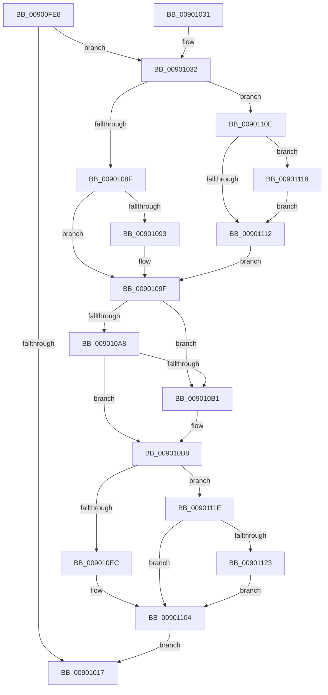

# IopDestroyActiveConnectBlock

- RVA: `0x00900FE8`–`0x00901132` (길이 `330` bytes)
- VA: `0x0000000140900FE8`
- 실행 섹션: `PAGE`
- PDB 이름 있음: `예`; PDB Function 태그: `아니요`
- unwind 정보 RVA: `0x0008858C`
- 디코드: `94`개 명령, `330/330` bytes 표시
- 미해석 바이트: `0` (있으면 어셈블리에 `.byte`로 보존)

> 이 문서는 커널 이미지의 기계어와 PDB 기호를 분석해 생성했습니다. 4번과 5번은 함수 원형과 자료형을 바이너리 사용 방식에서 추정한 C 해석이며 원본 소스 복구 결과는 아닙니다.

## 1. Dependencies

- 직접 호출 지점: **7**; 고유 호출 대상: **4**
- 직접 호출자로 확인된 함수: **2**
- RIP 상대 이미지 참조: **1**

### Outgoing calls
- `0x00901046` → [KeInitializeEvent](../../text/40/KeInitializeEvent_function_0040DD10.md) (function, `0x0040DD10`)
- `0x0090107A` → [KeWaitForSingleObject](../../text/20/KeWaitForSingleObject_function_0020E6B0.md) (function, `0x0020E6B0`)
- `0x009010CB` → [KeSetEvent](../../text/33/KeSetEvent_function_0033F310.md) (function, `0x0033F310`)
- `0x009010D0` → [KeLeaveCriticalRegion](../../text/25/KeLeaveCriticalRegion_function_0025D8B0.md) (function, `0x0025D8B0`)
- `0x009010FF` → [KeWaitForSingleObject](../../text/20/KeWaitForSingleObject_function_0020E6B0.md) (function, `0x0020E6B0`)
- `0x00901104` → [KeLeaveCriticalRegion](../../text/25/KeLeaveCriticalRegion_function_0025D8B0.md) (function, `0x0025D8B0`)
- `0x0090112B` → [KeSetEvent](../../text/33/KeSetEvent_function_0033F310.md) (function, `0x0033F310`)

### Direct callers
- [IoDisconnectInterrupt](IoDisconnectInterrupt_function_00900890.md) at `0x009009F1`
- [IopConnectInterrupt](IopConnectInterrupt_function_00900B40.md) at `0x00900D71`

### Static image references
- `0x00901054` → RVA `0x00F8CCA0` (`.data`; read)

## 2. Other-region calls and transfers

- 다른 실행 섹션으로 향하는 call: **7**
  - `0x00901046` → [KeInitializeEvent](../../text/40/KeInitializeEvent_function_0040DD10.md) (`PAGE` → `.text`)
  - `0x0090107A` → [KeWaitForSingleObject](../../text/20/KeWaitForSingleObject_function_0020E6B0.md) (`PAGE` → `.text`)
  - `0x009010CB` → [KeSetEvent](../../text/33/KeSetEvent_function_0033F310.md) (`PAGE` → `.text`)
  - `0x009010D0` → [KeLeaveCriticalRegion](../../text/25/KeLeaveCriticalRegion_function_0025D8B0.md) (`PAGE` → `.text`)
  - `0x009010FF` → [KeWaitForSingleObject](../../text/20/KeWaitForSingleObject_function_0020E6B0.md) (`PAGE` → `.text`)
  - `0x00901104` → [KeLeaveCriticalRegion](../../text/25/KeLeaveCriticalRegion_function_0025D8B0.md) (`PAGE` → `.text`)
  - `0x0090112B` → [KeSetEvent](../../text/33/KeSetEvent_function_0033F310.md) (`PAGE` → `.text`)
- 별도 외부 분기/꼬리 이동을 확인하지 못했습니다.

## 3. Assembly (complete function range)

```asm
00900FE8  4C 8B DC                        mov r11, rsp
00900FEB  49 89 5B 08                     mov qword ptr [r11 + 8], rbx
00900FEF  49 89 6B 10                     mov qword ptr [r11 + 0x10], rbp
00900FF3  49 89 73 18                     mov qword ptr [r11 + 0x18], rsi
00900FF7  57                              push rdi
00900FF8  41 54                           push r12
00900FFA  41 56                           push r14
00900FFC  48 83 EC 50                     sub rsp, 0x50
00901000  33 C0                           xor eax, eax
00901002  0F 57 C0                        xorps xmm0, xmm0
00901005  48 8B D9                        mov rbx, rcx
00901008  0F 11 44 24 30                  movups xmmword ptr [rsp + 0x30], xmm0
0090100D  49 89 43 D8                     mov qword ptr [r11 - 0x28], rax
00901011  48 39 41 18                     cmp qword ptr [rcx + 0x18], rax
00901015  75 1B                           jne 0x140901032
00901017  4C 8D 5C 24 50                  lea r11, [rsp + 0x50]
0090101C  49 8B 5B 20                     mov rbx, qword ptr [r11 + 0x20]
00901020  49 8B 6B 28                     mov rbp, qword ptr [r11 + 0x28]
00901024  49 8B 73 30                     mov rsi, qword ptr [r11 + 0x30]
00901028  49 8B E3                        mov rsp, r11
0090102B  41 5E                           pop r14
0090102D  41 5C                           pop r12
0090102F  5F                              pop rdi
00901030  C3                              ret
00901031  CC                              int3
00901032  48 8B 69 20                     mov rbp, qword ptr [rcx + 0x20]
00901036  48 8D 71 40                     lea rsi, [rcx + 0x40]
0090103A  45 33 C0                        xor r8d, r8d
0090103D  48 8D 4C 24 30                  lea rcx, [rsp + 0x30]
00901042  41 8D 50 01                     lea edx, [r8 + 1]
00901046  E8 C5 CC B0 FF                  call 0x14040dd10
0090104B  65 48 8B 04 25 88 01 00 00      mov rax, qword ptr gs:[0x188]
00901054  48 8D 0D 45 BC 68 00            lea rcx, [rip + 0x68bc45]
0090105B  33 FF                           xor edi, edi
0090105D  41 83 CC FF                     or r12d, 0xffffffff
00901061  48 21 7C 24 20                  and qword ptr [rsp + 0x20], rdi
00901066  45 32 F6                        xor r14b, r14b
00901069  45 33 C9                        xor r9d, r9d
0090106C  45 33 C0                        xor r8d, r8d
0090106F  66 44 01 A0 E4 01 00 00         add word ptr [rax + 0x1e4], r12w
00901077  33 D2                           xor edx, edx
00901079  90                              nop
0090107A  E8 31 D6 90 FF                  call 0x14020e6b0
0090107F  41 8B C4                        mov eax, r12d
00901082  F0 0F C1 45 00                  lock xadd dword ptr [rbp], eax
00901087  41 03 C4                        add eax, r12d
0090108A  48 3B EE                        cmp rbp, rsi
0090108D  75 7F                           jne 0x14090110e
0090108F  85 C0                           test eax, eax
00901091  74 0C                           je 0x14090109f
00901093  48 8D 44 24 30                  lea rax, [rsp + 0x30]
00901098  41 B6 01                        mov r14b, 1
0090109B  48 89 43 48                     mov qword ptr [rbx + 0x48], rax
0090109F  48 8B 13                        mov rdx, qword ptr [rbx]
009010A2  48 39 5A 08                     cmp qword ptr [rdx + 8], rbx
009010A6  75 09                           jne 0x1409010b1
009010A8  48 8B 43 08                     mov rax, qword ptr [rbx + 8]
009010AC  48 39 18                        cmp qword ptr [rax], rbx
009010AF  74 07                           je 0x1409010b8
009010B1  B9 03 00 00 00                  mov ecx, 3
009010B6  CD 29                           int 0x29
009010B8  48 89 10                        mov qword ptr [rax], rdx
009010BB  48 8D 0D DE BB 68 00            lea rcx, [rip + 0x68bbde]
009010C2  48 89 42 08                     mov qword ptr [rdx + 8], rax
009010C6  45 33 C0                        xor r8d, r8d
009010C9  33 D2                           xor edx, edx
009010CB  E8 40 E2 A3 FF                  call 0x14033f310
009010D0  E8 DB C7 95 FF                  call 0x14025d8b0
009010D5  65 48 8B 04 25 88 01 00 00      mov rax, qword ptr gs:[0x188]
009010DE  66 44 01 A0 E4 01 00 00         add word ptr [rax + 0x1e4], r12w
009010E6  90                              nop
009010E7  45 84 F6                        test r14b, r14b
009010EA  74 32                           je 0x14090111e
009010EC  48 83 64 24 20 00               and qword ptr [rsp + 0x20], 0
009010F2  48 8D 4C 24 30                  lea rcx, [rsp + 0x30]
009010F7  45 33 C9                        xor r9d, r9d
009010FA  45 33 C0                        xor r8d, r8d
009010FD  33 D2                           xor edx, edx
009010FF  E8 AC D5 90 FF                  call 0x14020e6b0
00901104  E8 A7 C7 95 FF                  call 0x14025d8b0
00901109  E9 09 FF FF FF                  jmp 0x140901017
0090110E  85 C0                           test eax, eax
00901110  74 06                           je 0x140901118
00901112  F0 44 01 26                     lock add dword ptr [rsi], r12d
00901116  EB 87                           jmp 0x14090109f
00901118  48 8B 7D 08                     mov rdi, qword ptr [rbp + 8]
0090111C  EB F4                           jmp 0x140901112
0090111E  48 85 FF                        test rdi, rdi
00901121  74 E1                           je 0x140901104
00901123  45 33 C0                        xor r8d, r8d
00901126  33 D2                           xor edx, edx
00901128  48 8B CF                        mov rcx, rdi
0090112B  E8 E0 E1 A3 FF                  call 0x14033f310
00901130  EB D2                           jmp 0x140901104
```

## 4. C-style interpretation (structured pseudocode)

```c
__int64 __fastcall IopDestroyActiveConnectBlock(__int64 a1, __int64 a2, int a3, int a4)
{
    __int64 result;
    __int64 v_r12;
    __int64 v_r14;
    __int64 v_rdi;
    __int64 v_rsp;
    unsigned __int64 v_stack_m18;
    unsigned __int64 v_stack_m20;
    unsigned __int64 v_stack_m30;
    unsigned __int64 v_stack_m38;

    *(unsigned __int64 *)(v_rsp + 8) = v_rbx;
    *(unsigned __int64 *)(v_rsp + 16) = v_rbp;
    *(unsigned __int64 *)(v_rsp + 24) = v_rsi;
    v_rsp = (v_rsp) - (80);
    result = 0;
    v_stack_m38 = v_xmm0;
    *(unsigned __int64 *)(v_rsp - 40) = 0;
    if ((*(unsigned __int64 *)(a1 + 24)) != 0) goto loc_00901032;
loc_00901017:
    return result;
loc_00901032:
    a3 = 0;
    result = KeInitializeEvent(v_stack_m20, a3 + 1, a3, a4);
    v_rdi = 0;
    v_r12 = (unsigned int)((v_r12) | (0xFFFFFFFFULL));
    v_r14 = 0;
    a4 = 0;
    a3 = 0;
    a2 = 0;
    result = KeWaitForSingleObject(v_rip + 6863941, a2, a3, a4);
    result = (unsigned int)(((unsigned int)((unsigned int)(v_r12))) + ((unsigned int)(v_r12)));
    if ((*(unsigned __int64 *)(a1 + 32)) != (a1 + 64)) goto loc_0090110E;
    if ((unsigned int)(result) != 0) {
        result = v_stack_m20;
        v_r14 = 1;
        *(unsigned __int64 *)(*(unsigned __int64 *)(v_stack_m18 + 32) + 72) = result;
    }
    if ((*(unsigned __int64 *)(*(unsigned __int64 *)(*(unsigned __int64 *)(v_stack_m18 + 32)) + 8)) != (*(unsigned __int64 *)(v_stack_m18 + 32))) goto loc_009010B1;
    if ((*(unsigned __int64 *)(*(unsigned __int64 *)(*(unsigned __int64 *)(v_stack_m18 + 32) + 8))) != (*(unsigned __int64 *)(v_stack_m18 + 32))) {
        a1 = 3;
    }
    *(unsigned __int64 *)(*(unsigned __int64 *)(*(unsigned __int64 *)(v_stack_m18 + 32) + 8)) = *(unsigned __int64 *)(*(unsigned __int64 *)(v_stack_m18 + 32));
    *(unsigned __int64 *)(*(unsigned __int64 *)(*(unsigned __int64 *)(v_stack_m18 + 32)) + 8) = *(unsigned __int64 *)(*(unsigned __int64 *)(v_stack_m18 + 32) + 8);
    a3 = 0;
    a2 = 0;
    result = KeSetEvent(v_rip + 6863838, a2, a3, a4);
    result = KeLeaveCriticalRegion(v_rip + 6863838, a2, a3, a4);
    if ((unsigned __int8)(v_r14) == 0) goto loc_0090111E;
    a4 = 0;
    a3 = 0;
    a2 = 0;
    result = KeWaitForSingleObject(v_stack_m20, a2, a3, a4);
loc_00901104:
    result = KeLeaveCriticalRegion(v_stack_m20, a2, a3, a4);
    goto loc_00901017;
loc_0090110E:
    if ((unsigned int)(result) == 0) goto loc_00901118;
loc_00901112:
    goto loc_0090109F;
loc_00901118:
    goto loc_00901112;
loc_0090111E:
    if (*(unsigned __int64 *)(*(unsigned __int64 *)(a1 + 32) + 8) == 0) goto loc_00901104;
    a3 = 0;
    a2 = 0;
    result = KeSetEvent(*(unsigned __int64 *)(*(unsigned __int64 *)(a1 + 32) + 8), a2, a3, a4);
    goto loc_00901104;
}
```

## 5. (Beta) C Style

```c
int64_t IopDestroyActiveConnectBlock(void *Arg1, int64_t Arg2, int32_t Arg3, int32_t Arg4)
{
    uint8_t *arg1 = (uint8_t *)Arg1;

    int64_t result;
    int64_t local_r12;
    int64_t local_r14;
    int64_t local_rdi;
    int64_t local_rsp;
    uint64_t v_stack_m18;
    uint64_t v_stack_m20;
    uint64_t v_stack_m30;
    uint64_t v_stack_m38;

    *(uint64_t *)(local_rsp + 0x8) = local_rbx;
    *(uint64_t *)(local_rsp + 0x10) = local_rbp;
    *(uint64_t *)(local_rsp + 0x18) = local_rsi;
    local_rsp = (local_rsp) - (80);
    result = 0;
    v_stack_m38 = v_xmm0;
    *(uint64_t *)(local_rsp - 0x28) = 0;
    if ((*(uint64_t *)(arg1 + 0x18)) != 0) goto loc_00901032;
loc_00901017:
    return result;
loc_00901032:
    Arg3 = 0;
    result = KeInitializeEvent(v_stack_m20, Arg3 + 1, Arg3, Arg4);
    local_rdi = 0;
    local_r12 = (uint32_t)((local_r12) | (0xFFFFFFFFULL));
    local_r14 = 0;
    Arg4 = 0;
    Arg3 = 0;
    Arg2 = 0;
    result = KeWaitForSingleObject(v_rip + 6863941, Arg2, Arg3, Arg4);
    result = (uint32_t)(((uint32_t)((uint32_t)(local_r12))) + ((uint32_t)(local_r12)));
    if ((*(uint64_t *)(arg1 + 0x20)) != (Arg1 + 64)) goto loc_0090110E;
    if ((uint32_t)(result) != 0) {
        result = v_stack_m20;
        local_r14 = 1;
        *(uint64_t *)(*(uint64_t *)(v_stack_m18 + 0x20) + 0x48) = result;
    }
    if ((*(uint64_t *)(*(uint64_t *)(*(uint64_t *)(v_stack_m18 + 0x20)) + 0x8)) != (*(uint64_t *)(v_stack_m18 + 0x20))) goto loc_009010B1;
    if ((*(uint64_t *)(*(uint64_t *)(*(uint64_t *)(v_stack_m18 + 0x20) + 0x8))) != (*(uint64_t *)(v_stack_m18 + 0x20))) {
        Arg1 = 3;
    }
    *(uint64_t *)(*(uint64_t *)(*(uint64_t *)(v_stack_m18 + 0x20) + 0x8)) = *(uint64_t *)(*(uint64_t *)(v_stack_m18 + 0x20));
    *(uint64_t *)(*(uint64_t *)(*(uint64_t *)(v_stack_m18 + 0x20)) + 0x8) = *(uint64_t *)(*(uint64_t *)(v_stack_m18 + 0x20) + 0x8);
    Arg3 = 0;
    Arg2 = 0;
    result = KeSetEvent(v_rip + 6863838, Arg2, Arg3, Arg4);
    result = KeLeaveCriticalRegion(v_rip + 6863838, Arg2, Arg3, Arg4);
    if ((uint8_t)(local_r14) == 0) goto loc_0090111E;
    Arg4 = 0;
    Arg3 = 0;
    Arg2 = 0;
    result = KeWaitForSingleObject(v_stack_m20, Arg2, Arg3, Arg4);
loc_00901104:
    result = KeLeaveCriticalRegion(v_stack_m20, Arg2, Arg3, Arg4);
    goto loc_00901017;
loc_0090110E:
    if ((uint32_t)(result) == 0) goto loc_00901118;
loc_00901112:
    goto loc_0090109F;
loc_00901118:
    goto loc_00901112;
loc_0090111E:
    if (*(uint64_t *)(*(uint64_t *)(arg1 + 0x20) + 0x8) == 0) goto loc_00901104;
    Arg3 = 0;
    Arg2 = 0;
    result = KeSetEvent(*(uint64_t *)(*(uint64_t *)(arg1 + 0x20) + 0x8), Arg2, Arg3, Arg4);
    goto loc_00901104;
}
```

### 관측된 메모리 오프셋

구조체 형식이 확인되지 않은 접근은 인자 기준의 오프셋으로만 기록했습니다.

| 기준 인자 | 오프셋 표현 | 폭 (bit) | 접근 |
|---|---:|---:|---|
| `Arg1` | `+ 0x0` | `32` | `R/W` |
| `Arg1` | `+ 0x0` | `64` | `R` |
| `Arg1` | `+ 0x8` | `64` | `R` |
| `Arg1` | `+ 0x18` | `64` | `R` |
| `Arg1` | `+ 0x20` | `64` | `R` |
| `Arg1` | `+ 0x40` | `64` | `R` |
| `Arg1` | `+ 0x48` | `64` | `W` |

## 6. Execution-region graph

[열기: 2D/3D 그래프와 함수 탐색 컨트롤 패널](../../../control-panel.html?section=page&rva=0x00900FE8&view=graph)

- 2D 그래프는 위에서 아래로 흐르고, 3D 그래프는 빈 공간을 드래그해 회전합니다. Shift+드래그는 이동, 휠은 확대·축소, 함수 노드 선택은 대상 보고서 이동입니다.

### Static fallback


