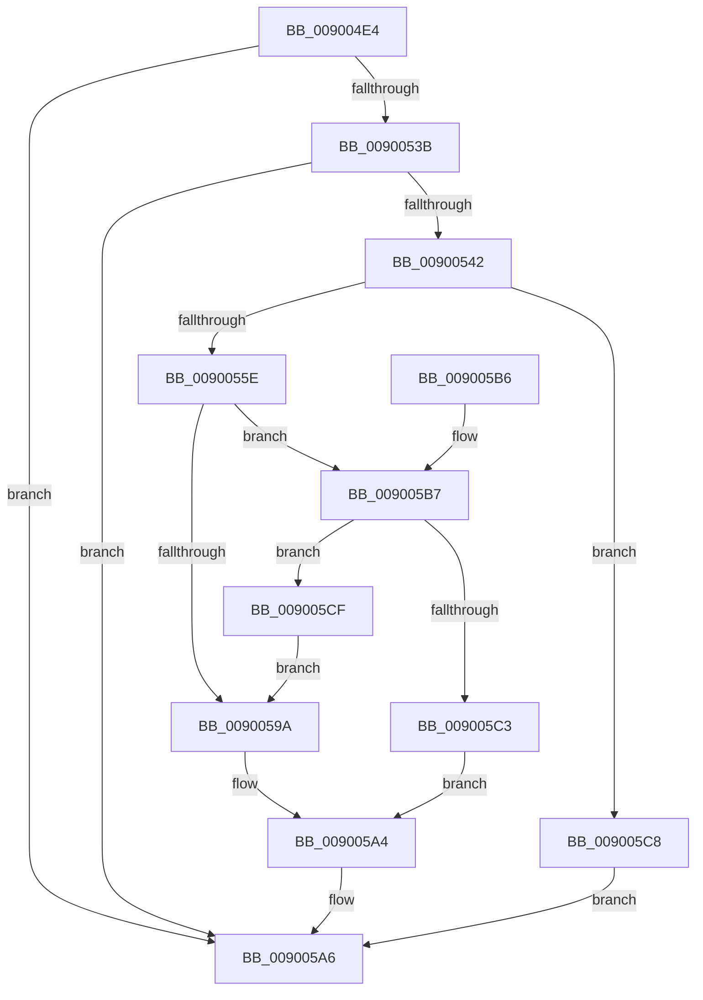

# IopGetInterruptConnectionData

- RVA: `0x009004E4`–`0x009005D6` (길이 `242` bytes)
- VA: `0x00000001409004E4`
- 실행 섹션: `PAGE`
- PDB 이름 있음: `예`; PDB Function 태그: `아니요`
- unwind 정보 RVA: `0x000884BC`
- 디코드: `66`개 명령, `242/242` bytes 표시
- 미해석 바이트: `0` (있으면 어셈블리에 `.byte`로 보존)

> 이 문서는 커널 이미지의 기계어와 PDB 기호를 분석해 생성했습니다. 4번과 5번은 함수 원형과 자료형을 바이너리 사용 방식에서 추정한 C 해석이며 원본 소스 복구 결과는 아닙니다.

## 1. Dependencies

- 직접 호출 지점: **4**; 고유 호출 대상: **3**
- 직접 호출자로 확인된 함수: **3**
- RIP 상대 이미지 참조: **1**

### Outgoing calls
- `0x0090052F` → [IoGetDevicePropertyData](IoGetDevicePropertyData_function_009005E0.md) (function, `0x009005E0`)
- `0x00900551` → [ExAllocatePool2](../../poolcode/B8/ExAllocatePool2_function_00B820F0.md) (function, `0x00B820F0`)
- `0x0090058F` → [IoGetDevicePropertyData](IoGetDevicePropertyData_function_009005E0.md) (function, `0x009005E0`)
- `0x0090059F` → [ExFreePoolWithTag](../../poolcode/B8/ExFreePoolWithTag_function_00B82870.md) (function, `0x00B82870`)

### Direct callers
- [IopConnectLineBasedInterrupt](../8F/IopConnectLineBasedInterrupt_function_008FFE64.md) at `0x00900092`
- [IoConnectInterruptEx](IoConnectInterruptEx_function_009001F0.md) at `0x00900307`
- [IopConnectMessageBasedInterrupt](IopConnectMessageBasedInterrupt_function_0090124C.md) at `0x00901327`

### Static image references
- `0x00900509` → RVA `0x00011710` (`.rdata`; read)

## 2. Other-region calls and transfers

- 다른 실행 섹션으로 향하는 call: **2**
  - `0x00900551` → [ExAllocatePool2](../../poolcode/B8/ExAllocatePool2_function_00B820F0.md) (`PAGE` → `POOLCODE`)
  - `0x0090059F` → [ExFreePoolWithTag](../../poolcode/B8/ExFreePoolWithTag_function_00B82870.md) (`PAGE` → `POOLCODE`)
- 별도 외부 분기/꼬리 이동을 확인하지 못했습니다.

## 3. Assembly (complete function range)

```asm
009004E4  4C 8B DC                        mov r11, rsp
009004E7  49 89 5B 08                     mov qword ptr [r11 + 8], rbx
009004EB  49 89 73 20                     mov qword ptr [r11 + 0x20], rsi
009004EF  57                              push rdi
009004F0  48 83 EC 40                     sub rsp, 0x40
009004F4  48 83 22 00                     and qword ptr [rdx], 0
009004F8  49 8D 43 18                     lea rax, [r11 + 0x18]
009004FC  83 64 24 58 00                  and dword ptr [rsp + 0x58], 0
00900501  48 8B F2                        mov rsi, rdx
00900504  83 64 24 60 00                  and dword ptr [rsp + 0x60], 0
00900509  48 8D 15 00 12 71 FF            lea rdx, [rip - 0x8eee00]
00900510  49 89 43 F0                     mov qword ptr [r11 - 0x10], rax
00900514  45 33 C9                        xor r9d, r9d
00900517  49 8D 43 10                     lea rax, [r11 + 0x10]
0090051B  45 33 C0                        xor r8d, r8d
0090051E  49 89 43 E8                     mov qword ptr [r11 - 0x18], rax
00900522  48 8B F9                        mov rdi, rcx
00900525  49 83 63 E0 00                  and qword ptr [r11 - 0x20], 0
0090052A  83 64 24 20 00                  and dword ptr [rsp + 0x20], 0
0090052F  E8 AC 00 00 00                  call 0x1409005e0
00900534  3D 23 00 00 C0                  cmp eax, 0xc0000023
00900539  75 6B                           jne 0x1409005a6
0090053B  83 7C 24 58 60                  cmp dword ptr [rsp + 0x58], 0x60
00900540  72 64                           jb 0x1409005a6
00900542  8B 54 24 58                     mov edx, dword ptr [rsp + 0x58]
00900546  B9 40 00 00 00                  mov ecx, 0x40
0090054B  41 B8 50 70 69 6F               mov r8d, 0x6f697050
00900551  E8 9A 1B 28 00                  call 0x140b820f0
00900556  48 8B D8                        mov rbx, rax
00900559  48 85 C0                        test rax, rax
0090055C  74 6A                           je 0x1409005c8
0090055E  48 8D 44 24 60                  lea rax, [rsp + 0x60]
00900563  45 33 C9                        xor r9d, r9d
00900566  48 89 44 24 38                  mov qword ptr [rsp + 0x38], rax
0090056B  48 8D 15 9E 11 71 FF            lea rdx, [rip - 0x8eee62]
00900572  48 8D 44 24 58                  lea rax, [rsp + 0x58]
00900577  45 33 C0                        xor r8d, r8d
0090057A  48 89 44 24 30                  mov qword ptr [rsp + 0x30], rax
0090057F  48 8B CF                        mov rcx, rdi
00900582  8B 44 24 58                     mov eax, dword ptr [rsp + 0x58]
00900586  48 89 5C 24 28                  mov qword ptr [rsp + 0x28], rbx
0090058B  89 44 24 20                     mov dword ptr [rsp + 0x20], eax
0090058F  E8 4C 00 00 00                  call 0x1409005e0
00900594  8B F8                           mov edi, eax
00900596  85 C0                           test eax, eax
00900598  79 1D                           jns 0x1409005b7
0090059A  33 D2                           xor edx, edx
0090059C  48 8B CB                        mov rcx, rbx
0090059F  E8 CC 22 28 00                  call 0x140b82870
009005A4  8B C7                           mov eax, edi
009005A6  48 8B 5C 24 50                  mov rbx, qword ptr [rsp + 0x50]
009005AB  48 8B 74 24 68                  mov rsi, qword ptr [rsp + 0x68]
009005B0  48 83 C4 40                     add rsp, 0x40
009005B4  5F                              pop rdi
009005B5  C3                              ret
009005B6  CC                              int3
009005B7  6B 0B 58                        imul ecx, dword ptr [rbx], 0x58
009005BA  83 C1 08                        add ecx, 8
009005BD  39 4C 24 58                     cmp dword ptr [rsp + 0x58], ecx
009005C1  72 0C                           jb 0x1409005cf
009005C3  48 89 1E                        mov qword ptr [rsi], rbx
009005C6  EB DC                           jmp 0x1409005a4
009005C8  B8 9A 00 00 C0                  mov eax, 0xc000009a
009005CD  EB D7                           jmp 0x1409005a6
009005CF  BF 3E 00 00 C0                  mov edi, 0xc000003e
009005D4  EB C4                           jmp 0x14090059a
```

## 4. C-style interpretation (structured pseudocode)

```c
__int64 __fastcall IopGetInterruptConnectionData(__int64 a1, __int64 a2, int a3, int a4)
{
    __int64 result;
    __int64 v_rsp;
    unsigned __int64 v_stack_m10;
    unsigned __int64 v_stack_m18;
    unsigned __int64 v_stack_m20;
    unsigned int v_stack_m28;
    unsigned int v_stack_p10;
    unsigned int v_stack_p18;
    unsigned __int64 v_stack_p20;
    unsigned int v_stack_p58;
    unsigned __int64 v_stack_p8;

    *(unsigned __int64 *)(v_rsp + 8) = v_rbx;
    *(unsigned __int64 *)(v_rsp + 32) = v_rsi;
    v_rsp = (v_rsp) - (64);
    *(unsigned __int64 *)(v_rsp - 16) = v_rsp + 24;
    a4 = 0;
    a3 = 0;
    *(unsigned __int64 *)(v_rsp - 24) = v_rsp + 16;
    result = IoGetDevicePropertyData(a1, v_rip - 9367040, a3, a4);
    if (((unsigned int)(result)) != 0xC0000023ULL) goto loc_009005A6;
    if (v_stack_p10 < 96) goto loc_009005A6;
    result = ExAllocatePool2(64, (unsigned int)(v_stack_p10), (unsigned int)(0x6F697050ULL), a4);
    if (result == 0) goto loc_009005C8;
    a4 = 0;
    v_stack_m10 = v_stack_p18;
    a3 = 0;
    v_stack_m18 = v_stack_p10;
    v_stack_m20 = result;
    v_stack_m28 = (unsigned int)((unsigned int)(v_stack_p10));
    result = IoGetDevicePropertyData(a1, v_rip - 9367138, a3, a4);
    if (!sign_flag) goto loc_009005B7;
loc_0090059A:
    a2 = 0;
    result = ExFreePoolWithTag(result, a2, a3, a4);
loc_009005A4:
loc_009005A6:
    v_rsp = (v_rsp) + (64);
    return (unsigned int)((unsigned int)((unsigned int)((unsigned int)(result))));
loc_009005B7:
    a1 = (unsigned int)((result) * (*(unsigned int *)(v_stack_p8)));
    a1 = (unsigned int)((a1) + (8));
    if (v_stack_p58 < ((unsigned int)(a1))) goto loc_009005CF;
    *(unsigned __int64 *)(v_stack_p20) = v_stack_p8;
    goto loc_009005A4;
loc_009005C8:
    goto loc_009005A6;
loc_009005CF:
    goto loc_0090059A;
}
```

## 5. (Beta) C Style

```c
int64_t IopGetInterruptConnectionData(int64_t Arg1, void *Arg2, int32_t Arg3, int32_t Arg4)
{
    uint8_t *arg2 = (uint8_t *)Arg2;

    int64_t result;
    int64_t local_rsp;
    uint64_t v_stack_m10;
    uint64_t v_stack_m18;
    uint64_t v_stack_m20;
    uint32_t v_stack_m28;
    uint32_t v_stack_p10;
    uint32_t v_stack_p18;
    uint64_t v_stack_p20;
    uint32_t v_stack_p58;
    uint64_t v_stack_p8;

    *(uint64_t *)(local_rsp + 0x8) = local_rbx;
    *(uint64_t *)(local_rsp + 0x20) = local_rsi;
    local_rsp = (local_rsp) - (64);
    *(uint64_t *)(local_rsp - 0x10) = local_rsp + 24;
    Arg4 = 0;
    Arg3 = 0;
    *(uint64_t *)(local_rsp - 0x18) = local_rsp + 16;
    result = IoGetDevicePropertyData(Arg1, v_rip - 9367040, Arg3, Arg4);
    if (((uint32_t)(result)) != 0xC0000023ULL) goto loc_009005A6;
    if (v_stack_p10 < 96) goto loc_009005A6;
    result = ExAllocatePool2(64, (uint32_t)(v_stack_p10), (uint32_t)(0x6F697050ULL), Arg4);
    if (result == 0) goto loc_009005C8;
    Arg4 = 0;
    v_stack_m10 = v_stack_p18;
    Arg3 = 0;
    v_stack_m18 = v_stack_p10;
    v_stack_m20 = result;
    v_stack_m28 = (uint32_t)((uint32_t)(v_stack_p10));
    result = IoGetDevicePropertyData(Arg1, v_rip - 9367138, Arg3, Arg4);
    if (!sign_flag) goto loc_009005B7;
loc_0090059A:
    Arg2 = 0;
    result = ExFreePoolWithTag(result, Arg2, Arg3, Arg4);
loc_009005A4:
loc_009005A6:
    local_rsp = (local_rsp) + (64);
    return (uint32_t)((uint32_t)((uint32_t)((uint32_t)(result))));
loc_009005B7:
    Arg1 = (uint32_t)((result) * (*(uint32_t *)(v_stack_p8)));
    Arg1 = (uint32_t)((Arg1) + (8));
    if (v_stack_p58 < ((uint32_t)(Arg1))) goto loc_009005CF;
    *(uint64_t *)(v_stack_p20) = v_stack_p8;
    goto loc_009005A4;
loc_009005C8:
    goto loc_009005A6;
loc_009005CF:
    goto loc_0090059A;
}
```

### 관측된 메모리 오프셋

구조체 형식이 확인되지 않은 접근은 인자 기준의 오프셋으로만 기록했습니다.

| 기준 인자 | 오프셋 표현 | 폭 (bit) | 접근 |
|---|---:|---:|---|
| `Arg2` | `+ 0x0` | `64` | `R/W` |
| `Arg2` | `+ 0x0` | `64` | `W` |

## 6. Execution-region graph

[열기: 2D/3D 그래프와 함수 탐색 컨트롤 패널](../../../control-panel.html?section=page&rva=0x009004E4&view=graph)

- 2D 그래프는 위에서 아래로 흐르고, 3D 그래프는 빈 공간을 드래그해 회전합니다. Shift+드래그는 이동, 휠은 확대·축소, 함수 노드 선택은 대상 보고서 이동입니다.

### Static fallback


