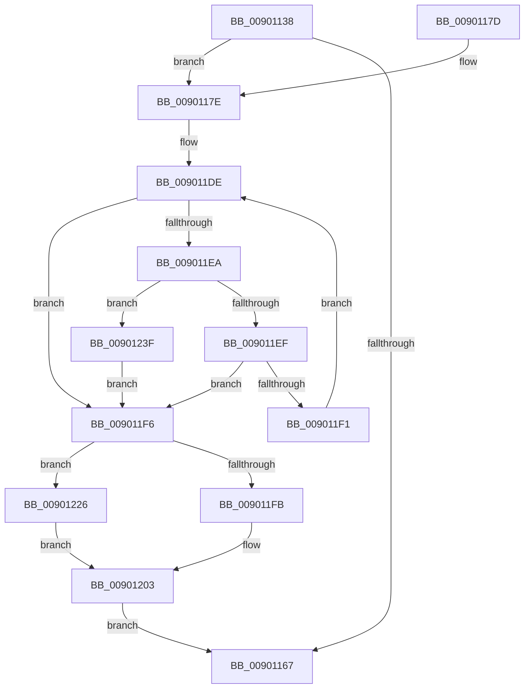

# IopInitializeActiveConnectBlock

- RVA: `0x00901138`–`0x00901244` (길이 `268` bytes)
- VA: `0x0000000140901138`
- 실행 섹션: `PAGE`
- PDB 이름 있음: `예`; PDB Function 태그: `아니요`
- unwind 정보 RVA: `0x000885A8`
- 디코드: `71`개 명령, `268/268` bytes 표시
- 미해석 바이트: `0` (있으면 어셈블리에 `.byte`로 보존)

> 이 문서는 커널 이미지의 기계어와 PDB 기호를 분석해 생성했습니다. 4번과 5번은 함수 원형과 자료형을 바이너리 사용 방식에서 추정한 C 해석이며 원본 소스 복구 결과는 아닙니다.

## 1. Dependencies

- 직접 호출 지점: **6**; 고유 호출 대상: **6**
- 직접 호출자로 확인된 함수: **2**
- RIP 상대 이미지 참조: **2**

### Outgoing calls
- `0x0090115C` → [memset](../../text/6C/memset_function_006C6C40.md) (function, `0x006C6C40`)
- `0x00901194` → [KeInitializeEvent](../../text/40/KeInitializeEvent_function_0040DD10.md) (function, `0x0040DD10`)
- `0x009011D0` → [KeWaitForSingleObject](../../text/20/KeWaitForSingleObject_function_0020E6B0.md) (function, `0x0020E6B0`)
- `0x00901206` → [IopInsertActiveConnectListLocked](IopInsertActiveConnectListLocked_function_00901510.md) (function, `0x00901510`)
- `0x00901217` → [KeSetEvent](../../text/33/KeSetEvent_function_0033F310.md) (function, `0x0033F310`)
- `0x0090121C` → [KeLeaveCriticalRegion](../../text/25/KeLeaveCriticalRegion_function_0025D8B0.md) (function, `0x0025D8B0`)

### Direct callers
- [IoDisconnectInterrupt](IoDisconnectInterrupt_function_00900890.md) at `0x009008D7`
- [IopConnectInterrupt](IopConnectInterrupt_function_00900B40.md) at `0x00900BA1`

### Static image references
- `0x009011AA` → RVA `0x00F8CCA0` (`.data`; read)
- `0x009011D5` → RVA `0x00F8CCC0` (`.data`; read)

## 2. Other-region calls and transfers

- 다른 실행 섹션으로 향하는 call: **5**
  - `0x0090115C` → [memset](../../text/6C/memset_function_006C6C40.md) (`PAGE` → `.text`)
  - `0x00901194` → [KeInitializeEvent](../../text/40/KeInitializeEvent_function_0040DD10.md) (`PAGE` → `.text`)
  - `0x009011D0` → [KeWaitForSingleObject](../../text/20/KeWaitForSingleObject_function_0020E6B0.md) (`PAGE` → `.text`)
  - `0x00901217` → [KeSetEvent](../../text/33/KeSetEvent_function_0033F310.md) (`PAGE` → `.text`)
  - `0x0090121C` → [KeLeaveCriticalRegion](../../text/25/KeLeaveCriticalRegion_function_0025D8B0.md) (`PAGE` → `.text`)
- 별도 외부 분기/꼬리 이동을 확인하지 못했습니다.

## 3. Assembly (complete function range)

```asm
00901138  48 89 5C 24 08                  mov qword ptr [rsp + 8], rbx
0090113D  48 89 74 24 10                  mov qword ptr [rsp + 0x10], rsi
00901142  48 89 7C 24 18                  mov qword ptr [rsp + 0x18], rdi
00901147  41 56                           push r14
00901149  48 83 EC 30                     sub rsp, 0x30
0090114D  48 8B DA                        mov rbx, rdx
00901150  48 8B F9                        mov rdi, rcx
00901153  33 D2                           xor edx, edx
00901155  48 8B CB                        mov rcx, rbx
00901158  44 8D 42 50                     lea r8d, [rdx + 0x50]
0090115C  E8 DF 5A DC FF                  call 0x1406c6c40
00901161  83 7F 08 00                     cmp dword ptr [rdi + 8], 0
00901165  74 17                           je 0x14090117e
00901167  48 8B 5C 24 40                  mov rbx, qword ptr [rsp + 0x40]
0090116C  48 8B 74 24 48                  mov rsi, qword ptr [rsp + 0x48]
00901171  48 8B 7C 24 50                  mov rdi, qword ptr [rsp + 0x50]
00901176  48 83 C4 30                     add rsp, 0x30
0090117A  41 5E                           pop r14
0090117C  C3                              ret
0090117D  CC                              int3
0090117E  48 8D 73 28                     lea rsi, [rbx + 0x28]
00901182  48 89 5B 08                     mov qword ptr [rbx + 8], rbx
00901186  48 8B CE                        mov rcx, rsi
00901189  48 89 1B                        mov qword ptr [rbx], rbx
0090118C  41 B0 01                        mov r8b, 1
0090118F  BA 01 00 00 00                  mov edx, 1
00901194  E8 77 CB B0 FF                  call 0x14040dd10
00901199  48 83 64 24 20 00               and qword ptr [rsp + 0x20], 0
0090119F  4C 8D 73 40                     lea r14, [rbx + 0x40]
009011A3  41 C7 06 01 00 00 00            mov dword ptr [r14], 1
009011AA  48 8D 0D EF BA 68 00            lea rcx, [rip + 0x68baef]
009011B1  8B 7F 40                        mov edi, dword ptr [rdi + 0x40]
009011B4  45 33 C9                        xor r9d, r9d
009011B7  89 7B 10                        mov dword ptr [rbx + 0x10], edi
009011BA  45 33 C0                        xor r8d, r8d
009011BD  65 48 8B 04 25 88 01 00 00      mov rax, qword ptr gs:[0x188]
009011C6  33 D2                           xor edx, edx
009011C8  66 FF 88 E4 01 00 00            dec word ptr [rax + 0x1e4]
009011CF  90                              nop
009011D0  E8 DB D4 90 FF                  call 0x14020e6b0
009011D5  48 8B 05 E4 BA 68 00            mov rax, qword ptr [rip + 0x68bae4]
009011DC  33 C9                           xor ecx, ecx
009011DE  48 8D 15 DB BA 68 00            lea rdx, [rip + 0x68badb]
009011E5  48 3B C2                        cmp rax, rdx
009011E8  74 0C                           je 0x1409011f6
009011EA  39 78 10                        cmp dword ptr [rax + 0x10], edi
009011ED  74 50                           je 0x14090123f
009011EF  77 05                           ja 0x1409011f6
009011F1  48 8B 00                        mov rax, qword ptr [rax]
009011F4  EB E8                           jmp 0x1409011de
009011F6  48 85 C9                        test rcx, rcx
009011F9  75 2B                           jne 0x140901226
009011FB  48 89 73 18                     mov qword ptr [rbx + 0x18], rsi
009011FF  4C 89 73 20                     mov qword ptr [rbx + 0x20], r14
00901203  48 8B CB                        mov rcx, rbx
00901206  E8 05 03 00 00                  call 0x140901510
0090120B  45 33 C0                        xor r8d, r8d
0090120E  48 8D 0D 8B BA 68 00            lea rcx, [rip + 0x68ba8b]
00901215  33 D2                           xor edx, edx
00901217  E8 F4 E0 A3 FF                  call 0x14033f310
0090121C  E8 8F C6 95 FF                  call 0x14025d8b0
00901221  E9 41 FF FF FF                  jmp 0x140901167
00901226  48 8B 41 18                     mov rax, qword ptr [rcx + 0x18]
0090122A  48 89 43 18                     mov qword ptr [rbx + 0x18], rax
0090122E  48 8B 41 20                     mov rax, qword ptr [rcx + 0x20]
00901232  48 89 43 20                     mov qword ptr [rbx + 0x20], rax
00901236  48 8B 41 20                     mov rax, qword ptr [rcx + 0x20]
0090123A  F0 FF 00                        lock inc dword ptr [rax]
0090123D  EB C4                           jmp 0x140901203
0090123F  48 8B C8                        mov rcx, rax
00901242  EB B2                           jmp 0x1409011f6
```

## 4. C-style interpretation (structured pseudocode)

```c
__int64 __fastcall IopInitializeActiveConnectBlock(__int64 a1, __int64 a2, __int64 a3, int a4)
{
    __int64 result;
    __int64 v_rsp;
    unsigned __int64 v_stack_p10;
    unsigned __int64 v_stack_p18;
    unsigned __int64 v_stack_p20;
    unsigned __int64 v_stack_p8;

    v_stack_p8 = v_rbx;
    v_stack_p10 = v_rsi;
    v_stack_p18 = v_rdi;
    v_rsp = (v_rsp) - (48);
    a2 = 0;
    result = memset(0, a2, a2 + 80, a4);
    if ((*(unsigned int *)(a1 + 8)) == 0) goto loc_0090117E;
loc_00901167:
    v_rsp = (v_rsp) + (48);
    return result;
loc_0090117E:
    *(unsigned __int64 *)(v_stack_p8 + 8) = v_stack_p8;
    *(unsigned __int64 *)(v_stack_p8) = v_stack_p8;
    result = KeInitializeEvent(v_stack_p8 + 40, 1, 1, a4);
    *(unsigned int *)(v_stack_p8 + 64) = 1;
    a4 = 0;
    *(unsigned int *)(v_stack_p8 + 16) = (unsigned int)((unsigned int)(*(unsigned int *)(v_stack_p18 + 64)));
    a3 = 0;
    a2 = 0;
    result = KeWaitForSingleObject(v_rip + 6863599, a2, a3, a4);
    a1 = 0;
loc_009011DE:
    if ((*(unsigned __int64 *)(v_rip + 6863588)) == (v_rip + 6863579)) goto loc_009011F6;
    if ((*(unsigned int *)(*(unsigned __int64 *)(v_rip + 6863588) + 16)) == ((unsigned int)((unsigned int)(*(unsigned int *)(v_stack_p18 + 64))))) goto loc_0090123F;
    if ((*(unsigned int *)(*(unsigned __int64 *)(v_rip + 6863588) + 16)) > ((unsigned int)((unsigned int)(*(unsigned int *)(v_stack_p18 + 64))))) goto loc_009011F6;
    goto loc_009011DE;
loc_009011F6:
    if (0 != 0) goto loc_00901226;
    *(unsigned __int64 *)(v_stack_p8 + 24) = v_stack_p8 + 40;
    *(unsigned __int64 *)(v_stack_p8 + 32) = v_stack_p8 + 64;
loc_00901203:
    result = IopInsertActiveConnectListLocked(v_stack_p8, v_rip + 6863579, a3, a4);
    a3 = 0;
    a2 = 0;
    result = KeSetEvent(v_rip + 6863499, a2, a3, a4);
    result = KeLeaveCriticalRegion(v_rip + 6863499, a2, a3, a4);
    goto loc_00901167;
loc_00901226:
    *(unsigned __int64 *)(v_stack_p8 + 24) = *(unsigned __int64 *)(v_rip + 6863499 + 24);
    *(unsigned __int64 *)(v_stack_p8 + 32) = *(unsigned __int64 *)(v_rip + 6863499 + 32);
    goto loc_00901203;
loc_0090123F:
    goto loc_009011F6;
}
```

## 5. (Beta) C Style

```c
int64_t IopInitializeActiveConnectBlock(void *Arg1, void *Arg2, int64_t Arg3, int32_t Arg4)
{
    uint8_t *arg1 = (uint8_t *)Arg1;
    uint8_t *arg2 = (uint8_t *)Arg2;

    int64_t result;
    int64_t local_rsp;
    uint64_t v_stack_p10;
    uint64_t v_stack_p18;
    uint64_t v_stack_p20;
    uint64_t v_stack_p8;

    v_stack_p8 = local_rbx;
    v_stack_p10 = local_rsi;
    v_stack_p18 = local_rdi;
    local_rsp = (local_rsp) - (48);
    Arg2 = 0;
    result = memset(0, Arg2, Arg2 + 80, Arg4);
    if ((*(uint32_t *)(arg1 + 0x8)) == 0) goto loc_0090117E;
loc_00901167:
    local_rsp = (local_rsp) + (48);
    return result;
loc_0090117E:
    *(uint64_t *)(v_stack_p8 + 0x8) = v_stack_p8;
    *(uint64_t *)(v_stack_p8) = v_stack_p8;
    result = KeInitializeEvent(v_stack_p8 + 40, 1, 1, Arg4);
    *(uint32_t *)(v_stack_p8 + 0x40) = 1;
    Arg4 = 0;
    *(uint32_t *)(v_stack_p8 + 0x10) = (uint32_t)((uint32_t)(*(uint32_t *)(v_stack_p18 + 0x40)));
    Arg3 = 0;
    Arg2 = 0;
    result = KeWaitForSingleObject(v_rip + 6863599, Arg2, Arg3, Arg4);
    Arg1 = 0;
loc_009011DE:
    if ((*(uint64_t *)(v_rip + 0x68BAE4)) == (v_rip + 6863579)) goto loc_009011F6;
    if ((*(uint32_t *)(*(uint64_t *)(v_rip + 0x68BAE4) + 0x10)) == ((uint32_t)((uint32_t)(*(uint32_t *)(v_stack_p18 + 0x40))))) goto loc_0090123F;
    if ((*(uint32_t *)(*(uint64_t *)(v_rip + 0x68BAE4) + 0x10)) > ((uint32_t)((uint32_t)(*(uint32_t *)(v_stack_p18 + 0x40))))) goto loc_009011F6;
    goto loc_009011DE;
loc_009011F6:
    if (0 != 0) goto loc_00901226;
    *(uint64_t *)(v_stack_p8 + 0x18) = v_stack_p8 + 40;
    *(uint64_t *)(v_stack_p8 + 0x20) = v_stack_p8 + 64;
loc_00901203:
    result = IopInsertActiveConnectListLocked(v_stack_p8, v_rip + 6863579, Arg3, Arg4);
    Arg3 = 0;
    Arg2 = 0;
    result = KeSetEvent(v_rip + 6863499, Arg2, Arg3, Arg4);
    result = KeLeaveCriticalRegion(v_rip + 6863499, Arg2, Arg3, Arg4);
    goto loc_00901167;
loc_00901226:
    *(uint64_t *)(v_stack_p8 + 0x18) = *(uint64_t *)(v_rip + 0x68BA8B + 0x18);
    *(uint64_t *)(v_stack_p8 + 0x20) = *(uint64_t *)(v_rip + 0x68BA8B + 0x20);
    goto loc_00901203;
loc_0090123F:
    goto loc_009011F6;
}
```

### 관측된 메모리 오프셋

구조체 형식이 확인되지 않은 접근은 인자 기준의 오프셋으로만 기록했습니다.

| 기준 인자 | 오프셋 표현 | 폭 (bit) | 접근 |
|---|---:|---:|---|
| `Arg1` | `+ 0x8` | `32` | `R` |
| `Arg1` | `+ 0x40` | `32` | `R` |
| `Arg2` | `+ 0x0` | `32` | `W` |
| `Arg2` | `+ 0x0` | `64` | `W` |
| `Arg2` | `+ 0x8` | `64` | `W` |
| `Arg2` | `+ 0x10` | `32` | `W` |
| `Arg2` | `+ 0x18` | `64` | `W` |
| `Arg2` | `+ 0x20` | `64` | `W` |
| `Arg2` | `+ 0x28` | `64` | `R` |
| `Arg2` | `+ 0x40` | `64` | `R` |

## 6. Execution-region graph

[열기: 2D/3D 그래프와 함수 탐색 컨트롤 패널](../../../control-panel.html?section=page&rva=0x00901138&view=graph)

- 2D 그래프는 위에서 아래로 흐르고, 3D 그래프는 빈 공간을 드래그해 회전합니다. Shift+드래그는 이동, 휠은 확대·축소, 함수 노드 선택은 대상 보고서 이동입니다.

### Static fallback


