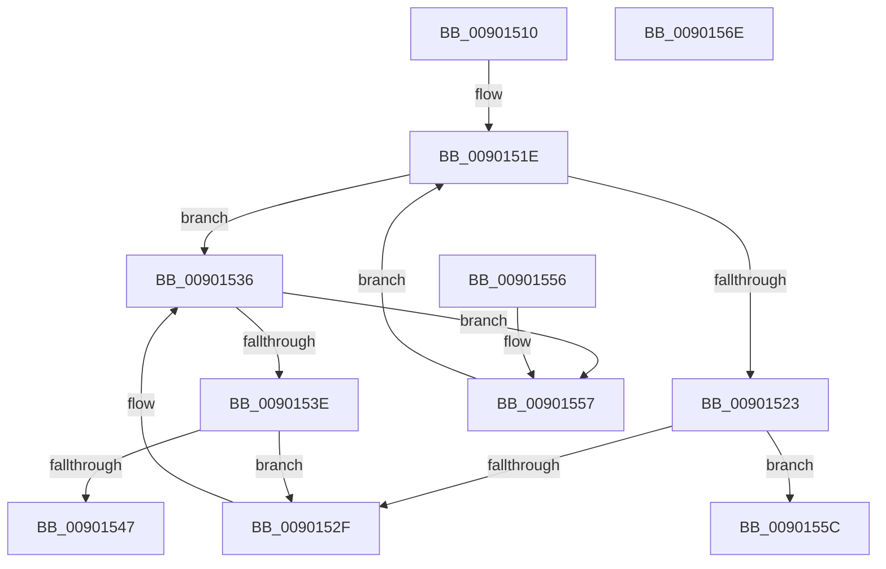

# IopInsertActiveConnectListLocked

- RVA: `0x00901510`–`0x0090156F` (길이 `95` bytes)
- VA: `0x0000000140901510`
- 실행 섹션: `PAGE`
- PDB 이름 있음: `예`; PDB Function 태그: `아니요`
- unwind 정보 RVA: `0x000DB714`
- 디코드: `29`개 명령, `95/95` bytes 표시
- 미해석 바이트: `0` (있으면 어셈블리에 `.byte`로 보존)

> 이 문서는 커널 이미지의 기계어와 PDB 기호를 분석해 생성했습니다. 4번과 5번은 함수 원형과 자료형을 바이너리 사용 방식에서 추정한 C 해석이며 원본 소스 복구 결과는 아닙니다.

## 1. Dependencies

- 직접 호출 지점: **0**; 고유 호출 대상: **0**
- 직접 호출자로 확인된 함수: **1**
- RIP 상대 이미지 참조: **3**

### Outgoing calls
- 직접 디코드된 call 명령이 없습니다.

### Direct callers
- [IopInitializeActiveConnectBlock](IopInitializeActiveConnectBlock_function_00901138.md) at `0x00901206`

### Static image references
- `0x00901510` → RVA `0x00F8CCC0` (`.data`; read)
- `0x00901523` → RVA `0x00F8CCC8` (`.data`; read)
- `0x00901566` → RVA `0x00F8CCC8` (`.data`; write)

## 2. Other-region calls and transfers

- 다른 실행 섹션으로 향하는 call: **0**
- 별도 외부 분기/꼬리 이동을 확인하지 못했습니다.

## 3. Assembly (complete function range)

```asm
00901510  48 8B 15 A9 B7 68 00            mov rdx, qword ptr [rip + 0x68b7a9]
00901517  4C 8D 05 A2 B7 68 00            lea r8, [rip + 0x68b7a2]
0090151E  49 3B D0                        cmp rdx, r8
00901521  75 13                           jne 0x140901536
00901523  48 8B 05 9E B7 68 00            mov rax, qword ptr [rip + 0x68b79e]
0090152A  4C 39 00                        cmp qword ptr [rax], r8
0090152D  74 2D                           je 0x14090155c
0090152F  B9 03 00 00 00                  mov ecx, 3
00901534  CD 29                           int 0x29
00901536  8B 41 10                        mov eax, dword ptr [rcx + 0x10]
00901539  39 42 10                        cmp dword ptr [rdx + 0x10], eax
0090153C  76 19                           jbe 0x140901557
0090153E  48 8B 42 08                     mov rax, qword ptr [rdx + 8]
00901542  48 39 10                        cmp qword ptr [rax], rdx
00901545  75 E8                           jne 0x14090152f
00901547  48 89 11                        mov qword ptr [rcx], rdx
0090154A  48 89 41 08                     mov qword ptr [rcx + 8], rax
0090154E  48 89 08                        mov qword ptr [rax], rcx
00901551  48 89 4A 08                     mov qword ptr [rdx + 8], rcx
00901555  C3                              ret
00901556  CC                              int3
00901557  48 8B 12                        mov rdx, qword ptr [rdx]
0090155A  EB C2                           jmp 0x14090151e
0090155C  4C 89 01                        mov qword ptr [rcx], r8
0090155F  48 89 41 08                     mov qword ptr [rcx + 8], rax
00901563  48 89 08                        mov qword ptr [rax], rcx
00901566  48 89 0D 5B B7 68 00            mov qword ptr [rip + 0x68b75b], rcx
0090156D  C3                              ret
0090156E  CC                              int3
```

## 4. C-style interpretation (structured pseudocode)

```c
__int64 __fastcall IopInsertActiveConnectListLocked(void)
{
loc_0090151E:
    if ((*(unsigned __int64 *)(v_rip + 6862761)) != (v_rip + 6862754)) goto loc_00901536;
    if ((*(unsigned __int64 *)(*(unsigned __int64 *)(v_rip + 6862750))) == (v_rip + 6862754)) goto loc_0090155C;
loc_0090152F:
loc_00901536:
    if ((*(unsigned int *)(*(unsigned __int64 *)(v_rip + 6862761) + 16)) <= ((unsigned int)((unsigned int)(*(unsigned int *)(3 + 16))))) goto loc_00901557;
    if ((*(unsigned __int64 *)(*(unsigned __int64 *)(*(unsigned __int64 *)(v_rip + 6862761) + 8))) != (*(unsigned __int64 *)(v_rip + 6862761))) goto loc_0090152F;
    *(unsigned __int64 *)(3) = *(unsigned __int64 *)(v_rip + 6862761);
    *(unsigned __int64 *)(3 + 8) = *(unsigned __int64 *)(*(unsigned __int64 *)(v_rip + 6862761) + 8);
    *(unsigned __int64 *)(*(unsigned __int64 *)(*(unsigned __int64 *)(v_rip + 6862761) + 8)) = 3;
    *(unsigned __int64 *)(*(unsigned __int64 *)(v_rip + 6862761) + 8) = 3;
    return *(unsigned __int64 *)(*(unsigned __int64 *)(v_rip + 6862761) + 8);
loc_00901557:
    goto loc_0090151E;
loc_0090155C:
    *(unsigned __int64 *)(3) = v_rip + 6862754;
    *(unsigned __int64 *)(3 + 8) = *(unsigned __int64 *)(*(unsigned __int64 *)(v_rip + 6862761) + 8);
    *(unsigned __int64 *)(*(unsigned __int64 *)(*(unsigned __int64 *)(v_rip + 6862761) + 8)) = 3;
    *(unsigned __int64 *)(v_rip + 6862683) = 3;
    return *(unsigned __int64 *)(*(unsigned __int64 *)(v_rip + 6862761) + 8);
}
```

## 5. (Beta) C Style

```c
void IopInsertActiveConnectListLocked(void)
{
loc_0090151E:
    if ((*(uint64_t *)(v_rip + 0x68B7A9)) != (v_rip + 6862754)) goto loc_00901536;
    if ((*(uint64_t *)(*(uint64_t *)(v_rip + 0x68B79E))) == (v_rip + 6862754)) goto loc_0090155C;
loc_0090152F:
loc_00901536:
    if ((*(uint32_t *)(*(uint64_t *)(v_rip + 0x68B7A9) + 0x10)) <= ((uint32_t)((uint32_t)(*(uint32_t *)(3 + 0x10))))) goto loc_00901557;
    if ((*(uint64_t *)(*(uint64_t *)(*(uint64_t *)(v_rip + 0x68B7A9) + 0x8))) != (*(uint64_t *)(v_rip + 0x68B7A9))) goto loc_0090152F;
    *(uint64_t *)(3) = *(uint64_t *)(v_rip + 0x68B7A9);
    *(uint64_t *)(3 + 0x8) = *(uint64_t *)(*(uint64_t *)(v_rip + 0x68B7A9) + 0x8);
    *(uint64_t *)(*(uint64_t *)(*(uint64_t *)(v_rip + 0x68B7A9) + 0x8)) = 3;
    *(uint64_t *)(*(uint64_t *)(v_rip + 0x68B7A9) + 0x8) = 3;
    return *(uint64_t *)(*(uint64_t *)(v_rip + 0x68B7A9) + 0x8);
loc_00901557:
    goto loc_0090151E;
loc_0090155C:
    *(uint64_t *)(3) = v_rip + 6862754;
    *(uint64_t *)(3 + 0x8) = *(uint64_t *)(*(uint64_t *)(v_rip + 0x68B7A9) + 0x8);
    *(uint64_t *)(*(uint64_t *)(*(uint64_t *)(v_rip + 0x68B7A9) + 0x8)) = 3;
    *(uint64_t *)(v_rip + 0x68B75B) = 3;
    return *(uint64_t *)(*(uint64_t *)(v_rip + 0x68B7A9) + 0x8);
}
```

## 6. Execution-region graph

[열기: 2D/3D 그래프와 함수 탐색 컨트롤 패널](../../../control-panel.html?section=page&rva=0x00901510&view=graph)

- 2D 그래프는 위에서 아래로 흐르고, 3D 그래프는 빈 공간을 드래그해 회전합니다. Shift+드래그는 이동, 휠은 확대·축소, 함수 노드 선택은 대상 보고서 이동입니다.

### Static fallback


