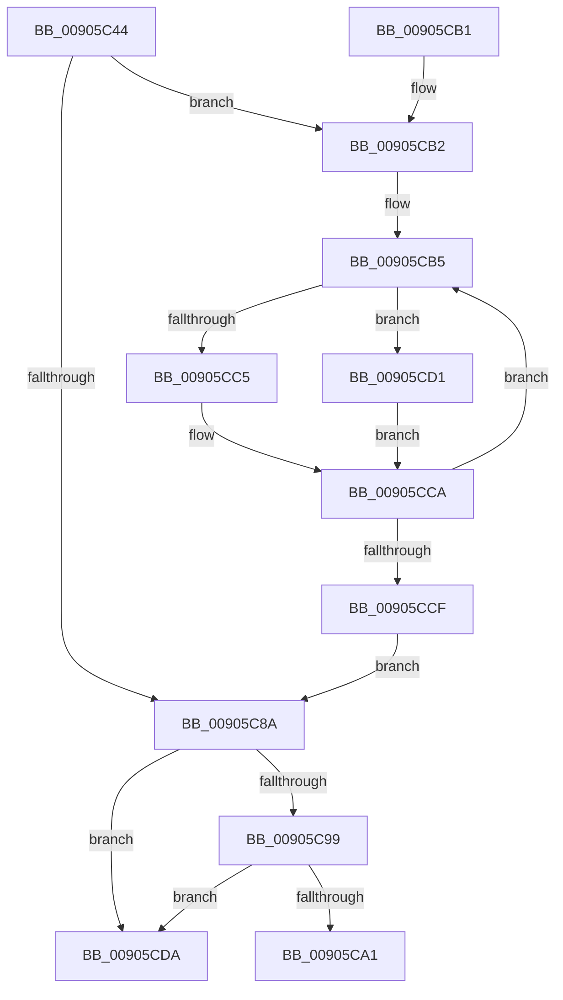

# KeRundownApcQueues

- RVA: `0x00905C44`–`0x00905CFD` (길이 `185` bytes)
- VA: `0x0000000140905C44`
- 실행 섹션: `PAGE`
- PDB 이름 있음: `예`; PDB Function 태그: `아니요`
- unwind 정보 RVA: `0x00088C58`
- 디코드: `53`개 명령, `185/185` bytes 표시
- 미해석 바이트: `0` (있으면 어셈블리에 `.byte`로 보존)

> 이 문서는 커널 이미지의 기계어와 PDB 기호를 분석해 생성했습니다. 4번과 5번은 함수 원형과 자료형을 바이너리 사용 방식에서 추정한 C 해석이며 원본 소스 복구 결과는 아닙니다.

## 1. Dependencies

- 직접 호출 지점: **8**; 고유 호출 대상: **7**
- 직접 호출자로 확인된 함수: **2**
- RIP 상대 이미지 참조: **0**

### Outgoing calls
- `0x00905C63` → [KiAcquireReleaseThreadLock](../../text/46/KiAcquireReleaseThreadLock_function_0046B658.md) (function, `0x0046B658`)
- `0x00905C6B` → [KeForceResumeThread](../../text/20/KeForceResumeThread_function_0020292C.md) (function, `0x0020292C`)
- `0x00905C73` → [KeLeaveCriticalRegionThread](../../text/25/KeLeaveCriticalRegionThread_function_0025EFF0.md) (function, `0x0025EFF0`)
- `0x00905C7D` → [KiFlushQueueApc](../../text/3C/KiFlushQueueApc_function_003C653C.md) (function, `0x003C653C`)
- `0x00905C8F` → [KiFlushQueueApc](../../text/3C/KiFlushQueueApc_function_003C653C.md) (function, `0x003C653C`)
- `0x00905CC5` → [guard_dispatch_icall](../../text/6B/guard_dispatch_icall_function_006BAAD0.md) (function, `0x006BAAD0`)
- `0x00905CD3` → [ExFreePoolWithTag](../../poolcode/B8/ExFreePoolWithTag_function_00B82870.md) (function, `0x00B82870`)
- `0x00905CF7` → [KeBugCheckEx](../../text/4F/KeBugCheckEx_function_004FD660.md) (function, `0x004FD660`)

### Direct callers
- [sub_0069B640](../../text/69/Unknown_function_0069B640.md) at `0x0069B6AA`
- [PspExitThread](PspExitThread_function_00905F60.md) at `0x00906443`

### Static image references
- 디코드된 RIP-relative 메모리 참조가 없습니다.

## 2. Other-region calls and transfers

- 다른 실행 섹션으로 향하는 call: **8**
  - `0x00905C63` → [KiAcquireReleaseThreadLock](../../text/46/KiAcquireReleaseThreadLock_function_0046B658.md) (`PAGE` → `.text`)
  - `0x00905C6B` → [KeForceResumeThread](../../text/20/KeForceResumeThread_function_0020292C.md) (`PAGE` → `.text`)
  - `0x00905C73` → [KeLeaveCriticalRegionThread](../../text/25/KeLeaveCriticalRegionThread_function_0025EFF0.md) (`PAGE` → `.text`)
  - `0x00905C7D` → [KiFlushQueueApc](../../text/3C/KiFlushQueueApc_function_003C653C.md) (`PAGE` → `.text`)
  - `0x00905C8F` → [KiFlushQueueApc](../../text/3C/KiFlushQueueApc_function_003C653C.md) (`PAGE` → `.text`)
  - `0x00905CC5` → [guard_dispatch_icall](../../text/6B/guard_dispatch_icall_function_006BAAD0.md) (`PAGE` → `.text`)
  - `0x00905CD3` → [ExFreePoolWithTag](../../poolcode/B8/ExFreePoolWithTag_function_00B82870.md) (`PAGE` → `POOLCODE`)
  - `0x00905CF7` → [KeBugCheckEx](../../text/4F/KeBugCheckEx_function_004FD660.md) (`PAGE` → `.text`)
- 별도 외부 분기/꼬리 이동을 확인하지 못했습니다.

## 3. Assembly (complete function range)

```asm
00905C44  48 89 5C 24 08                  mov qword ptr [rsp + 8], rbx
00905C49  48 89 74 24 10                  mov qword ptr [rsp + 0x10], rsi
00905C4E  57                              push rdi
00905C4F  48 83 EC 30                     sub rsp, 0x30
00905C53  66 FF 89 E4 01 00 00            dec word ptr [rcx + 0x1e4]
00905C5A  48 8B D9                        mov rbx, rcx
00905C5D  90                              nop
00905C5E  0F BA 71 74 0E                  btr dword ptr [rcx + 0x74], 0xe
00905C63  E8 F0 59 B6 FF                  call 0x14046b658
00905C68  48 8B CB                        mov rcx, rbx
00905C6B  E8 BC CC 8F FF                  call 0x14020292c
00905C70  48 8B CB                        mov rcx, rbx
00905C73  E8 78 93 95 FF                  call 0x14025eff0
00905C78  B2 01                           mov dl, 1
00905C7A  48 8B CB                        mov rcx, rbx
00905C7D  E8 BA 08 AC FF                  call 0x1403c653c
00905C82  48 8B F0                        mov rsi, rax
00905C85  48 85 C0                        test rax, rax
00905C88  75 28                           jne 0x140905cb2
00905C8A  33 D2                           xor edx, edx
00905C8C  48 8B CB                        mov rcx, rbx
00905C8F  E8 A8 08 AC FF                  call 0x1403c653c
00905C94  48 85 C0                        test rax, rax
00905C97  75 41                           jne 0x140905cda
00905C99  39 83 E4 01 00 00               cmp dword ptr [rbx + 0x1e4], eax
00905C9F  75 39                           jne 0x140905cda
00905CA1  48 8B 5C 24 40                  mov rbx, qword ptr [rsp + 0x40]
00905CA6  48 8B 74 24 48                  mov rsi, qword ptr [rsp + 0x48]
00905CAB  48 83 C4 30                     add rsp, 0x30
00905CAF  5F                              pop rdi
00905CB0  C3                              ret
00905CB1  CC                              int3
00905CB2  48 8B FE                        mov rdi, rsi
00905CB5  48 8D 4F F0                     lea rcx, [rdi - 0x10]
00905CB9  48 8B 3F                        mov rdi, qword ptr [rdi]
00905CBC  48 8B 41 28                     mov rax, qword ptr [rcx + 0x28]
00905CC0  48 85 C0                        test rax, rax
00905CC3  74 0C                           je 0x140905cd1
00905CC5  E8 06 4E DB FF                  call 0x1406baad0
00905CCA  48 3B FE                        cmp rdi, rsi
00905CCD  75 E6                           jne 0x140905cb5
00905CCF  EB B9                           jmp 0x140905c8a
00905CD1  33 D2                           xor edx, edx
00905CD3  E8 98 CB 27 00                  call 0x140b82870
00905CD8  EB F0                           jmp 0x140905cca
00905CDA  44 0F 20 C1                     mov rcx, cr8
00905CDE  44 8B 83 E4 01 00 00            mov r8d, dword ptr [rbx + 0x1e4]
00905CE5  48 8B D0                        mov rdx, rax
00905CE8  48 83 64 24 20 00               and qword ptr [rsp + 0x20], 0
00905CEE  44 0F B6 C9                     movzx r9d, cl
00905CF2  B9 20 00 00 00                  mov ecx, 0x20
00905CF7  E8 64 79 BF FF                  call 0x1404fd660
00905CFC  CC                              int3
```

## 4. C-style interpretation (structured pseudocode)

```c
__int64 __fastcall KeRundownApcQueues(__int64 a1)
{
    __int64 result;
    __int64 v_rsp;
    unsigned __int64 v_stack_p10;
    unsigned __int64 v_stack_p20;
    unsigned __int64 v_stack_p8;

    v_stack_p8 = v_rbx;
    v_stack_p10 = v_rsi;
    v_rsp = (v_rsp) - (48);
    result = KiAcquireReleaseThreadLock(a1, a2, a3, a4);
    result = KeForceResumeThread(a1, a2, a3, a4);
    result = KeLeaveCriticalRegionThread(a1, a2, a3, a4);
    result = KiFlushQueueApc(a1, 1, a3, a4);
    if (result != 0) goto loc_00905CB2;
loc_00905C8A:
    a2 = 0;
    result = KiFlushQueueApc(a1, a2, a3, a4);
    if (result != 0) goto loc_00905CDA;
    if ((*(unsigned int *)(a1 + 484)) != ((unsigned int)(result))) goto loc_00905CDA;
    v_rsp = (v_rsp) + (48);
    return result;
loc_00905CB2:
loc_00905CB5:
    if (*(unsigned __int64 *)(v_stack_p10 - 16 + 40) == 0) goto loc_00905CD1;
    result = guard_dispatch_icall(v_stack_p10 - 16, a2, a3, a4);
loc_00905CCA:
    if ((*(unsigned __int64 *)(v_stack_p10)) != v_stack_p10) goto loc_00905CB5;
    goto loc_00905C8A;
loc_00905CD1:
    a2 = 0;
    result = ExFreePoolWithTag(v_stack_p10 - 16, a2, a3, a4);
    goto loc_00905CCA;
loc_00905CDA:
    result = KeBugCheckEx(32, result, (unsigned int)(*(unsigned int *)(v_stack_p8 + 484)), (unsigned __int8)(v_cr8));
    return result;
}
```

## 5. (Beta) C Style

```c
int64_t KeRundownApcQueues(void *Arg1)
{
    uint8_t *arg1 = (uint8_t *)Arg1;

    int64_t result;
    int64_t local_rsp;
    uint64_t v_stack_p10;
    uint64_t v_stack_p20;
    uint64_t v_stack_p8;

    v_stack_p8 = local_rbx;
    v_stack_p10 = local_rsi;
    local_rsp = (local_rsp) - (48);
    result = KiAcquireReleaseThreadLock(Arg1, a2, a3, a4);
    result = KeForceResumeThread(Arg1, a2, a3, a4);
    result = KeLeaveCriticalRegionThread(Arg1, a2, a3, a4);
    result = KiFlushQueueApc(Arg1, 1, a3, a4);
    if (result != 0) goto loc_00905CB2;
loc_00905C8A:
    a2 = 0;
    result = KiFlushQueueApc(Arg1, a2, a3, a4);
    if (result != 0) goto loc_00905CDA;
    if ((*(uint32_t *)(arg1 + 0x1E4)) != ((uint32_t)(result))) goto loc_00905CDA;
    local_rsp = (local_rsp) + (48);
    return result;
loc_00905CB2:
loc_00905CB5:
    if (*(uint64_t *)(v_stack_p10 - 0x10 + 0x28) == 0) goto loc_00905CD1;
    result = guard_dispatch_icall(v_stack_p10 - 16, a2, a3, a4);
loc_00905CCA:
    if ((*(uint64_t *)(v_stack_p10)) != v_stack_p10) goto loc_00905CB5;
    goto loc_00905C8A;
loc_00905CD1:
    a2 = 0;
    result = ExFreePoolWithTag(v_stack_p10 - 16, a2, a3, a4);
    goto loc_00905CCA;
loc_00905CDA:
    result = KeBugCheckEx(32, result, (uint32_t)(*(uint32_t *)(v_stack_p8 + 0x1E4)), (uint8_t)(v_cr8));
    return result;
}
```

### 관측된 메모리 오프셋

구조체 형식이 확인되지 않은 접근은 인자 기준의 오프셋으로만 기록했습니다.

| 기준 인자 | 오프셋 표현 | 폭 (bit) | 접근 |
|---|---:|---:|---|
| `Arg1` | `+ 0x74` | `32` | `R/W` |
| `Arg1` | `+ 0x1E4` | `16` | `R/W` |
| `Arg1` | `+ 0x1E4` | `32` | `R` |

## 6. Execution-region graph

[열기: 2D/3D 그래프와 함수 탐색 컨트롤 패널](../../../control-panel.html?section=page&rva=0x00905C44&view=graph)

- 2D 그래프는 위에서 아래로 흐르고, 3D 그래프는 빈 공간을 드래그해 회전합니다. Shift+드래그는 이동, 휠은 확대·축소, 함수 노드 선택은 대상 보고서 이동입니다.

### Static fallback


