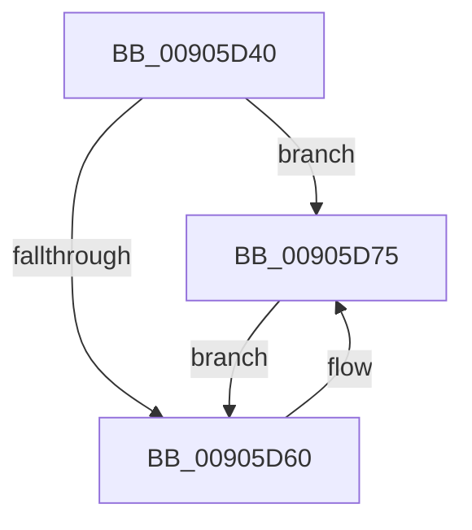

# KiSchedulerApcTerminate

- RVA: `0x00905D40`–`0x00905D90` (길이 `80` bytes)
- VA: `0x0000000140905D40`
- 실행 섹션: `PAGE`
- PDB 이름 있음: `예`; PDB Function 태그: `아니요`
- unwind 정보 RVA: `0x000622F0`
- 디코드: `16`개 명령, `80/80` bytes 표시
- 미해석 바이트: `0` (있으면 어셈블리에 `.byte`로 보존)

> 이 문서는 커널 이미지의 기계어와 PDB 기호를 분석해 생성했습니다. 4번과 5번은 함수 원형과 자료형을 바이너리 사용 방식에서 추정한 C 해석이며 원본 소스 복구 결과는 아닙니다.

## 1. Dependencies

- 직접 호출 지점: **3**; 고유 호출 대상: **3**
- 직접 호출자로 확인된 함수: **1**
- RIP 상대 이미지 참조: **0**

### Outgoing calls
- `0x00905D57` → [KiIsProcessTerminationRequested](../../text/48/KiIsProcessTerminationRequested_function_00481984.md) (function, `0x00481984`)
- `0x00905D6F` → [PspExitThread](PspExitThread_function_00905F60.md) (function, `0x00905F60`)
- `0x00905D89` → [PsTerminateProcess](PsTerminateProcess_function_00904C64.md) (function, `0x00904C64`)

### Direct callers
- [sub_00251225](../../text/25/Unknown_function_00251225.md) at `0x0025138B`

### Static image references
- 디코드된 RIP-relative 메모리 참조가 없습니다.

## 2. Other-region calls and transfers

- 다른 실행 섹션으로 향하는 call: **1**
  - `0x00905D57` → [KiIsProcessTerminationRequested](../../text/48/KiIsProcessTerminationRequested_function_00481984.md) (`PAGE` → `.text`)
- 별도 외부 분기/꼬리 이동을 확인하지 못했습니다.

## 3. Assembly (complete function range)

```asm
00905D40  48 83 EC 38                     sub rsp, 0x38
00905D44  65 48 8B 0C 25 88 01 00 00      mov rcx, qword ptr gs:[0x188]
00905D4D  48 8D 54 24 20                  lea rdx, [rsp + 0x20]
00905D52  83 64 24 20 00                  and dword ptr [rsp + 0x20], 0
00905D57  E8 28 BC B7 FF                  call 0x140481984
00905D5C  84 C0                           test al, al
00905D5E  75 15                           jne 0x140905d75
00905D60  65 48 8B 0C 25 88 01 00 00      mov rcx, qword ptr gs:[0x188]
00905D69  8B 89 D8 05 00 00               mov ecx, dword ptr [rcx + 0x5d8]
00905D6F  E8 EC 01 00 00                  call 0x140905f60
00905D74  CC                              int3
00905D75  65 48 8B 0C 25 88 01 00 00      mov rcx, qword ptr gs:[0x188]
00905D7E  8B 54 24 20                     mov edx, dword ptr [rsp + 0x20]
00905D82  48 8B 89 B8 00 00 00            mov rcx, qword ptr [rcx + 0xb8]
00905D89  E8 D6 EE FF FF                  call 0x140904c64
00905D8E  EB D0                           jmp 0x140905d60
```

## 4. C-style interpretation (structured pseudocode)

```c
__int64 __fastcall KiSchedulerApcTerminate(void)
{
    __int64 result;
    __int64 v_rsp;
    unsigned __int64 v_stack_m18;

    v_rsp = (v_rsp) - (56);
    result = KiIsProcessTerminationRequested(*(unsigned __int64 *)(gs_base + (0 + 392)), v_stack_m18, a3, a4);
    if ((unsigned __int8)(result) == 0) {
        a1 = *(unsigned __int64 *)(gs_base + (0 + 392));
        a1 = *(unsigned int *)(a1 + 1496);
        result = PspExitThread(a1, v_stack_m18, a3, a4);
    }
    result = PsTerminateProcess(*(unsigned __int64 *)(*(unsigned __int64 *)(gs_base + (0 + 392)) + 184), (unsigned int)(v_stack_m18), a3, a4);
    goto loc_00905D60;
}
```

## 5. (Beta) C Style

```c
void KiSchedulerApcTerminate(void)
{
    int64_t result;
    int64_t local_rsp;
    uint64_t v_stack_m18;

    local_rsp = (local_rsp) - (56);
    result = KiIsProcessTerminationRequested(*(uint64_t *)(gs_base + (0 + 0x188)), v_stack_m18, a3, a4);
    if ((uint8_t)(result) == 0) {
        a1 = *(uint64_t *)(gs_base + (0 + 0x188));
        a1 = *(uint32_t *)(a1 + 0x5D8);
        result = PspExitThread(a1, v_stack_m18, a3, a4);
    }
    result = PsTerminateProcess(*(uint64_t *)(*(uint64_t *)(gs_base + (0 + 0x188)) + 0xB8), (uint32_t)(v_stack_m18), a3, a4);
    goto loc_00905D60;
}
```

## 6. Execution-region graph

[열기: 2D/3D 그래프와 함수 탐색 컨트롤 패널](../../../control-panel.html?section=page&rva=0x00905D40&view=graph)

- 2D 그래프는 위에서 아래로 흐르고, 3D 그래프는 빈 공간을 드래그해 회전합니다. Shift+드래그는 이동, 휠은 확대·축소, 함수 노드 선택은 대상 보고서 이동입니다.

### Static fallback


