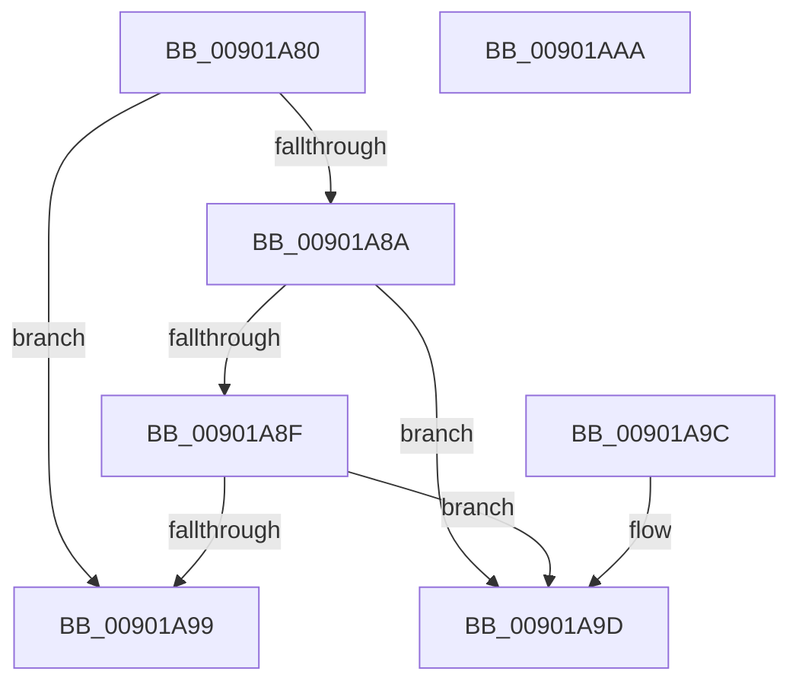

# MmCheckPartitionManagementSupported

- RVA: `0x00901A80`–`0x00901AAB` (길이 `43` bytes)
- VA: `0x0000000140901A80`
- 실행 섹션: `PAGE`
- PDB 이름 있음: `예`; PDB Function 태그: `아니요`
- unwind 정보 RVA: `0x000DB714`
- 디코드: `18`개 명령, `43/43` bytes 표시
- 미해석 바이트: `0` (있으면 어셈블리에 `.byte`로 보존)

> 이 문서는 커널 이미지의 기계어와 PDB 기호를 분석해 생성했습니다. 4번과 5번은 함수 원형과 자료형을 바이너리 사용 방식에서 추정한 C 해석이며 원본 소스 복구 결과는 아닙니다.

## 1. Dependencies

- 직접 호출 지점: **0**; 고유 호출 대상: **0**
- 직접 호출자로 확인된 함수: **1**
- RIP 상대 이미지 참조: **0**

### Outgoing calls
- 직접 디코드된 call 명령이 없습니다.

### Direct callers
- [NtManagePartition](NtManagePartition_function_00902FC0.md) at `0x0090312D`
- [NtManagePartition](NtManagePartition_function_00902FC0.md) at `0x00903269`

### Static image references
- 디코드된 RIP-relative 메모리 참조가 없습니다.

## 2. Other-region calls and transfers

- 다른 실행 섹션으로 향하는 call: **0**
- 별도 외부 분기/꼬리 이동을 확인하지 못했습니다.

## 3. Assembly (complete function range)

```asm
00901A80  48 8B 01                        mov rax, qword ptr [rcx]
00901A83  8B 40 04                        mov eax, dword ptr [rax + 4]
00901A86  84 C0                           test al, al
00901A88  79 0F                           jns 0x140901a99
00901A8A  83 FA 0C                        cmp edx, 0xc
00901A8D  77 0E                           ja 0x140901a9d
00901A8F  B8 E3 11 00 00                  mov eax, 0x11e3
00901A94  0F A3 D0                        bt eax, edx
00901A97  73 04                           jae 0x140901a9d
00901A99  33 C0                           xor eax, eax
00901A9B  C3                              ret
00901A9C  CC                              int3
00901A9D  83 EA 0E                        sub edx, 0xe
00901AA0  F7 DA                           neg edx
00901AA2  1B C0                           sbb eax, eax
00901AA4  25 BB 00 00 C0                  and eax, 0xc00000bb
00901AA9  C3                              ret
00901AAA  CC                              int3
```

## 4. C-style interpretation (structured pseudocode)

```c
__int64 __fastcall MmCheckPartitionManagementSupported(__int64 a1, int a2)
{
    __int64 result;

    if (!sign_flag) goto loc_00901A99;
    if (a2 > 12) goto loc_00901A9D;
    if (a2 >= 12) goto loc_00901A9D;
loc_00901A99:
    result = 0;
    return result;
loc_00901A9D:
    a2 = (unsigned int)((a2) - (14));
    a2 = (unsigned int)(-(a2));
    result = (unsigned int)((result) & (0xC00000BBULL));
    return result;
}
```

## 5. (Beta) C Style

```c
int64_t MmCheckPartitionManagementSupported(void *Arg1, int32_t Arg2)
{
    uint8_t *arg1 = (uint8_t *)Arg1;

    int64_t result;

    if (!sign_flag) goto loc_00901A99;
    if (Arg2 > 12) goto loc_00901A9D;
    if (Arg2 >= 12) goto loc_00901A9D;
loc_00901A99:
    result = 0;
    return result;
loc_00901A9D:
    Arg2 = (uint32_t)((Arg2) - (14));
    Arg2 = (uint32_t)(-(Arg2));
    result = (uint32_t)((result) & (0xC00000BBULL));
    return result;
}
```

### 관측된 메모리 오프셋

구조체 형식이 확인되지 않은 접근은 인자 기준의 오프셋으로만 기록했습니다.

| 기준 인자 | 오프셋 표현 | 폭 (bit) | 접근 |
|---|---:|---:|---|
| `Arg1` | `+ 0x0` | `64` | `R` |

## 6. Execution-region graph

[열기: 2D/3D 그래프와 함수 탐색 컨트롤 패널](../../../control-panel.html?section=page&rva=0x00901A80&view=graph)

- 2D 그래프는 위에서 아래로 흐르고, 3D 그래프는 빈 공간을 드래그해 회전합니다. Shift+드래그는 이동, 휠은 확대·축소, 함수 노드 선택은 대상 보고서 이동입니다.

### Static fallback


