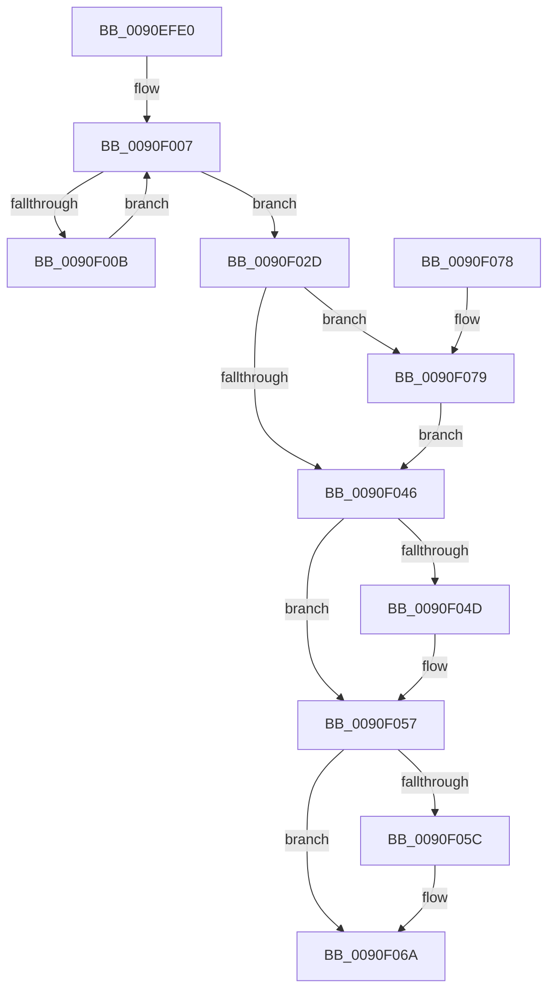

# MmGetSystemRoutineAddress

- RVA: `0x0090EFE0`–`0x0090F08F` (길이 `175` bytes)
- VA: `0x000000014090EFE0`
- 실행 섹션: `PAGE`
- PDB 이름 있음: `예`; PDB Function 태그: `아니요`
- unwind 정보 RVA: `0x0008981C`
- 디코드: `49`개 명령, `175/175` bytes 표시
- 미해석 바이트: `0` (있으면 어셈블리에 `.byte`로 보존)

> 이 문서는 커널 이미지의 기계어와 PDB 기호를 분석해 생성했습니다. 4번과 5번은 함수 원형과 자료형을 바이너리 사용 방식에서 추정한 C 해석이며 원본 소스 복구 결과는 아닙니다.

## 1. Dependencies

- 직접 호출 지점: **7**; 고유 호출 대상: **5**
- 직접 호출자로 확인된 함수: **6**
- RIP 상대 이미지 참조: **3**

### Outgoing calls
- `0x0090F000` → [RtlUnicodeStringToAnsiString](RtlUnicodeStringToAnsiString_function_0090D1F0.md) (function, `0x0090D1F0`)
- `0x0090F016` → [KeDelayExecutionThread](../../text/20/KeDelayExecutionThread_function_00209550.md) (function, `0x00209550`)
- `0x0090F026` → [RtlUnicodeStringToAnsiString](RtlUnicodeStringToAnsiString_function_0090D1F0.md) (function, `0x0090D1F0`)
- `0x0090F039` → [RtlFindExportedRoutineByName](RtlFindExportedRoutineByName_function_0090F0A0.md) (function, `0x0090F0A0`)
- `0x0090F052` → [ExFreePool](../../poolcode/B8/ExFreePool_function_00B82850.md) (function, `0x00B82850`)
- `0x0090F05F` → [MiMarkKernelCfgTarget](../../text/48/MiMarkKernelCfgTarget_function_0048C8F4.md) (function, `0x0048C8F4`)
- `0x0090F085` → [RtlFindExportedRoutineByName](RtlFindExportedRoutineByName_function_0090F0A0.md) (function, `0x0090F0A0`)

### Direct callers
- [HalpCmciLoadThresholdConfiguration](../../text/4E/HalpCmciLoadThresholdConfiguration_function_004E06A0.md) at `0x004E07B6`
- [HalpMcEnumerateAndSetPatchConfig](../../text/55/HalpMcEnumerateAndSetPatchConfig_function_0055AB38.md) at `0x0055AE62`
- [HalpMcGetLoadConfiguration](../../text/55/HalpMcGetLoadConfiguration_function_0055AF34.md) at `0x0055AF98`
- [HalpMcGetRollbackRequest](../../text/55/HalpMcGetRollbackRequest_function_0055AFEC.md) at `0x0055B049`
- [HalpPmuArbiterQueryRegistryQuantum](../70/HalpPmuArbiterQueryRegistryQuantum_function_00707D04.md) at `0x00707D61`
- [HalpDmaCvmQueryRegistryKeys](../../init/C2/HalpDmaCvmQueryRegistryKeys_function_00C20BD0.md) at `0x00C20C87`

### Static image references
- `0x0090F00B` → RVA `0x00010780` (`.rdata`; read)
- `0x0090F032` → RVA `0x00FC6B28` (`ALMOSTRO`; read)
- `0x0090F07E` → RVA `0x00FC6B98` (`ALMOSTRO`; read)

## 2. Other-region calls and transfers

- 다른 실행 섹션으로 향하는 call: **3**
  - `0x0090F016` → [KeDelayExecutionThread](../../text/20/KeDelayExecutionThread_function_00209550.md) (`PAGE` → `.text`)
  - `0x0090F052` → [ExFreePool](../../poolcode/B8/ExFreePool_function_00B82850.md) (`PAGE` → `POOLCODE`)
  - `0x0090F05F` → [MiMarkKernelCfgTarget](../../text/48/MiMarkKernelCfgTarget_function_0048C8F4.md) (`PAGE` → `.text`)
- 별도 외부 분기/꼬리 이동을 확인하지 못했습니다.

## 3. Assembly (complete function range)

```asm
0090EFE0  48 89 5C 24 08                  mov qword ptr [rsp + 8], rbx
0090EFE5  56                              push rsi
0090EFE6  48 83 EC 30                     sub rsp, 0x30
0090EFEA  48 8B D9                        mov rbx, rcx
0090EFED  0F 57 C0                        xorps xmm0, xmm0
0090EFF0  48 8B D1                        mov rdx, rcx
0090EFF3  41 B0 01                        mov r8b, 1
0090EFF6  48 8D 4C 24 20                  lea rcx, [rsp + 0x20]
0090EFFB  0F 11 44 24 20                  movups xmmword ptr [rsp + 0x20], xmm0
0090F000  E8 EB E1 FF FF                  call 0x14090d1f0
0090F005  33 F6                           xor esi, esi
0090F007  85 C0                           test eax, eax
0090F009  79 22                           jns 0x14090f02d
0090F00B  4C 8D 05 6E 17 70 FF            lea r8, [rip - 0x8fe892]
0090F012  33 D2                           xor edx, edx
0090F014  33 C9                           xor ecx, ecx
0090F016  E8 35 A5 8F FF                  call 0x140209550
0090F01B  41 B0 01                        mov r8b, 1
0090F01E  48 8D 4C 24 20                  lea rcx, [rsp + 0x20]
0090F023  48 8B D3                        mov rdx, rbx
0090F026  E8 C5 E1 FF FF                  call 0x14090d1f0
0090F02B  EB DA                           jmp 0x14090f007
0090F02D  48 8B 54 24 28                  mov rdx, qword ptr [rsp + 0x28]
0090F032  48 8B 0D EF 7A 6B 00            mov rcx, qword ptr [rip + 0x6b7aef]
0090F039  E8 62 00 00 00                  call 0x14090f0a0
0090F03E  48 8B D8                        mov rbx, rax
0090F041  48 85 C0                        test rax, rax
0090F044  74 33                           je 0x14090f079
0090F046  48 39 74 24 28                  cmp qword ptr [rsp + 0x28], rsi
0090F04B  74 0A                           je 0x14090f057
0090F04D  48 8B 4C 24 28                  mov rcx, qword ptr [rsp + 0x28]
0090F052  E8 F9 37 27 00                  call 0x140b82850
0090F057  48 85 DB                        test rbx, rbx
0090F05A  74 0E                           je 0x14090f06a
0090F05C  48 8B CB                        mov rcx, rbx
0090F05F  E8 90 D8 B7 FF                  call 0x14048c8f4
0090F064  85 C0                           test eax, eax
0090F066  48 0F 48 DE                     cmovs rbx, rsi
0090F06A  48 8B C3                        mov rax, rbx
0090F06D  48 8B 5C 24 40                  mov rbx, qword ptr [rsp + 0x40]
0090F072  48 83 C4 30                     add rsp, 0x30
0090F076  5E                              pop rsi
0090F077  C3                              ret
0090F078  CC                              int3
0090F079  48 8B 54 24 28                  mov rdx, qword ptr [rsp + 0x28]
0090F07E  48 8B 0D 13 7B 6B 00            mov rcx, qword ptr [rip + 0x6b7b13]
0090F085  E8 16 00 00 00                  call 0x14090f0a0
0090F08A  48 8B D8                        mov rbx, rax
0090F08D  EB B7                           jmp 0x14090f046
```

## 4. C-style interpretation (structured pseudocode)

```c
__int64 __fastcall MmGetSystemRoutineAddress(__int64 a1)
{
    __int64 result;
    __int64 v_rbx;
    __int64 v_rsi;
    __int64 v_rsp;
    unsigned __int64 v_stack_m10;
    unsigned __int64 v_stack_m18;
    unsigned __int64 v_stack_p28;
    unsigned __int64 v_stack_p8;

    v_stack_p8 = v_rbx;
    v_rsp = (v_rsp) - (48);
    v_stack_m18 = v_xmm0;
    result = RtlUnicodeStringToAnsiString(v_stack_m18, a1, 1, a4);
    v_rsi = 0;
loc_0090F007:
    if (!sign_flag) goto loc_0090F02D;
    a2 = 0;
    a1 = 0;
    result = KeDelayExecutionThread(a1, a2, v_rip - 9431186, a4);
    result = RtlUnicodeStringToAnsiString(v_stack_m18, 0, 1, a4);
    goto loc_0090F007;
loc_0090F02D:
    result = RtlFindExportedRoutineByName(*(unsigned __int64 *)(v_rip + 7043823), v_stack_m10, 1, a4);
    if (result == 0) goto loc_0090F079;
loc_0090F046:
    if (v_stack_m10 != 0) {
        a1 = v_stack_m10;
        result = ExFreePool(a1, v_stack_m10, 1, a4);
    }
    v_rbx = result;
    if (result != 0) {
        a1 = result;
        result = MiMarkKernelCfgTarget(a1, v_stack_m10, 1, a4);
        v_rbx = result;
        if (sign_flag) { v_rbx = 0; }
    }
    v_rsp = (v_rsp) + (48);
    return v_rbx;
loc_0090F079:
    result = RtlFindExportedRoutineByName(*(unsigned __int64 *)(v_rip + 7043859), v_stack_p28, 1, a4);
    goto loc_0090F046;
}
```

## 5. (Beta) C Style

```c
int64_t MmGetSystemRoutineAddress(int64_t Arg1)
{
    int64_t result;
    int64_t local_rbx;
    int64_t local_rsi;
    int64_t local_rsp;
    uint64_t v_stack_m10;
    uint64_t v_stack_m18;
    uint64_t v_stack_p28;
    uint64_t v_stack_p8;

    v_stack_p8 = local_rbx;
    local_rsp = (local_rsp) - (48);
    v_stack_m18 = v_xmm0;
    result = RtlUnicodeStringToAnsiString(v_stack_m18, Arg1, 1, a4);
    local_rsi = 0;
loc_0090F007:
    if (!sign_flag) goto loc_0090F02D;
    a2 = 0;
    Arg1 = 0;
    result = KeDelayExecutionThread(Arg1, a2, v_rip - 9431186, a4);
    result = RtlUnicodeStringToAnsiString(v_stack_m18, 0, 1, a4);
    goto loc_0090F007;
loc_0090F02D:
    result = RtlFindExportedRoutineByName(*(uint64_t *)(v_rip + 0x6B7AEF), v_stack_m10, 1, a4);
    if (result == 0) goto loc_0090F079;
loc_0090F046:
    if (v_stack_m10 != 0) {
        Arg1 = v_stack_m10;
        result = ExFreePool(Arg1, v_stack_m10, 1, a4);
    }
    local_rbx = result;
    if (result != 0) {
        Arg1 = result;
        result = MiMarkKernelCfgTarget(Arg1, v_stack_m10, 1, a4);
        local_rbx = result;
        if (sign_flag) { local_rbx = 0; }
    }
    local_rsp = (local_rsp) + (48);
    return local_rbx;
loc_0090F079:
    result = RtlFindExportedRoutineByName(*(uint64_t *)(v_rip + 0x6B7B13), v_stack_p28, 1, a4);
    goto loc_0090F046;
}
```

## 6. Execution-region graph

[열기: 2D/3D 그래프와 함수 탐색 컨트롤 패널](../../../control-panel.html?section=page&rva=0x0090EFE0&view=graph)

- 2D 그래프는 위에서 아래로 흐르고, 3D 그래프는 빈 공간을 드래그해 회전합니다. Shift+드래그는 이동, 휠은 확대·축소, 함수 노드 선택은 대상 보고서 이동입니다.

### Static fallback


