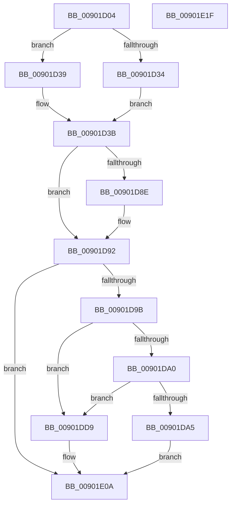

# MmLogQueryCombineStats

- RVA: `0x00901D04`–`0x00901E20` (길이 `284` bytes)
- VA: `0x0000000140901D04`
- 실행 섹션: `PAGE`
- PDB 이름 있음: `예`; PDB Function 태그: `아니요`
- unwind 정보 RVA: `0x000886E8`
- 디코드: `70`개 명령, `284/284` bytes 표시
- 미해석 바이트: `0` (있으면 어셈블리에 `.byte`로 보존)

> 이 문서는 커널 이미지의 기계어와 PDB 기호를 분석해 생성했습니다. 4번과 5번은 함수 원형과 자료형을 바이너리 사용 방식에서 추정한 C 해석이며 원본 소스 복구 결과는 아닙니다.

## 1. Dependencies

- 직접 호출 지점: **3**; 고유 호출 대상: **3**
- 직접 호출자로 확인된 함수: **2**
- RIP 상대 이미지 참조: **7**

### Outgoing calls
- `0x00901DD2` → [EtwTraceSiloDcEvent](../../text/48/EtwTraceSiloDcEvent_function_0048B28C.md) (function, `0x0048B28C`)
- `0x00901E05` → [EtwTraceKernelEvent](../../text/23/EtwTraceKernelEvent_function_00235350.md) (function, `0x00235350`)
- `0x00901E11` → [_security_check_cookie](../../text/6A/_security_check_cookie_function_006AC640.md) (function, `0x006AC640`)

### Direct callers
- [PfQuerySuperfetchInformation](PfQuerySuperfetchInformation_function_0090210C.md) at `0x00902396`
- [EtwpKernelTraceRundown](../9E/EtwpKernelTraceRundown_function_009E4080.md) at `0x009E4366`

### Static image references
- `0x00901D10` → RVA `0x00E0A740` (`.data`; read)
- `0x00901D4F` → RVA `0x00E3D0D8` (`.data`; read)
- `0x00901D59` → RVA `0x00E3D0C8` (`.data`; read)
- `0x00901D60` → RVA `0x00E3D0C0` (`.data`; read)
- `0x00901D6B` → RVA `0x00E3D0D0` (`.data`; read)
- `0x00901D76` → RVA `0x00E3D0DC` (`.data`; read)
- `0x00901D80` → RVA `0x00E3D0E0` (`.data`; read)

## 2. Other-region calls and transfers

- 다른 실행 섹션으로 향하는 call: **3**
  - `0x00901DD2` → [EtwTraceSiloDcEvent](../../text/48/EtwTraceSiloDcEvent_function_0048B28C.md) (`PAGE` → `.text`)
  - `0x00901E05` → [EtwTraceKernelEvent](../../text/23/EtwTraceKernelEvent_function_00235350.md) (`PAGE` → `.text`)
  - `0x00901E11` → [_security_check_cookie](../../text/6A/_security_check_cookie_function_006AC640.md) (`PAGE` → `.text`)
- 별도 외부 분기/꼬리 이동을 확인하지 못했습니다.

## 3. Assembly (complete function range)

```asm
00901D04  40 55                           push rbp
00901D06  48 8B EC                        mov rbp, rsp
00901D09  48 81 EC 80 00 00 00            sub rsp, 0x80
00901D10  48 8B 05 29 8A 50 00            mov rax, qword ptr [rip + 0x508a29]
00901D17  48 33 C4                        xor rax, rsp
00901D1A  48 89 45 F0                     mov qword ptr [rbp - 0x10], rax
00901D1E  0F 57 C0                        xorps xmm0, xmm0
00901D21  4C 8B DA                        mov r11, rdx
00901D24  48 8B D1                        mov rdx, rcx
00901D27  0F 11 45 D0                     movups xmmword ptr [rbp - 0x30], xmm0
00901D2B  0F 11 45 E0                     movups xmmword ptr [rbp - 0x20], xmm0
00901D2F  4D 85 C0                        test r8, r8
00901D32  74 05                           je 0x140901d39
00901D34  41 8B 00                        mov eax, dword ptr [r8]
00901D37  EB 02                           jmp 0x140901d3b
00901D39  33 C0                           xor eax, eax
00901D3B  4D 85 C0                        test r8, r8
00901D3E  4C 8D 55 D0                     lea r10, [rbp - 0x30]
00901D42  4D 0F 45 D0                     cmovne r10, r8
00901D46  83 E0 C1                        and eax, 0xffffffc1
00901D49  83 C8 01                        or eax, 1
00901D4C  41 89 02                        mov dword ptr [r10], eax
00901D4F  8B 05 83 B3 53 00               mov eax, dword ptr [rip + 0x53b383]
00901D55  41 89 42 04                     mov dword ptr [r10 + 4], eax
00901D59  48 8B 0D 68 B3 53 00            mov rcx, qword ptr [rip + 0x53b368]
00901D60  48 03 0D 59 B3 53 00            add rcx, qword ptr [rip + 0x53b359]
00901D67  49 89 4A 08                     mov qword ptr [r10 + 8], rcx
00901D6B  48 8B 05 5E B3 53 00            mov rax, qword ptr [rip + 0x53b35e]
00901D72  49 89 42 10                     mov qword ptr [r10 + 0x10], rax
00901D76  8B 05 60 B3 53 00               mov eax, dword ptr [rip + 0x53b360]
00901D7C  41 89 42 18                     mov dword ptr [r10 + 0x18], eax
00901D80  8B 0D 5A B3 53 00               mov ecx, dword ptr [rip + 0x53b35a]
00901D86  41 89 4A 1C                     mov dword ptr [r10 + 0x1c], ecx
00901D8A  3B C1                           cmp eax, ecx
00901D8C  7E 04                           jle 0x140901d92
00901D8E  41 89 4A 18                     mov dword ptr [r10 + 0x18], ecx
00901D92  48 8D 45 D0                     lea rax, [rbp - 0x30]
00901D96  4C 3B D0                        cmp r10, rax
00901D99  75 6F                           jne 0x140901e0a
00901D9B  48 85 D2                        test rdx, rdx
00901D9E  74 39                           je 0x140901dd9
00901DA0  4D 85 DB                        test r11, r11
00901DA3  74 34                           je 0x140901dd9
00901DA5  83 65 BC 00                     and dword ptr [rbp - 0x44], 0
00901DA9  48 8D 4D B0                     lea rcx, [rbp - 0x50]
00901DAD  45 8B 0B                        mov r9d, dword ptr [r11]
00901DB0  4C 8B C2                        mov r8, rdx
00901DB3  BA 01 00 00 00                  mov edx, 1
00901DB8  C7 44 24 28 02 18 50 00         mov dword ptr [rsp + 0x28], 0x501802
00901DC0  4C 89 55 B0                     mov qword ptr [rbp - 0x50], r10
00901DC4  C7 45 B8 20 00 00 00            mov dword ptr [rbp - 0x48], 0x20
00901DCB  66 C7 44 24 20 7C 02            mov word ptr [rsp + 0x20], 0x27c
00901DD2  E8 B5 94 B8 FF                  call 0x14048b28c
00901DD7  EB 31                           jmp 0x140901e0a
00901DD9  83 65 CC 00                     and dword ptr [rbp - 0x34], 0
00901DDD  48 8D 4D C0                     lea rcx, [rbp - 0x40]
00901DE1  41 B9 7C 02 00 00               mov r9d, 0x27c
00901DE7  4C 89 55 C0                     mov qword ptr [rbp - 0x40], r10
00901DEB  BA 01 00 00 00                  mov edx, 1
00901DF0  C7 45 C8 20 00 00 00            mov dword ptr [rbp - 0x38], 0x20
00901DF7  41 B8 00 00 08 20               mov r8d, 0x20080000
00901DFD  C7 44 24 20 02 18 50 00         mov dword ptr [rsp + 0x20], 0x501802
00901E05  E8 46 35 93 FF                  call 0x140235350
00901E0A  48 8B 4D F0                     mov rcx, qword ptr [rbp - 0x10]
00901E0E  48 33 CC                        xor rcx, rsp
00901E11  E8 2A A8 DA FF                  call 0x1406ac640
00901E16  48 81 C4 80 00 00 00            add rsp, 0x80
00901E1D  5D                              pop rbp
00901E1E  C3                              ret
00901E1F  CC                              int3
```

## 4. C-style interpretation (structured pseudocode)

```c
__int64 __fastcall MmLogQueryCombineStats(__int64 a1, __int64 a2, __int64 a3)
{
    __int64 result;
    __int64 v_r10;
    __int64 v_rsp;
    unsigned __int64 v_stack_m18;
    unsigned __int64 v_stack_m28;
    unsigned __int64 v_stack_m38;
    unsigned int v_stack_m3C;
    unsigned int v_stack_m40;
    unsigned __int64 v_stack_m48;
    unsigned int v_stack_m4C;
    unsigned int v_stack_m50;
    unsigned __int64 v_stack_m58;
    unsigned int v_stack_m60;
    unsigned __int16 v_stack_m68;

    v_rsp = (v_rsp) - (128);
    result = (*(unsigned __int64 *)(v_rip + 5278249)) ^ (v_rsp);
    v_stack_m18 = result;
    v_stack_m38 = v_xmm0;
    v_stack_m28 = v_xmm0;
    if (a3 == 0) goto loc_00901D39;
    goto loc_00901D3B;
loc_00901D39:
    result = 0;
loc_00901D3B:
    v_r10 = v_stack_m38;
    if (a3 != 0) { v_r10 = a3; }
    result = (unsigned int)((result) & (0xFFFFFFC1ULL));
    result = (unsigned int)((result) | (1));
    *(unsigned int *)(v_r10) = (unsigned int)(result);
    *(unsigned int *)(v_r10 + 4) = (unsigned int)((unsigned int)(*(unsigned int *)(v_rip + 5485443)));
    a1 = (*(unsigned __int64 *)(v_rip + 5485416)) + (*(unsigned __int64 *)(v_rip + 5485401));
    *(unsigned __int64 *)(v_r10 + 8) = a1;
    *(unsigned __int64 *)(v_r10 + 16) = *(unsigned __int64 *)(v_rip + 5485406);
    *(unsigned int *)(v_r10 + 24) = (unsigned int)((unsigned int)(*(unsigned int *)(v_rip + 5485408)));
    *(unsigned int *)(v_r10 + 28) = (unsigned int)((unsigned int)(*(unsigned int *)(v_rip + 5485402)));
    if (((unsigned int)((unsigned int)(*(unsigned int *)(v_rip + 5485408)))) >= = ((unsigned int)((unsigned int)(*(unsigned int *)(v_rip + 5485402))))) {
        *(unsigned int *)(v_r10 + 24) = (unsigned int)((unsigned int)(*(unsigned int *)(v_rip + 5485402)));
    }
    if (v_r10 != v_stack_m38) goto loc_00901E0A;
    if (a1 == 0) goto loc_00901DD9;
    if (a2 == 0) goto loc_00901DD9;
    v_stack_m60 = 0x501802ULL;
    v_stack_m58 = v_r10;
    v_stack_m50 = 32;
    v_stack_m68 = 636;
    result = EtwTraceSiloDcEvent(v_stack_m58, 1, a1, (unsigned int)(*(unsigned int *)(a2)));
    goto loc_00901E0A;
loc_00901DD9:
    v_stack_m48 = v_r10;
    v_stack_m40 = 32;
    v_stack_m68 = 0x501802ULL;
    result = EtwTraceKernelEvent(v_stack_m48, 1, (unsigned int)(0x20080000ULL), 636);
loc_00901E0A:
    a1 = (v_stack_m18) ^ (v_rsp);
    result = _security_check_cookie(a1, 1, (unsigned int)(0x20080000ULL), 636);
    v_rsp = (v_rsp) + (128);
    return result;
}
```

## 5. (Beta) C Style

```c
int64_t MmLogQueryCombineStats(int64_t Arg1, int64_t Arg2, int64_t Arg3)
{
    int64_t result;
    int64_t local_r10;
    int64_t local_rsp;
    uint64_t v_stack_m18;
    uint64_t v_stack_m28;
    uint64_t v_stack_m38;
    uint32_t v_stack_m3C;
    uint32_t v_stack_m40;
    uint64_t v_stack_m48;
    uint32_t v_stack_m4C;
    uint32_t v_stack_m50;
    uint64_t v_stack_m58;
    uint32_t v_stack_m60;
    uint16_t v_stack_m68;

    local_rsp = (local_rsp) - (128);
    result = (*(uint64_t *)(v_rip + 0x508A29)) ^ (local_rsp);
    v_stack_m18 = result;
    v_stack_m38 = v_xmm0;
    v_stack_m28 = v_xmm0;
    if (Arg3 == 0) goto loc_00901D39;
    goto loc_00901D3B;
loc_00901D39:
    result = 0;
loc_00901D3B:
    local_r10 = v_stack_m38;
    if (Arg3 != 0) { local_r10 = Arg3; }
    result = (uint32_t)((result) & (0xFFFFFFC1ULL));
    result = (uint32_t)((result) | (1));
    *(uint32_t *)(local_r10) = (uint32_t)(result);
    *(uint32_t *)(local_r10 + 0x4) = (uint32_t)((uint32_t)(*(uint32_t *)(v_rip + 0x53B383)));
    Arg1 = (*(uint64_t *)(v_rip + 0x53B368)) + (*(uint64_t *)(v_rip + 0x53B359));
    *(uint64_t *)(local_r10 + 0x8) = Arg1;
    *(uint64_t *)(local_r10 + 0x10) = *(uint64_t *)(v_rip + 0x53B35E);
    *(uint32_t *)(local_r10 + 0x18) = (uint32_t)((uint32_t)(*(uint32_t *)(v_rip + 0x53B360)));
    *(uint32_t *)(local_r10 + 0x1C) = (uint32_t)((uint32_t)(*(uint32_t *)(v_rip + 0x53B35A)));
    if (((uint32_t)((uint32_t)(*(uint32_t *)(v_rip + 0x53B360)))) >= = ((uint32_t)((uint32_t)(*(uint32_t *)(v_rip + 0x53B35A))))) {
        *(uint32_t *)(local_r10 + 0x18) = (uint32_t)((uint32_t)(*(uint32_t *)(v_rip + 0x53B35A)));
    }
    if (local_r10 != v_stack_m38) goto loc_00901E0A;
    if (Arg1 == 0) goto loc_00901DD9;
    if (Arg2 == 0) goto loc_00901DD9;
    v_stack_m60 = 0x501802ULL;
    v_stack_m58 = local_r10;
    v_stack_m50 = 32;
    v_stack_m68 = 636;
    result = EtwTraceSiloDcEvent(v_stack_m58, 1, Arg1, (uint32_t)(*(uint32_t *)(Arg2)));
    goto loc_00901E0A;
loc_00901DD9:
    v_stack_m48 = local_r10;
    v_stack_m40 = 32;
    v_stack_m68 = 0x501802ULL;
    result = EtwTraceKernelEvent(v_stack_m48, 1, (uint32_t)(0x20080000ULL), 636);
loc_00901E0A:
    Arg1 = (v_stack_m18) ^ (local_rsp);
    result = _security_check_cookie(Arg1, 1, (uint32_t)(0x20080000ULL), 636);
    local_rsp = (local_rsp) + (128);
    return result;
}
```

## 6. Execution-region graph

[열기: 2D/3D 그래프와 함수 탐색 컨트롤 패널](../../../control-panel.html?section=page&rva=0x00901D04&view=graph)

- 2D 그래프는 위에서 아래로 흐르고, 3D 그래프는 빈 공간을 드래그해 회전합니다. Shift+드래그는 이동, 휠은 확대·축소, 함수 노드 선택은 대상 보고서 이동입니다.

### Static fallback


