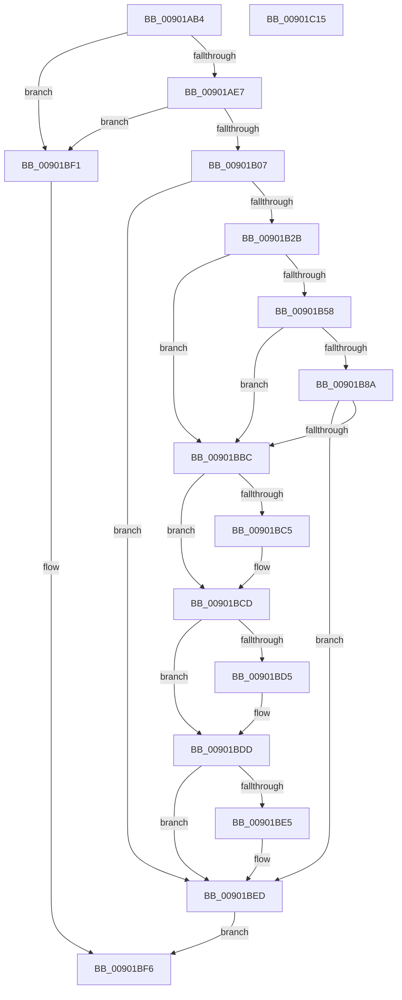

# MmManagePartitionGetMemoryEvents

- RVA: `0x00901AB4`–`0x00901C16` (길이 `354` bytes)
- VA: `0x0000000140901AB4`
- 실행 섹션: `PAGE`
- PDB 이름 있음: `예`; PDB Function 태그: `아니요`
- unwind 정보 RVA: `0x000886A4`
- 디코드: `96`개 명령, `354/354` bytes 표시
- 미해석 바이트: `0` (있으면 어셈블리에 `.byte`로 보존)

> 이 문서는 커널 이미지의 기계어와 PDB 기호를 분석해 생성했습니다. 4번과 5번은 함수 원형과 자료형을 바이너리 사용 방식에서 추정한 C 해석이며 원본 소스 복구 결과는 아닙니다.

## 1. Dependencies

- 직접 호출 지점: **6**; 고유 호출 대상: **2**
- 직접 호출자로 확인된 함수: **1**
- RIP 상대 이미지 참조: **1**

### Outgoing calls
- `0x00901B4D` → [ObOpenObjectByPointer](../8B/ObOpenObjectByPointer_function_008B7420.md) (function, `0x008B7420`)
- `0x00901B7F` → [ObOpenObjectByPointer](../8B/ObOpenObjectByPointer_function_008B7420.md) (function, `0x008B7420`)
- `0x00901BB1` → [ObOpenObjectByPointer](../8B/ObOpenObjectByPointer_function_008B7420.md) (function, `0x008B7420`)
- `0x00901BC8` → [ObCloseHandle](../8A/ObCloseHandle_function_008A1870.md) (function, `0x008A1870`)
- `0x00901BD8` → [ObCloseHandle](../8A/ObCloseHandle_function_008A1870.md) (function, `0x008A1870`)
- `0x00901BE8` → [ObCloseHandle](../8A/ObCloseHandle_function_008A1870.md) (function, `0x008A1870`)

### Direct callers
- [NtManagePartition](NtManagePartition_function_00902FC0.md) at `0x00903253`

### Static image references
- `0x00901B2B` → RVA `0x00FC6B80` (`ALMOSTRO`; read)

## 2. Other-region calls and transfers

- 다른 실행 섹션으로 향하는 call: **0**
- 별도 외부 분기/꼬리 이동을 확인하지 못했습니다.

## 3. Assembly (complete function range)

```asm
00901AB4  4C 8B DC                        mov r11, rsp
00901AB7  49 89 5B 08                     mov qword ptr [r11 + 8], rbx
00901ABB  49 89 6B 10                     mov qword ptr [r11 + 0x10], rbp
00901ABF  49 89 73 18                     mov qword ptr [r11 + 0x18], rsi
00901AC3  49 89 7B 20                     mov qword ptr [r11 + 0x20], rdi
00901AC7  41 55                           push r13
00901AC9  41 56                           push r14
00901ACB  41 57                           push r15
00901ACD  48 83 EC 40                     sub rsp, 0x40
00901AD1  4C 8B 29                        mov r13, qword ptr [rcx]
00901AD4  41 8A F8                        mov dil, r8b
00901AD7  44 8B 02                        mov r8d, dword ptr [rdx]
00901ADA  48 8B DA                        mov rbx, rdx
00901ADD  41 83 F8 01                     cmp r8d, 1
00901AE1  0F 85 0A 01 00 00               jne 0x140901bf1
00901AE7  8B 52 04                        mov edx, dword ptr [rdx + 4]
00901AEA  40 8A C7                        mov al, dil
00901AED  F6 D8                           neg al
00901AEF  1B C9                           sbb ecx, ecx
00901AF1  81 E1 00 FE FE FF               and ecx, 0xfffefe00
00901AF7  81 C1 F2 1F 01 00               add ecx, 0x11ff2
00901AFD  23 CA                           and ecx, edx
00901AFF  3B CA                           cmp ecx, edx
00901B01  0F 85 EA 00 00 00               jne 0x140901bf1
00901B07  48 8D 6B 10                     lea rbp, [rbx + 0x10]
00901B0B  33 F6                           xor esi, esi
00901B0D  48 83 65 00 00                  and qword ptr [rbp], 0
00901B12  4C 8D 7B 18                     lea r15, [rbx + 0x18]
00901B16  49 83 27 00                     and qword ptr [r15], 0
00901B1A  4C 8D 73 20                     lea r14, [rbx + 0x20]
00901B1E  49 83 26 00                     and qword ptr [r14], 0
00901B22  45 84 C0                        test r8b, r8b
00901B25  0F 84 C2 00 00 00               je 0x140901bed
00901B2B  48 8B 05 4E 50 6C 00            mov rax, qword ptr [rip + 0x6c504e]
00901B32  45 33 C0                        xor r8d, r8d
00901B35  49 8B 8D 28 01 00 00            mov rcx, qword ptr [r13 + 0x128]
00901B3C  44 8B 4B 08                     mov r9d, dword ptr [rbx + 8]
00901B40  49 89 6B D8                     mov qword ptr [r11 - 0x28], rbp
00901B44  40 88 7C 24 28                  mov byte ptr [rsp + 0x28], dil
00901B49  49 89 43 C8                     mov qword ptr [r11 - 0x38], rax
00901B4D  E8 CE 58 FB FF                  call 0x1408b7420
00901B52  8B F0                           mov esi, eax
00901B54  85 C0                           test eax, eax
00901B56  78 64                           js 0x140901bbc
00901B58  48 8B 05 21 50 6C 00            mov rax, qword ptr [rip + 0x6c5021]
00901B5F  45 33 C0                        xor r8d, r8d
00901B62  49 8B 8D 30 01 00 00            mov rcx, qword ptr [r13 + 0x130]
00901B69  44 8B 4B 08                     mov r9d, dword ptr [rbx + 8]
00901B6D  8B 53 04                        mov edx, dword ptr [rbx + 4]
00901B70  4C 89 7C 24 30                  mov qword ptr [rsp + 0x30], r15
00901B75  40 88 7C 24 28                  mov byte ptr [rsp + 0x28], dil
00901B7A  48 89 44 24 20                  mov qword ptr [rsp + 0x20], rax
00901B7F  E8 9C 58 FB FF                  call 0x1408b7420
00901B84  8B F0                           mov esi, eax
00901B86  85 C0                           test eax, eax
00901B88  78 32                           js 0x140901bbc
00901B8A  48 8B 05 EF 4F 6C 00            mov rax, qword ptr [rip + 0x6c4fef]
00901B91  45 33 C0                        xor r8d, r8d
00901B94  49 8B 8D 38 01 00 00            mov rcx, qword ptr [r13 + 0x138]
00901B9B  44 8B 4B 08                     mov r9d, dword ptr [rbx + 8]
00901B9F  8B 53 04                        mov edx, dword ptr [rbx + 4]
00901BA2  4C 89 74 24 30                  mov qword ptr [rsp + 0x30], r14
00901BA7  40 88 7C 24 28                  mov byte ptr [rsp + 0x28], dil
00901BAC  48 89 44 24 20                  mov qword ptr [rsp + 0x20], rax
00901BB1  E8 6A 58 FB FF                  call 0x1408b7420
00901BB6  8B F0                           mov esi, eax
00901BB8  85 C0                           test eax, eax
00901BBA  79 31                           jns 0x140901bed
00901BBC  48 8B 4D 00                     mov rcx, qword ptr [rbp]
00901BC0  48 85 C9                        test rcx, rcx
00901BC3  74 08                           je 0x140901bcd
00901BC5  40 8A D7                        mov dl, dil
00901BC8  E8 A3 FC F9 FF                  call 0x1408a1870
00901BCD  49 8B 0F                        mov rcx, qword ptr [r15]
00901BD0  48 85 C9                        test rcx, rcx
00901BD3  74 08                           je 0x140901bdd
00901BD5  40 8A D7                        mov dl, dil
00901BD8  E8 93 FC F9 FF                  call 0x1408a1870
00901BDD  49 8B 0E                        mov rcx, qword ptr [r14]
00901BE0  48 85 C9                        test rcx, rcx
00901BE3  74 08                           je 0x140901bed
00901BE5  40 8A D7                        mov dl, dil
00901BE8  E8 83 FC F9 FF                  call 0x1408a1870
00901BED  8B C6                           mov eax, esi
00901BEF  EB 05                           jmp 0x140901bf6
00901BF1  B8 0D 00 00 C0                  mov eax, 0xc000000d
00901BF6  48 8B 5C 24 60                  mov rbx, qword ptr [rsp + 0x60]
00901BFB  48 8B 6C 24 68                  mov rbp, qword ptr [rsp + 0x68]
00901C00  48 8B 74 24 70                  mov rsi, qword ptr [rsp + 0x70]
00901C05  48 8B 7C 24 78                  mov rdi, qword ptr [rsp + 0x78]
00901C0A  48 83 C4 40                     add rsp, 0x40
00901C0E  41 5F                           pop r15
00901C10  41 5E                           pop r14
00901C12  41 5D                           pop r13
00901C14  C3                              ret
00901C15  CC                              int3
```

## 4. C-style interpretation (structured pseudocode)

```c
__int64 __fastcall MmManagePartitionGetMemoryEvents(__int64 a1, __int64 a2, unsigned __int8 a3)
{
    __int64 result;
    __int64 v_rsi;
    __int64 v_rsp;
    unsigned __int64 v_stack_m28;
    unsigned __int8 v_stack_m30;
    unsigned __int64 v_stack_m38;
    unsigned __int64 v_stack_p10;
    unsigned __int64 v_stack_p18;
    unsigned __int64 v_stack_p20;
    unsigned __int64 v_stack_p8;

    *(unsigned __int64 *)(v_rsp + 8) = v_rbx;
    *(unsigned __int64 *)(v_rsp + 16) = v_rbp;
    *(unsigned __int64 *)(v_rsp + 24) = v_rsi;
    *(unsigned __int64 *)(v_rsp + 32) = v_rdi;
    v_rsp = (v_rsp) - (64);
    if (((unsigned int)((unsigned int)(*(unsigned int *)(a2)))) != 1) goto loc_00901BF1;
    result = (unsigned __int8)(-(a3));
    a1 = (unsigned int)((a1) & (0xFFFEFE00ULL));
    a1 = (unsigned int)((a1) + (0x11FF2ULL));
    a1 = (unsigned int)((a1) & ((unsigned int)((unsigned int)(*(unsigned int *)(a2 + 4)))));
    if (((unsigned int)(a1)) != ((unsigned int)((unsigned int)(*(unsigned int *)(a2 + 4))))) goto loc_00901BF1;
    v_rsi = 0;
    if ((unsigned __int8)((unsigned int)(*(unsigned int *)(a2))) == 0) goto loc_00901BED;
    a3 = 0;
    *(unsigned __int64 *)(v_rsp - 40) = a2 + 16;
    v_stack_m30 = 0;
    *(unsigned __int64 *)(v_rsp - 56) = *(unsigned __int64 *)(v_rip + 7098446);
    result = ObOpenObjectByPointer(*(unsigned __int64 *)(*(unsigned __int64 *)(a1) + 296), (unsigned int)(*(unsigned int *)(a2 + 4)), a3, (unsigned int)(*(unsigned int *)(a2 + 8)));
    if (sign_flag) goto loc_00901BBC;
    a3 = 0;
    v_stack_m28 = a2 + 24;
    v_stack_m30 = 0;
    v_stack_m38 = *(unsigned __int64 *)(v_rip + 7098401);
    result = ObOpenObjectByPointer(*(unsigned __int64 *)(*(unsigned __int64 *)(a1) + 304), (unsigned int)(*(unsigned int *)(a2 + 4)), a3, (unsigned int)(*(unsigned int *)(a2 + 8)));
    if (sign_flag) goto loc_00901BBC;
    a3 = 0;
    v_stack_m28 = a2 + 32;
    v_stack_m30 = 0;
    v_stack_m38 = *(unsigned __int64 *)(v_rip + 7098351);
    result = ObOpenObjectByPointer(*(unsigned __int64 *)(*(unsigned __int64 *)(a1) + 312), (unsigned int)(*(unsigned int *)(a2 + 4)), a3, (unsigned int)(*(unsigned int *)(a2 + 8)));
    if (!sign_flag) goto loc_00901BED;
loc_00901BBC:
    if (*(unsigned __int64 *)(a2 + 16) != 0) {
        a2 = 0;
        result = ObCloseHandle(*(unsigned __int64 *)(a2 + 16), a2, a3, (unsigned int)(*(unsigned int *)(a2 + 8)));
    }
    if (*(unsigned __int64 *)(a2 + 24) != 0) {
        a2 = 0;
        result = ObCloseHandle(*(unsigned __int64 *)(a2 + 24), a2, a3, (unsigned int)(*(unsigned int *)(a2 + 8)));
    }
    if (*(unsigned __int64 *)(a2 + 32) != 0) {
        a2 = 0;
        result = ObCloseHandle(*(unsigned __int64 *)(a2 + 32), a2, a3, (unsigned int)(*(unsigned int *)(a2 + 8)));
    }
    goto loc_00901BF6;
loc_00901BF1:
loc_00901BF6:
    v_rsp = (v_rsp) + (64);
    return (unsigned int)(0xC000000DULL);
}
```

## 5. (Beta) C Style

```c
int64_t MmManagePartitionGetMemoryEvents(void *Arg1, void *Arg2, uint8_t Arg3)
{
    uint8_t *arg1 = (uint8_t *)Arg1;
    uint8_t *arg2 = (uint8_t *)Arg2;

    int64_t result;
    int64_t local_rsi;
    int64_t local_rsp;
    uint64_t v_stack_m28;
    uint8_t v_stack_m30;
    uint64_t v_stack_m38;
    uint64_t v_stack_p10;
    uint64_t v_stack_p18;
    uint64_t v_stack_p20;
    uint64_t v_stack_p8;

    *(uint64_t *)(local_rsp + 0x8) = local_rbx;
    *(uint64_t *)(local_rsp + 0x10) = local_rbp;
    *(uint64_t *)(local_rsp + 0x18) = local_rsi;
    *(uint64_t *)(local_rsp + 0x20) = local_rdi;
    local_rsp = (local_rsp) - (64);
    if (((uint32_t)((uint32_t)(*(uint32_t *)(arg2)))) != 1) goto loc_00901BF1;
    result = (uint8_t)(-(Arg3));
    Arg1 = (uint32_t)((Arg1) & (0xFFFEFE00ULL));
    Arg1 = (uint32_t)((Arg1) + (0x11FF2ULL));
    Arg1 = (uint32_t)((Arg1) & ((uint32_t)((uint32_t)(*(uint32_t *)(arg2 + 0x4)))));
    if (((uint32_t)(Arg1)) != ((uint32_t)((uint32_t)(*(uint32_t *)(arg2 + 0x4))))) goto loc_00901BF1;
    local_rsi = 0;
    if ((uint8_t)((uint32_t)(*(uint32_t *)(arg2))) == 0) goto loc_00901BED;
    Arg3 = 0;
    *(void **)(local_rsp - 0x28) = Arg2 + 16;
    v_stack_m30 = 0;
    *(uint64_t *)(local_rsp - 0x38) = *(uint64_t *)(v_rip + 0x6C504E);
    result = ObOpenObjectByPointer(*(uint64_t *)(*(uint64_t *)(arg1) + 0x128), (uint32_t)(*(uint32_t *)(arg2 + 0x4)), Arg3, (uint32_t)(*(uint32_t *)(arg2 + 0x8)));
    if (sign_flag) goto loc_00901BBC;
    Arg3 = 0;
    v_stack_m28 = Arg2 + 24;
    v_stack_m30 = 0;
    v_stack_m38 = *(uint64_t *)(v_rip + 0x6C5021);
    result = ObOpenObjectByPointer(*(uint64_t *)(*(uint64_t *)(arg1) + 0x130), (uint32_t)(*(uint32_t *)(arg2 + 0x4)), Arg3, (uint32_t)(*(uint32_t *)(arg2 + 0x8)));
    if (sign_flag) goto loc_00901BBC;
    Arg3 = 0;
    v_stack_m28 = Arg2 + 32;
    v_stack_m30 = 0;
    v_stack_m38 = *(uint64_t *)(v_rip + 0x6C4FEF);
    result = ObOpenObjectByPointer(*(uint64_t *)(*(uint64_t *)(arg1) + 0x138), (uint32_t)(*(uint32_t *)(arg2 + 0x4)), Arg3, (uint32_t)(*(uint32_t *)(arg2 + 0x8)));
    if (!sign_flag) goto loc_00901BED;
loc_00901BBC:
    if (*(uint64_t *)(arg2 + 0x10) != 0) {
        Arg2 = 0;
        result = ObCloseHandle(*(uint64_t *)(arg2 + 0x10), Arg2, Arg3, (uint32_t)(*(uint32_t *)(arg2 + 0x8)));
    }
    if (*(uint64_t *)(arg2 + 0x18) != 0) {
        Arg2 = 0;
        result = ObCloseHandle(*(uint64_t *)(arg2 + 0x18), Arg2, Arg3, (uint32_t)(*(uint32_t *)(arg2 + 0x8)));
    }
    if (*(uint64_t *)(arg2 + 0x20) != 0) {
        Arg2 = 0;
        result = ObCloseHandle(*(uint64_t *)(arg2 + 0x20), Arg2, Arg3, (uint32_t)(*(uint32_t *)(arg2 + 0x8)));
    }
    goto loc_00901BF6;
loc_00901BF1:
loc_00901BF6:
    local_rsp = (local_rsp) + (64);
    return (uint32_t)(0xC000000DULL);
}
```

### 관측된 메모리 오프셋

구조체 형식이 확인되지 않은 접근은 인자 기준의 오프셋으로만 기록했습니다.

| 기준 인자 | 오프셋 표현 | 폭 (bit) | 접근 |
|---|---:|---:|---|
| `Arg1` | `+ 0x0` | `64` | `R` |
| `Arg2` | `+ 0x0` | `32` | `R` |
| `Arg2` | `+ 0x0` | `64` | `R` |
| `Arg2` | `+ 0x0` | `64` | `R/W` |
| `Arg2` | `+ 0x4` | `32` | `R` |
| `Arg2` | `+ 0x8` | `32` | `R` |
| `Arg2` | `+ 0x10` | `64` | `R` |
| `Arg2` | `+ 0x18` | `64` | `R` |
| `Arg2` | `+ 0x20` | `64` | `R` |

## 6. Execution-region graph

[열기: 2D/3D 그래프와 함수 탐색 컨트롤 패널](../../../control-panel.html?section=page&rva=0x00901AB4&view=graph)

- 2D 그래프는 위에서 아래로 흐르고, 3D 그래프는 빈 공간을 드래그해 회전합니다. Shift+드래그는 이동, 휠은 확대·축소, 함수 노드 선택은 대상 보고서 이동입니다.

### Static fallback


