# MmManagePartitionMemoryInformation

- RVA: `0x0090343C`–`0x00903887` (길이 `1,099` bytes)
- VA: `0x000000014090343C`
- 실행 섹션: `PAGE`
- PDB 이름 있음: `예`; PDB Function 태그: `아니요`
- unwind 정보 RVA: `0x00088978`
- 디코드: `262`개 명령, `1,099/1,099` bytes 표시
- 미해석 바이트: `0` (있으면 어셈블리에 `.byte`로 보존)

> 이 문서는 커널 이미지의 기계어와 PDB 기호를 분석해 생성했습니다. 4번과 5번은 함수 원형과 자료형을 바이너리 사용 방식에서 추정한 C 해석이며 원본 소스 복구 결과는 아닙니다.

## 1. Dependencies

- 직접 호출 지점: **11**; 고유 호출 대상: **7**
- 직접 호출자로 확인된 함수: **4**
- RIP 상대 이미지 참조: **5**

### Outgoing calls
- `0x0090347F` → [memset](../../text/6C/memset_function_006C6C40.md) (function, `0x006C6C40`)
- `0x0090355C` → [MiQueryMemoryListInformation](../../text/3B/MiQueryMemoryListInformation_function_003BA110.md) (function, `0x003BA110`)
- `0x0090356D` → [memcpy](../../text/6C/memcpy_function_006C6840.md) (function, `0x006C6840`)
- `0x00903580` → [memcpy](../../text/6C/memcpy_function_006C6840.md) (function, `0x006C6840`)
- `0x0090361C` → [MiGetChannelInformation](../../text/3B/MiGetChannelInformation_function_003B8738.md) (function, `0x003B8738`)
- `0x00903709` → [_security_check_cookie](../../text/6A/_security_check_cookie_function_006AC640.md) (function, `0x006AC640`)
- `0x00903785` → [memset](../../text/6C/memset_function_006C6C40.md) (function, `0x006C6C40`)
- `0x00903796` → [memset](../../text/6C/memset_function_006C6C40.md) (function, `0x006C6C40`)
- `0x009037AB` → [KeDelayExecutionThread](../../text/20/KeDelayExecutionThread_function_00209550.md) (function, `0x00209550`)
- `0x009037D6` → [KeDelayExecutionThread](../../text/20/KeDelayExecutionThread_function_00209550.md) (function, `0x00209550`)
- `0x00903833` → [MiGetNodeHugeRangeCounts](../../text/4F/MiGetNodeHugeRangeCounts_function_004FB248.md) (function, `0x004FB248`)

### Direct callers
- [DifUpdatePluginState](../../text/61/DifUpdatePluginState_function_0061AF84.md) at `0x0061AFCD`
- [DifGetAvailableSystemPages](../../text/61/DifGetAvailableSystemPages_function_0061B704.md) at `0x0061B761`
- [NtManagePartition](NtManagePartition_function_00902FC0.md) at `0x00903165`
- [sub_00B3B882](../B3/Unknown_function_00B3B882.md) at `0x00B3B8A5`

### Static image references
- `0x00903458` → RVA `0x00E0A740` (`.data`; read)
- `0x00903495` → RVA `0x00FC5000` (`ALMOSTRO`; read)
- `0x009034C5` → RVA `0x00E2CB40` (`.data`; read)
- `0x009034CC` → RVA `0x00E38D00` (`.data`; read)
- `0x009037A0` → RVA `0x000118B0` (`.rdata`; read)

## 2. Other-region calls and transfers

- 다른 실행 섹션으로 향하는 call: **11**
  - `0x0090347F` → [memset](../../text/6C/memset_function_006C6C40.md) (`PAGE` → `.text`)
  - `0x0090355C` → [MiQueryMemoryListInformation](../../text/3B/MiQueryMemoryListInformation_function_003BA110.md) (`PAGE` → `.text`)
  - `0x0090356D` → [memcpy](../../text/6C/memcpy_function_006C6840.md) (`PAGE` → `.text`)
  - `0x00903580` → [memcpy](../../text/6C/memcpy_function_006C6840.md) (`PAGE` → `.text`)
  - `0x0090361C` → [MiGetChannelInformation](../../text/3B/MiGetChannelInformation_function_003B8738.md) (`PAGE` → `.text`)
  - `0x00903709` → [_security_check_cookie](../../text/6A/_security_check_cookie_function_006AC640.md) (`PAGE` → `.text`)
  - `0x00903785` → [memset](../../text/6C/memset_function_006C6C40.md) (`PAGE` → `.text`)
  - `0x00903796` → [memset](../../text/6C/memset_function_006C6C40.md) (`PAGE` → `.text`)
  - `0x009037AB` → [KeDelayExecutionThread](../../text/20/KeDelayExecutionThread_function_00209550.md) (`PAGE` → `.text`)
  - `0x009037D6` → [KeDelayExecutionThread](../../text/20/KeDelayExecutionThread_function_00209550.md) (`PAGE` → `.text`)
  - `0x00903833` → [MiGetNodeHugeRangeCounts](../../text/4F/MiGetNodeHugeRangeCounts_function_004FB248.md) (`PAGE` → `.text`)
- 별도 외부 분기/꼬리 이동을 확인하지 못했습니다.

## 3. Assembly (complete function range)

```asm
0090343C  48 89 5C 24 18                  mov qword ptr [rsp + 0x18], rbx
00903441  55                              push rbp
00903442  56                              push rsi
00903443  57                              push rdi
00903444  41 54                           push r12
00903446  41 55                           push r13
00903448  41 56                           push r14
0090344A  41 57                           push r15
0090344C  48 8D 6C 24 A0                  lea rbp, [rsp - 0x60]
00903451  48 81 EC 60 01 00 00            sub rsp, 0x160
00903458  48 8B 05 E1 72 50 00            mov rax, qword ptr [rip + 0x5072e1]
0090345F  48 33 C4                        xor rax, rsp
00903462  48 89 45 50                     mov qword ptr [rbp + 0x50], rax
00903466  4C 8B 29                        mov r13, qword ptr [rcx]
00903469  4C 8B F2                        mov r14, rdx
0090346C  48 83 64 24 40 00               and qword ptr [rsp + 0x40], 0
00903472  48 8D 4C 24 50                  lea rcx, [rsp + 0x50]
00903477  33 D2                           xor edx, edx
00903479  41 B8 B0 00 00 00               mov r8d, 0xb0
0090347F  E8 BC 37 DC FF                  call 0x1406c6c40
00903484  41 F7 06 FE FF FF FF            test dword ptr [r14], 0xfffffffe
0090348B  0F 85 30 03 00 00               jne 0x1409037c1
00903491  41 8B 46 04                     mov eax, dword ptr [r14 + 4]
00903495  0F B7 3D 64 1B 6C 00            movzx edi, word ptr [rip + 0x6c1b64]
0090349C  83 F8 FF                        cmp eax, -1
0090349F  0F 85 14 03 00 00               jne 0x1409037b9
009034A5  41 83 7E 08 FF                  cmp dword ptr [r14 + 8], -1
009034AA  0F 85 11 03 00 00               jne 0x1409037c1
009034B0  33 C0                           xor eax, eax
009034B2  33 F6                           xor esi, esi
009034B4  49 21 86 E0 00 00 00            and qword ptr [r14 + 0xe0], rax
009034BB  89 44 24 20                     mov dword ptr [rsp + 0x20], eax
009034BF  41 BF 40 00 00 00               mov r15d, 0x40
009034C5  48 8D 15 74 96 52 00            lea rdx, [rip + 0x529674]
009034CC  48 8D 0D 2D 58 53 00            lea rcx, [rip + 0x53582d]
009034D3  45 33 E4                        xor r12d, r12d
009034D6  8B D8                           mov ebx, eax
009034D8  4C 3B E9                        cmp r13, rcx
009034DB  0F 84 49 02 00 00               je 0x14090372a
009034E1  41 8B 46 04                     mov eax, dword ptr [r14 + 4]
009034E5  83 F8 FF                        cmp eax, -1
009034E8  0F 85 60 02 00 00               jne 0x14090374e
009034EE  0F B7 05 0B 1B 6C 00            movzx eax, word ptr [rip + 0x6c1b0b]
009034F5  41 89 46 0C                     mov dword ptr [r14 + 0xc], eax
009034F9  41 8B 06                        mov eax, dword ptr [r14]
009034FC  A8 01                           test al, 1
009034FE  0F 85 54 02 00 00               jne 0x140903758
00903504  49 8B 85 40 49 00 00            mov rax, qword ptr [r13 + 0x4940]
0090350B  49 89 46 10                     mov qword ptr [r14 + 0x10], rax
0090350F  49 8B 85 80 4B 00 00            mov rax, qword ptr [r13 + 0x4b80]
00903516  49 3B C4                        cmp rax, r12
00903519  0F 82 81 02 00 00               jb 0x1409037a0
0090351F  49 2B C4                        sub rax, r12
00903522  49 89 46 18                     mov qword ptr [r14 + 0x18], rax
00903526  49 8B 85 98 4C 00 00            mov rax, qword ptr [r13 + 0x4c98]
0090352D  49 3B C4                        cmp rax, r12
00903530  0F 82 6A 02 00 00               jb 0x1409037a0
00903536  49 2B C4                        sub rax, r12
00903539  49 89 46 20                     mov qword ptr [r14 + 0x20], rax
0090353D  49 8B 85 C0 41 00 00            mov rax, qword ptr [r13 + 0x41c0]
00903544  49 3B C4                        cmp rax, r12
00903547  0F 82 53 02 00 00               jb 0x1409037a0
0090354D  49 2B C4                        sub rax, r12
00903550  48 8D 54 24 50                  lea rdx, [rsp + 0x50]
00903555  49 8B CD                        mov rcx, r13
00903558  49 89 46 28                     mov qword ptr [r14 + 0x28], rax
0090355C  E8 AF 6B AB FF                  call 0x1403ba110
00903561  49 8D 4E 58                     lea rcx, [r14 + 0x58]
00903565  4D 8B C7                        mov r8, r15
00903568  48 8D 54 24 78                  lea rdx, [rsp + 0x78]
0090356D  E8 CE 32 DC FF                  call 0x1406c6840
00903572  49 8D 8E 98 00 00 00            lea rcx, [r14 + 0x98]
00903579  4D 8B C7                        mov r8, r15
0090357C  48 8D 55 B8                     lea rdx, [rbp - 0x48]
00903580  E8 BB 32 DC FF                  call 0x1406c6840
00903585  49 8B 85 C8 41 00 00            mov rax, qword ptr [r13 + 0x41c8]
0090358C  49 3B C4                        cmp rax, r12
0090358F  0F 82 0B 02 00 00               jb 0x1409037a0
00903595  49 2B C4                        sub rax, r12
00903598  49 89 86 D8 00 00 00            mov qword ptr [r14 + 0xd8], rax
0090359F  90                              nop
009035A0  49 8B 46 20                     mov rax, qword ptr [r14 + 0x20]
009035A4  49 3B 86 D8 00 00 00            cmp rax, qword ptr [r14 + 0xd8]
009035AB  0F 87 B8 02 00 00               ja 0x140903869
009035B1  49 8B 4E 18                     mov rcx, qword ptr [r14 + 0x18]
009035B5  49 39 4E 28                     cmp qword ptr [r14 + 0x28], rcx
009035B9  0F 82 B6 02 00 00               jb 0x140903875
009035BF  48 3B C8                        cmp rcx, rax
009035C2  0F 87 B6 02 00 00               ja 0x14090387e
009035C8  89 5C 24 20                     mov dword ptr [rsp + 0x20], ebx
009035CC  85 DB                           test ebx, ebx
009035CE  0F 85 8C 01 00 00               jne 0x140903760
009035D4  49 83 66 40 00                  and qword ptr [r14 + 0x40], 0
009035D9  33 C9                           xor ecx, ecx
009035DB  49 83 66 48 00                  and qword ptr [r14 + 0x48], 0
009035E0  8B DE                           mov ebx, esi
009035E2  49 83 66 50 00                  and qword ptr [r14 + 0x50], 0
009035E7  49 83 66 30 00                  and qword ptr [r14 + 0x30], 0
009035EC  8B C6                           mov eax, esi
009035EE  4C 69 F8 80 DF 00 00            imul r15, rax, 0xdf80
009035F5  33 C0                           xor eax, eax
009035F7  4D 03 7D 10                     add r15, qword ptr [r13 + 0x10]
009035FB  3B F7                           cmp esi, edi
009035FD  0F 83 8E 00 00 00               jae 0x140903691
00903603  41 8B 06                        mov eax, dword ptr [r14]
00903606  A8 01                           test al, 1
00903608  0F 85 01 02 00 00               jne 0x14090380f
0090360E  4C 8D 4C 24 40                  lea r9, [rsp + 0x40]
00903613  8B D3                           mov edx, ebx
00903615  4C 8D 45 00                     lea r8, [rbp]
00903619  49 8B CD                        mov rcx, r13
0090361C  E8 17 51 AB FF                  call 0x1403b8738
00903621  48 B8 CD CC CC CC CC CC CC CC   movabs rax, 0xcccccccccccccccd
0090362B  48 F7 64 24 40                  mul qword ptr [rsp + 0x40]
00903630  48 C1 EA 05                     shr rdx, 5
00903634  84 D2                           test dl, dl
00903636  74 35                           je 0x14090366d
00903638  49 8B 4E 40                     mov rcx, qword ptr [r14 + 0x40]
0090363C  48 8D 45 18                     lea rax, [rbp + 0x18]
00903640  4D 8B 46 48                     mov r8, qword ptr [r14 + 0x48]
00903644  4D 8B 4E 50                     mov r9, qword ptr [r14 + 0x50]
00903648  44 0F B6 D2                     movzx r10d, dl
0090364C  48 03 48 F8                     add rcx, qword ptr [rax - 8]
00903650  4C 03 00                        add r8, qword ptr [rax]
00903653  4C 03 48 08                     add r9, qword ptr [rax + 8]
00903657  48 8D 40 28                     lea rax, [rax + 0x28]
0090365B  49 83 EA 01                     sub r10, 1
0090365F  75 EB                           jne 0x14090364c
00903661  49 89 4E 40                     mov qword ptr [r14 + 0x40], rcx
00903665  4D 89 46 48                     mov qword ptr [r14 + 0x48], r8
00903669  4D 89 4E 50                     mov qword ptr [r14 + 0x50], r9
0090366D  49 8B 87 80 3A 00 00            mov rax, qword ptr [r15 + 0x3a80]
00903674  49 01 46 30                     add qword ptr [r14 + 0x30], rax
00903678  49 8B 46 30                     mov rax, qword ptr [r14 + 0x30]
0090367C  FF C3                           inc ebx
0090367E  49 81 C7 80 DF 00 00            add r15, 0xdf80
00903685  3B DF                           cmp ebx, edi
00903687  0F 82 76 FF FF FF               jb 0x140903603
0090368D  49 8B 4E 50                     mov rcx, qword ptr [r14 + 0x50]
00903691  48 8D 15 68 56 53 00            lea rdx, [rip + 0x535668]
00903698  4C 3B EA                        cmp r13, rdx
0090369B  75 10                           jne 0x1409036ad
0090369D  49 3B C4                        cmp rax, r12
009036A0  0F 82 25 01 00 00               jb 0x1409037cb
009036A6  49 2B C4                        sub rax, r12
009036A9  49 89 46 30                     mov qword ptr [r14 + 0x30], rax
009036AD  41 83 7E 04 FF                  cmp dword ptr [r14 + 4], -1
009036B2  75 27                           jne 0x1409036db
009036B4  41 8B 06                        mov eax, dword ptr [r14]
009036B7  A8 01                           test al, 1
009036B9  75 20                           jne 0x1409036db
009036BB  49 83 66 50 00                  and qword ptr [r14 + 0x50], 0
009036C0  49 8D 56 58                     lea rdx, [r14 + 0x58]
009036C4  33 C9                           xor ecx, ecx
009036C6  44 8D 41 08                     lea r8d, [rcx + 8]
009036CA  48 03 0A                        add rcx, qword ptr [rdx]
009036CD  48 8D 52 08                     lea rdx, [rdx + 8]
009036D1  49 89 4E 50                     mov qword ptr [r14 + 0x50], rcx
009036D5  49 83 E8 01                     sub r8, 1
009036D9  75 EF                           jne 0x1409036ca
009036DB  49 8B 46 40                     mov rax, qword ptr [r14 + 0x40]
009036DF  49 03 46 48                     add rax, qword ptr [r14 + 0x48]
009036E3  48 03 C8                        add rcx, rax
009036E6  49 89 4E 38                     mov qword ptr [r14 + 0x38], rcx
009036EA  49 3B 4E 30                     cmp rcx, qword ptr [r14 + 0x30]
009036EE  0F 87 D7 00 00 00               ja 0x1409037cb
009036F4  41 0F B7 45 00                  movzx eax, word ptr [r13]
009036F9  41 89 86 E8 00 00 00            mov dword ptr [r14 + 0xe8], eax
00903700  33 C0                           xor eax, eax
00903702  48 8B 4D 50                     mov rcx, qword ptr [rbp + 0x50]
00903706  48 33 CC                        xor rcx, rsp
00903709  E8 32 8F DA FF                  call 0x1406ac640
0090370E  48 8B 9C 24 B0 01 00 00         mov rbx, qword ptr [rsp + 0x1b0]
00903716  48 81 C4 60 01 00 00            add rsp, 0x160
0090371D  41 5F                           pop r15
0090371F  41 5E                           pop r14
00903721  41 5D                           pop r13
00903723  41 5C                           pop r12
00903725  5F                              pop rdi
00903726  5E                              pop rsi
00903727  5D                              pop rbp
00903728  C3                              ret
00903729  CC                              int3
0090372A  41 8B 06                        mov eax, dword ptr [r14]
0090372D  A8 01                           test al, 1
0090372F  0F 85 AC FD FF FF               jne 0x1409034e1
00903735  41 8B 46 04                     mov eax, dword ptr [r14 + 4]
00903739  83 F8 FF                        cmp eax, -1
0090373C  0F 84 A2 00 00 00               je 0x1409037e4
00903742  4C 8B A4 C2 C0 AB 00 00         mov r12, qword ptr [rdx + rax*8 + 0xabc0]
0090374A  41 8B 46 04                     mov eax, dword ptr [r14 + 4]
0090374E  41 83 66 0C 00                  and dword ptr [r14 + 0xc], 0
00903753  8D 78 01                        lea edi, [rax + 1]
00903756  8B F0                           mov esi, eax
00903758  C7 44 24 20 01 00 00 00         mov dword ptr [rsp + 0x20], 1
00903760  49 83 66 10 00                  and qword ptr [r14 + 0x10], 0
00903765  49 8D 4E 58                     lea rcx, [r14 + 0x58]
00903769  49 83 66 18 00                  and qword ptr [r14 + 0x18], 0
0090376E  4D 8B C7                        mov r8, r15
00903771  49 83 66 20 00                  and qword ptr [r14 + 0x20], 0
00903776  33 D2                           xor edx, edx
00903778  49 83 66 28 00                  and qword ptr [r14 + 0x28], 0
0090377D  49 83 A6 D8 00 00 00 00         and qword ptr [r14 + 0xd8], 0
00903785  E8 B6 34 DC FF                  call 0x1406c6c40
0090378A  49 8D 8E 98 00 00 00            lea rcx, [r14 + 0x98]
00903791  4D 8B C7                        mov r8, r15
00903794  33 D2                           xor edx, edx
00903796  E8 A5 34 DC FF                  call 0x1406c6c40
0090379B  E9 34 FE FF FF                  jmp 0x1409035d4
009037A0  4C 8D 05 09 E1 70 FF            lea r8, [rip - 0x8f1ef7]
009037A7  33 D2                           xor edx, edx
009037A9  33 C9                           xor ecx, ecx
009037AB  E8 A0 5D 90 FF                  call 0x140209550
009037B0  8B 44 24 20                     mov eax, dword ptr [rsp + 0x20]
009037B4  E9 0C FD FF FF                  jmp 0x1409034c5
009037B9  3B C7                           cmp eax, edi
009037BB  0F 82 E4 FC FF FF               jb 0x1409034a5
009037C1  B8 0D 00 00 C0                  mov eax, 0xc000000d
009037C6  E9 37 FF FF FF                  jmp 0x140903702
009037CB  4C 8D 05 DE E0 70 FF            lea r8, [rip - 0x8f1f22]
009037D2  33 D2                           xor edx, edx
009037D4  33 C9                           xor ecx, ecx
009037D6  E8 75 5D 90 FF                  call 0x140209550
009037DB  8B 44 24 20                     mov eax, dword ptr [rsp + 0x20]
009037DF  E9 DB FC FF FF                  jmp 0x1409034bf
009037E4  3B F7                           cmp esi, edi
009037E6  0F 83 02 FD FF FF               jae 0x1409034ee
009037EC  8B CE                           mov ecx, esi
009037EE  48 81 C1 78 15 00 00            add rcx, 0x1578
009037F5  48 8D 0C CA                     lea rcx, [rdx + rcx*8]
009037F9  8B D7                           mov edx, edi
009037FB  2B D6                           sub edx, esi
009037FD  4C 03 21                        add r12, qword ptr [rcx]
00903800  48 8D 49 08                     lea rcx, [rcx + 8]
00903804  48 83 EA 01                     sub rdx, 1
00903808  75 F3                           jne 0x1409037fd
0090380A  E9 DF FC FF FF                  jmp 0x1409034ee
0090380F  48 83 64 24 28 00               and qword ptr [rsp + 0x28], 0
00903815  4C 8D 4C 24 30                  lea r9, [rsp + 0x30]
0090381A  48 83 64 24 30 00               and qword ptr [rsp + 0x30], 0
00903820  4C 8D 44 24 28                  lea r8, [rsp + 0x28]
00903825  48 83 64 24 38 00               and qword ptr [rsp + 0x38], 0
0090382B  48 8D 54 24 38                  lea rdx, [rsp + 0x38]
00903830  49 8B CF                        mov rcx, r15
00903833  E8 10 7A BF FF                  call 0x1404fb248
00903838  48 8B 44 24 30                  mov rax, qword ptr [rsp + 0x30]
0090383D  48 8B 4C 24 28                  mov rcx, qword ptr [rsp + 0x28]
00903842  48 C1 E0 12                     shl rax, 0x12
00903846  49 01 46 48                     add qword ptr [r14 + 0x48], rax
0090384A  48 8B 44 24 38                  mov rax, qword ptr [rsp + 0x38]
0090384F  48 C1 E0 12                     shl rax, 0x12
00903853  49 01 46 30                     add qword ptr [r14 + 0x30], rax
00903857  48 C1 E1 12                     shl rcx, 0x12
0090385B  49 01 4E 40                     add qword ptr [r14 + 0x40], rcx
0090385F  49 83 66 50 00                  and qword ptr [r14 + 0x50], 0
00903864  E9 0F FE FF FF                  jmp 0x140903678
00903869  49 89 86 D8 00 00 00            mov qword ptr [r14 + 0xd8], rax
00903870  E9 3C FD FF FF                  jmp 0x1409035b1
00903875  49 89 4E 28                     mov qword ptr [r14 + 0x28], rcx
00903879  E9 41 FD FF FF                  jmp 0x1409035bf
0090387E  49 89 46 18                     mov qword ptr [r14 + 0x18], rax
00903882  E9 41 FD FF FF                  jmp 0x1409035c8
```

## 4. C-style interpretation (structured pseudocode)

```c
__int64 __fastcall MmManagePartitionMemoryInformation(__int64 a1, __int64 a2)
{
    __int64 result;
    __int64 v_r10;
    __int64 v_r12;
    __int64 v_r15;
    __int64 v_rbx;
    __int64 v_rsi;
    __int64 v_rsp;
    unsigned __int64 v_stack_m120;
    unsigned __int64 v_stack_m148;
    unsigned __int64 v_stack_m158;
    unsigned int v_stack_m178;
    unsigned __int64 v_stack_m48;
    unsigned __int64 v_stack_m80;
    unsigned __int64 v_stack_m98;
    unsigned __int64 v_stack_mE0;
    unsigned __int64 v_stack_p18;
    unsigned int v_stack_p20;
    unsigned __int64 v_stack_p28;
    unsigned __int64 v_stack_p30;
    unsigned __int64 v_stack_p38;

    v_stack_p18 = v_rbx;
    v_rsp = (v_rsp) - (352);
    result = (*(unsigned __int64 *)(v_rip + 5272289)) ^ (v_rsp);
    v_stack_m48 = result;
    a2 = 0;
    result = memset(v_stack_m148, a2, 176, a4);
    if (((*(unsigned int *)(a2)) & (0xFFFFFFFEULL)) != 0) goto loc_009037C1;
    if (((unsigned int)((unsigned int)(*(unsigned int *)(a2 + 4)))) != -1) goto loc_009037B9;
loc_009034A5:
    if ((*(unsigned int *)(a2 + 8)) != -1) goto loc_009037C1;
    result = 0;
    v_rsi = 0;
    v_stack_m178 = 0;
loc_009034BF:
loc_009034C5:
    v_r12 = 0;
    if ((*(unsigned __int64 *)(a1)) == (v_rip + 5462061)) goto loc_0090372A;
loc_009034E1:
    if (((unsigned int)((unsigned int)(*(unsigned int *)(a2 + 4)))) != -1) goto loc_0090374E;
loc_009034EE:
    *(unsigned int *)(a2 + 12) = (unsigned int)(*(unsigned __int16 *)(v_rip + 7084811));
    if ((((unsigned __int8)((unsigned int)(*(unsigned int *)(a2)))) & (1)) != 0) goto loc_00903758;
    *(unsigned __int64 *)(a2 + 16) = *(unsigned __int64 *)(*(unsigned __int64 *)(a1) + 18752);
    if ((*(unsigned __int64 *)(*(unsigned __int64 *)(a1) + 19328)) < 0) goto loc_009037A0;
    result = (*(unsigned __int64 *)(*(unsigned __int64 *)(a1) + 19328)) - (0);
    *(unsigned __int64 *)(a2 + 24) = result;
    if ((*(unsigned __int64 *)(*(unsigned __int64 *)(a1) + 19608)) < 0) goto loc_009037A0;
    result = (*(unsigned __int64 *)(*(unsigned __int64 *)(a1) + 19608)) - (0);
    *(unsigned __int64 *)(a2 + 32) = result;
    if ((*(unsigned __int64 *)(*(unsigned __int64 *)(a1) + 16832)) < 0) goto loc_009037A0;
    result = (*(unsigned __int64 *)(*(unsigned __int64 *)(a1) + 16832)) - (0);
    *(unsigned __int64 *)(a2 + 40) = result;
    result = MiQueryMemoryListInformation(*(unsigned __int64 *)(a1), v_stack_m148, 176, a4);
    result = memcpy(a2 + 88, v_stack_m120, 64, a4);
    result = memcpy(a2 + 152, v_stack_mE0, 64, a4);
    if ((*(unsigned __int64 *)(*(unsigned __int64 *)(a1) + 16840)) < 0) goto loc_009037A0;
    result = (*(unsigned __int64 *)(*(unsigned __int64 *)(a1) + 16840)) - (0);
    *(unsigned __int64 *)(a2 + 216) = result;
    if ((*(unsigned __int64 *)(a2 + 32)) > (*(unsigned __int64 *)(a2 + 216))) goto loc_00903869;
loc_009035B1:
    if ((*(unsigned __int64 *)(a2 + 40)) < (*(unsigned __int64 *)(a2 + 24))) goto loc_00903875;
loc_009035BF:
    if ((*(unsigned __int64 *)(a2 + 24)) > (*(unsigned __int64 *)(a2 + 32))) goto loc_0090387E;
loc_009035C8:
    v_stack_m178 = 0;
    if (0 != 0) goto loc_00903760;
loc_009035D4:
    a1 = 0;
    v_r15 = (64) * (0);
    result = 0;
    v_r15 = (v_r15) + (*(unsigned __int64 *)(*(unsigned __int64 *)(a1) + 16));
    if (0 >= ((unsigned int)(*(unsigned __int16 *)(v_rip + 7084900)))) goto loc_00903691;
loc_00903603:
    if ((((unsigned __int8)((unsigned int)(*(unsigned int *)(a2)))) & (1)) != 0) goto loc_0090380F;
    result = MiGetChannelInformation(*(unsigned __int64 *)(a1), 0, v_stack_m98, v_stack_m158);
    a2 = (0) >> (5);
    if ((unsigned __int8)(a2) == 0) goto loc_0090366D;
loc_0090364C:
    a1 = (*(unsigned __int64 *)(a2 + 64)) + (*(unsigned __int64 *)(v_stack_m80 - 8));
    a3 = (*(unsigned __int64 *)(a2 + 72)) + (*(unsigned __int64 *)(v_stack_m80));
    a4 = (*(unsigned __int64 *)(a2 + 80)) + (*(unsigned __int64 *)(v_stack_m80 + 8));
    v_r10 = ((unsigned __int8)(a2)) - (1);
    if (condition_is_not_equal) goto loc_0090364C;
    *(unsigned __int64 *)(a2 + 64) = a1;
    *(unsigned __int64 *)(a2 + 72) = a3;
    *(unsigned __int64 *)(a2 + 80) = a4;
loc_0090366D:
loc_00903678:
    v_rbx = (unsigned int)((0) + 1);
    v_r15 = (v_r15) + (0xDF80ULL);
    if (((unsigned int)(v_rbx)) < ((unsigned int)(*(unsigned __int16 *)(v_rip + 7084900)))) goto loc_00903603;
loc_00903691:
    if ((*(unsigned __int64 *)(a1)) != (v_rip + 5461608)) goto loc_009036AD;
    if ((*(unsigned __int64 *)(a2 + 48)) < 0) goto loc_009037CB;
    result = (*(unsigned __int64 *)(a2 + 48)) - (0);
    *(unsigned __int64 *)(a2 + 48) = result;
loc_009036AD:
    if ((*(unsigned int *)(a2 + 4)) != -1) goto loc_009036DB;
    if ((((unsigned __int8)((unsigned int)(*(unsigned int *)(a2)))) & (1)) != 0) goto loc_009036DB;
    a1 = 0;
loc_009036CA:
    a1 = (a1) + (*(unsigned __int64 *)(a2 + 88));
    *(unsigned __int64 *)(a2 + 80) = a1;
    a3 = (a1 + 8) - (1);
    if (condition_is_not_equal) goto loc_009036CA;
loc_009036DB:
    result = (*(unsigned __int64 *)(a2 + 64)) + (*(unsigned __int64 *)(a2 + 72));
    a1 = (a1) + (result);
    *(unsigned __int64 *)(a2 + 56) = a1;
    if (a1 > (*(unsigned __int64 *)(a2 + 48))) goto loc_009037CB;
    *(unsigned int *)(a2 + 232) = (unsigned int)(*(unsigned __int16 *)(*(unsigned __int64 *)(a1)));
    result = 0;
loc_00903702:
    a1 = (v_stack_m48) ^ (v_rsp);
    result = _security_check_cookie(a1, a2 + 88 + 8, a3, a4);
    v_rsp = (v_rsp) + (352);
    return result;
loc_0090372A:
    if ((((unsigned __int8)((unsigned int)(*(unsigned int *)(a2)))) & (1)) != 0) goto loc_009034E1;
    if (((unsigned int)((unsigned int)(*(unsigned int *)(a2 + 4)))) == -1) goto loc_009037E4;
loc_0090374E:
loc_00903758:
    v_stack_p20 = 1;
loc_00903760:
    a2 = 0;
    result = memset(a2 + 88, a2, v_r15, a4);
    a2 = 0;
    result = memset(a2 + 152, a2, v_r15, a4);
    goto loc_009035D4;
loc_009037A0:
    a2 = 0;
    a1 = 0;
    result = KeDelayExecutionThread(a1, a2, v_rip - 9379575, a4);
    goto loc_009034C5;
loc_009037B9:
    if (((unsigned int)((unsigned int)(v_stack_p20))) < ((unsigned int)((unsigned int)(*(unsigned int *)(a2 + 4)) + 1))) goto loc_009034A5;
loc_009037C1:
    goto loc_00903702;
loc_009037CB:
    a2 = 0;
    a1 = 0;
    result = KeDelayExecutionThread(a1, a2, v_rip - 9379618, a4);
    goto loc_009034BF;
loc_009037E4:
    if (((unsigned int)((unsigned int)((unsigned int)((unsigned int)(*(unsigned int *)(a2 + 4)))))) >= ((unsigned int)((unsigned int)(*(unsigned int *)(a2 + 4)) + 1))) goto loc_009034EE;
    a1 = ((unsigned int)((unsigned int)((unsigned int)((unsigned int)((unsigned int)(*(unsigned int *)(a2 + 4))))))) + (0x1578ULL);
    a2 = (unsigned int)(((unsigned int)((unsigned int)((unsigned int)(*(unsigned int *)(a2 + 4)) + 1))) - ((unsigned int)((unsigned int)((unsigned int)((unsigned int)(*(unsigned int *)(a2 + 4)))))));
loc_009037FD:
    v_r12 = (*(unsigned __int64 *)(a2 + 88 + 8 + (unsigned int)(*(unsigned int *)(a2 + 4)) * 8 + 43968)) + (*(unsigned __int64 *)(a2 + a1 * 8));
    a2 = (a2) - (1);
    if (condition_is_not_equal) goto loc_009037FD;
    goto loc_009034EE;
loc_0090380F:
    result = MiGetNodeHugeRangeCounts(v_r15, v_stack_p38, v_stack_p28, v_stack_p30);
    result = (v_stack_p30) << (18);
    result = (v_stack_p38) << (18);
    a1 = (v_stack_p28) << (18);
    goto loc_00903678;
loc_00903869:
    *(unsigned __int64 *)(a2 + 216) = result;
    goto loc_009035B1;
loc_00903875:
    *(unsigned __int64 *)(a2 + 40) = a1;
    goto loc_009035BF;
loc_0090387E:
    *(unsigned __int64 *)(a2 + 24) = result;
    goto loc_009035C8;
}
```

## 5. (Beta) C Style

```c
int64_t MmManagePartitionMemoryInformation(void *Arg1, void *Arg2)
{
    uint8_t *arg1 = (uint8_t *)Arg1;
    uint8_t *arg2 = (uint8_t *)Arg2;

    int64_t result;
    int64_t local_r10;
    int64_t local_r12;
    int64_t local_r15;
    int64_t local_rbx;
    int64_t local_rsi;
    int64_t local_rsp;
    uint64_t v_stack_m120;
    uint64_t v_stack_m148;
    uint64_t v_stack_m158;
    uint32_t v_stack_m178;
    uint64_t v_stack_m48;
    uint64_t v_stack_m80;
    uint64_t v_stack_m98;
    uint64_t v_stack_mE0;
    uint64_t v_stack_p18;
    uint32_t v_stack_p20;
    uint64_t v_stack_p28;
    uint64_t v_stack_p30;
    uint64_t v_stack_p38;

    v_stack_p18 = local_rbx;
    local_rsp = (local_rsp) - (352);
    result = (*(uint64_t *)(v_rip + 0x5072E1)) ^ (local_rsp);
    v_stack_m48 = result;
    Arg2 = 0;
    result = memset(v_stack_m148, Arg2, 176, a4);
    if (((*(uint32_t *)(arg2)) & (0xFFFFFFFEULL)) != 0) goto loc_009037C1;
    if (((uint32_t)((uint32_t)(*(uint32_t *)(arg2 + 0x4)))) != -1) goto loc_009037B9;
loc_009034A5:
    if ((*(uint32_t *)(arg2 + 0x8)) != -1) goto loc_009037C1;
    result = 0;
    local_rsi = 0;
    v_stack_m178 = 0;
loc_009034BF:
loc_009034C5:
    local_r12 = 0;
    if ((*(uint64_t *)(arg1)) == (v_rip + 5462061)) goto loc_0090372A;
loc_009034E1:
    if (((uint32_t)((uint32_t)(*(uint32_t *)(arg2 + 0x4)))) != -1) goto loc_0090374E;
loc_009034EE:
    *(uint32_t *)(arg2 + 0xC) = (uint32_t)(*(uint16_t *)(v_rip + 0x6C1B0B));
    if ((((uint8_t)((uint32_t)(*(uint32_t *)(arg2)))) & (1)) != 0) goto loc_00903758;
    *(uint64_t *)(arg2 + 0x10) = *(uint64_t *)(*(uint64_t *)(arg1) + 0x4940);
    if ((*(uint64_t *)(*(uint64_t *)(arg1) + 0x4B80)) < 0) goto loc_009037A0;
    result = (*(uint64_t *)(*(uint64_t *)(arg1) + 0x4B80)) - (0);
    *(uint64_t *)(arg2 + 0x18) = result;
    if ((*(uint64_t *)(*(uint64_t *)(arg1) + 0x4C98)) < 0) goto loc_009037A0;
    result = (*(uint64_t *)(*(uint64_t *)(arg1) + 0x4C98)) - (0);
    *(uint64_t *)(arg2 + 0x20) = result;
    if ((*(uint64_t *)(*(uint64_t *)(arg1) + 0x41C0)) < 0) goto loc_009037A0;
    result = (*(uint64_t *)(*(uint64_t *)(arg1) + 0x41C0)) - (0);
    *(uint64_t *)(arg2 + 0x28) = result;
    result = MiQueryMemoryListInformation(*(uint64_t *)(arg1), v_stack_m148, 176, a4);
    result = memcpy(Arg2 + 88, v_stack_m120, 64, a4);
    result = memcpy(Arg2 + 152, v_stack_mE0, 64, a4);
    if ((*(uint64_t *)(*(uint64_t *)(arg1) + 0x41C8)) < 0) goto loc_009037A0;
    result = (*(uint64_t *)(*(uint64_t *)(arg1) + 0x41C8)) - (0);
    *(uint64_t *)(arg2 + 0xD8) = result;
    if ((*(uint64_t *)(arg2 + 0x20)) > (*(uint64_t *)(arg2 + 0xD8))) goto loc_00903869;
loc_009035B1:
    if ((*(uint64_t *)(arg2 + 0x28)) < (*(uint64_t *)(arg2 + 0x18))) goto loc_00903875;
loc_009035BF:
    if ((*(uint64_t *)(arg2 + 0x18)) > (*(uint64_t *)(arg2 + 0x20))) goto loc_0090387E;
loc_009035C8:
    v_stack_m178 = 0;
    if (0 != 0) goto loc_00903760;
loc_009035D4:
    Arg1 = 0;
    local_r15 = (64) * (0);
    result = 0;
    local_r15 = (local_r15) + (*(uint64_t *)(*(uint64_t *)(arg1) + 0x10));
    if (0 >= ((uint32_t)(*(uint16_t *)(v_rip + 0x6C1B64)))) goto loc_00903691;
loc_00903603:
    if ((((uint8_t)((uint32_t)(*(uint32_t *)(arg2)))) & (1)) != 0) goto loc_0090380F;
    result = MiGetChannelInformation(*(uint64_t *)(arg1), 0, v_stack_m98, v_stack_m158);
    Arg2 = (0) >> (5);
    if ((uint8_t)(Arg2) == 0) goto loc_0090366D;
loc_0090364C:
    Arg1 = (*(uint64_t *)(arg2 + 0x40)) + (*(uint64_t *)(v_stack_m80 - 0x8));
    a3 = (*(uint64_t *)(arg2 + 0x48)) + (*(uint64_t *)(v_stack_m80));
    a4 = (*(uint64_t *)(arg2 + 0x50)) + (*(uint64_t *)(v_stack_m80 + 0x8));
    local_r10 = ((uint8_t)(Arg2)) - (1);
    if (condition_is_not_equal) goto loc_0090364C;
    *(void **)(arg2 + 0x40) = Arg1;
    *(uint64_t *)(arg2 + 0x48) = a3;
    *(uint64_t *)(arg2 + 0x50) = a4;
loc_0090366D:
loc_00903678:
    local_rbx = (uint32_t)((0) + 1);
    local_r15 = (local_r15) + (0xDF80ULL);
    if (((uint32_t)(local_rbx)) < ((uint32_t)(*(uint16_t *)(v_rip + 0x6C1B64)))) goto loc_00903603;
loc_00903691:
    if ((*(uint64_t *)(arg1)) != (v_rip + 5461608)) goto loc_009036AD;
    if ((*(uint64_t *)(arg2 + 0x30)) < 0) goto loc_009037CB;
    result = (*(uint64_t *)(arg2 + 0x30)) - (0);
    *(uint64_t *)(arg2 + 0x30) = result;
loc_009036AD:
    if ((*(uint32_t *)(arg2 + 0x4)) != -1) goto loc_009036DB;
    if ((((uint8_t)((uint32_t)(*(uint32_t *)(arg2)))) & (1)) != 0) goto loc_009036DB;
    Arg1 = 0;
loc_009036CA:
    Arg1 = (Arg1) + (*(uint64_t *)(arg2 + 0x58));
    *(void **)(arg2 + 0x50) = Arg1;
    a3 = (Arg1 + 8) - (1);
    if (condition_is_not_equal) goto loc_009036CA;
loc_009036DB:
    result = (*(uint64_t *)(arg2 + 0x40)) + (*(uint64_t *)(arg2 + 0x48));
    Arg1 = (Arg1) + (result);
    *(void **)(arg2 + 0x38) = Arg1;
    if (Arg1 > (*(uint64_t *)(arg2 + 0x30))) goto loc_009037CB;
    *(uint32_t *)(arg2 + 0xE8) = (uint32_t)(*(uint16_t *)(*(uint64_t *)(arg1)));
    result = 0;
loc_00903702:
    Arg1 = (v_stack_m48) ^ (local_rsp);
    result = _security_check_cookie(Arg1, Arg2 + 88 + 8, a3, a4);
    local_rsp = (local_rsp) + (352);
    return result;
loc_0090372A:
    if ((((uint8_t)((uint32_t)(*(uint32_t *)(arg2)))) & (1)) != 0) goto loc_009034E1;
    if (((uint32_t)((uint32_t)(*(uint32_t *)(arg2 + 0x4)))) == -1) goto loc_009037E4;
loc_0090374E:
loc_00903758:
    v_stack_p20 = 1;
loc_00903760:
    Arg2 = 0;
    result = memset(Arg2 + 88, Arg2, local_r15, a4);
    Arg2 = 0;
    result = memset(Arg2 + 152, Arg2, local_r15, a4);
    goto loc_009035D4;
loc_009037A0:
    Arg2 = 0;
    Arg1 = 0;
    result = KeDelayExecutionThread(Arg1, Arg2, v_rip - 9379575, a4);
    goto loc_009034C5;
loc_009037B9:
    if (((uint32_t)((uint32_t)(v_stack_p20))) < ((uint32_t)((uint32_t)(*(uint32_t *)(arg2 + 0x4)) + 1))) goto loc_009034A5;
loc_009037C1:
    goto loc_00903702;
loc_009037CB:
    Arg2 = 0;
    Arg1 = 0;
    result = KeDelayExecutionThread(Arg1, Arg2, v_rip - 9379618, a4);
    goto loc_009034BF;
loc_009037E4:
    if (((uint32_t)((uint32_t)((uint32_t)((uint32_t)(*(uint32_t *)(arg2 + 0x4)))))) >= ((uint32_t)((uint32_t)(*(uint32_t *)(arg2 + 0x4)) + 1))) goto loc_009034EE;
    Arg1 = ((uint32_t)((uint32_t)((uint32_t)((uint32_t)((uint32_t)(*(uint32_t *)(arg2 + 0x4))))))) + (0x1578ULL);
    Arg2 = (uint32_t)(((uint32_t)((uint32_t)((uint32_t)(*(uint32_t *)(arg2 + 0x4)) + 1))) - ((uint32_t)((uint32_t)((uint32_t)((uint32_t)(*(uint32_t *)(arg2 + 0x4)))))));
loc_009037FD:
    local_r12 = (*(uint64_t *)(arg2 + 0x58 + 0x8 + (uint32_t)(*(uint32_t *)(arg2 + 0x4)) * 8 + 0xABC0)) + (*(uint64_t *)(arg2 + arg1 * 8));
    Arg2 = (Arg2) - (1);
    if (condition_is_not_equal) goto loc_009037FD;
    goto loc_009034EE;
loc_0090380F:
    result = MiGetNodeHugeRangeCounts(local_r15, v_stack_p38, v_stack_p28, v_stack_p30);
    result = (v_stack_p30) << (18);
    result = (v_stack_p38) << (18);
    Arg1 = (v_stack_p28) << (18);
    goto loc_00903678;
loc_00903869:
    *(uint64_t *)(arg2 + 0xD8) = result;
    goto loc_009035B1;
loc_00903875:
    *(void **)(arg2 + 0x28) = Arg1;
    goto loc_009035BF;
loc_0090387E:
    *(uint64_t *)(arg2 + 0x18) = result;
    goto loc_009035C8;
}
```

### 관측된 메모리 오프셋

구조체 형식이 확인되지 않은 접근은 인자 기준의 오프셋으로만 기록했습니다.

| 기준 인자 | 오프셋 표현 | 폭 (bit) | 접근 |
|---|---:|---:|---|
| `Arg1` | `+ 0x0` | `64` | `R` |
| `Arg2` | `+ 0x0` | `32` | `R` |
| `Arg2` | `+ 0x0` | `64` | `R` |
| `Arg2` | `+ 0x4` | `32` | `R` |
| `Arg2` | `+ 0x8` | `32` | `R` |
| `Arg2` | `+ 0x8` | `64` | `R` |
| `Arg2` | `+ 0xC` | `32` | `R/W` |
| `Arg2` | `+ 0xC` | `32` | `W` |
| `Arg2` | `+ 0x10` | `64` | `R/W` |
| `Arg2` | `+ 0x10` | `64` | `W` |
| `Arg2` | `+ 0x18` | `64` | `R` |
| `Arg2` | `+ 0x18` | `64` | `R/W` |
| `Arg2` | `+ 0x18` | `64` | `W` |
| `Arg2` | `+ 0x20` | `64` | `R` |
| `Arg2` | `+ 0x20` | `64` | `R/W` |
| `Arg2` | `+ 0x20` | `64` | `W` |
| `Arg2` | `+ 0x28` | `64` | `R` |
| `Arg2` | `+ 0x28` | `64` | `R/W` |
| `Arg2` | `+ 0x28` | `64` | `W` |
| `Arg2` | `+ 0x30` | `64` | `R` |
| `Arg2` | `+ 0x30` | `64` | `R/W` |
| `Arg2` | `+ 0x30` | `64` | `W` |
| `Arg2` | `+ 0x38` | `64` | `W` |
| `Arg2` | `+ 0x40` | `64` | `R` |
| `Arg2` | `+ 0x40` | `64` | `R/W` |
| `Arg2` | `+ 0x40` | `64` | `W` |
| `Arg2` | `+ 0x48` | `64` | `R` |
| `Arg2` | `+ 0x48` | `64` | `R/W` |
| `Arg2` | `+ 0x48` | `64` | `W` |
| `Arg2` | `+ 0x50` | `64` | `R` |
| `Arg2` | `+ 0x50` | `64` | `R/W` |
| `Arg2` | `+ 0x50` | `64` | `W` |

추가 오프셋 7개는 표에서 생략했습니다.

## 6. Execution-region graph

[열기: 2D/3D 그래프와 함수 탐색 컨트롤 패널](../../../control-panel.html?section=page&rva=0x0090343C&view=graph)

- 2D 그래프는 위에서 아래로 흐르고, 3D 그래프는 빈 공간을 드래그해 회전합니다. Shift+드래그는 이동, 휠은 확대·축소, 함수 노드 선택은 대상 보고서 이동입니다.

### Static fallback

```mermaid
flowchart TD
  bb_0090343C[BB_0090343C]
  bb_00903491[BB_00903491]
  bb_009034A5[BB_009034A5]
  bb_009034B0[BB_009034B0]
  bb_009034BF[BB_009034BF]
  bb_009034C5[BB_009034C5]
  bb_009034E1[BB_009034E1]
  bb_009034EE[BB_009034EE]
  bb_00903504[BB_00903504]
  bb_0090351F[BB_0090351F]
  bb_00903536[BB_00903536]
  bb_0090354D[BB_0090354D]
  bb_00903595[BB_00903595]
  bb_009035B1[BB_009035B1]
  bb_009035BF[BB_009035BF]
  bb_009035C8[BB_009035C8]
  bb_009035D4[BB_009035D4]
  bb_00903603[BB_00903603]
  bb_0090360E[BB_0090360E]
  bb_00903638[BB_00903638]
  bb_0090364C[BB_0090364C]
  bb_00903661[BB_00903661]
  bb_0090366D[BB_0090366D]
  bb_00903678[BB_00903678]
  bb_0090368D[BB_0090368D]
  bb_00903691[BB_00903691]
  bb_0090369D[BB_0090369D]
  bb_009036A6[BB_009036A6]
  bb_009036AD[BB_009036AD]
  bb_009036B4[BB_009036B4]
  bb_009036BB[BB_009036BB]
  bb_009036CA[BB_009036CA]
  bb_009036DB[BB_009036DB]
  bb_009036F4[BB_009036F4]
  bb_00903702[BB_00903702]
  bb_00903729[BB_00903729]
  bb_0090372A[BB_0090372A]
  bb_00903735[BB_00903735]
  bb_00903742[BB_00903742]
  bb_0090374E[BB_0090374E]
  bb_00903758[BB_00903758]
  bb_00903760[BB_00903760]
  bb_009037A0[BB_009037A0]
  bb_009037B9[BB_009037B9]
  bb_009037C1[BB_009037C1]
  bb_009037CB[BB_009037CB]
  bb_009037E4[BB_009037E4]
  bb_009037EC[BB_009037EC]
  bb_009037FD[BB_009037FD]
  bb_0090380A[BB_0090380A]
  bb_0090380F[BB_0090380F]
  bb_00903869[BB_00903869]
  bb_00903875[BB_00903875]
  bb_0090387E[BB_0090387E]
  bb_0090343C -->|branch| bb_009037C1
  bb_0090343C -->|fallthrough| bb_00903491
  bb_00903491 -->|branch| bb_009037B9
  bb_00903491 -->|fallthrough| bb_009034A5
  bb_009034A5 -->|branch| bb_009037C1
  bb_009034A5 -->|fallthrough| bb_009034B0
  bb_009034B0 -->|flow| bb_009034BF
  bb_009034BF -->|flow| bb_009034C5
  bb_009034C5 -->|branch| bb_0090372A
  bb_009034C5 -->|fallthrough| bb_009034E1
  bb_009034E1 -->|branch| bb_0090374E
  bb_009034E1 -->|fallthrough| bb_009034EE
  bb_009034EE -->|branch| bb_00903758
  bb_009034EE -->|fallthrough| bb_00903504
  bb_00903504 -->|branch| bb_009037A0
  bb_00903504 -->|fallthrough| bb_0090351F
  bb_0090351F -->|branch| bb_009037A0
  bb_0090351F -->|fallthrough| bb_00903536
  bb_00903536 -->|branch| bb_009037A0
  bb_00903536 -->|fallthrough| bb_0090354D
  bb_0090354D -->|branch| bb_009037A0
  bb_0090354D -->|fallthrough| bb_00903595
  bb_00903595 -->|branch| bb_00903869
  bb_00903595 -->|fallthrough| bb_009035B1
  bb_009035B1 -->|branch| bb_00903875
  bb_009035B1 -->|fallthrough| bb_009035BF
  bb_009035BF -->|branch| bb_0090387E
  bb_009035BF -->|fallthrough| bb_009035C8
  bb_009035C8 -->|branch| bb_00903760
  bb_009035C8 -->|fallthrough| bb_009035D4
  bb_009035D4 -->|branch| bb_00903691
  bb_009035D4 -->|fallthrough| bb_00903603
  bb_00903603 -->|branch| bb_0090380F
  bb_00903603 -->|fallthrough| bb_0090360E
  bb_0090360E -->|branch| bb_0090366D
  bb_0090360E -->|fallthrough| bb_00903638
  bb_00903638 -->|flow| bb_0090364C
  bb_0090364C -->|branch| bb_0090364C
  bb_0090364C -->|fallthrough| bb_00903661
  bb_00903661 -->|flow| bb_0090366D
  bb_0090366D -->|flow| bb_00903678
  bb_00903678 -->|branch| bb_00903603
  bb_00903678 -->|fallthrough| bb_0090368D
  bb_0090368D -->|flow| bb_00903691
  bb_00903691 -->|branch| bb_009036AD
  bb_00903691 -->|fallthrough| bb_0090369D
  bb_0090369D -->|branch| bb_009037CB
  bb_0090369D -->|fallthrough| bb_009036A6
  bb_009036A6 -->|flow| bb_009036AD
  bb_009036AD -->|branch| bb_009036DB
  bb_009036AD -->|fallthrough| bb_009036B4
  bb_009036B4 -->|branch| bb_009036DB
  bb_009036B4 -->|fallthrough| bb_009036BB
  bb_009036BB -->|flow| bb_009036CA
  bb_009036CA -->|branch| bb_009036CA
  bb_009036CA -->|fallthrough| bb_009036DB
  bb_009036DB -->|branch| bb_009037CB
  bb_009036DB -->|fallthrough| bb_009036F4
  bb_009036F4 -->|flow| bb_00903702
  bb_00903729 -->|flow| bb_0090372A
  bb_0090372A -->|branch| bb_009034E1
  bb_0090372A -->|fallthrough| bb_00903735
  bb_00903735 -->|branch| bb_009037E4
  bb_00903735 -->|fallthrough| bb_00903742
  bb_00903742 -->|flow| bb_0090374E
  bb_0090374E -->|flow| bb_00903758
  bb_00903758 -->|flow| bb_00903760
  bb_00903760 -->|branch| bb_009035D4
  bb_009037A0 -->|branch| bb_009034C5
  bb_009037B9 -->|branch| bb_009034A5
  bb_009037B9 -->|fallthrough| bb_009037C1
  bb_009037C1 -->|branch| bb_00903702
  bb_009037CB -->|branch| bb_009034BF
  bb_009037E4 -->|branch| bb_009034EE
  bb_009037E4 -->|fallthrough| bb_009037EC
  bb_009037EC -->|flow| bb_009037FD
  bb_009037FD -->|branch| bb_009037FD
  bb_009037FD -->|fallthrough| bb_0090380A
  bb_0090380A -->|branch| bb_009034EE
  bb_0090380F -->|branch| bb_00903678
  bb_00903869 -->|branch| bb_009035B1
  bb_00903875 -->|branch| bb_009035BF
  bb_0090387E -->|branch| bb_009035C8
```


