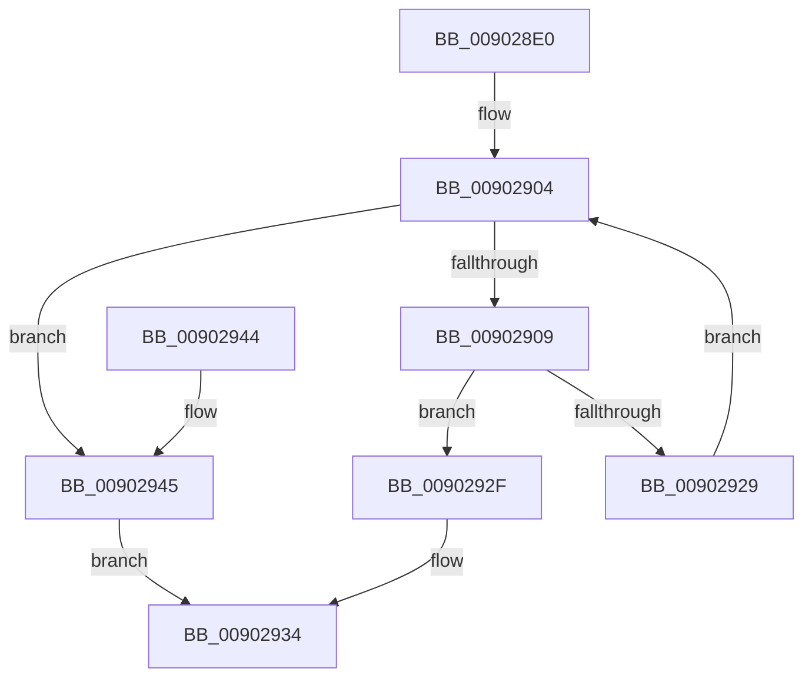

# MmQueryPfnList

- RVA: `0x009028E0`–`0x00902949` (길이 `105` bytes)
- VA: `0x00000001409028E0`
- 실행 섹션: `PAGE`
- PDB 이름 있음: `예`; PDB Function 태그: `아니요`
- unwind 정보 RVA: `0x00088864`
- 디코드: `30`개 명령, `105/105` bytes 표시
- 미해석 바이트: `0` (있으면 어셈블리에 `.byte`로 보존)

> 이 문서는 커널 이미지의 기계어와 PDB 기호를 분석해 생성했습니다. 4번과 5번은 함수 원형과 자료형을 바이너리 사용 방식에서 추정한 C 해석이며 원본 소스 복구 결과는 아닙니다.

## 1. Dependencies

- 직접 호출 지점: **1**; 고유 호출 대상: **1**
- 직접 호출자로 확인된 함수: **1**
- RIP 상대 이미지 참조: **0**

### Outgoing calls
- `0x0090291E` → [MiIdentifyPfnWrapper](../../text/31/MiIdentifyPfnWrapper_function_0031C8F0.md) (function, `0x0031C8F0`)

### Direct callers
- [PfpPfnPrioRequest](PfpPfnPrioRequest_function_00902488.md) at `0x00902503`

### Static image references
- 디코드된 RIP-relative 메모리 참조가 없습니다.

## 2. Other-region calls and transfers

- 다른 실행 섹션으로 향하는 call: **1**
  - `0x0090291E` → [MiIdentifyPfnWrapper](../../text/31/MiIdentifyPfnWrapper_function_0031C8F0.md) (`PAGE` → `.text`)
- 별도 외부 분기/꼬리 이동을 확인하지 못했습니다.

## 3. Assembly (complete function range)

```asm
009028E0  48 89 5C 24 08                  mov qword ptr [rsp + 8], rbx
009028E5  48 89 74 24 10                  mov qword ptr [rsp + 0x10], rsi
009028EA  57                              push rdi
009028EB  48 83 EC 20                     sub rsp, 0x20
009028EF  48 8D 04 49                     lea rax, [rcx + rcx*2]
009028F3  48 BE 00 00 00 00 00 DE FF FF   movabs rsi, 0xffffde0000000000
009028FD  48 8D 3C C2                     lea rdi, [rdx + rax*8]
00902901  48 8B DA                        mov rbx, rdx
00902904  48 3B DF                        cmp rbx, rdi
00902907  73 3C                           jae 0x140902945
00902909  48 8B 43 08                     mov rax, qword ptr [rbx + 8]
0090290D  48 8D 0C 40                     lea rcx, [rax + rax*2]
00902911  48 C1 E1 04                     shl rcx, 4
00902915  48 8B C6                        mov rax, rsi
00902918  48 03 C8                        add rcx, rax
0090291B  48 8B D3                        mov rdx, rbx
0090291E  E8 CD 9F A1 FF                  call 0x14031c8f0
00902923  F6 43 10 02                     test byte ptr [rbx + 0x10], 2
00902927  75 06                           jne 0x14090292f
00902929  48 83 C3 18                     add rbx, 0x18
0090292D  EB D5                           jmp 0x140902904
0090292F  B8 F0 00 00 C0                  mov eax, 0xc00000f0
00902934  48 8B 5C 24 30                  mov rbx, qword ptr [rsp + 0x30]
00902939  48 8B 74 24 38                  mov rsi, qword ptr [rsp + 0x38]
0090293E  48 83 C4 20                     add rsp, 0x20
00902942  5F                              pop rdi
00902943  C3                              ret
00902944  CC                              int3
00902945  33 C0                           xor eax, eax
00902947  EB EB                           jmp 0x140902934
```

## 4. C-style interpretation (structured pseudocode)

```c
__int64 __fastcall MmQueryPfnList(__int64 a1, __int64 a2)
{
    __int64 result;
    __int64 v_rbx;
    __int64 v_rsp;
    unsigned __int64 v_stack_p10;
    unsigned __int64 v_stack_p8;

    v_stack_p8 = v_rbx;
    v_stack_p10 = v_rsi;
    v_rsp = (v_rsp) - (32);
loc_00902904:
    if (a2 >= (a2 + a1 + a1 * 2 * 8)) goto loc_00902945;
    a1 = (*(unsigned __int64 *)(a2 + 8) + *(unsigned __int64 *)(a2 + 8) * 2) << (4);
    a1 = (a1) + (v_rsi);
    result = MiIdentifyPfnWrapper(a1, a2, a3, a4);
    if (((*(unsigned __int8 *)(a2 + 16)) & (2)) != 0) goto loc_0090292F;
    v_rbx = (a2) + (24);
    goto loc_00902904;
loc_0090292F:
loc_00902934:
    v_rsp = (v_rsp) + (32);
    return (unsigned int)(0xC00000F0ULL);
loc_00902945:
    result = 0;
    goto loc_00902934;
}
```

## 5. (Beta) C Style

```c
int64_t MmQueryPfnList(void *Arg1, void *Arg2)
{
    uint8_t *arg1 = (uint8_t *)Arg1;
    uint8_t *arg2 = (uint8_t *)Arg2;

    int64_t result;
    int64_t local_rbx;
    int64_t local_rsp;
    uint64_t v_stack_p10;
    uint64_t v_stack_p8;

    v_stack_p8 = local_rbx;
    v_stack_p10 = local_rsi;
    local_rsp = (local_rsp) - (32);
loc_00902904:
    if (Arg2 >= (Arg2 + Arg1 + Arg1 * 2 * 8)) goto loc_00902945;
    Arg1 = (*(uint64_t *)(arg2 + 0x8) + *(uint64_t *)(arg2 + 0x8) * 2) << (4);
    Arg1 = (Arg1) + (local_rsi);
    result = MiIdentifyPfnWrapper(Arg1, Arg2, a3, a4);
    if (((*(uint8_t *)(arg2 + 0x10)) & (2)) != 0) goto loc_0090292F;
    local_rbx = (Arg2) + (24);
    goto loc_00902904;
loc_0090292F:
loc_00902934:
    local_rsp = (local_rsp) + (32);
    return (uint32_t)(0xC00000F0ULL);
loc_00902945:
    result = 0;
    goto loc_00902934;
}
```

### 관측된 메모리 오프셋

구조체 형식이 확인되지 않은 접근은 인자 기준의 오프셋으로만 기록했습니다.

| 기준 인자 | 오프셋 표현 | 폭 (bit) | 접근 |
|---|---:|---:|---|
| `Arg1` | `+ 0x0 + rcx*2` | `64` | `R` |
| `Arg2` | `+ 0x0 + rax*8` | `64` | `R` |

## 6. Execution-region graph

[열기: 2D/3D 그래프와 함수 탐색 컨트롤 패널](../../../control-panel.html?section=page&rva=0x009028E0&view=graph)

- 2D 그래프는 위에서 아래로 흐르고, 3D 그래프는 빈 공간을 드래그해 회전합니다. Shift+드래그는 이동, 휠은 확대·축소, 함수 노드 선택은 대상 보고서 이동입니다.

### Static fallback


