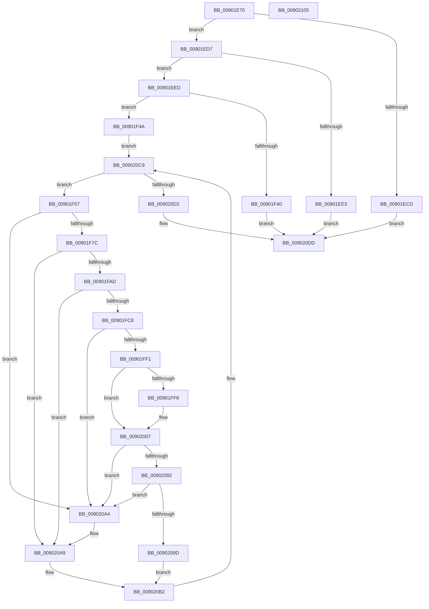

# MmRelocatePfnList

- RVA: `0x00901E70`–`0x00902106` (길이 `662` bytes)
- VA: `0x0000000140901E70`
- 실행 섹션: `PAGE`
- PDB 이름 있음: `예`; PDB Function 태그: `아니요`
- unwind 정보 RVA: `0x000886FC`
- 디코드: `155`개 명령, `662/662` bytes 표시
- 미해석 바이트: `0` (있으면 어셈블리에 `.byte`로 보존)

> 이 문서는 커널 이미지의 기계어와 PDB 기호를 분석해 생성했습니다. 4번과 5번은 함수 원형과 자료형을 바이너리 사용 방식에서 추정한 C 해석이며 원본 소스 복구 결과는 아닙니다.

## 1. Dependencies

- 직접 호출 지점: **11**; 고유 호출 대상: **11**
- 직접 호출자로 확인된 함수: **1**
- RIP 상대 이미지 참조: **6**

### Outgoing calls
- `0x00901F11` → [MiInitializePageColorBase](../../text/32/MiInitializePageColorBase_function_00320410.md) (function, `0x00320410`)
- `0x00901F22` → [memset](../../text/6C/memset_function_006C6C40.md) (function, `0x006C6C40`)
- `0x00901F37` → [MiCreateUltraThreadContext](../../text/28/MiCreateUltraThreadContext_function_00288200.md) (function, `0x00288200`)
- `0x00901F6F` → [MiIsPfn](../../text/46/MiIsPfn_function_00462450.md) (function, `0x00462450`)
- `0x00901F99` → [MiIdentifyPfnWrapper](../../text/31/MiIdentifyPfnWrapper_function_0031C8F0.md) (function, `0x0031C8F0`)
- `0x00901FE3` → [MiPfnsWorthTrying](../../text/31/MiPfnsWorthTrying_function_0031B0C0.md) (function, `0x0031B0C0`)
- `0x00902002` → [MiAdjustCachedStacks](../../text/2D/MiAdjustCachedStacks_function_002D8AAC.md) (function, `0x002D8AAC`)
- `0x00902037` → [MiMakeColor](../../text/43/MiMakeColor_function_0043E240.md) (function, `0x0043E240`)
- `0x00902088` → [MiClaimPhysicalRun](../../text/28/MiClaimPhysicalRun_function_0028CF00.md) (function, `0x0028CF00`)
- `0x009020D6` → [MiDeleteUltraThreadContext](../../text/32/MiDeleteUltraThreadContext_function_00322C90.md) (function, `0x00322C90`)
- `0x009020E4` → [_security_check_cookie](../../text/6A/_security_check_cookie_function_006AC640.md) (function, `0x006AC640`)

### Direct callers
- [PfpPfnPrioRequest](PfpPfnPrioRequest_function_00902488.md) at `0x00902661`

### Static image references
- `0x00901E8E` → RVA `0x00E0A740` (`.data`; read)
- `0x00901EAB` → RVA `0x00FC5000` (`ALMOSTRO`; read)
- `0x00901ED7` → RVA `0x00FC5002` (`ALMOSTRO`; read)
- `0x00901FD8` → RVA `0x00E38D00` (`.data`; read)
- `0x0090200C` → RVA `0x00E2DCCC` (`.data`; read)
- `0x0090203C` → RVA `0x00E2DCE0` (`.data`; read)

## 2. Other-region calls and transfers

- 다른 실행 섹션으로 향하는 call: **11**
  - `0x00901F11` → [MiInitializePageColorBase](../../text/32/MiInitializePageColorBase_function_00320410.md) (`PAGE` → `.text`)
  - `0x00901F22` → [memset](../../text/6C/memset_function_006C6C40.md) (`PAGE` → `.text`)
  - `0x00901F37` → [MiCreateUltraThreadContext](../../text/28/MiCreateUltraThreadContext_function_00288200.md) (`PAGE` → `.text`)
  - `0x00901F6F` → [MiIsPfn](../../text/46/MiIsPfn_function_00462450.md) (`PAGE` → `.text`)
  - `0x00901F99` → [MiIdentifyPfnWrapper](../../text/31/MiIdentifyPfnWrapper_function_0031C8F0.md) (`PAGE` → `.text`)
  - `0x00901FE3` → [MiPfnsWorthTrying](../../text/31/MiPfnsWorthTrying_function_0031B0C0.md) (`PAGE` → `.text`)
  - `0x00902002` → [MiAdjustCachedStacks](../../text/2D/MiAdjustCachedStacks_function_002D8AAC.md) (`PAGE` → `.text`)
  - `0x00902037` → [MiMakeColor](../../text/43/MiMakeColor_function_0043E240.md) (`PAGE` → `.text`)
  - `0x00902088` → [MiClaimPhysicalRun](../../text/28/MiClaimPhysicalRun_function_0028CF00.md) (`PAGE` → `.text`)
  - `0x009020D6` → [MiDeleteUltraThreadContext](../../text/32/MiDeleteUltraThreadContext_function_00322C90.md) (`PAGE` → `.text`)
  - `0x009020E4` → [_security_check_cookie](../../text/6A/_security_check_cookie_function_006AC640.md) (`PAGE` → `.text`)
- 별도 외부 분기/꼬리 이동을 확인하지 못했습니다.

## 3. Assembly (complete function range)

```asm
00901E70  48 89 5C 24 08                  mov qword ptr [rsp + 8], rbx
00901E75  48 89 74 24 20                  mov qword ptr [rsp + 0x20], rsi
00901E7A  55                              push rbp
00901E7B  57                              push rdi
00901E7C  41 54                           push r12
00901E7E  41 56                           push r14
00901E80  41 57                           push r15
00901E82  48 8D 6C 24 F0                  lea rbp, [rsp - 0x10]
00901E87  48 81 EC 10 01 00 00            sub rsp, 0x110
00901E8E  48 8B 05 AB 88 50 00            mov rax, qword ptr [rip + 0x5088ab]
00901E95  48 33 C4                        xor rax, rsp
00901E98  48 89 45 00                     mov qword ptr [rbp], rax
00901E9C  83 64 24 50 00                  and dword ptr [rsp + 0x50], 0
00901EA1  33 C0                           xor eax, eax
00901EA3  0F 57 C0                        xorps xmm0, xmm0
00901EA6  48 89 44 24 68                  mov qword ptr [rsp + 0x68], rax
00901EAB  0F B7 05 4E 31 6C 00            movzx eax, word ptr [rip + 0x6c314e]
00901EB2  45 8B E1                        mov r12d, r9d
00901EB5  45 8B F8                        mov r15d, r8d
00901EB8  48 8B DA                        mov rbx, rdx
00901EBB  48 8B F9                        mov rdi, rcx
00901EBE  0F 11 44 24 58                  movups xmmword ptr [rsp + 0x58], xmm0
00901EC3  0F 11 44 24 70                  movups xmmword ptr [rsp + 0x70], xmm0
00901EC8  44 3B C0                        cmp r8d, eax
00901ECB  72 0A                           jb 0x140901ed7
00901ECD  B8 F0 00 00 C0                  mov eax, 0xc00000f0
00901ED2  E9 06 02 00 00                  jmp 0x1409020dd
00901ED7  0F B6 05 24 31 6C 00            movzx eax, byte ptr [rip + 0x6c3124]
00901EDE  44 3B E0                        cmp r12d, eax
00901EE1  72 0A                           jb 0x140901eed
00901EE3  B8 F1 00 00 C0                  mov eax, 0xc00000f1
00901EE8  E9 F0 01 00 00                  jmp 0x1409020dd
00901EED  65 48 8B 04 25 88 01 00 00      mov rax, qword ptr gs:[0x188]
00901EF6  4C 8D 4C 24 70                  lea r9, [rsp + 0x70]
00901EFB  41 FF C0                        inc r8d
00901EFE  BA 03 00 00 00                  mov edx, 3
00901F03  48 8B 88 B8 00 00 00            mov rcx, qword ptr [rax + 0xb8]
00901F0A  48 81 C1 00 04 00 00            add rcx, 0x400
00901F11  E8 FA E4 A1 FF                  call 0x140320410
00901F16  33 D2                           xor edx, edx
00901F18  48 8D 4D 80                     lea rcx, [rbp - 0x80]
00901F1C  41 B8 80 00 00 00               mov r8d, 0x80
00901F22  E8 19 4D DC FF                  call 0x1406c6c40
00901F27  45 33 C9                        xor r9d, r9d
00901F2A  48 8D 54 24 70                  lea rdx, [rsp + 0x70]
00901F2F  48 8D 4D 80                     lea rcx, [rbp - 0x80]
00901F33  45 8D 41 08                     lea r8d, [r9 + 8]
00901F37  E8 C4 62 98 FF                  call 0x140288200
00901F3C  85 C0                           test eax, eax
00901F3E  75 0A                           jne 0x140901f4a
00901F40  B8 9A 00 00 C0                  mov eax, 0xc000009a
00901F45  E9 93 01 00 00                  jmp 0x1409020dd
00901F4A  48 8D 04 7F                     lea rax, [rdi + rdi*2]
00901F4E  4C 8D 34 C3                     lea r14, [rbx + rax*8]
00901F52  E9 72 01 00 00                  jmp 0x1409020c9
00901F57  48 8B 73 08                     mov rsi, qword ptr [rbx + 8]
00901F5B  48 83 64 24 58 00               and qword ptr [rsp + 0x58], 0
00901F61  48 8B CE                        mov rcx, rsi
00901F64  48 83 64 24 68 00               and qword ptr [rsp + 0x68], 0
00901F6A  48 89 74 24 60                  mov qword ptr [rsp + 0x60], rsi
00901F6F  E8 DC 04 B6 FF                  call 0x140462450
00901F74  85 C0                           test eax, eax
00901F76  0F 84 28 01 00 00               je 0x1409020a4
00901F7C  48 8D 3C 76                     lea rdi, [rsi + rsi*2]
00901F80  48 C1 E7 04                     shl rdi, 4
00901F84  48 B8 00 00 00 00 00 DE FF FF   movabs rax, 0xffffde0000000000
00901F8E  48 03 F8                        add rdi, rax
00901F91  48 8D 54 24 58                  lea rdx, [rsp + 0x58]
00901F96  48 8B CF                        mov rcx, rdi
00901F99  E8 52 A9 A1 FF                  call 0x14031c8f0
00901F9E  48 8B 4C 24 68                  mov rcx, qword ptr [rsp + 0x68]
00901FA3  48 3B 4B 10                     cmp rcx, qword ptr [rbx + 0x10]
00901FA7  0F 85 FC 00 00 00               jne 0x1409020a9
00901FAD  48 8B 44 24 58                  mov rax, qword ptr [rsp + 0x58]
00901FB2  48 BA 00 FE FF FF FF FF FF 01   movabs rdx, 0x1fffffffffffe00
00901FBC  48 33 03                        xor rax, qword ptr [rbx]
00901FBF  48 85 C2                        test rdx, rax
00901FC2  0F 85 E1 00 00 00               jne 0x1409020a9
00901FC8  45 33 C9                        xor r9d, r9d
00901FCB  48 8D 44 24 50                  lea rax, [rsp + 0x50]
00901FD0  48 8B D7                        mov rdx, rdi
00901FD3  48 89 44 24 20                  mov qword ptr [rsp + 0x20], rax
00901FD8  48 8D 0D 21 6D 53 00            lea rcx, [rip + 0x536d21]
00901FDF  45 8D 41 01                     lea r8d, [r9 + 1]
00901FE3  E8 D8 90 A1 FF                  call 0x14031b0c0
00901FE8  48 85 C0                        test rax, rax
00901FEB  0F 85 B3 00 00 00               jne 0x1409020a4
00901FF1  F6 44 24 50 01                  test byte ptr [rsp + 0x50], 1
00901FF6  74 0F                           je 0x140902007
00901FF8  8D 50 01                        lea edx, [rax + 1]
00901FFB  48 8D 0D FE 6C 53 00            lea rcx, [rip + 0x536cfe]
00902002  E8 A5 6A 9D FF                  call 0x1402d8aac
00902007  8B 47 20                        mov eax, dword ptr [rdi + 0x20]
0090200A  33 D2                           xor edx, edx
0090200C  8B 0D BA BC 52 00               mov ecx, dword ptr [rip + 0x52bcba]
00902012  C1 E8 10                        shr eax, 0x10
00902015  44 0F B6 C8                     movzx r9d, al
00902019  48 8B C6                        mov rax, rsi
0090201C  48 F7 F1                        div rcx
0090201F  41 C1 E9 06                     shr r9d, 6
00902023  41 8B CF                        mov ecx, r15d
00902026  4C 8B C2                        mov r8, rdx
00902029  44 89 4C 24 20                  mov dword ptr [rsp + 0x20], r9d
0090202E  41 8A D4                        mov dl, r12b
00902031  41 B9 03 00 00 00               mov r9d, 3
00902037  E8 04 C2 B3 FF                  call 0x14043e240
0090203C  4C 8B 0D 9D BC 52 00            mov r9, qword ptr [rip + 0x52bc9d]
00902043  48 8D 4C 24 50                  lea rcx, [rsp + 0x50]
00902048  48 83 4C 24 70 FF               or qword ptr [rsp + 0x70], 0xffffffffffffffff
0090204E  41 B8 01 00 00 00               mov r8d, 1
00902054  48 89 4C 24 48                  mov qword ptr [rsp + 0x48], rcx
00902059  48 8B D6                        mov rdx, rsi
0090205C  48 8D 4C 24 70                  lea rcx, [rsp + 0x70]
00902061  48 89 4C 24 40                  mov qword ptr [rsp + 0x40], rcx
00902066  48 8D 0D 93 6C 53 00            lea rcx, [rip + 0x536c93]
0090206D  48 83 64 24 38 00               and qword ptr [rsp + 0x38], 0
00902073  89 44 24 30                     mov dword ptr [rsp + 0x30], eax
00902077  48 8D 45 80                     lea rax, [rbp - 0x80]
0090207B  C7 44 24 28 00 40 40 00         mov dword ptr [rsp + 0x28], 0x404000
00902083  48 89 44 24 20                  mov qword ptr [rsp + 0x20], rax
00902088  E8 73 AE 98 FF                  call 0x14028cf00
0090208D  48 85 C0                        test rax, rax
00902090  75 12                           jne 0x1409020a4
00902092  48 8B 44 24 70                  mov rax, qword ptr [rsp + 0x70]
00902097  48 83 F8 FF                     cmp rax, -1
0090209B  74 07                           je 0x1409020a4
0090209D  48 89 44 24 60                  mov qword ptr [rsp + 0x60], rax
009020A2  EB 0E                           jmp 0x1409020b2
009020A4  48 8B 4C 24 68                  mov rcx, qword ptr [rsp + 0x68]
009020A9  48 83 C9 02                     or rcx, 2
009020AD  48 89 4C 24 68                  mov qword ptr [rsp + 0x68], rcx
009020B2  0F 10 44 24 58                  movups xmm0, xmmword ptr [rsp + 0x58]
009020B7  F2 0F 10 4C 24 68               movsd xmm1, qword ptr [rsp + 0x68]
009020BD  0F 11 03                        movups xmmword ptr [rbx], xmm0
009020C0  F2 0F 11 4B 10                  movsd qword ptr [rbx + 0x10], xmm1
009020C5  48 83 C3 18                     add rbx, 0x18
009020C9  49 3B DE                        cmp rbx, r14
009020CC  0F 82 85 FE FF FF               jb 0x140901f57
009020D2  48 8D 4D 80                     lea rcx, [rbp - 0x80]
009020D6  E8 B5 0B A2 FF                  call 0x140322c90
009020DB  33 C0                           xor eax, eax
009020DD  48 8B 4D 00                     mov rcx, qword ptr [rbp]
009020E1  48 33 CC                        xor rcx, rsp
009020E4  E8 57 A5 DA FF                  call 0x1406ac640
009020E9  4C 8D 9C 24 10 01 00 00         lea r11, [rsp + 0x110]
009020F1  49 8B 5B 30                     mov rbx, qword ptr [r11 + 0x30]
009020F5  49 8B 73 48                     mov rsi, qword ptr [r11 + 0x48]
009020F9  49 8B E3                        mov rsp, r11
009020FC  41 5F                           pop r15
009020FE  41 5E                           pop r14
00902100  41 5C                           pop r12
00902102  5F                              pop rdi
00902103  5D                              pop rbp
00902104  C3                              ret
00902105  CC                              int3
```

## 4. C-style interpretation (structured pseudocode)

```c
__int64 __fastcall MmRelocatePfnList(__int64 a1, __int64 a2, int a3, int a4)
{
    __int64 result;
    __int64 v_rbx;
    __int64 v_rdi;
    __int64 v_rsp;
    unsigned __int64 v_stack_m100;
    unsigned int v_stack_m108;
    unsigned int v_stack_m110;
    unsigned __int64 v_stack_m118;
    unsigned __int64 v_stack_m28;
    unsigned __int64 v_stack_m38;
    unsigned __int64 v_stack_mB8;
    unsigned __int64 v_stack_mC8;
    unsigned __int64 v_stack_mD0;
    unsigned __int64 v_stack_mD8;
    unsigned __int64 v_stack_mE0;
    unsigned int v_stack_mE8;
    unsigned __int64 v_stack_mF0;
    unsigned __int64 v_stack_mF8;
    unsigned __int64 v_stack_p20;
    unsigned __int64 v_stack_p8;

    v_stack_p8 = v_rbx;
    v_stack_p20 = v_rsi;
    v_rsp = (v_rsp) - (272);
    result = (*(unsigned __int64 *)(v_rip + 5277867)) ^ (v_rsp);
    v_stack_m38 = result;
    result = 0;
    v_stack_mD0 = 0;
    v_stack_mE0 = v_xmm0;
    v_stack_mC8 = v_xmm0;
    if (a3 < ((unsigned int)(*(unsigned __int16 *)(v_rip + 7090510)))) goto loc_00901ED7;
    goto loc_009020DD;
loc_00901ED7:
    if (((unsigned int)((unsigned int)(a4))) < ((unsigned int)(*(unsigned __int8 *)(v_rip + 7090468)))) goto loc_00901EED;
    goto loc_009020DD;
loc_00901EED:
    a3 = (unsigned int)((a3) + 1);
    a1 = (*(unsigned __int64 *)(*(unsigned __int64 *)(gs_base + (0 + 392)) + 184)) + (0x400ULL);
    result = MiInitializePageColorBase(a1, 3, a3, v_stack_mC8);
    a2 = 0;
    result = memset(v_stack_mB8, a2, 128, v_stack_mC8);
    a4 = 0;
    result = MiCreateUltraThreadContext(v_stack_mB8, v_stack_mC8, a4 + 8, a4);
    if ((unsigned int)(result) != 0) goto loc_00901F4A;
    goto loc_009020DD;
loc_00901F4A:
    goto loc_009020C9;
loc_00901F57:
    v_stack_mD8 = *(unsigned __int64 *)(a2 + 8);
    result = MiIsPfn(*(unsigned __int64 *)(a2 + 8), v_stack_mC8, a4 + 8, a4);
    if ((unsigned int)(result) == 0) goto loc_009020A4;
    v_rdi = (*(unsigned __int64 *)(a2 + 8) + *(unsigned __int64 *)(a2 + 8) * 2) << (4);
    v_rdi = (v_rdi) + (result);
    result = MiIdentifyPfnWrapper(v_rdi, v_stack_mE0, a4 + 8, a4);
    if (v_stack_mD0 != (*(unsigned __int64 *)(a2 + 16))) goto loc_009020A9;
    result = (v_stack_mE0) ^ (*(unsigned __int64 *)(a2));
    if (((v_stack_mE0) & (result)) != 0) goto loc_009020A9;
    a4 = 0;
    v_stack_m118 = v_stack_mE8;
    result = MiPfnsWorthTrying(v_rip + 5467425, v_rdi, a4 + 1, a4);
    if (result != 0) goto loc_009020A4;
    if (((v_stack_mE8) & (1)) != 0) {
        a2 = result + 1;
        a1 = v_rip + 5467390;
        result = MiAdjustCachedStacks(a1, a2, a4 + 1, a4);
    }
    a2 = 0;
    result = (unsigned int)(((unsigned int)(*(unsigned int *)(v_rdi + 32))) >> (16));
    a4 = (unsigned int)(((unsigned __int8)(result)) >> (6));
    v_stack_m118 = a4;
    result = MiMakeColor((unsigned int)((unsigned int)((unsigned int)(a3))), (unsigned __int8)((unsigned int)(a4)), 0, 3);
    v_stack_mF0 = v_stack_mE8;
    v_stack_mF8 = v_stack_mC8;
    v_stack_m108 = (unsigned int)(result);
    v_stack_m110 = 0x404000ULL;
    v_stack_m118 = v_stack_mB8;
    result = MiClaimPhysicalRun(v_rip + 5467283, *(unsigned __int64 *)(a2 + 8), 1, *(unsigned __int64 *)(v_rip + 5422237));
    if (result != 0) goto loc_009020A4;
    if (v_stack_mC8 == -1) goto loc_009020A4;
    v_stack_mD8 = v_stack_mC8;
    goto loc_009020B2;
loc_009020A4:
loc_009020A9:
    a1 = (v_stack_mD0) | (2);
    v_stack_mD0 = a1;
loc_009020B2:
    *(unsigned __int64 *)(a2) = v_xmm0;
    *(unsigned __int64 *)(a2 + 16) = v_xmm1;
    v_rbx = (a2) + (24);
loc_009020C9:
    if (v_rbx < (a2 + a1 + a1 * 2 * 8)) goto loc_00901F57;
    result = MiDeleteUltraThreadContext(v_stack_mB8, *(unsigned __int64 *)(a2 + 8), 1, *(unsigned __int64 *)(v_rip + 5422237));
    result = 0;
loc_009020DD:
    a1 = (v_stack_m38) ^ (v_rsp);
    result = _security_check_cookie(a1, *(unsigned __int64 *)(a2 + 8), 1, *(unsigned __int64 *)(v_rip + 5422237));
    return result;
}
```

## 5. (Beta) C Style

```c
int64_t MmRelocatePfnList(void *Arg1, void *Arg2, int32_t Arg3, int32_t Arg4)
{
    uint8_t *arg1 = (uint8_t *)Arg1;
    uint8_t *arg2 = (uint8_t *)Arg2;

    int64_t result;
    int64_t local_rbx;
    int64_t local_rdi;
    int64_t local_rsp;
    uint64_t v_stack_m100;
    uint32_t v_stack_m108;
    uint32_t v_stack_m110;
    uint64_t v_stack_m118;
    uint64_t v_stack_m28;
    uint64_t v_stack_m38;
    uint64_t v_stack_mB8;
    uint64_t v_stack_mC8;
    uint64_t v_stack_mD0;
    uint64_t v_stack_mD8;
    uint64_t v_stack_mE0;
    uint32_t v_stack_mE8;
    uint64_t v_stack_mF0;
    uint64_t v_stack_mF8;
    uint64_t v_stack_p20;
    uint64_t v_stack_p8;

    v_stack_p8 = local_rbx;
    v_stack_p20 = local_rsi;
    local_rsp = (local_rsp) - (272);
    result = (*(uint64_t *)(v_rip + 0x5088AB)) ^ (local_rsp);
    v_stack_m38 = result;
    result = 0;
    v_stack_mD0 = 0;
    v_stack_mE0 = v_xmm0;
    v_stack_mC8 = v_xmm0;
    if (Arg3 < ((uint32_t)(*(uint16_t *)(v_rip + 0x6C314E)))) goto loc_00901ED7;
    goto loc_009020DD;
loc_00901ED7:
    if (((uint32_t)((uint32_t)(Arg4))) < ((uint32_t)(*(uint8_t *)(v_rip + 0x6C3124)))) goto loc_00901EED;
    goto loc_009020DD;
loc_00901EED:
    Arg3 = (uint32_t)((Arg3) + 1);
    Arg1 = (*(uint64_t *)(*(uint64_t *)(gs_base + (0 + 0x188)) + 0xB8)) + (0x400ULL);
    result = MiInitializePageColorBase(Arg1, 3, Arg3, v_stack_mC8);
    Arg2 = 0;
    result = memset(v_stack_mB8, Arg2, 128, v_stack_mC8);
    Arg4 = 0;
    result = MiCreateUltraThreadContext(v_stack_mB8, v_stack_mC8, Arg4 + 8, Arg4);
    if ((uint32_t)(result) != 0) goto loc_00901F4A;
    goto loc_009020DD;
loc_00901F4A:
    goto loc_009020C9;
loc_00901F57:
    v_stack_mD8 = *(uint64_t *)(arg2 + 0x8);
    result = MiIsPfn(*(uint64_t *)(arg2 + 0x8), v_stack_mC8, Arg4 + 8, Arg4);
    if ((uint32_t)(result) == 0) goto loc_009020A4;
    local_rdi = (*(uint64_t *)(arg2 + 0x8) + *(uint64_t *)(arg2 + 0x8) * 2) << (4);
    local_rdi = (local_rdi) + (result);
    result = MiIdentifyPfnWrapper(local_rdi, v_stack_mE0, Arg4 + 8, Arg4);
    if (v_stack_mD0 != (*(uint64_t *)(arg2 + 0x10))) goto loc_009020A9;
    result = (v_stack_mE0) ^ (*(uint64_t *)(arg2));
    if (((v_stack_mE0) & (result)) != 0) goto loc_009020A9;
    Arg4 = 0;
    v_stack_m118 = v_stack_mE8;
    result = MiPfnsWorthTrying(v_rip + 5467425, local_rdi, Arg4 + 1, Arg4);
    if (result != 0) goto loc_009020A4;
    if (((v_stack_mE8) & (1)) != 0) {
        Arg2 = result + 1;
        Arg1 = v_rip + 5467390;
        result = MiAdjustCachedStacks(Arg1, Arg2, Arg4 + 1, Arg4);
    }
    Arg2 = 0;
    result = (uint32_t)(((uint32_t)(*(uint32_t *)(local_rdi + 0x20))) >> (16));
    Arg4 = (uint32_t)(((uint8_t)(result)) >> (6));
    v_stack_m118 = Arg4;
    result = MiMakeColor((uint32_t)((uint32_t)((uint32_t)(Arg3))), (uint8_t)((uint32_t)(Arg4)), 0, 3);
    v_stack_mF0 = v_stack_mE8;
    v_stack_mF8 = v_stack_mC8;
    v_stack_m108 = (uint32_t)(result);
    v_stack_m110 = 0x404000ULL;
    v_stack_m118 = v_stack_mB8;
    result = MiClaimPhysicalRun(v_rip + 5467283, *(uint64_t *)(arg2 + 0x8), 1, *(uint64_t *)(v_rip + 0x52BC9D));
    if (result != 0) goto loc_009020A4;
    if (v_stack_mC8 == -1) goto loc_009020A4;
    v_stack_mD8 = v_stack_mC8;
    goto loc_009020B2;
loc_009020A4:
loc_009020A9:
    Arg1 = (v_stack_mD0) | (2);
    v_stack_mD0 = Arg1;
loc_009020B2:
    *(uint64_t *)(arg2) = v_xmm0;
    *(uint64_t *)(arg2 + 0x10) = v_xmm1;
    local_rbx = (Arg2) + (24);
loc_009020C9:
    if (local_rbx < (Arg2 + Arg1 + Arg1 * 2 * 8)) goto loc_00901F57;
    result = MiDeleteUltraThreadContext(v_stack_mB8, *(uint64_t *)(arg2 + 0x8), 1, *(uint64_t *)(v_rip + 0x52BC9D));
    result = 0;
loc_009020DD:
    Arg1 = (v_stack_m38) ^ (local_rsp);
    result = _security_check_cookie(Arg1, *(uint64_t *)(arg2 + 0x8), 1, *(uint64_t *)(v_rip + 0x52BC9D));
    return result;
}
```

### 관측된 메모리 오프셋

구조체 형식이 확인되지 않은 접근은 인자 기준의 오프셋으로만 기록했습니다.

| 기준 인자 | 오프셋 표현 | 폭 (bit) | 접근 |
|---|---:|---:|---|
| `Arg1` | `+ 0x0 + rdi*2` | `64` | `R` |
| `Arg2` | `+ 0x0 + rax*8` | `64` | `R` |

## 6. Execution-region graph

[열기: 2D/3D 그래프와 함수 탐색 컨트롤 패널](../../../control-panel.html?section=page&rva=0x00901E70&view=graph)

- 2D 그래프는 위에서 아래로 흐르고, 3D 그래프는 빈 공간을 드래그해 회전합니다. Shift+드래그는 이동, 휠은 확대·축소, 함수 노드 선택은 대상 보고서 이동입니다.

### Static fallback


