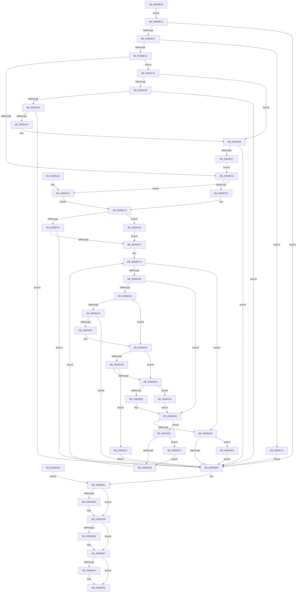

# NtDeleteWnfStateName

- RVA: `0x00908E60`–`0x0090929B` (길이 `1,083` bytes)
- VA: `0x0000000140908E60`
- 실행 섹션: `PAGE`
- PDB 이름 있음: `예`; PDB Function 태그: `아니요`
- unwind 정보 RVA: `0x00088EE0`
- 디코드: `242`개 명령, `1,083/1,083` bytes 표시
- 미해석 바이트: `0` (있으면 어셈블리에 `.byte`로 보존)

> 이 문서는 커널 이미지의 기계어와 PDB 기호를 분석해 생성했습니다. 4번과 5번은 함수 원형과 자료형을 바이너리 사용 방식에서 추정한 C 해석이며 원본 소스 복구 결과는 아닙니다.

## 1. Dependencies

- 직접 호출 지점: **21**; 고유 호출 대상: **15**
- 직접 호출자로 확인된 함수: **0**
- RIP 상대 이미지 참조: **2**

### Outgoing calls
- `0x00908EC3` → [ExpCaptureWnfStateName](ExpCaptureWnfStateName_function_00909370.md) (function, `0x00909370`)
- `0x00908F65` → [ExpWnfResolveScopeInstance](ExpWnfResolveScopeInstance_function_0090B280.md) (function, `0x0090B280`)
- `0x00908F91` → [ExpWnfLookupNameInstance](ExpWnfLookupNameInstance_function_00908C70.md) (function, `0x00908C70`)
- `0x00908FD8` → [SeCaptureSubjectContext](../86/SeCaptureSubjectContext_function_0086B820.md) (function, `0x0086B820`)
- `0x00909022` → [SeAccessCheck](../../text/3A/SeAccessCheck_function_003A6BC0.md) (function, `0x003A6BC0`)
- `0x0090902F` → [SeReleaseSubjectContext](../86/SeReleaseSubjectContext_function_0086B710.md) (function, `0x0086B710`)
- `0x0090907F` → [ExpWnfNotifyNameSubscribers](ExpWnfNotifyNameSubscribers_function_0090C160.md) (function, `0x0090C160`)
- `0x0090908F` → [ExpWnfDeleteNameInstance](ExpWnfDeleteNameInstance_function_009088C8.md) (function, `0x009088C8`)
- `0x009090D4` → [ExReleaseRundownProtection](../../text/34/ExReleaseRundownProtection_function_00349E80.md) (function, `0x00349E80`)
- `0x009090E2` → [ExReleaseRundownProtection](../../text/34/ExReleaseRundownProtection_function_00349E80.md) (function, `0x00349E80`)
- `0x009090F9` → [ExFreePoolWithTag](../../poolcode/B8/ExFreePoolWithTag_function_00B82870.md) (function, `0x00B82870`)
- `0x009090FE` → [KeLeaveCriticalRegion](../../text/25/KeLeaveCriticalRegion_function_0025D8B0.md) (function, `0x0025D8B0`)
- `0x00909153` → [ExpWnfLookupPermanentName](../8B/ExpWnfLookupPermanentName_function_008BD914.md) (function, `0x008BD914`)
- `0x00909194` → [SeCaptureSubjectContext](../86/SeCaptureSubjectContext_function_0086B820.md) (function, `0x0086B820`)
- `0x009091DE` → [SeAccessCheck](../../text/3A/SeAccessCheck_function_003A6BC0.md) (function, `0x003A6BC0`)
- `0x009091EB` → [SeReleaseSubjectContext](../86/SeReleaseSubjectContext_function_0086B710.md) (function, `0x0086B710`)
- `0x00909208` → [ExpWnfDeletePermanentName](../A9/ExpWnfDeletePermanentName_function_00A99434.md) (function, `0x00A99434`)
- `0x0090923A` → [ExpWnfEnumerateScopeInstances](../A7/ExpWnfEnumerateScopeInstances_function_00A7ECE8.md) (function, `0x00A7ECE8`)
- `0x00909265` → [ExpWnfEnumerateScopeInstances](../A7/ExpWnfEnumerateScopeInstances_function_00A7ECE8.md) (function, `0x00A7ECE8`)
- `0x00909280` → [ExReleaseRundownProtection](../../text/34/ExReleaseRundownProtection_function_00349E80.md) (function, `0x00349E80`)
- `0x00909291` → [ExpWnfDeletePermanentStateData](../7D/ExpWnfDeletePermanentStateData_function_007D6254.md) (function, `0x007D6254`)

### Direct callers
- 이 함수 시작 RVA로 연결되는 직접 call은 확인되지 않았습니다. 간접 호출은 완전히 역산할 수 없습니다.

### Static image references
- `0x00908F3C` → RVA `0x00FC6AB0` (`ALMOSTRO`; read)
- `0x00908FF9` → RVA `0x00B4B070` (`ExpWnfNotificationMapping`; read)

## 2. Other-region calls and transfers

- 다른 실행 섹션으로 향하는 call: **7**
  - `0x00909022` → [SeAccessCheck](../../text/3A/SeAccessCheck_function_003A6BC0.md) (`PAGE` → `.text`)
  - `0x009090D4` → [ExReleaseRundownProtection](../../text/34/ExReleaseRundownProtection_function_00349E80.md) (`PAGE` → `.text`)
  - `0x009090E2` → [ExReleaseRundownProtection](../../text/34/ExReleaseRundownProtection_function_00349E80.md) (`PAGE` → `.text`)
  - `0x009090F9` → [ExFreePoolWithTag](../../poolcode/B8/ExFreePoolWithTag_function_00B82870.md) (`PAGE` → `POOLCODE`)
  - `0x009090FE` → [KeLeaveCriticalRegion](../../text/25/KeLeaveCriticalRegion_function_0025D8B0.md) (`PAGE` → `.text`)
  - `0x009091DE` → [SeAccessCheck](../../text/3A/SeAccessCheck_function_003A6BC0.md) (`PAGE` → `.text`)
  - `0x00909280` → [ExReleaseRundownProtection](../../text/34/ExReleaseRundownProtection_function_00349E80.md) (`PAGE` → `.text`)
- 별도 외부 분기/꼬리 이동을 확인하지 못했습니다.

## 3. Assembly (complete function range)

```asm
00908E60  4C 8B DC                        mov r11, rsp
00908E63  53                              push rbx
00908E64  56                              push rsi
00908E65  57                              push rdi
00908E66  41 54                           push r12
00908E68  41 55                           push r13
00908E6A  41 56                           push r14
00908E6C  41 57                           push r15
00908E6E  48 81 EC C0 00 00 00            sub rsp, 0xc0
00908E75  33 F6                           xor esi, esi
00908E77  49 89 73 88                     mov qword ptr [r11 - 0x78], rsi
00908E7B  65 48 8B 04 25 88 01 00 00      mov rax, qword ptr gs:[0x188]
00908E84  66 FF 88 E4 01 00 00            dec word ptr [rax + 0x1e4]
00908E8B  90                              nop
00908E8C  65 48 8B 04 25 88 01 00 00      mov rax, qword ptr gs:[0x188]
00908E95  8A 80 32 02 00 00               mov al, byte ptr [rax + 0x232]
00908E9B  88 84 24 08 01 00 00            mov byte ptr [rsp + 0x108], al
00908EA2  8B D6                           mov edx, esi
00908EA4  89 94 24 10 01 00 00            mov dword ptr [rsp + 0x110], edx
00908EAB  49 89 73 90                     mov qword ptr [r11 - 0x70], rsi
00908EAF  44 8B F6                        mov r14d, esi
00908EB2  48 89 74 24 70                  mov qword ptr [rsp + 0x70], rsi
00908EB7  48 89 74 24 58                  mov qword ptr [rsp + 0x58], rsi
00908EBC  44 8A C0                        mov r8b, al
00908EBF  49 8D 53 88                     lea rdx, [r11 - 0x78]
00908EC3  E8 A8 04 00 00                  call 0x140909370
00908EC8  8B F8                           mov edi, eax
00908ECA  89 44 24 78                     mov dword ptr [rsp + 0x78], eax
00908ECE  EB 14                           jmp 0x140908ee4
00908ED0  8B F8                           mov edi, eax
00908ED2  89 44 24 78                     mov dword ptr [rsp + 0x78], eax
00908ED6  33 F6                           xor esi, esi
00908ED8  8B C6                           mov eax, esi
00908EDA  4C 8B 74 24 70                  mov r14, qword ptr [rsp + 0x70]
00908EDF  E9 DD 01 00 00                  jmp 0x1409090c1
00908EE4  85 C0                           test eax, eax
00908EE6  0F 88 CE 01 00 00               js 0x1409090ba
00908EEC  48 8B 9C 24 80 00 00 00         mov rbx, qword ptr [rsp + 0x80]
00908EF4  4C 8B EB                        mov r13, rbx
00908EF7  49 C1 ED 04                     shr r13, 4
00908EFB  45 8B FD                        mov r15d, r13d
00908EFE  48 8B CB                        mov rcx, rbx
00908F01  48 C1 E9 06                     shr rcx, 6
00908F05  83 E1 0F                        and ecx, 0xf
00908F08  48 89 8C 24 90 00 00 00         mov qword ptr [rsp + 0x90], rcx
00908F10  41 83 E7 03                     and r15d, 3
00908F14  0F 84 58 03 00 00               je 0x140909272
00908F1A  44 8B E6                        mov r12d, esi
00908F1D  8A 84 24 08 01 00 00            mov al, byte ptr [rsp + 0x108]
00908F24  84 C0                           test al, al
00908F26  41 0F 94 C4                     sete r12b
00908F2A  41 83 FF 03                     cmp r15d, 3
00908F2E  0F 85 0C 02 00 00               jne 0x140909140
00908F34  84 C0                           test al, al
00908F36  0F 85 DD 01 00 00               jne 0x140909119
00908F3C  48 8B 05 6D DB 6B 00            mov rax, qword ptr [rip + 0x6bdb6d]
00908F43  48 89 44 24 68                  mov qword ptr [rsp + 0x68], rax
00908F48  41 83 FF 03                     cmp r15d, 3
00908F4C  0F 85 E4 02 00 00               jne 0x140909236
00908F52  48 89 74 24 20                  mov qword ptr [rsp + 0x20], rsi
00908F57  44 8B C9                        mov r9d, ecx
00908F5A  45 33 C0                        xor r8d, r8d
00908F5D  48 8B D0                        mov rdx, rax
00908F60  48 8D 4C 24 70                  lea rcx, [rsp + 0x70]
00908F65  E8 16 23 00 00                  call 0x14090b280
00908F6A  8B F8                           mov edi, eax
00908F6C  4C 8B 74 24 70                  mov r14, qword ptr [rsp + 0x70]
00908F71  85 C0                           test eax, eax
00908F73  0F 88 41 01 00 00               js 0x1409090ba
00908F79  41 83 E5 03                     and r13d, 3
00908F7D  4D 85 F6                        test r14, r14
00908F80  0F 84 25 01 00 00               je 0x1409090ab
00908F86  4C 8D 44 24 58                  lea r8, [rsp + 0x58]
00908F8B  48 8B D3                        mov rdx, rbx
00908F8E  49 8B CE                        mov rcx, r14
00908F91  E8 DA FC FF FF                  call 0x140908c70
00908F96  8B F8                           mov edi, eax
00908F98  85 C0                           test eax, eax
00908F9A  0F 88 01 01 00 00               js 0x1409090a1
00908FA0  45 85 E4                        test r12d, r12d
00908FA3  0F 85 9C 00 00 00               jne 0x140909045
00908FA9  48 8B 44 24 58                  mov rax, qword ptr [rsp + 0x58]
00908FAE  48 8B 78 48                     mov rdi, qword ptr [rax + 0x48]
00908FB2  0F 57 C0                        xorps xmm0, xmm0
00908FB5  0F 11 84 24 98 00 00 00         movups xmmword ptr [rsp + 0x98], xmm0
00908FBD  0F 11 84 24 A8 00 00 00         movups xmmword ptr [rsp + 0xa8], xmm0
00908FC5  89 74 24 60                     mov dword ptr [rsp + 0x60], esi
00908FC9  89 B4 24 18 01 00 00            mov dword ptr [rsp + 0x118], esi
00908FD0  48 8D 8C 24 98 00 00 00         lea rcx, [rsp + 0x98]
00908FD8  E8 43 28 F6 FF                  call 0x14086b820
00908FDD  48 8D 84 24 18 01 00 00         lea rax, [rsp + 0x118]
00908FE5  48 89 44 24 48                  mov qword ptr [rsp + 0x48], rax
00908FEA  48 8D 44 24 60                  lea rax, [rsp + 0x60]
00908FEF  48 89 44 24 40                  mov qword ptr [rsp + 0x40], rax
00908FF4  C6 44 24 38 01                  mov byte ptr [rsp + 0x38], 1
00908FF9  48 8D 05 70 20 24 00            lea rax, [rip + 0x242070]
00909000  48 89 44 24 30                  mov qword ptr [rsp + 0x30], rax
00909005  48 89 74 24 28                  mov qword ptr [rsp + 0x28], rsi
0090900A  89 74 24 20                     mov dword ptr [rsp + 0x20], esi
0090900E  41 B9 00 00 01 00               mov r9d, 0x10000
00909014  45 33 C0                        xor r8d, r8d
00909017  48 8D 94 24 98 00 00 00         lea rdx, [rsp + 0x98]
0090901F  48 8B CF                        mov rcx, rdi
00909022  E8 99 DB A9 FF                  call 0x1403a6bc0
00909027  48 8D 8C 24 98 00 00 00         lea rcx, [rsp + 0x98]
0090902F  E8 DC 26 F6 FF                  call 0x14086b710
00909034  8B BC 24 18 01 00 00            mov edi, dword ptr [rsp + 0x118]
0090903B  85 FF                           test edi, edi
0090903D  78 7B                           js 0x1409090ba
0090903F  41 BC 01 00 00 00               mov r12d, 1
00909045  49 83 FD 03                     cmp r13, 3
00909049  75 17                           jne 0x140909062
0090904B  48 8B 44 24 58                  mov rax, qword ptr [rsp + 0x58]
00909050  48 8B 4C 24 68                  mov rcx, qword ptr [rsp + 0x68]
00909055  48 39 88 98 00 00 00            cmp qword ptr [rax + 0x98], rcx
0090905C  0F 85 E5 01 00 00               jne 0x140909247
00909062  44 8B CE                        mov r9d, esi
00909065  40 38 B4 24 08 01 00 00         cmp byte ptr [rsp + 0x108], sil
0090906D  41 0F 95 C1                     setne r9b
00909071  BA 10 00 00 00                  mov edx, 0x10
00909076  44 8D 42 F1                     lea r8d, [rdx - 0xf]
0090907A  48 8B 4C 24 58                  mov rcx, qword ptr [rsp + 0x58]
0090907F  E8 DC 30 00 00                  call 0x14090c160
00909084  41 B0 01                        mov r8b, 1
00909087  48 8B 54 24 58                  mov rdx, qword ptr [rsp + 0x58]
0090908C  49 8B CE                        mov rcx, r14
0090908F  E8 34 F8 FF FF                  call 0x1409088c8
00909094  85 C0                           test eax, eax
00909096  0F 84 9A 00 00 00               je 0x140909136
0090909C  48 89 74 24 58                  mov qword ptr [rsp + 0x58], rsi
009090A1  49 83 FD 03                     cmp r13, 3
009090A5  0F 85 A6 01 00 00               jne 0x140909251
009090AB  48 8B C3                        mov rax, rbx
009090AE  48 C1 E8 0A                     shr rax, 0xa
009090B2  A8 01                           test al, 1
009090B4  0F 85 D2 01 00 00               jne 0x14090928c
009090BA  8B 84 24 10 01 00 00            mov eax, dword ptr [rsp + 0x110]
009090C1  85 C0                           test eax, eax
009090C3  0F 45 FE                        cmovne edi, esi
009090C6  4C 8B 7C 24 58                  mov r15, qword ptr [rsp + 0x58]
009090CB  4D 85 FF                        test r15, r15
009090CE  74 09                           je 0x1409090d9
009090D0  49 8D 4F 08                     lea rcx, [r15 + 8]
009090D4  E8 A7 0D A4 FF                  call 0x140349e80
009090D9  4D 85 F6                        test r14, r14
009090DC  74 09                           je 0x1409090e7
009090DE  49 8D 4E 08                     lea rcx, [r14 + 8]
009090E2  E8 99 0D A4 FF                  call 0x140349e80
009090E7  48 8B 8C 24 88 00 00 00         mov rcx, qword ptr [rsp + 0x88]
009090EF  48 85 C9                        test rcx, rcx
009090F2  74 0A                           je 0x1409090fe
009090F4  BA 57 6E 66 20                  mov edx, 0x20666e57
009090F9  E8 72 97 27 00                  call 0x140b82870
009090FE  E8 AD 47 95 FF                  call 0x14025d8b0
00909103  8B C7                           mov eax, edi
00909105  48 81 C4 C0 00 00 00            add rsp, 0xc0
0090910C  41 5F                           pop r15
0090910E  41 5E                           pop r14
00909110  41 5D                           pop r13
00909112  41 5C                           pop r12
00909114  5F                              pop rdi
00909115  5E                              pop rsi
00909116  5B                              pop rbx
00909117  C3                              ret
00909118  CC                              int3
00909119  65 48 8B 04 25 88 01 00 00      mov rax, qword ptr gs:[0x188]
00909122  48 8B 80 B8 00 00 00            mov rax, qword ptr [rax + 0xb8]
00909129  48 8B 9C 24 80 00 00 00         mov rbx, qword ptr [rsp + 0x80]
00909131  E9 0D FE FF FF                  jmp 0x140908f43
00909136  BF 34 00 00 C0                  mov edi, 0xc0000034
0090913B  E9 61 FF FF FF                  jmp 0x1409090a1
00909140  84 C0                           test al, al
00909142  0F 84 BD 00 00 00               je 0x140909205
00909148  48 8D 94 24 88 00 00 00         lea rdx, [rsp + 0x88]
00909150  48 8B CB                        mov rcx, rbx
00909153  E8 BC 47 FB FF                  call 0x1408bd914
00909158  8B F8                           mov edi, eax
0090915A  85 C0                           test eax, eax
0090915C  0F 88 58 FF FF FF               js 0x1409090ba
00909162  48 8B 84 24 88 00 00 00         mov rax, qword ptr [rsp + 0x88]
0090916A  48 8B 78 10                     mov rdi, qword ptr [rax + 0x10]
0090916E  0F 57 C0                        xorps xmm0, xmm0
00909171  0F 11 84 24 98 00 00 00         movups xmmword ptr [rsp + 0x98], xmm0
00909179  0F 11 84 24 A8 00 00 00         movups xmmword ptr [rsp + 0xa8], xmm0
00909181  89 74 24 60                     mov dword ptr [rsp + 0x60], esi
00909185  89 B4 24 18 01 00 00            mov dword ptr [rsp + 0x118], esi
0090918C  48 8D 8C 24 98 00 00 00         lea rcx, [rsp + 0x98]
00909194  E8 87 26 F6 FF                  call 0x14086b820
00909199  48 8D 84 24 18 01 00 00         lea rax, [rsp + 0x118]
009091A1  48 89 44 24 48                  mov qword ptr [rsp + 0x48], rax
009091A6  48 8D 44 24 60                  lea rax, [rsp + 0x60]
009091AB  48 89 44 24 40                  mov qword ptr [rsp + 0x40], rax
009091B0  C6 44 24 38 01                  mov byte ptr [rsp + 0x38], 1
009091B5  48 8D 05 B4 1E 24 00            lea rax, [rip + 0x241eb4]
009091BC  48 89 44 24 30                  mov qword ptr [rsp + 0x30], rax
009091C1  48 89 74 24 28                  mov qword ptr [rsp + 0x28], rsi
009091C6  89 74 24 20                     mov dword ptr [rsp + 0x20], esi
009091CA  41 B9 00 00 01 00               mov r9d, 0x10000
009091D0  45 33 C0                        xor r8d, r8d
009091D3  48 8D 94 24 98 00 00 00         lea rdx, [rsp + 0x98]
009091DB  48 8B CF                        mov rcx, rdi
009091DE  E8 DD D9 A9 FF                  call 0x1403a6bc0
009091E3  48 8D 8C 24 98 00 00 00         lea rcx, [rsp + 0x98]
009091EB  E8 20 25 F6 FF                  call 0x14086b710
009091F0  8B BC 24 18 01 00 00            mov edi, dword ptr [rsp + 0x118]
009091F7  85 FF                           test edi, edi
009091F9  0F 88 BB FE FF FF               js 0x1409090ba
009091FF  41 BC 01 00 00 00               mov r12d, 1
00909205  48 8B CB                        mov rcx, rbx
00909208  E8 27 02 19 00                  call 0x140a99434
0090920D  8B F8                           mov edi, eax
0090920F  85 C0                           test eax, eax
00909211  0F 88 A3 FE FF FF               js 0x1409090ba
00909217  C7 84 24 10 01 00 00 01 00 00 00  mov dword ptr [rsp + 0x110], 1
00909222  48 8B 8C 24 90 00 00 00         mov rcx, qword ptr [rsp + 0x90]
0090922A  8A 84 24 08 01 00 00            mov al, byte ptr [rsp + 0x108]
00909231  E9 FE FC FF FF                  jmp 0x140908f34
00909236  8B FE                           mov edi, esi
00909238  33 D2                           xor edx, edx
0090923A  E8 A9 5A 17 00                  call 0x140a7ece8
0090923F  4C 8B F0                        mov r14, rax
00909242  E9 32 FD FF FF                  jmp 0x140908f79
00909247  BF 22 00 00 C0                  mov edi, 0xc0000022
0090924C  E9 69 FE FF FF                  jmp 0x1409090ba
00909251  4C 8B 7C 24 58                  mov r15, qword ptr [rsp + 0x58]
00909256  4D 85 FF                        test r15, r15
00909259  75 21                           jne 0x14090927c
0090925B  49 8B D6                        mov rdx, r14
0090925E  8B 8C 24 90 00 00 00            mov ecx, dword ptr [rsp + 0x90]
00909265  E8 7E 5A 17 00                  call 0x140a7ece8
0090926A  4C 8B F0                        mov r14, rax
0090926D  E9 0B FD FF FF                  jmp 0x140908f7d
00909272  BF 0D 00 00 C0                  mov edi, 0xc000000d
00909277  E9 3E FE FF FF                  jmp 0x1409090ba
0090927C  49 8D 4F 08                     lea rcx, [r15 + 8]
00909280  E8 FB 0B A4 FF                  call 0x140349e80
00909285  48 89 74 24 58                  mov qword ptr [rsp + 0x58], rsi
0090928A  EB CF                           jmp 0x14090925b
0090928C  48 8B D3                        mov rdx, rbx
0090928F  33 C9                           xor ecx, ecx
00909291  E8 BE CF EC FF                  call 0x1407d6254
00909296  E9 1F FE FF FF                  jmp 0x1409090ba
```

## 4. C-style interpretation (structured pseudocode)

```c
__int64 __fastcall NtDeleteWnfStateName(void)
{
    __int64 result;
    __int64 v_r12;
    __int64 v_r13;
    __int64 v_r15;
    __int64 v_rdi;
    __int64 v_rsi;
    __int64 v_rsp;
    unsigned __int64 v_stack_m50;
    unsigned __int64 v_stack_m60;
    unsigned __int64 v_stack_m68;
    unsigned __int64 v_stack_m70;
    unsigned __int64 v_stack_m78;
    unsigned int v_stack_m80;
    unsigned __int64 v_stack_m88;
    unsigned __int64 v_stack_m90;
    unsigned int v_stack_m98;
    unsigned __int64 v_stack_mA0;
    unsigned __int64 v_stack_mB0;
    unsigned __int64 v_stack_mB8;
    unsigned __int8 v_stack_mC0;
    unsigned __int64 v_stack_mC8;
    unsigned __int64 v_stack_mD0;
    unsigned __int64 v_stack_mD8;
    unsigned __int8 v_stack_p10;
    unsigned __int8 v_stack_p108;
    unsigned int v_stack_p110;
    unsigned int v_stack_p118;
    unsigned int v_stack_p18;
    unsigned int v_stack_p20;
    unsigned __int64 v_stack_p28;
    unsigned __int64 v_stack_p30;
    unsigned __int8 v_stack_p38;
    unsigned __int64 v_stack_p40;
    unsigned __int64 v_stack_p48;
    unsigned __int64 v_stack_p58;
    unsigned int v_stack_p60;
    unsigned __int64 v_stack_p80;
    unsigned __int64 v_stack_p88;
    unsigned __int64 v_stack_p90;
    unsigned __int64 v_stack_p98;
    unsigned __int64 v_stack_pA8;

    v_rsp = (v_rsp) - (192);
    v_rsi = 0;
    *(unsigned __int64 *)(v_rsp - 120) = 0;
    v_stack_p10 = (unsigned __int8)(*(unsigned __int8 *)(*(unsigned __int64 *)(gs_base + (0 + 392)) + 562));
    v_stack_p18 = 0;
    *(unsigned __int64 *)(v_rsp - 112) = 0;
    v_stack_m88 = 0;
    v_stack_mA0 = 0;
    result = ExpCaptureWnfStateName(a1, v_rsp - 120, (unsigned __int8)(*(unsigned __int8 *)(*(unsigned __int64 *)(gs_base + (0 + 392)) + 562)), a4);
    v_stack_m80 = (unsigned int)(result);
    goto loc_00908EE4;
loc_00908EE4:
    if (sign_flag) goto loc_009090BA;
    v_r13 = (v_stack_m78) >> (4);
    a1 = (v_stack_m78) >> (6);
    a1 = (unsigned int)((a1) & (15));
    v_stack_m68 = a1;
    v_r15 = (unsigned int)(((unsigned int)((unsigned int)(v_r13))) & (3));
    if (condition_is_equal) goto loc_00909272;
    v_r12 = ((unsigned __int8)(v_stack_p10) == 0) ? 1 : 0;
    if (((unsigned int)(v_r15)) != 3) goto loc_00909140;
loc_00908F34:
    if ((unsigned __int8)(v_stack_p10) != 0) goto loc_00909119;
loc_00908F43:
    v_stack_m90 = *(unsigned __int64 *)(v_rip + 7068525);
    if (((unsigned int)(v_r15)) != 3) goto loc_00909236;
    v_stack_mD8 = 0;
    a3 = 0;
    result = ExpWnfResolveScopeInstance(v_stack_m88, *(unsigned __int64 *)(v_rip + 7068525), a3, (unsigned int)((unsigned int)(a1)));
    if (sign_flag) goto loc_009090BA;
loc_00908F79:
    v_r13 = (unsigned int)((v_r13) & (3));
loc_00908F7D:
    if (v_stack_m88 == 0) goto loc_009090AB;
    result = ExpWnfLookupNameInstance(v_stack_m88, v_stack_m78, v_stack_mA0, (unsigned int)((unsigned int)(a1)));
    if (sign_flag) goto loc_009090A1;
    if ((unsigned int)(v_r12) != 0) goto loc_00909045;
    v_stack_m60 = v_xmm0;
    v_stack_m50 = v_xmm0;
    v_stack_m98 = 0;
    v_stack_p20 = 0;
    result = SeCaptureSubjectContext(v_stack_m60, v_stack_m78, v_stack_mA0, (unsigned int)((unsigned int)(a1)));
    v_stack_mB0 = v_stack_p20;
    v_stack_mB8 = v_stack_m98;
    v_stack_mC0 = 1;
    v_stack_mC8 = v_rip + 2367600;
    v_stack_mD0 = 0;
    v_stack_mD8 = 0;
    a3 = 0;
    result = SeAccessCheck(*(unsigned __int64 *)(v_stack_mA0 + 72), v_stack_m60, a3, (unsigned int)(0x10000ULL));
    result = SeReleaseSubjectContext(v_stack_m60, v_stack_m60, a3, (unsigned int)(0x10000ULL));
    if (sign_flag) goto loc_009090BA;
loc_00909045:
    if (v_r13 != 3) goto loc_00909062;
    if ((*(unsigned __int64 *)(v_stack_mA0 + 152)) != v_stack_m90) goto loc_00909247;
loc_00909062:
    a4 = (v_stack_p10 != 0) ? 1 : 0;
    result = ExpWnfNotifyNameSubscribers(v_stack_mA0, 16, 16 - 15, a4);
    result = ExpWnfDeleteNameInstance(v_stack_m88, v_stack_mA0, 1, a4);
    if ((unsigned int)(result) == 0) goto loc_00909136;
    v_stack_mA0 = 0;
loc_009090A1:
    if (v_r13 != 3) goto loc_00909251;
loc_009090AB:
    result = (v_stack_m78) >> (10);
    if ((((unsigned __int8)(result)) & (1)) != 0) goto loc_0090928C;
loc_009090BA:
loc_009090C1:
    v_rdi = (unsigned int)(v_stack_p20);
    if ((unsigned int)((unsigned int)(v_stack_p18)) != 0) { v_rdi = 0; }
    result = (unsigned int)(v_stack_p18);
    if (v_stack_mA0 != 0) {
        a1 = v_stack_mA0 + 8;
        result = ExReleaseRundownProtection(a1, v_stack_mA0, 1, a4);
    }
    if (v_stack_m88 != 0) {
        a1 = v_stack_m88 + 8;
        result = ExReleaseRundownProtection(a1, v_stack_mA0, 1, a4);
    }
    if (v_stack_m70 != 0) {
        a2 = 0x20666E57ULL;
        result = ExFreePoolWithTag(v_stack_m70, a2, 1, a4);
    }
    result = KeLeaveCriticalRegion(v_stack_m70, a2, 1, a4);
    v_rsp = (v_rsp) + (192);
    return (unsigned int)((unsigned int)(v_rdi));
loc_00909119:
    goto loc_00908F43;
loc_00909136:
    goto loc_009090A1;
loc_00909140:
    if ((unsigned __int8)(*(unsigned __int64 *)(*(unsigned __int64 *)(gs_base + (0 + 392)) + 184)) == 0) goto loc_00909205;
    result = ExpWnfLookupPermanentName(v_stack_p80, v_stack_p88, 1, a4);
    if (sign_flag) goto loc_009090BA;
    v_stack_p98 = v_xmm0;
    v_stack_pA8 = v_xmm0;
    v_stack_p60 = 0;
    v_stack_p118 = 0;
    result = SeCaptureSubjectContext(v_stack_p98, v_stack_p88, 1, a4);
    v_stack_p48 = v_stack_p118;
    v_stack_p40 = v_stack_p60;
    v_stack_p38 = 1;
    v_stack_p30 = v_rip + 2367156;
    v_stack_p28 = 0;
    v_stack_p20 = 0;
    a3 = 0;
    result = SeAccessCheck(*(unsigned __int64 *)(v_stack_p88 + 16), v_stack_p98, a3, (unsigned int)(0x10000ULL));
    result = SeReleaseSubjectContext(v_stack_p98, v_stack_p98, a3, (unsigned int)(0x10000ULL));
    if (sign_flag) goto loc_009090BA;
loc_00909205:
    result = ExpWnfDeletePermanentName(v_stack_p80, v_stack_p98, a3, (unsigned int)(0x10000ULL));
    if (sign_flag) goto loc_009090BA;
    v_stack_p110 = 1;
    goto loc_00908F34;
loc_00909236:
    a2 = 0;
    result = ExpWnfEnumerateScopeInstances(v_stack_p90, a2, a3, (unsigned int)(0x10000ULL));
    goto loc_00908F79;
loc_00909247:
    goto loc_009090BA;
loc_00909251:
    if (v_stack_p58 != 0) goto loc_0090927C;
loc_0090925B:
    result = ExpWnfEnumerateScopeInstances((unsigned int)(v_stack_p90), result, a3, (unsigned int)(0x10000ULL));
    goto loc_00908F7D;
loc_00909272:
    goto loc_009090BA;
loc_0090927C:
    result = ExReleaseRundownProtection(v_stack_p58 + 8, result, a3, (unsigned int)(0x10000ULL));
    v_stack_p58 = 0;
    goto loc_0090925B;
loc_0090928C:
    a1 = 0;
    result = ExpWnfDeletePermanentStateData(a1, v_stack_p80, a3, (unsigned int)(0x10000ULL));
    goto loc_009090BA;
}
```

## 5. (Beta) C Style

```c
void NtDeleteWnfStateName(void)
{
    int64_t result;
    int64_t local_r12;
    int64_t local_r13;
    int64_t local_r15;
    int64_t local_rdi;
    int64_t local_rsi;
    int64_t local_rsp;
    uint64_t v_stack_m50;
    uint64_t v_stack_m60;
    uint64_t v_stack_m68;
    uint64_t v_stack_m70;
    uint64_t v_stack_m78;
    uint32_t v_stack_m80;
    uint64_t v_stack_m88;
    uint64_t v_stack_m90;
    uint32_t v_stack_m98;
    uint64_t v_stack_mA0;
    uint64_t v_stack_mB0;
    uint64_t v_stack_mB8;
    uint8_t v_stack_mC0;
    uint64_t v_stack_mC8;
    uint64_t v_stack_mD0;
    uint64_t v_stack_mD8;
    uint8_t v_stack_p10;
    uint8_t v_stack_p108;
    uint32_t v_stack_p110;
    uint32_t v_stack_p118;
    uint32_t v_stack_p18;
    uint32_t v_stack_p20;
    uint64_t v_stack_p28;
    uint64_t v_stack_p30;
    uint8_t v_stack_p38;
    uint64_t v_stack_p40;
    uint64_t v_stack_p48;
    uint64_t v_stack_p58;
    uint32_t v_stack_p60;
    uint64_t v_stack_p80;
    uint64_t v_stack_p88;
    uint64_t v_stack_p90;
    uint64_t v_stack_p98;
    uint64_t v_stack_pA8;

    local_rsp = (local_rsp) - (192);
    local_rsi = 0;
    *(uint64_t *)(local_rsp - 0x78) = 0;
    v_stack_p10 = (uint8_t)(*(uint8_t *)(*(uint64_t *)(gs_base + (0 + 0x188)) + 0x232));
    v_stack_p18 = 0;
    *(uint64_t *)(local_rsp - 0x70) = 0;
    v_stack_m88 = 0;
    v_stack_mA0 = 0;
    result = ExpCaptureWnfStateName(a1, local_rsp - 120, (uint8_t)(*(uint8_t *)(*(uint64_t *)(gs_base + (0 + 0x188)) + 0x232)), a4);
    v_stack_m80 = (uint32_t)(result);
    goto loc_00908EE4;
loc_00908EE4:
    if (sign_flag) goto loc_009090BA;
    local_r13 = (v_stack_m78) >> (4);
    a1 = (v_stack_m78) >> (6);
    a1 = (uint32_t)((a1) & (15));
    v_stack_m68 = a1;
    local_r15 = (uint32_t)(((uint32_t)((uint32_t)(local_r13))) & (3));
    if (condition_is_equal) goto loc_00909272;
    local_r12 = ((uint8_t)(v_stack_p10) == 0) ? 1 : 0;
    if (((uint32_t)(local_r15)) != 3) goto loc_00909140;
loc_00908F34:
    if ((uint8_t)(v_stack_p10) != 0) goto loc_00909119;
loc_00908F43:
    v_stack_m90 = *(uint64_t *)(v_rip + 0x6BDB6D);
    if (((uint32_t)(local_r15)) != 3) goto loc_00909236;
    v_stack_mD8 = 0;
    a3 = 0;
    result = ExpWnfResolveScopeInstance(v_stack_m88, *(uint64_t *)(v_rip + 0x6BDB6D), a3, (uint32_t)((uint32_t)(a1)));
    if (sign_flag) goto loc_009090BA;
loc_00908F79:
    local_r13 = (uint32_t)((local_r13) & (3));
loc_00908F7D:
    if (v_stack_m88 == 0) goto loc_009090AB;
    result = ExpWnfLookupNameInstance(v_stack_m88, v_stack_m78, v_stack_mA0, (uint32_t)((uint32_t)(a1)));
    if (sign_flag) goto loc_009090A1;
    if ((uint32_t)(local_r12) != 0) goto loc_00909045;
    v_stack_m60 = v_xmm0;
    v_stack_m50 = v_xmm0;
    v_stack_m98 = 0;
    v_stack_p20 = 0;
    result = SeCaptureSubjectContext(v_stack_m60, v_stack_m78, v_stack_mA0, (uint32_t)((uint32_t)(a1)));
    v_stack_mB0 = v_stack_p20;
    v_stack_mB8 = v_stack_m98;
    v_stack_mC0 = 1;
    v_stack_mC8 = v_rip + 2367600;
    v_stack_mD0 = 0;
    v_stack_mD8 = 0;
    a3 = 0;
    result = SeAccessCheck(*(uint64_t *)(v_stack_mA0 + 0x48), v_stack_m60, a3, (uint32_t)(0x10000ULL));
    result = SeReleaseSubjectContext(v_stack_m60, v_stack_m60, a3, (uint32_t)(0x10000ULL));
    if (sign_flag) goto loc_009090BA;
loc_00909045:
    if (local_r13 != 3) goto loc_00909062;
    if ((*(uint64_t *)(v_stack_mA0 + 0x98)) != v_stack_m90) goto loc_00909247;
loc_00909062:
    a4 = (v_stack_p10 != 0) ? 1 : 0;
    result = ExpWnfNotifyNameSubscribers(v_stack_mA0, 16, 16 - 15, a4);
    result = ExpWnfDeleteNameInstance(v_stack_m88, v_stack_mA0, 1, a4);
    if ((uint32_t)(result) == 0) goto loc_00909136;
    v_stack_mA0 = 0;
loc_009090A1:
    if (local_r13 != 3) goto loc_00909251;
loc_009090AB:
    result = (v_stack_m78) >> (10);
    if ((((uint8_t)(result)) & (1)) != 0) goto loc_0090928C;
loc_009090BA:
loc_009090C1:
    local_rdi = (uint32_t)(v_stack_p20);
    if ((uint32_t)((uint32_t)(v_stack_p18)) != 0) { local_rdi = 0; }
    result = (uint32_t)(v_stack_p18);
    if (v_stack_mA0 != 0) {
        a1 = v_stack_mA0 + 8;
        result = ExReleaseRundownProtection(a1, v_stack_mA0, 1, a4);
    }
    if (v_stack_m88 != 0) {
        a1 = v_stack_m88 + 8;
        result = ExReleaseRundownProtection(a1, v_stack_mA0, 1, a4);
    }
    if (v_stack_m70 != 0) {
        a2 = 0x20666E57ULL;
        result = ExFreePoolWithTag(v_stack_m70, a2, 1, a4);
    }
    result = KeLeaveCriticalRegion(v_stack_m70, a2, 1, a4);
    local_rsp = (local_rsp) + (192);
    return (uint32_t)((uint32_t)(local_rdi));
loc_00909119:
    goto loc_00908F43;
loc_00909136:
    goto loc_009090A1;
loc_00909140:
    if ((uint8_t)(*(uint64_t *)(*(uint64_t *)(gs_base + (0 + 0x188)) + 0xB8)) == 0) goto loc_00909205;
    result = ExpWnfLookupPermanentName(v_stack_p80, v_stack_p88, 1, a4);
    if (sign_flag) goto loc_009090BA;
    v_stack_p98 = v_xmm0;
    v_stack_pA8 = v_xmm0;
    v_stack_p60 = 0;
    v_stack_p118 = 0;
    result = SeCaptureSubjectContext(v_stack_p98, v_stack_p88, 1, a4);
    v_stack_p48 = v_stack_p118;
    v_stack_p40 = v_stack_p60;
    v_stack_p38 = 1;
    v_stack_p30 = v_rip + 2367156;
    v_stack_p28 = 0;
    v_stack_p20 = 0;
    a3 = 0;
    result = SeAccessCheck(*(uint64_t *)(v_stack_p88 + 0x10), v_stack_p98, a3, (uint32_t)(0x10000ULL));
    result = SeReleaseSubjectContext(v_stack_p98, v_stack_p98, a3, (uint32_t)(0x10000ULL));
    if (sign_flag) goto loc_009090BA;
loc_00909205:
    result = ExpWnfDeletePermanentName(v_stack_p80, v_stack_p98, a3, (uint32_t)(0x10000ULL));
    if (sign_flag) goto loc_009090BA;
    v_stack_p110 = 1;
    goto loc_00908F34;
loc_00909236:
    a2 = 0;
    result = ExpWnfEnumerateScopeInstances(v_stack_p90, a2, a3, (uint32_t)(0x10000ULL));
    goto loc_00908F79;
loc_00909247:
    goto loc_009090BA;
loc_00909251:
    if (v_stack_p58 != 0) goto loc_0090927C;
loc_0090925B:
    result = ExpWnfEnumerateScopeInstances((uint32_t)(v_stack_p90), result, a3, (uint32_t)(0x10000ULL));
    goto loc_00908F7D;
loc_00909272:
    goto loc_009090BA;
loc_0090927C:
    result = ExReleaseRundownProtection(v_stack_p58 + 8, result, a3, (uint32_t)(0x10000ULL));
    v_stack_p58 = 0;
    goto loc_0090925B;
loc_0090928C:
    a1 = 0;
    result = ExpWnfDeletePermanentStateData(a1, v_stack_p80, a3, (uint32_t)(0x10000ULL));
    goto loc_009090BA;
}
```

## 6. Execution-region graph

[열기: 2D/3D 그래프와 함수 탐색 컨트롤 패널](../../../control-panel.html?section=page&rva=0x00908E60&view=graph)

- 2D 그래프는 위에서 아래로 흐르고, 3D 그래프는 빈 공간을 드래그해 회전합니다. Shift+드래그는 이동, 휠은 확대·축소, 함수 노드 선택은 대상 보고서 이동입니다.

### Static fallback


