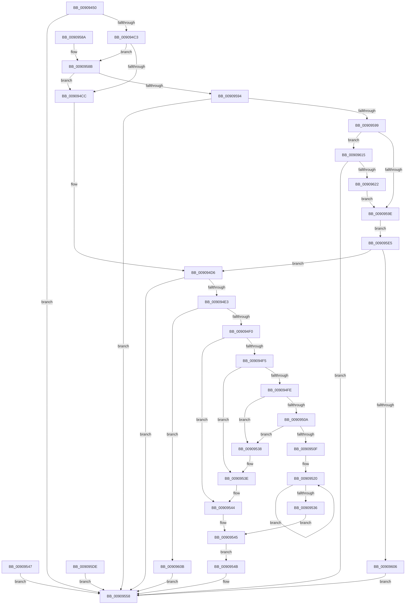

# NtGetCompleteWnfStateSubscription

- RVA: `0x00909450`–`0x00909627` (길이 `471` bytes)
- VA: `0x0000000140909450`
- 실행 섹션: `PAGE`
- PDB 이름 있음: `예`; PDB Function 태그: `아니요`
- unwind 정보 RVA: `0x00088F60`
- 디코드: `118`개 명령, `471/471` bytes 표시
- 미해석 바이트: `0` (있으면 어셈블리에 `.byte`로 보존)

> 이 문서는 커널 이미지의 기계어와 PDB 기호를 분석해 생성했습니다. 4번과 5번은 함수 원형과 자료형을 바이너리 사용 방식에서 추정한 C 해석이며 원본 소스 복구 결과는 아닙니다.

## 1. Dependencies

- 직접 호출 지점: **8**; 고유 호출 대상: **7**
- 직접 호출자로 확인된 함수: **0**
- RIP 상대 이미지 참조: **1**

### Outgoing calls
- `0x00909538` → [ExRaiseAccessViolation](../8E/ExRaiseAccessViolation_function_008E9240.md) (function, `0x008E9240`)
- `0x0090953E` → [ExRaiseDatatypeMisalignment](../89/ExRaiseDatatypeMisalignment_function_00899FD0.md) (function, `0x00899FD0`)
- `0x00909551` → [ExpWnfDeliverThreadNotifications](ExpWnfDeliverThreadNotifications_function_00909630.md) (function, `0x00909630`)
- `0x00909561` → [KeLeaveCriticalRegionThread](../../text/25/KeLeaveCriticalRegionThread_function_0025EFF0.md) (function, `0x0025EFF0`)
- `0x00909570` → [_security_check_cookie](../../text/6A/_security_check_cookie_function_006AC640.md) (function, `0x006AC640`)
- `0x009095BD` → [RtlCopyVolatileMemory](../../text/6B/RtlCopyVolatileMemory_function_006BC9D0.md) (function, `0x006BC9D0`)
- `0x009095D7` → [RtlCopyVolatileMemory](../../text/6B/RtlCopyVolatileMemory_function_006BC9D0.md) (function, `0x006BC9D0`)
- `0x009095F7` → [ExpWnfCompleteThreadSubscriptions](ExpWnfCompleteThreadSubscriptions_function_00909A10.md) (function, `0x00909A10`)

### Direct callers
- 이 함수 시작 RVA로 연결되는 직접 call은 확인되지 않았습니다. 간접 호출은 완전히 역산할 수 없습니다.

### Static image references
- `0x00909461` → RVA `0x00E0A740` (`.data`; read)

## 2. Other-region calls and transfers

- 다른 실행 섹션으로 향하는 call: **4**
  - `0x00909561` → [KeLeaveCriticalRegionThread](../../text/25/KeLeaveCriticalRegionThread_function_0025EFF0.md) (`PAGE` → `.text`)
  - `0x00909570` → [_security_check_cookie](../../text/6A/_security_check_cookie_function_006AC640.md) (`PAGE` → `.text`)
  - `0x009095BD` → [RtlCopyVolatileMemory](../../text/6B/RtlCopyVolatileMemory_function_006BC9D0.md) (`PAGE` → `.text`)
  - `0x009095D7` → [RtlCopyVolatileMemory](../../text/6B/RtlCopyVolatileMemory_function_006BC9D0.md) (`PAGE` → `.text`)
- 별도 외부 분기/꼬리 이동을 확인하지 못했습니다.

## 3. Assembly (complete function range)

```asm
00909450  48 89 5C 24 18                  mov qword ptr [rsp + 0x18], rbx
00909455  56                              push rsi
00909456  57                              push rdi
00909457  41 54                           push r12
00909459  41 56                           push r14
0090945B  41 57                           push r15
0090945D  48 83 EC 60                     sub rsp, 0x60
00909461  48 8B 05 D8 12 50 00            mov rax, qword ptr [rip + 0x5012d8]
00909468  48 33 C4                        xor rax, rsp
0090946B  48 89 44 24 58                  mov qword ptr [rsp + 0x58], rax
00909470  45 8B F1                        mov r14d, r9d
00909473  4C 8B FA                        mov r15, rdx
00909476  4C 8B C9                        mov r9, rcx
00909479  48 8B BC 24 B0 00 00 00         mov rdi, qword ptr [rsp + 0xb0]
00909481  33 C0                           xor eax, eax
00909483  48 89 44 24 50                  mov qword ptr [rsp + 0x50], rax
00909488  48 89 44 24 38                  mov qword ptr [rsp + 0x38], rax
0090948D  65 48 8B 04 25 88 01 00 00      mov rax, qword ptr gs:[0x188]
00909496  66 FF 88 E4 01 00 00            dec word ptr [rax + 0x1e4]
0090949D  90                              nop
0090949E  BB 0D 00 00 C0                  mov ebx, 0xc000000d
009094A3  65 48 8B 04 25 88 01 00 00      mov rax, qword ptr gs:[0x188]
009094AC  48 8B 88 B8 00 00 00            mov rcx, qword ptr [rax + 0xb8]
009094B3  4C 8B A1 E8 05 00 00            mov r12, qword ptr [rcx + 0x5e8]
009094BA  4D 85 E4                        test r12, r12
009094BD  0F 84 95 00 00 00               je 0x140909558
009094C3  4D 85 C9                        test r9, r9
009094C6  0F 85 BF 00 00 00               jne 0x14090958b
009094CC  48 BE 00 00 FF FF FF 7F 00 00   movabs rsi, 0x7fffffff0000
009094D6  44 8B 84 24 B8 00 00 00         mov r8d, dword ptr [rsp + 0xb8]
009094DE  45 85 C0                        test r8d, r8d
009094E1  74 75                           je 0x140909558
009094E3  41 81 F8 30 10 00 00            cmp r8d, 0x1030
009094EA  0F 82 1B 01 00 00               jb 0x14090960b
009094F0  45 85 C0                        test r8d, r8d
009094F3  74 4F                           je 0x140909544
009094F5  48 8B C7                        mov rax, rdi
009094F8  40 F6 C7 07                     test dil, 7
009094FC  75 40                           jne 0x14090953e
009094FE  48 8D 57 FF                     lea rdx, [rdi - 1]
00909502  49 03 D0                        add rdx, r8
00909505  48 3B FA                        cmp rdi, rdx
00909508  77 2E                           ja 0x140909538
0090950A  48 3B D6                        cmp rdx, rsi
0090950D  73 29                           jae 0x140909538
0090950F  48 81 E2 00 F0 FF FF            and rdx, 0xfffffffffffff000
00909516  48 81 C2 00 10 00 00            add rdx, 0x1000
0090951D  0F 1F 00                        nop dword ptr [rax]
00909520  0F B6 08                        movzx ecx, byte ptr [rax]
00909523  88 08                           mov byte ptr [rax], cl
00909525  48 25 00 F0 FF FF               and rax, 0xfffffffffffff000
0090952B  48 05 00 10 00 00               add rax, 0x1000
00909531  48 3B C2                        cmp rax, rdx
00909534  75 EA                           jne 0x140909520
00909536  EB 0D                           jmp 0x140909545
00909538  E8 03 FD FD FF                  call 0x1408e9240
0090953D  CC                              int3
0090953E  E8 8D 0A F9 FF                  call 0x140899fd0
00909543  CC                              int3
00909544  90                              nop
00909545  EB 04                           jmp 0x14090954b
00909547  8B D8                           mov ebx, eax
00909549  EB 0D                           jmp 0x140909558
0090954B  48 8B D7                        mov rdx, rdi
0090954E  49 8B CC                        mov rcx, r12
00909551  E8 DA 00 00 00                  call 0x140909630
00909556  8B D8                           mov ebx, eax
00909558  65 48 8B 0C 25 88 01 00 00      mov rcx, qword ptr gs:[0x188]
00909561  E8 8A 5A 95 FF                  call 0x14025eff0
00909566  8B C3                           mov eax, ebx
00909568  48 8B 4C 24 58                  mov rcx, qword ptr [rsp + 0x58]
0090956D  48 33 CC                        xor rcx, rsp
00909570  E8 CB 30 DA FF                  call 0x1406ac640
00909575  48 8B 9C 24 A0 00 00 00         mov rbx, qword ptr [rsp + 0xa0]
0090957D  48 83 C4 60                     add rsp, 0x60
00909581  41 5F                           pop r15
00909583  41 5E                           pop r14
00909585  41 5C                           pop r12
00909587  5F                              pop rdi
00909588  5E                              pop rsi
00909589  C3                              ret
0090958A  CC                              int3
0090958B  4D 85 FF                        test r15, r15
0090958E  0F 84 38 FF FF FF               je 0x1409094cc
00909594  45 85 C0                        test r8d, r8d
00909597  74 BF                           je 0x140909558
00909599  45 85 F6                        test r14d, r14d
0090959C  75 77                           jne 0x140909615
0090959E  48 BE 00 00 FF FF FF 7F 00 00   movabs rsi, 0x7fffffff0000
009095A8  48 8B D6                        mov rdx, rsi
009095AB  4C 3B CE                        cmp r9, rsi
009095AE  49 0F 42 D1                     cmovb rdx, r9
009095B2  41 B8 08 00 00 00               mov r8d, 8
009095B8  48 8D 4C 24 50                  lea rcx, [rsp + 0x50]
009095BD  E8 0E 34 DB FF                  call 0x1406bc9d0
009095C2  48 8B D6                        mov rdx, rsi
009095C5  4C 3B FE                        cmp r15, rsi
009095C8  49 0F 42 D7                     cmovb rdx, r15
009095CC  41 B8 08 00 00 00               mov r8d, 8
009095D2  48 8D 4C 24 38                  lea rcx, [rsp + 0x38]
009095D7  E8 F4 33 DB FF                  call 0x1406bc9d0
009095DC  EB 07                           jmp 0x1409095e5
009095DE  8B D8                           mov ebx, eax
009095E0  E9 73 FF FF FF                  jmp 0x140909558
009095E5  44 89 74 24 20                  mov dword ptr [rsp + 0x20], r14d
009095EA  4C 8B 44 24 38                  mov r8, qword ptr [rsp + 0x38]
009095EF  48 8D 54 24 50                  lea rdx, [rsp + 0x50]
009095F4  49 8B CC                        mov rcx, r12
009095F7  E8 14 04 00 00                  call 0x140909a10
009095FC  8B D8                           mov ebx, eax
009095FE  85 C0                           test eax, eax
00909600  0F 89 D0 FE FF FF               jns 0x1409094d6
00909606  E9 4D FF FF FF                  jmp 0x140909558
0090960B  BB 23 00 00 C0                  mov ebx, 0xc0000023
00909610  E9 43 FF FF FF                  jmp 0x140909558
00909615  41 81 FE 2D 02 00 C0            cmp r14d, 0xc000022d
0090961C  0F 85 36 FF FF FF               jne 0x140909558
00909622  E9 77 FF FF FF                  jmp 0x14090959e
```

## 4. C-style interpretation (structured pseudocode)

```c
__int64 __fastcall NtGetCompleteWnfStateSubscription(__int64 a1, __int64 a2, __int64 a3, int a4, __int64 a5, unsigned int a6)
{
    __int64 result;
    __int64 v_rsp;
    unsigned __int64 v_stack_m30;
    unsigned __int64 v_stack_m38;
    unsigned __int64 v_stack_m50;
    unsigned __int64 v_stack_p18;
    unsigned int v_stack_p20;
    unsigned __int64 v_stack_p38;
    unsigned __int64 v_stack_p50;

    v_stack_p18 = v_rbx;
    v_rsp = (v_rsp) - (96);
    result = (*(unsigned __int64 *)(v_rip + 5247704)) ^ (v_rsp);
    v_stack_m30 = result;
    result = 0;
    v_stack_m38 = 0;
    v_stack_m50 = 0;
    if (*(unsigned __int64 *)(*(unsigned __int64 *)(*(unsigned __int64 *)(gs_base + (0 + 392)) + 184) + 1512) == 0) goto loc_00909558;
    if (a1 != 0) goto loc_0090958B;
loc_009094CC:
loc_009094D6:
    if ((unsigned int)((unsigned int)(a6)) == 0) goto loc_00909558;
    if (((unsigned int)((unsigned int)(a6))) < 0x1030ULL) goto loc_0090960B;
    if ((unsigned int)((unsigned int)(a6)) == 0) goto loc_00909544;
    if ((((unsigned __int8)(a5)) & (7)) != 0) goto loc_0090953E;
    a2 = (a5 - 1) + ((unsigned int)(a6));
    if (a5 > a2) goto loc_00909538;
    if (a2 >= v_rsi) goto loc_00909538;
    a2 = (a2) & (0xFFFFFFFFFFFFF000ULL);
    a2 = (a2) + (0x1000ULL);
loc_00909520:
    *(unsigned __int8 *)(a5) = (unsigned __int8)(*(unsigned __int8 *)(a5));
    result = (a5) & (0xFFFFFFFFFFFFF000ULL);
    result = (result) + (0x1000ULL);
    if (result != a2) goto loc_00909520;
    goto loc_00909545;
loc_00909538:
    result = ExRaiseAccessViolation(*(unsigned __int8 *)(a5), a2, (unsigned int)(a6), a1);
loc_0090953E:
    result = ExRaiseDatatypeMisalignment(*(unsigned __int8 *)(a5), a2, (unsigned int)(a6), a1);
loc_00909544:
loc_00909545:
    goto loc_0090954B;
loc_0090954B:
    result = ExpWnfDeliverThreadNotifications(*(unsigned __int64 *)(*(unsigned __int64 *)(*(unsigned __int64 *)(gs_base + (0 + 392)) + 184) + 1512), a5, (unsigned int)(a6), a1);
loc_00909558:
    result = KeLeaveCriticalRegionThread(*(unsigned __int64 *)(gs_base + (0 + 392)), a5, (unsigned int)(a6), a1);
    a1 = (v_stack_m30) ^ (v_rsp);
    result = _security_check_cookie(a1, a5, (unsigned int)(a6), a1);
    v_rsp = (v_rsp) + (96);
    return result;
loc_0090958B:
    if (a2 == 0) goto loc_009094CC;
    if ((unsigned int)((unsigned int)(a6)) == 0) goto loc_00909558;
    if ((unsigned int)((unsigned int)(a4)) != 0) goto loc_00909615;
loc_0090959E:
    a2 = v_rsi;
    if (a1 < v_rsi) { a2 = a1; }
    result = RtlCopyVolatileMemory(v_stack_p50, a2, 8, a1);
    a2 = v_rsi;
    if (a2 < v_rsi) { a2 = a2; }
    result = RtlCopyVolatileMemory(v_stack_p38, a2, 8, a1);
    goto loc_009095E5;
loc_009095E5:
    v_stack_p20 = (unsigned int)((unsigned int)(a4));
    result = ExpWnfCompleteThreadSubscriptions(*(unsigned __int64 *)(*(unsigned __int64 *)(*(unsigned __int64 *)(gs_base + (0 + 392)) + 184) + 1512), v_stack_p50, v_stack_p38, a1);
    if (!sign_flag) goto loc_009094D6;
    goto loc_00909558;
loc_0090960B:
    goto loc_00909558;
loc_00909615:
    if (((unsigned int)((unsigned int)(a4))) != 0xC000022DULL) goto loc_00909558;
    goto loc_0090959E;
}
```

## 5. (Beta) C Style

```c
int64_t NtGetCompleteWnfStateSubscription(int64_t Arg1, int64_t Arg2, int64_t Arg3, int32_t Arg4, void *Arg5, uint32_t Arg6)
{
    uint8_t *arg5 = (uint8_t *)Arg5;

    int64_t result;
    int64_t local_rsp;
    uint64_t v_stack_m30;
    uint64_t v_stack_m38;
    uint64_t v_stack_m50;
    uint64_t v_stack_p18;
    uint32_t v_stack_p20;
    uint64_t v_stack_p38;
    uint64_t v_stack_p50;

    v_stack_p18 = local_rbx;
    local_rsp = (local_rsp) - (96);
    result = (*(uint64_t *)(v_rip + 0x5012D8)) ^ (local_rsp);
    v_stack_m30 = result;
    result = 0;
    v_stack_m38 = 0;
    v_stack_m50 = 0;
    if (*(uint64_t *)(*(uint64_t *)(*(uint64_t *)(gs_base + (0 + 0x188)) + 0xB8) + 0x5E8) == 0) goto loc_00909558;
    if (Arg1 != 0) goto loc_0090958B;
loc_009094CC:
loc_009094D6:
    if ((uint32_t)((uint32_t)(Arg6)) == 0) goto loc_00909558;
    if (((uint32_t)((uint32_t)(Arg6))) < 0x1030ULL) goto loc_0090960B;
    if ((uint32_t)((uint32_t)(Arg6)) == 0) goto loc_00909544;
    if ((((uint8_t)(Arg5)) & (7)) != 0) goto loc_0090953E;
    Arg2 = (Arg5 - 1) + ((uint32_t)(Arg6));
    if (Arg5 > Arg2) goto loc_00909538;
    if (Arg2 >= local_rsi) goto loc_00909538;
    Arg2 = (Arg2) & (0xFFFFFFFFFFFFF000ULL);
    Arg2 = (Arg2) + (0x1000ULL);
loc_00909520:
    *(uint8_t *)(arg5) = (uint8_t)(*(uint8_t *)(arg5));
    result = (Arg5) & (0xFFFFFFFFFFFFF000ULL);
    result = (result) + (0x1000ULL);
    if (result != Arg2) goto loc_00909520;
    goto loc_00909545;
loc_00909538:
    result = ExRaiseAccessViolation(*(uint8_t *)(arg5), Arg2, (uint32_t)(Arg6), Arg1);
loc_0090953E:
    result = ExRaiseDatatypeMisalignment(*(uint8_t *)(arg5), Arg2, (uint32_t)(Arg6), Arg1);
loc_00909544:
loc_00909545:
    goto loc_0090954B;
loc_0090954B:
    result = ExpWnfDeliverThreadNotifications(*(uint64_t *)(*(uint64_t *)(*(uint64_t *)(gs_base + (0 + 0x188)) + 0xB8) + 0x5E8), Arg5, (uint32_t)(Arg6), Arg1);
loc_00909558:
    result = KeLeaveCriticalRegionThread(*(uint64_t *)(gs_base + (0 + 0x188)), Arg5, (uint32_t)(Arg6), Arg1);
    Arg1 = (v_stack_m30) ^ (local_rsp);
    result = _security_check_cookie(Arg1, Arg5, (uint32_t)(Arg6), Arg1);
    local_rsp = (local_rsp) + (96);
    return result;
loc_0090958B:
    if (Arg2 == 0) goto loc_009094CC;
    if ((uint32_t)((uint32_t)(Arg6)) == 0) goto loc_00909558;
    if ((uint32_t)((uint32_t)(Arg4)) != 0) goto loc_00909615;
loc_0090959E:
    Arg2 = local_rsi;
    if (Arg1 < local_rsi) { Arg2 = Arg1; }
    result = RtlCopyVolatileMemory(v_stack_p50, Arg2, 8, Arg1);
    Arg2 = local_rsi;
    if (Arg2 < local_rsi) { Arg2 = Arg2; }
    result = RtlCopyVolatileMemory(v_stack_p38, Arg2, 8, Arg1);
    goto loc_009095E5;
loc_009095E5:
    v_stack_p20 = (uint32_t)((uint32_t)(Arg4));
    result = ExpWnfCompleteThreadSubscriptions(*(uint64_t *)(*(uint64_t *)(*(uint64_t *)(gs_base + (0 + 0x188)) + 0xB8) + 0x5E8), v_stack_p50, v_stack_p38, Arg1);
    if (!sign_flag) goto loc_009094D6;
    goto loc_00909558;
loc_0090960B:
    goto loc_00909558;
loc_00909615:
    if (((uint32_t)((uint32_t)(Arg4))) != 0xC000022DULL) goto loc_00909558;
    goto loc_0090959E;
}
```

### 관측된 메모리 오프셋

구조체 형식이 확인되지 않은 접근은 인자 기준의 오프셋으로만 기록했습니다.

| 기준 인자 | 오프셋 표현 | 폭 (bit) | 접근 |
|---|---:|---:|---|
| `Arg5` | `+ 0x0` | `32` | `R` |

## 6. Execution-region graph

[열기: 2D/3D 그래프와 함수 탐색 컨트롤 패널](../../../control-panel.html?section=page&rva=0x00909450&view=graph)

- 2D 그래프는 위에서 아래로 흐르고, 3D 그래프는 빈 공간을 드래그해 회전합니다. Shift+드래그는 이동, 휠은 확대·축소, 함수 노드 선택은 대상 보고서 이동입니다.

### Static fallback


