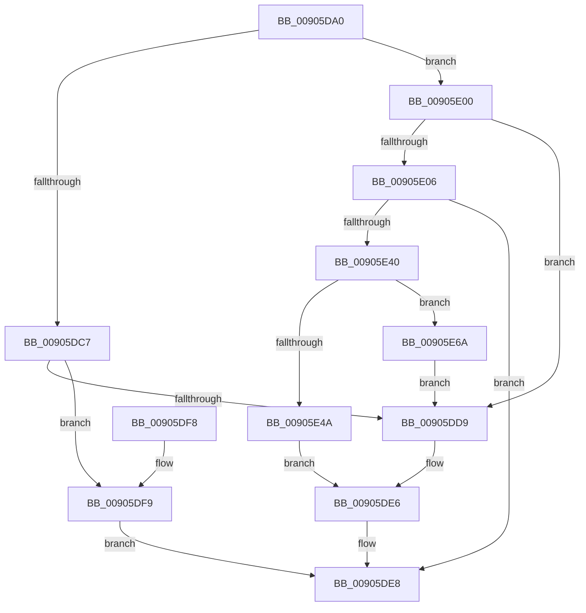

# NtTerminateThread

- RVA: `0x00905DA0`–`0x00905E79` (길이 `217` bytes)
- VA: `0x0000000140905DA0`
- 실행 섹션: `PAGE`
- PDB 이름 있음: `예`; PDB Function 태그: `아니요`
- unwind 정보 RVA: `0x00088C6C`
- 디코드: `55`개 명령, `217/217` bytes 표시
- 미해석 바이트: `0` (있으면 어셈블리에 `.byte`로 보존)

> 이 문서는 커널 이미지의 기계어와 PDB 기호를 분석해 생성했습니다. 4번과 5번은 함수 원형과 자료형을 바이너리 사용 방식에서 추정한 C 해석이며 원본 소스 복구 결과는 아닙니다.

## 1. Dependencies

- 직접 호출 지점: **5**; 고유 호출 대상: **3**
- 직접 호출자로 확인된 함수: **0**
- RIP 상대 이미지 참조: **1**

### Outgoing calls
- `0x00905DE1` → [PspTerminateThreadByPointer](PspTerminateThreadByPointer_function_00905E80.md) (function, `0x00905E80`)
- `0x00905E35` → [ObpReferenceObjectByHandleWithTag](../86/ObpReferenceObjectByHandleWithTag_function_00869650.md) (function, `0x00869650`)
- `0x00905E4F` → [PspTerminateThreadByPointer](PspTerminateThreadByPointer_function_00905E80.md) (function, `0x00905E80`)
- `0x00905E60` → [ObfDereferenceObjectWithTag](../../text/2F/ObfDereferenceObjectWithTag_function_002F78E0.md) (function, `0x002F78E0`)
- `0x00905E6F` → [ObfDereferenceObjectWithTag](../../text/2F/ObfDereferenceObjectWithTag_function_002F78E0.md) (function, `0x002F78E0`)

### Direct callers
- 이 함수 시작 RVA로 연결되는 직접 call은 확인되지 않았습니다. 간접 호출은 완전히 역산할 수 없습니다.

### Static image references
- `0x00905E21` → RVA `0x00FC6AC8` (`ALMOSTRO`; read)

## 2. Other-region calls and transfers

- 다른 실행 섹션으로 향하는 call: **2**
  - `0x00905E60` → [ObfDereferenceObjectWithTag](../../text/2F/ObfDereferenceObjectWithTag_function_002F78E0.md) (`PAGE` → `.text`)
  - `0x00905E6F` → [ObfDereferenceObjectWithTag](../../text/2F/ObfDereferenceObjectWithTag_function_002F78E0.md) (`PAGE` → `.text`)
- 별도 외부 분기/꼬리 이동을 확인하지 못했습니다.

## 3. Assembly (complete function range)

```asm
00905DA0  48 89 5C 24 10                  mov qword ptr [rsp + 0x10], rbx
00905DA5  48 89 6C 24 18                  mov qword ptr [rsp + 0x18], rbp
00905DAA  56                              push rsi
00905DAB  48 83 EC 40                     sub rsp, 0x40
00905DAF  48 83 64 24 50 00               and qword ptr [rsp + 0x50], 0
00905DB5  33 DB                           xor ebx, ebx
00905DB7  65 48 8B 34 25 88 01 00 00      mov rsi, qword ptr gs:[0x188]
00905DC0  8B EA                           mov ebp, edx
00905DC2  48 85 C9                        test rcx, rcx
00905DC5  75 39                           jne 0x140905e00
00905DC7  48 8B 86 B8 00 00 00            mov rax, qword ptr [rsi + 0xb8]
00905DCE  8B 88 80 03 00 00               mov ecx, dword ptr [rax + 0x380]
00905DD4  83 F9 01                        cmp ecx, 1
00905DD7  74 20                           je 0x140905df9
00905DD9  41 B0 01                        mov r8b, 1
00905DDC  8B D5                           mov edx, ebp
00905DDE  48 8B CE                        mov rcx, rsi
00905DE1  E8 9A 00 00 00                  call 0x140905e80
00905DE6  8B C3                           mov eax, ebx
00905DE8  48 8B 5C 24 58                  mov rbx, qword ptr [rsp + 0x58]
00905DED  48 8B 6C 24 60                  mov rbp, qword ptr [rsp + 0x60]
00905DF2  48 83 C4 40                     add rsp, 0x40
00905DF6  5E                              pop rsi
00905DF7  C3                              ret
00905DF8  CC                              int3
00905DF9  B8 DB 00 00 C0                  mov eax, 0xc00000db
00905DFE  EB E8                           jmp 0x140905de8
00905E00  48 83 F9 FE                     cmp rcx, -2
00905E04  74 D3                           je 0x140905dd9
00905E06  48 21 5C 24 38                  and qword ptr [rsp + 0x38], rbx
00905E0B  48 8D 44 24 50                  lea rax, [rsp + 0x50]
00905E10  48 21 5C 24 30                  and qword ptr [rsp + 0x30], rbx
00905E15  BA 01 00 00 00                  mov edx, 1
00905E1A  44 8A 8E 32 02 00 00            mov r9b, byte ptr [rsi + 0x232]
00905E21  4C 8B 05 A0 0C 6C 00            mov r8, qword ptr [rip + 0x6c0ca0]
00905E28  48 89 44 24 28                  mov qword ptr [rsp + 0x28], rax
00905E2D  C7 44 24 20 50 73 54 65         mov dword ptr [rsp + 0x20], 0x65547350
00905E35  E8 16 38 F6 FF                  call 0x140869650
00905E3A  8B D8                           mov ebx, eax
00905E3C  85 C0                           test eax, eax
00905E3E  78 A8                           js 0x140905de8
00905E40  48 8B 4C 24 50                  mov rcx, qword ptr [rsp + 0x50]
00905E45  48 3B CE                        cmp rcx, rsi
00905E48  74 20                           je 0x140905e6a
00905E4A  45 33 C0                        xor r8d, r8d
00905E4D  8B D5                           mov edx, ebp
00905E4F  E8 2C 00 00 00                  call 0x140905e80
00905E54  48 8B 4C 24 50                  mov rcx, qword ptr [rsp + 0x50]
00905E59  BA 50 73 54 65                  mov edx, 0x65547350
00905E5E  8B D8                           mov ebx, eax
00905E60  E8 7B 1A 9F FF                  call 0x1402f78e0
00905E65  E9 7C FF FF FF                  jmp 0x140905de6
00905E6A  BA 50 73 54 65                  mov edx, 0x65547350
00905E6F  E8 6C 1A 9F FF                  call 0x1402f78e0
00905E74  E9 60 FF FF FF                  jmp 0x140905dd9
```

## 4. C-style interpretation (structured pseudocode)

```c
__int64 __fastcall NtTerminateThread(__int64 a1, int a2)
{
    __int64 result;
    __int64 v_rbx;
    __int64 v_rsp;
    unsigned __int64 v_stack_p10;
    unsigned __int64 v_stack_p18;
    unsigned int v_stack_p20;
    unsigned __int64 v_stack_p28;
    unsigned __int64 v_stack_p30;
    unsigned __int64 v_stack_p38;
    unsigned __int64 v_stack_p50;
    unsigned __int64 v_stack_p8;

    v_stack_p10 = v_rbx;
    v_stack_p18 = v_rbp;
    v_rsp = (v_rsp) - (64);
    v_rbx = 0;
    if (a1 != 0) goto loc_00905E00;
    if (((unsigned int)((unsigned int)(*(unsigned int *)(*(unsigned __int64 *)(*(unsigned __int64 *)(gs_base + (0 + 392)) + 184) + 896)))) == 1) goto loc_00905DF9;
loc_00905DD9:
    result = PspTerminateThreadByPointer(*(unsigned __int64 *)(gs_base + (0 + 392)), (unsigned int)((unsigned int)((unsigned int)(a2))), 1, a4);
loc_00905DE6:
loc_00905DE8:
    v_rsp = (v_rsp) + (64);
    return 0;
loc_00905DF9:
    goto loc_00905DE8;
loc_00905E00:
    if ((*(unsigned __int64 *)(gs_base + (0 + 392))) == -2) goto loc_00905DD9;
    v_stack_p28 = v_stack_p50;
    v_stack_p20 = 0x65547350ULL;
    result = ObpReferenceObjectByHandleWithTag(*(unsigned __int64 *)(gs_base + (0 + 392)), 1, *(unsigned __int64 *)(v_rip + 7081120), *(unsigned __int8 *)(*(unsigned __int64 *)(gs_base + (0 + 392)) + 562));
    if (sign_flag) goto loc_00905DE8;
    if (v_stack_p50 == (*(unsigned __int64 *)(gs_base + (0 + 392)))) goto loc_00905E6A;
    a3 = 0;
    result = PspTerminateThreadByPointer(v_stack_p50, (unsigned int)((unsigned int)(v_stack_p18)), a3, *(unsigned __int8 *)(*(unsigned __int64 *)(gs_base + (0 + 392)) + 562));
    result = ObfDereferenceObjectWithTag(v_stack_p50, (unsigned int)(0x65547350ULL), a3, *(unsigned __int8 *)(*(unsigned __int64 *)(gs_base + (0 + 392)) + 562));
    goto loc_00905DE6;
loc_00905E6A:
    result = ObfDereferenceObjectWithTag(v_stack_p50, (unsigned int)(0x65547350ULL), a3, *(unsigned __int8 *)(*(unsigned __int64 *)(gs_base + (0 + 392)) + 562));
    goto loc_00905DD9;
}
```

## 5. (Beta) C Style

```c
int64_t NtTerminateThread(int64_t Arg1, int32_t Arg2)
{
    int64_t result;
    int64_t local_rbx;
    int64_t local_rsp;
    uint64_t v_stack_p10;
    uint64_t v_stack_p18;
    uint32_t v_stack_p20;
    uint64_t v_stack_p28;
    uint64_t v_stack_p30;
    uint64_t v_stack_p38;
    uint64_t v_stack_p50;
    uint64_t v_stack_p8;

    v_stack_p10 = local_rbx;
    v_stack_p18 = local_rbp;
    local_rsp = (local_rsp) - (64);
    local_rbx = 0;
    if (Arg1 != 0) goto loc_00905E00;
    if (((uint32_t)((uint32_t)(*(uint32_t *)(*(uint64_t *)(*(uint64_t *)(gs_base + (0 + 0x188)) + 0xB8) + 0x380)))) == 1) goto loc_00905DF9;
loc_00905DD9:
    result = PspTerminateThreadByPointer(*(uint64_t *)(gs_base + (0 + 0x188)), (uint32_t)((uint32_t)((uint32_t)(Arg2))), 1, a4);
loc_00905DE6:
loc_00905DE8:
    local_rsp = (local_rsp) + (64);
    return 0;
loc_00905DF9:
    goto loc_00905DE8;
loc_00905E00:
    if ((*(uint64_t *)(gs_base + (0 + 0x188))) == -2) goto loc_00905DD9;
    v_stack_p28 = v_stack_p50;
    v_stack_p20 = 0x65547350ULL;
    result = ObpReferenceObjectByHandleWithTag(*(uint64_t *)(gs_base + (0 + 0x188)), 1, *(uint64_t *)(v_rip + 0x6C0CA0), *(uint8_t *)(*(uint64_t *)(gs_base + (0 + 0x188)) + 0x232));
    if (sign_flag) goto loc_00905DE8;
    if (v_stack_p50 == (*(uint64_t *)(gs_base + (0 + 0x188)))) goto loc_00905E6A;
    a3 = 0;
    result = PspTerminateThreadByPointer(v_stack_p50, (uint32_t)((uint32_t)(v_stack_p18)), a3, *(uint8_t *)(*(uint64_t *)(gs_base + (0 + 0x188)) + 0x232));
    result = ObfDereferenceObjectWithTag(v_stack_p50, (uint32_t)(0x65547350ULL), a3, *(uint8_t *)(*(uint64_t *)(gs_base + (0 + 0x188)) + 0x232));
    goto loc_00905DE6;
loc_00905E6A:
    result = ObfDereferenceObjectWithTag(v_stack_p50, (uint32_t)(0x65547350ULL), a3, *(uint8_t *)(*(uint64_t *)(gs_base + (0 + 0x188)) + 0x232));
    goto loc_00905DD9;
}
```

## 6. Execution-region graph

[열기: 2D/3D 그래프와 함수 탐색 컨트롤 패널](../../../control-panel.html?section=page&rva=0x00905DA0&view=graph)

- 2D 그래프는 위에서 아래로 흐르고, 3D 그래프는 빈 공간을 드래그해 회전합니다. Shift+드래그는 이동, 휠은 확대·축소, 함수 노드 선택은 대상 보고서 이동입니다.

### Static fallback


