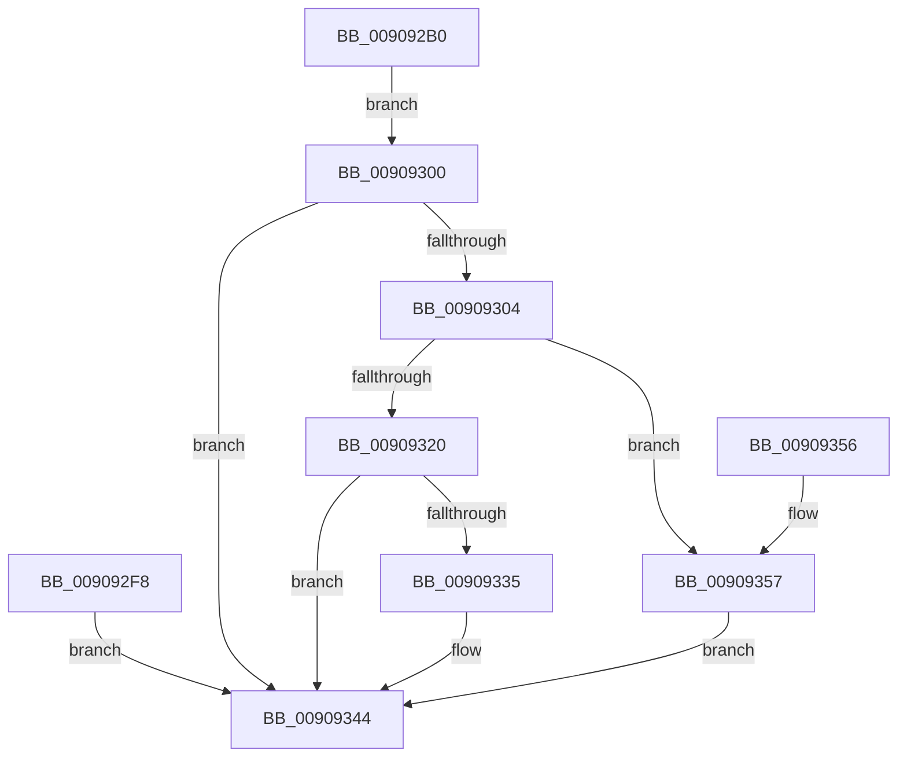

# NtUnsubscribeWnfStateChange

- RVA: `0x009092B0`–`0x0090935E` (길이 `174` bytes)
- VA: `0x00000001409092B0`
- 실행 섹션: `PAGE`
- PDB 이름 있음: `예`; PDB Function 태그: `아니요`
- unwind 정보 RVA: `0x00088F20`
- 디코드: `45`개 명령, `174/174` bytes 표시
- 미해석 바이트: `0` (있으면 어셈블리에 `.byte`로 보존)

> 이 문서는 커널 이미지의 기계어와 PDB 기호를 분석해 생성했습니다. 4번과 5번은 함수 원형과 자료형을 바이너리 사용 방식에서 추정한 C 해석이며 원본 소스 복구 결과는 아닙니다.

## 1. Dependencies

- 직접 호출 지점: **4**; 고유 호출 대상: **4**
- 직접 호출자로 확인된 함수: **0**
- RIP 상대 이미지 참조: **0**

### Outgoing calls
- `0x009092EB` → [ExpCaptureWnfStateName](ExpCaptureWnfStateName_function_00909370.md) (function, `0x00909370`)
- `0x0090932A` → [ExpWnfAcquireSubscriptionByName](ExpWnfAcquireSubscriptionByName_function_00908D7C.md) (function, `0x00908D7C`)
- `0x0090933D` → [ExpWnfDeleteSubscription](ExpWnfDeleteSubscription_function_00908528.md) (function, `0x00908528`)
- `0x00909344` → [KeLeaveCriticalRegion](../../text/25/KeLeaveCriticalRegion_function_0025D8B0.md) (function, `0x0025D8B0`)

### Direct callers
- 이 함수 시작 RVA로 연결되는 직접 call은 확인되지 않았습니다. 간접 호출은 완전히 역산할 수 없습니다.

### Static image references
- 디코드된 RIP-relative 메모리 참조가 없습니다.

## 2. Other-region calls and transfers

- 다른 실행 섹션으로 향하는 call: **1**
  - `0x00909344` → [KeLeaveCriticalRegion](../../text/25/KeLeaveCriticalRegion_function_0025D8B0.md) (`PAGE` → `.text`)
- 별도 외부 분기/꼬리 이동을 확인하지 못했습니다.

## 3. Assembly (complete function range)

```asm
009092B0  4C 8B DC                        mov r11, rsp
009092B3  49 89 5B 08                     mov qword ptr [r11 + 8], rbx
009092B7  57                              push rdi
009092B8  48 83 EC 30                     sub rsp, 0x30
009092BC  49 83 63 18 00                  and qword ptr [r11 + 0x18], 0
009092C1  49 83 63 10 00                  and qword ptr [r11 + 0x10], 0
009092C6  65 48 8B 04 25 88 01 00 00      mov rax, qword ptr gs:[0x188]
009092CF  66 FF 88 E4 01 00 00            dec word ptr [rax + 0x1e4]
009092D6  90                              nop
009092D7  65 48 8B 04 25 88 01 00 00      mov rax, qword ptr gs:[0x188]
009092E0  44 8A 80 32 02 00 00            mov r8b, byte ptr [rax + 0x232]
009092E7  49 8D 53 10                     lea rdx, [r11 + 0x10]
009092EB  E8 80 00 00 00                  call 0x140909370
009092F0  8B D8                           mov ebx, eax
009092F2  89 44 24 24                     mov dword ptr [rsp + 0x24], eax
009092F6  EB 08                           jmp 0x140909300
009092F8  8B D8                           mov ebx, eax
009092FA  89 44 24 24                     mov dword ptr [rsp + 0x24], eax
009092FE  EB 44                           jmp 0x140909344
00909300  85 C0                           test eax, eax
00909302  78 40                           js 0x140909344
00909304  65 48 8B 04 25 88 01 00 00      mov rax, qword ptr gs:[0x188]
0090930D  48 8B B8 B8 00 00 00            mov rdi, qword ptr [rax + 0xb8]
00909314  48 8B 97 E8 05 00 00            mov rdx, qword ptr [rdi + 0x5e8]
0090931B  48 85 D2                        test rdx, rdx
0090931E  74 37                           je 0x140909357
00909320  4C 8D 44 24 50                  lea r8, [rsp + 0x50]
00909325  48 8B 4C 24 48                  mov rcx, qword ptr [rsp + 0x48]
0090932A  E8 4D FA FF FF                  call 0x140908d7c
0090932F  8B D8                           mov ebx, eax
00909331  85 C0                           test eax, eax
00909333  78 0F                           js 0x140909344
00909335  48 8B D7                        mov rdx, rdi
00909338  48 8B 4C 24 50                  mov rcx, qword ptr [rsp + 0x50]
0090933D  E8 E6 F1 FF FF                  call 0x140908528
00909342  33 DB                           xor ebx, ebx
00909344  E8 67 45 95 FF                  call 0x14025d8b0
00909349  8B C3                           mov eax, ebx
0090934B  48 8B 5C 24 40                  mov rbx, qword ptr [rsp + 0x40]
00909350  48 83 C4 30                     add rsp, 0x30
00909354  5F                              pop rdi
00909355  C3                              ret
00909356  CC                              int3
00909357  BB 34 00 00 C0                  mov ebx, 0xc0000034
0090935C  EB E6                           jmp 0x140909344
```

## 4. C-style interpretation (structured pseudocode)

```c
__int64 __fastcall NtUnsubscribeWnfStateChange(void)
{
    __int64 result;
    __int64 v_rbx;
    __int64 v_rsp;
    unsigned int v_stack_m14;
    unsigned __int64 v_stack_p10;
    unsigned __int64 v_stack_p18;
    unsigned __int64 v_stack_p8;

    *(unsigned __int64 *)(v_rsp + 8) = v_rbx;
    v_rsp = (v_rsp) - (48);
    result = ExpCaptureWnfStateName(a1, v_rsp + 16, *(unsigned __int8 *)(*(unsigned __int64 *)(gs_base + (0 + 392)) + 562), a4);
    v_stack_m14 = (unsigned int)(result);
    goto loc_00909300;
loc_00909300:
    if (sign_flag) goto loc_00909344;
    if (*(unsigned __int64 *)(*(unsigned __int64 *)(*(unsigned __int64 *)(gs_base + (0 + 392)) + 184) + 1512) == 0) goto loc_00909357;
    result = ExpWnfAcquireSubscriptionByName(v_stack_p10, *(unsigned __int64 *)(*(unsigned __int64 *)(*(unsigned __int64 *)(gs_base + (0 + 392)) + 184) + 1512), v_stack_p18, a4);
    v_rbx = (unsigned int)((unsigned int)(result));
    if (!(sign_flag)) {
        a2 = *(unsigned __int64 *)(*(unsigned __int64 *)(gs_base + (0 + 392)) + 184);
        a1 = v_stack_p18;
        result = ExpWnfDeleteSubscription(a1, a2, v_stack_p18, a4);
        v_rbx = 0;
    }
    result = KeLeaveCriticalRegion(a1, a2, v_stack_p18, a4);
    v_rsp = (v_rsp) + (48);
    return 0;
loc_00909357:
    goto loc_00909344;
}
```

## 5. (Beta) C Style

```c
void NtUnsubscribeWnfStateChange(void)
{
    int64_t result;
    int64_t local_rbx;
    int64_t local_rsp;
    uint32_t v_stack_m14;
    uint64_t v_stack_p10;
    uint64_t v_stack_p18;
    uint64_t v_stack_p8;

    *(uint64_t *)(local_rsp + 0x8) = local_rbx;
    local_rsp = (local_rsp) - (48);
    result = ExpCaptureWnfStateName(a1, local_rsp + 16, *(uint8_t *)(*(uint64_t *)(gs_base + (0 + 0x188)) + 0x232), a4);
    v_stack_m14 = (uint32_t)(result);
    goto loc_00909300;
loc_00909300:
    if (sign_flag) goto loc_00909344;
    if (*(uint64_t *)(*(uint64_t *)(*(uint64_t *)(gs_base + (0 + 0x188)) + 0xB8) + 0x5E8) == 0) goto loc_00909357;
    result = ExpWnfAcquireSubscriptionByName(v_stack_p10, *(uint64_t *)(*(uint64_t *)(*(uint64_t *)(gs_base + (0 + 0x188)) + 0xB8) + 0x5E8), v_stack_p18, a4);
    local_rbx = (uint32_t)((uint32_t)(result));
    if (!(sign_flag)) {
        a2 = *(uint64_t *)(*(uint64_t *)(gs_base + (0 + 0x188)) + 0xB8);
        a1 = v_stack_p18;
        result = ExpWnfDeleteSubscription(a1, a2, v_stack_p18, a4);
        local_rbx = 0;
    }
    result = KeLeaveCriticalRegion(a1, a2, v_stack_p18, a4);
    local_rsp = (local_rsp) + (48);
    return 0;
loc_00909357:
    goto loc_00909344;
}
```

## 6. Execution-region graph

[열기: 2D/3D 그래프와 함수 탐색 컨트롤 패널](../../../control-panel.html?section=page&rva=0x009092B0&view=graph)

- 2D 그래프는 위에서 아래로 흐르고, 3D 그래프는 빈 공간을 드래그해 회전합니다. Shift+드래그는 이동, 휠은 확대·축소, 함수 노드 선택은 대상 보고서 이동입니다.

### Static fallback


