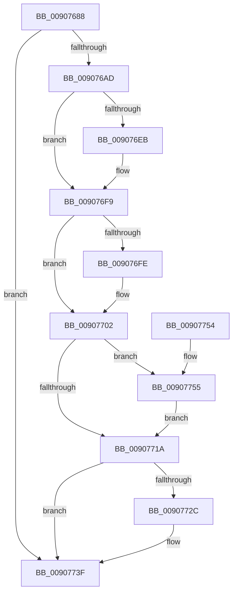

# ObClearProcessDeviceMap

- RVA: `0x00907688`–`0x0090775F` (길이 `215` bytes)
- VA: `0x0000000140907688`
- 실행 섹션: `PAGE`
- PDB 이름 있음: `예`; PDB Function 태그: `아니요`
- unwind 정보 RVA: `0x00073808`
- 디코드: `57`개 명령, `215/215` bytes 표시
- 미해석 바이트: `0` (있으면 어셈블리에 `.byte`로 보존)

> 이 문서는 커널 이미지의 기계어와 PDB 기호를 분석해 생성했습니다. 4번과 5번은 함수 원형과 자료형을 바이너리 사용 방식에서 추정한 C 해석이며 원본 소스 복구 결과는 아닙니다.

## 1. Dependencies

- 직접 호출 지점: **8**; 고유 호출 대상: **8**
- 직접 호출자로 확인된 함수: **2**
- RIP 상대 이미지 참조: **0**

### Outgoing calls
- `0x009076AD` → [PsGetProcessServerSilo](../../text/44/PsGetProcessServerSilo_function_0044BEE0.md) (function, `0x0044BEE0`)
- `0x009076B5` → [PsGetServerSiloGlobals](../../text/22/PsGetServerSiloGlobals_function_002250A0.md) (function, `0x002250A0`)
- `0x009076DB` → [KeAbPreAcquire](../../text/21/KeAbPreAcquire_function_00210230.md) (function, `0x00210230`)
- `0x009076F4` → [ExfAcquirePushLockExclusiveEx](../../text/20/ExfAcquirePushLockExclusiveEx_function_0020FC90.md) (function, `0x0020FC90`)
- `0x0090771D` → [KeAbPostRelease](../../text/2E/KeAbPostRelease_function_002E1600.md) (function, `0x002E1600`)
- `0x00907722` → [KeLeaveGuardedRegion](../../text/2E/KeLeaveGuardedRegion_function_002E2C40.md) (function, `0x002E2C40`)
- `0x0090773A` → [ObDereferenceDeviceMap](../96/ObDereferenceDeviceMap_function_0096D0E8.md) (function, `0x0096D0E8`)
- `0x00907758` → [ExfTryToWakePushLock](../../text/26/ExfTryToWakePushLock_function_00265DD0.md) (function, `0x00265DD0`)

### Direct callers
- [PspAssignPrimaryToken](../78/PspAssignPrimaryToken_function_00784870.md) at `0x007849F1`
- [PspProcessDelete](PspProcessDelete_function_00907B90.md) at `0x00907C53`

### Static image references
- 디코드된 RIP-relative 메모리 참조가 없습니다.

## 2. Other-region calls and transfers

- 다른 실행 섹션으로 향하는 call: **7**
  - `0x009076AD` → [PsGetProcessServerSilo](../../text/44/PsGetProcessServerSilo_function_0044BEE0.md) (`PAGE` → `.text`)
  - `0x009076B5` → [PsGetServerSiloGlobals](../../text/22/PsGetServerSiloGlobals_function_002250A0.md) (`PAGE` → `.text`)
  - `0x009076DB` → [KeAbPreAcquire](../../text/21/KeAbPreAcquire_function_00210230.md) (`PAGE` → `.text`)
  - `0x009076F4` → [ExfAcquirePushLockExclusiveEx](../../text/20/ExfAcquirePushLockExclusiveEx_function_0020FC90.md) (`PAGE` → `.text`)
  - `0x0090771D` → [KeAbPostRelease](../../text/2E/KeAbPostRelease_function_002E1600.md) (`PAGE` → `.text`)
  - `0x00907722` → [KeLeaveGuardedRegion](../../text/2E/KeLeaveGuardedRegion_function_002E2C40.md) (`PAGE` → `.text`)
  - `0x00907758` → [ExfTryToWakePushLock](../../text/26/ExfTryToWakePushLock_function_00265DD0.md) (`PAGE` → `.text`)
- 별도 외부 분기/꼬리 이동을 확인하지 못했습니다.

## 3. Assembly (complete function range)

```asm
00907688  48 89 5C 24 08                  mov qword ptr [rsp + 8], rbx
0090768D  48 89 6C 24 10                  mov qword ptr [rsp + 0x10], rbp
00907692  48 89 74 24 18                  mov qword ptr [rsp + 0x18], rsi
00907697  57                              push rdi
00907698  48 83 EC 20                     sub rsp, 0x20
0090769C  48 83 B9 18 03 00 00 00         cmp qword ptr [rcx + 0x318], 0
009076A4  48 8B E9                        mov rbp, rcx
009076A7  0F 84 92 00 00 00               je 0x14090773f
009076AD  E8 2E 48 B4 FF                  call 0x14044bee0
009076B2  48 8B C8                        mov rcx, rax
009076B5  E8 E6 D9 91 FF                  call 0x1402250a0
009076BA  65 48 8B 14 25 88 01 00 00      mov rdx, qword ptr gs:[0x188]
009076C3  48 83 CF FF                     or rdi, 0xffffffffffffffff
009076C7  45 33 C0                        xor r8d, r8d
009076CA  48 8D 70 78                     lea rsi, [rax + 0x78]
009076CE  66 01 BA E6 01 00 00            add word ptr [rdx + 0x1e6], di
009076D5  48 8B CE                        mov rcx, rsi
009076D8  33 D2                           xor edx, edx
009076DA  90                              nop
009076DB  E8 50 8B 90 FF                  call 0x140210230
009076E0  F0 48 0F BA 2E 00               lock bts qword ptr [rsi], 0
009076E6  48 8B D8                        mov rbx, rax
009076E9  73 0E                           jae 0x1409076f9
009076EB  4C 8B C6                        mov r8, rsi
009076EE  48 8B D0                        mov rdx, rax
009076F1  48 8B CE                        mov rcx, rsi
009076F4  E8 97 85 90 FF                  call 0x14020fc90
009076F9  48 85 DB                        test rbx, rbx
009076FC  74 04                           je 0x140907702
009076FE  C6 43 0A 01                     mov byte ptr [rbx + 0xa], 1
00907702  33 DB                           xor ebx, ebx
00907704  48 87 9D 18 03 00 00            xchg qword ptr [rbp + 0x318], rbx
0090770B  F0 48 0F C1 3E                  lock xadd qword ptr [rsi], rdi
00907710  40 80 E7 06                     and dil, 6
00907714  40 80 FF 02                     cmp dil, 2
00907718  74 3B                           je 0x140907755
0090771A  48 8B CE                        mov rcx, rsi
0090771D  E8 DE 9E 9D FF                  call 0x1402e1600
00907722  E8 19 B5 9D FF                  call 0x1402e2c40
00907727  48 85 DB                        test rbx, rbx
0090772A  74 13                           je 0x14090773f
0090772C  8B D3                           mov edx, ebx
0090772E  48 83 E3 F0                     and rbx, 0xfffffffffffffff0
00907732  83 E2 0F                        and edx, 0xf
00907735  48 8B CB                        mov rcx, rbx
00907738  FF C2                           inc edx
0090773A  E8 A9 59 06 00                  call 0x14096d0e8
0090773F  48 8B 5C 24 30                  mov rbx, qword ptr [rsp + 0x30]
00907744  48 8B 6C 24 38                  mov rbp, qword ptr [rsp + 0x38]
00907749  48 8B 74 24 40                  mov rsi, qword ptr [rsp + 0x40]
0090774E  48 83 C4 20                     add rsp, 0x20
00907752  5F                              pop rdi
00907753  C3                              ret
00907754  CC                              int3
00907755  48 8B CE                        mov rcx, rsi
00907758  E8 73 E6 95 FF                  call 0x140265dd0
0090775D  EB BB                           jmp 0x14090771a
```

## 4. C-style interpretation (structured pseudocode)

```c
__int64 __fastcall ObClearProcessDeviceMap(__int64 a1, __int64 a2, int a3)
{
    __int64 result;
    __int64 v_rbx;
    __int64 v_rdi;
    __int64 v_rsp;
    unsigned __int64 v_stack_p10;
    unsigned __int64 v_stack_p18;
    unsigned __int64 v_stack_p8;

    v_stack_p8 = v_rbx;
    v_stack_p10 = v_rbp;
    v_stack_p18 = v_rsi;
    v_rsp = (v_rsp) - (32);
    if ((*(unsigned __int64 *)(a1 + 792)) == 0) goto loc_0090773F;
    result = PsGetProcessServerSilo(a1, a2, a3, a4);
    result = PsGetServerSiloGlobals(result, a2, a3, a4);
    v_rdi = (v_rdi) | (-1);
    a3 = 0;
    a2 = 0;
    result = KeAbPreAcquire(result + 120, a2, a3, a4);
    if (!(condition_is_above_or_equal)) {
        a3 = result + 120;
        a2 = result;
        a1 = result + 120;
        result = ExfAcquirePushLockExclusiveEx(a1, a2, a3, a4);
    }
    if (result != 0) {
        *(unsigned __int8 *)(result + 10) = 1;
    }
    v_rbx = 0;
    v_rdi = (unsigned __int8)((v_rdi) & (6));
    if (((unsigned __int8)(v_rdi)) == 2) goto loc_00907755;
loc_0090771A:
    result = KeAbPostRelease(result + 120, a2, a3, a4);
    result = KeLeaveGuardedRegion(result + 120, a2, a3, a4);
    if (0 != 0) {
        a2 = 0;
        v_rbx = (v_rbx) & (-16);
        a2 = (unsigned int)((a2) & (15));
        a1 = v_rbx;
        a2 = (unsigned int)((a2) + 1);
        result = ObDereferenceDeviceMap(a1, a2, a3, a4);
    }
    v_rsp = (v_rsp) + (32);
    return result;
loc_00907755:
    result = ExfTryToWakePushLock(v_stack_p18, a2, a3, a4);
    goto loc_0090771A;
}
```

## 5. (Beta) C Style

```c
int64_t ObClearProcessDeviceMap(void *Arg1, int64_t Arg2, int32_t Arg3)
{
    uint8_t *arg1 = (uint8_t *)Arg1;

    int64_t result;
    int64_t local_rbx;
    int64_t local_rdi;
    int64_t local_rsp;
    uint64_t v_stack_p10;
    uint64_t v_stack_p18;
    uint64_t v_stack_p8;

    v_stack_p8 = local_rbx;
    v_stack_p10 = local_rbp;
    v_stack_p18 = local_rsi;
    local_rsp = (local_rsp) - (32);
    if ((*(uint64_t *)(arg1 + 0x318)) == 0) goto loc_0090773F;
    result = PsGetProcessServerSilo(Arg1, Arg2, Arg3, a4);
    result = PsGetServerSiloGlobals(result, Arg2, Arg3, a4);
    local_rdi = (local_rdi) | (-1);
    Arg3 = 0;
    Arg2 = 0;
    result = KeAbPreAcquire(result + 120, Arg2, Arg3, a4);
    if (!(condition_is_above_or_equal)) {
        Arg3 = result + 120;
        Arg2 = result;
        Arg1 = result + 120;
        result = ExfAcquirePushLockExclusiveEx(Arg1, Arg2, Arg3, a4);
    }
    if (result != 0) {
        *(uint8_t *)(result + 0xA) = 1;
    }
    local_rbx = 0;
    local_rdi = (uint8_t)((local_rdi) & (6));
    if (((uint8_t)(local_rdi)) == 2) goto loc_00907755;
loc_0090771A:
    result = KeAbPostRelease(result + 120, Arg2, Arg3, a4);
    result = KeLeaveGuardedRegion(result + 120, Arg2, Arg3, a4);
    if (0 != 0) {
        Arg2 = 0;
        local_rbx = (local_rbx) & (-16);
        Arg2 = (uint32_t)((Arg2) & (15));
        Arg1 = local_rbx;
        Arg2 = (uint32_t)((Arg2) + 1);
        result = ObDereferenceDeviceMap(Arg1, Arg2, Arg3, a4);
    }
    local_rsp = (local_rsp) + (32);
    return result;
loc_00907755:
    result = ExfTryToWakePushLock(v_stack_p18, Arg2, Arg3, a4);
    goto loc_0090771A;
}
```

### 관측된 메모리 오프셋

구조체 형식이 확인되지 않은 접근은 인자 기준의 오프셋으로만 기록했습니다.

| 기준 인자 | 오프셋 표현 | 폭 (bit) | 접근 |
|---|---:|---:|---|
| `Arg1` | `+ 0x318` | `64` | `R` |
| `Arg1` | `+ 0x318` | `64` | `R/W` |

## 6. Execution-region graph

[열기: 2D/3D 그래프와 함수 탐색 컨트롤 패널](../../../control-panel.html?section=page&rva=0x00907688&view=graph)

- 2D 그래프는 위에서 아래로 흐르고, 3D 그래프는 빈 공간을 드래그해 회전합니다. Shift+드래그는 이동, 휠은 확대·축소, 함수 노드 선택은 대상 보고서 이동입니다.

### Static fallback


