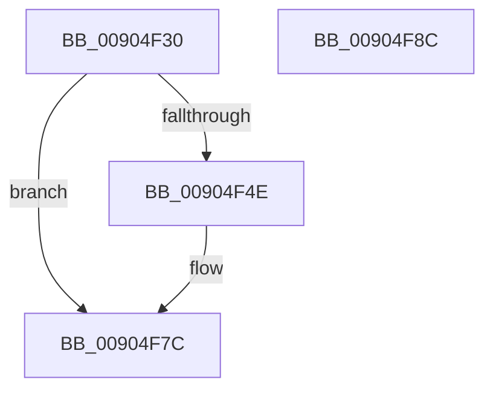

# ObKillProcess

- RVA: `0x00904F30`–`0x00904F8D` (길이 `93` bytes)
- VA: `0x0000000140904F30`
- 실행 섹션: `PAGE`
- PDB 이름 있음: `예`; PDB Function 태그: `아니요`
- unwind 정보 RVA: `0x00060BC4`
- 디코드: `26`개 명령, `93/93` bytes 표시
- 미해석 바이트: `0` (있으면 어셈블리에 `.byte`로 보존)

> 이 문서는 커널 이미지의 기계어와 PDB 기호를 분석해 생성했습니다. 4번과 5번은 함수 원형과 자료형을 바이너리 사용 방식에서 추정한 C 해석이며 원본 소스 복구 결과는 아닙니다.

## 1. Dependencies

- 직접 호출 지점: **4**; 고유 호출 대상: **3**
- 직접 호출자로 확인된 함수: **1**
- RIP 상대 이미지 참조: **0**

### Outgoing calls
- `0x00904F50` → [IoSetThreadHardErrorMode](../../text/46/IoSetThreadHardErrorMode_function_00466BF0.md) (function, `0x00466BF0`)
- `0x00904F60` → [ExSweepHandleTable](ExSweepHandleTable_function_00904D3C.md) (function, `0x00904D3C`)
- `0x00904F67` → [IoSetThreadHardErrorMode](../../text/46/IoSetThreadHardErrorMode_function_00466BF0.md) (function, `0x00466BF0`)
- `0x00904F77` → [ExDestroyHandleTable](ExDestroyHandleTable_function_00904D18.md) (function, `0x00904D18`)

### Direct callers
- [PspRundownSingleProcess](PspRundownSingleProcess_function_00906D50.md) at `0x00906E05`

### Static image references
- 디코드된 RIP-relative 메모리 참조가 없습니다.

## 2. Other-region calls and transfers

- 다른 실행 섹션으로 향하는 call: **2**
  - `0x00904F50` → [IoSetThreadHardErrorMode](../../text/46/IoSetThreadHardErrorMode_function_00466BF0.md) (`PAGE` → `.text`)
  - `0x00904F67` → [IoSetThreadHardErrorMode](../../text/46/IoSetThreadHardErrorMode_function_00466BF0.md) (`PAGE` → `.text`)
- 별도 외부 분기/꼬리 이동을 확인하지 못했습니다.

## 3. Assembly (complete function range)

```asm
00904F30  48 89 5C 24 08                  mov qword ptr [rsp + 8], rbx
00904F35  48 89 74 24 10                  mov qword ptr [rsp + 0x10], rsi
00904F3A  57                              push rdi
00904F3B  48 83 EC 20                     sub rsp, 0x20
00904F3F  48 8B B1 00 03 00 00            mov rsi, qword ptr [rcx + 0x300]
00904F46  48 8B F9                        mov rdi, rcx
00904F49  48 85 F6                        test rsi, rsi
00904F4C  74 2E                           je 0x140904f7c
00904F4E  33 C9                           xor ecx, ecx
00904F50  E8 9B 1C B6 FF                  call 0x140466bf0
00904F55  45 33 C0                        xor r8d, r8d
00904F58  48 8B D6                        mov rdx, rsi
00904F5B  48 8B CF                        mov rcx, rdi
00904F5E  8A D8                           mov bl, al
00904F60  E8 D7 FD FF FF                  call 0x140904d3c
00904F65  8A CB                           mov cl, bl
00904F67  E8 84 1C B6 FF                  call 0x140466bf0
00904F6C  48 83 A7 00 03 00 00 00         and qword ptr [rdi + 0x300], 0
00904F74  48 8B CE                        mov rcx, rsi
00904F77  E8 9C FD FF FF                  call 0x140904d18
00904F7C  48 8B 5C 24 30                  mov rbx, qword ptr [rsp + 0x30]
00904F81  48 8B 74 24 38                  mov rsi, qword ptr [rsp + 0x38]
00904F86  48 83 C4 20                     add rsp, 0x20
00904F8A  5F                              pop rdi
00904F8B  C3                              ret
00904F8C  CC                              int3
```

## 4. C-style interpretation (structured pseudocode)

```c
__int64 __fastcall ObKillProcess(__int64 a1, __int64 a2, int a3)
{
    __int64 result;
    __int64 v_rbx;
    __int64 v_rsp;
    unsigned __int64 v_stack_p10;
    unsigned __int64 v_stack_p8;

    v_stack_p8 = v_rbx;
    v_stack_p10 = v_rsi;
    v_rsp = (v_rsp) - (32);
    if (*(unsigned __int64 *)(a1 + 768) != 0) {
        a1 = 0;
        result = IoSetThreadHardErrorMode(a1, a2, a3, a4);
        a3 = 0;
        a2 = *(unsigned __int64 *)(a1 + 768);
        a1 = 0;
        v_rbx = (unsigned __int8)(result);
        result = ExSweepHandleTable(a1, a2, a3, a4);
        a1 = (unsigned __int8)(v_rbx);
        result = IoSetThreadHardErrorMode(a1, a2, a3, a4);
        a1 = *(unsigned __int64 *)(a1 + 768);
        result = ExDestroyHandleTable(a1, a2, a3, a4);
    }
    v_rsp = (v_rsp) + (32);
    return result;
}
```

## 5. (Beta) C Style

```c
int64_t ObKillProcess(void *Arg1, int64_t Arg2, int32_t Arg3)
{
    uint8_t *arg1 = (uint8_t *)Arg1;

    int64_t result;
    int64_t local_rbx;
    int64_t local_rsp;
    uint64_t v_stack_p10;
    uint64_t v_stack_p8;

    v_stack_p8 = local_rbx;
    v_stack_p10 = local_rsi;
    local_rsp = (local_rsp) - (32);
    if (*(uint64_t *)(arg1 + 0x300) != 0) {
        Arg1 = 0;
        result = IoSetThreadHardErrorMode(Arg1, Arg2, Arg3, a4);
        Arg3 = 0;
        Arg2 = *(uint64_t *)(arg1 + 0x300);
        Arg1 = 0;
        local_rbx = (uint8_t)(result);
        result = ExSweepHandleTable(Arg1, Arg2, Arg3, a4);
        Arg1 = (uint8_t)(local_rbx);
        result = IoSetThreadHardErrorMode(Arg1, Arg2, Arg3, a4);
        Arg1 = *(uint64_t *)(arg1 + 0x300);
        result = ExDestroyHandleTable(Arg1, Arg2, Arg3, a4);
    }
    local_rsp = (local_rsp) + (32);
    return result;
}
```

### 관측된 메모리 오프셋

구조체 형식이 확인되지 않은 접근은 인자 기준의 오프셋으로만 기록했습니다.

| 기준 인자 | 오프셋 표현 | 폭 (bit) | 접근 |
|---|---:|---:|---|
| `Arg1` | `+ 0x300` | `64` | `R` |
| `Arg1` | `+ 0x300` | `64` | `R/W` |

## 6. Execution-region graph

[열기: 2D/3D 그래프와 함수 탐색 컨트롤 패널](../../../control-panel.html?section=page&rva=0x00904F30&view=graph)

- 2D 그래프는 위에서 아래로 흐르고, 3D 그래프는 빈 공간을 드래그해 회전합니다. Shift+드래그는 이동, 휠은 확대·축소, 함수 노드 선택은 대상 보고서 이동입니다.

### Static fallback


