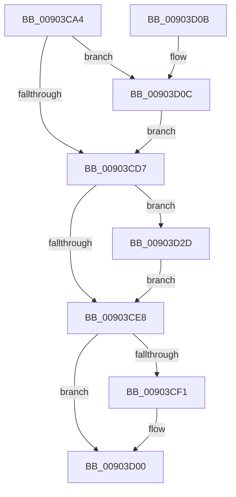

# PfProcessExitNotification

- RVA: `0x00903CA4`–`0x00903D44` (길이 `160` bytes)
- VA: `0x0000000140903CA4`
- 실행 섹션: `PAGE`
- PDB 이름 있음: `예`; PDB Function 태그: `아니요`
- unwind 정보 RVA: `0x00088A30`
- 디코드: `42`개 명령, `160/160` bytes 표시
- 미해석 바이트: `0` (있으면 어셈블리에 `.byte`로 보존)

> 이 문서는 커널 이미지의 기계어와 PDB 기호를 분석해 생성했습니다. 4번과 5번은 함수 원형과 자료형을 바이너리 사용 방식에서 추정한 C 해석이며 원본 소스 복구 결과는 아닙니다.

## 1. Dependencies

- 직접 호출 지점: **9**; 고유 호출 대상: **8**
- 직접 호출자로 확인된 함수: **1**
- RIP 상대 이미지 참조: **4**

### Outgoing calls
- `0x00903CB6` → [PfpLogApplicationEvent](../../text/3B/PfpLogApplicationEvent_function_003BA3A0.md) (function, `0x003BA3A0`)
- `0x00903CC2` → [FsRtlAcquirePushLockExclusive](../../text/4A/FsRtlAcquirePushLockExclusive_function_004A05F4.md) (function, `0x004A05F4`)
- `0x00903CCA` → [PfSnAltProfileFindByProcess](PfSnAltProfileFindByProcess_function_00903D4C.md) (function, `0x00903D4C`)
- `0x00903CDE` → [PfLockExclusiveRelease](../../text/49/PfLockExclusiveRelease_function_00491D88.md) (function, `0x00491D88`)
- `0x00903CFB` → [PfSnEndProcessTrace](PfSnEndProcessTrace_function_00903E04.md) (function, `0x00903E04`)
- `0x00903D16` → [RtlRbRemoveNode](../../text/2E/RtlRbRemoveNode_function_002E4C10.md) (function, `0x002E4C10`)
- `0x00903D26` → [RtlRbRemoveNode](../../text/2E/RtlRbRemoveNode_function_002E4C10.md) (function, `0x002E4C10`)
- `0x00903D30` → [PfSnAltProfileCleanup](../75/PfSnAltProfileCleanup_function_00752270.md) (function, `0x00752270`)
- `0x00903D3D` → [ExFreePoolWithTag](../../poolcode/B8/ExFreePoolWithTag_function_00B82870.md) (function, `0x00B82870`)

### Direct callers
- [PspExitProcess](PspExitProcess_function_00904830.md) at `0x009048FD`

### Static image references
- `0x00903CBB` → RVA `0x00E67388` (`.data`; read)
- `0x00903CE8` → RVA `0x00E67248` (`.data`; read)
- `0x00903D0F` → RVA `0x00E67368` (`.data`; read)
- `0x00903D1F` → RVA `0x00E67378` (`.data`; read)

## 2. Other-region calls and transfers

- 다른 실행 섹션으로 향하는 call: **6**
  - `0x00903CB6` → [PfpLogApplicationEvent](../../text/3B/PfpLogApplicationEvent_function_003BA3A0.md) (`PAGE` → `.text`)
  - `0x00903CC2` → [FsRtlAcquirePushLockExclusive](../../text/4A/FsRtlAcquirePushLockExclusive_function_004A05F4.md) (`PAGE` → `.text`)
  - `0x00903CDE` → [PfLockExclusiveRelease](../../text/49/PfLockExclusiveRelease_function_00491D88.md) (`PAGE` → `.text`)
  - `0x00903D16` → [RtlRbRemoveNode](../../text/2E/RtlRbRemoveNode_function_002E4C10.md) (`PAGE` → `.text`)
  - `0x00903D26` → [RtlRbRemoveNode](../../text/2E/RtlRbRemoveNode_function_002E4C10.md) (`PAGE` → `.text`)
  - `0x00903D3D` → [ExFreePoolWithTag](../../poolcode/B8/ExFreePoolWithTag_function_00B82870.md) (`PAGE` → `POOLCODE`)
- 별도 외부 분기/꼬리 이동을 확인하지 못했습니다.

## 3. Assembly (complete function range)

```asm
00903CA4  48 89 5C 24 08                  mov qword ptr [rsp + 8], rbx
00903CA9  57                              push rdi
00903CAA  48 83 EC 20                     sub rsp, 0x20
00903CAE  41 B0 01                        mov r8b, 1
00903CB1  33 D2                           xor edx, edx
00903CB3  48 8B F9                        mov rdi, rcx
00903CB6  E8 E5 66 AB FF                  call 0x1403ba3a0
00903CBB  48 8D 0D C6 36 56 00            lea rcx, [rip + 0x5636c6]
00903CC2  E8 2D C9 B9 FF                  call 0x1404a05f4
00903CC7  48 8B CF                        mov rcx, rdi
00903CCA  E8 7D 00 00 00                  call 0x140903d4c
00903CCF  48 8B D8                        mov rbx, rax
00903CD2  48 85 C0                        test rax, rax
00903CD5  75 35                           jne 0x140903d0c
00903CD7  48 8D 0D AA 36 56 00            lea rcx, [rip + 0x5636aa]
00903CDE  E8 A5 E0 B8 FF                  call 0x140491d88
00903CE3  48 85 DB                        test rbx, rbx
00903CE6  75 45                           jne 0x140903d2d
00903CE8  83 3D 59 35 56 00 00            cmp dword ptr [rip + 0x563559], 0
00903CEF  74 0F                           je 0x140903d00
00903CF1  45 33 C0                        xor r8d, r8d
00903CF4  48 8B CF                        mov rcx, rdi
00903CF7  41 8D 50 02                     lea edx, [r8 + 2]
00903CFB  E8 04 01 00 00                  call 0x140903e04
00903D00  48 8B 5C 24 30                  mov rbx, qword ptr [rsp + 0x30]
00903D05  48 83 C4 20                     add rsp, 0x20
00903D09  5F                              pop rdi
00903D0A  C3                              ret
00903D0B  CC                              int3
00903D0C  48 8B D3                        mov rdx, rbx
00903D0F  48 8D 0D 52 36 56 00            lea rcx, [rip + 0x563652]
00903D16  E8 F5 0E 9E FF                  call 0x1402e4c10
00903D1B  48 8D 53 18                     lea rdx, [rbx + 0x18]
00903D1F  48 8D 0D 52 36 56 00            lea rcx, [rip + 0x563652]
00903D26  E8 E5 0E 9E FF                  call 0x1402e4c10
00903D2B  EB AA                           jmp 0x140903cd7
00903D2D  48 8B CB                        mov rcx, rbx
00903D30  E8 3B E5 E4 FF                  call 0x140752270
00903D35  BA 43 63 50 66                  mov edx, 0x66506343
00903D3A  48 8B CB                        mov rcx, rbx
00903D3D  E8 2E EB 27 00                  call 0x140b82870
00903D42  EB A4                           jmp 0x140903ce8
```

## 4. C-style interpretation (structured pseudocode)

```c
__int64 __fastcall PfProcessExitNotification(__int64 a1, int a2)
{
    __int64 result;
    __int64 v_rsp;
    unsigned __int64 v_stack_p8;

    v_stack_p8 = v_rbx;
    v_rsp = (v_rsp) - (32);
    a2 = 0;
    result = PfpLogApplicationEvent(a1, a2, 1, a4);
    result = FsRtlAcquirePushLockExclusive(v_rip + 5650118, a2, 1, a4);
    result = PfSnAltProfileFindByProcess(a1, a2, 1, a4);
    if (result != 0) goto loc_00903D0C;
loc_00903CD7:
    result = PfLockExclusiveRelease(v_rip + 5650090, a2, 1, a4);
    if (result != 0) goto loc_00903D2D;
loc_00903CE8:
    if ((*(unsigned int *)(v_rip + 5649753)) != 0) {
        a3 = 0;
        a1 = a1;
        a2 = a3 + 2;
        result = PfSnEndProcessTrace(a1, a2, a3, a4);
    }
    v_rsp = (v_rsp) + (32);
    return result;
loc_00903D0C:
    result = RtlRbRemoveNode(v_rip + 5650002, v_stack_p8, a3, a4);
    result = RtlRbRemoveNode(v_rip + 5650002, v_stack_p8 + 24, a3, a4);
    goto loc_00903CD7;
loc_00903D2D:
    result = PfSnAltProfileCleanup(v_stack_p8, v_stack_p8 + 24, a3, a4);
    result = ExFreePoolWithTag(v_stack_p8, (unsigned int)(0x66506343ULL), a3, a4);
    goto loc_00903CE8;
}
```

## 5. (Beta) C Style

```c
int64_t PfProcessExitNotification(int64_t Arg1, int32_t Arg2)
{
    int64_t result;
    int64_t local_rsp;
    uint64_t v_stack_p8;

    v_stack_p8 = local_rbx;
    local_rsp = (local_rsp) - (32);
    Arg2 = 0;
    result = PfpLogApplicationEvent(Arg1, Arg2, 1, a4);
    result = FsRtlAcquirePushLockExclusive(v_rip + 5650118, Arg2, 1, a4);
    result = PfSnAltProfileFindByProcess(Arg1, Arg2, 1, a4);
    if (result != 0) goto loc_00903D0C;
loc_00903CD7:
    result = PfLockExclusiveRelease(v_rip + 5650090, Arg2, 1, a4);
    if (result != 0) goto loc_00903D2D;
loc_00903CE8:
    if ((*(uint32_t *)(v_rip + 0x563559)) != 0) {
        a3 = 0;
        Arg1 = Arg1;
        Arg2 = a3 + 2;
        result = PfSnEndProcessTrace(Arg1, Arg2, a3, a4);
    }
    local_rsp = (local_rsp) + (32);
    return result;
loc_00903D0C:
    result = RtlRbRemoveNode(v_rip + 5650002, v_stack_p8, a3, a4);
    result = RtlRbRemoveNode(v_rip + 5650002, v_stack_p8 + 24, a3, a4);
    goto loc_00903CD7;
loc_00903D2D:
    result = PfSnAltProfileCleanup(v_stack_p8, v_stack_p8 + 24, a3, a4);
    result = ExFreePoolWithTag(v_stack_p8, (uint32_t)(0x66506343ULL), a3, a4);
    goto loc_00903CE8;
}
```

## 6. Execution-region graph

[열기: 2D/3D 그래프와 함수 탐색 컨트롤 패널](../../../control-panel.html?section=page&rva=0x00903CA4&view=graph)

- 2D 그래프는 위에서 아래로 흐르고, 3D 그래프는 빈 공간을 드래그해 회전합니다. Shift+드래그는 이동, 휠은 확대·축소, 함수 노드 선택은 대상 보고서 이동입니다.

### Static fallback


