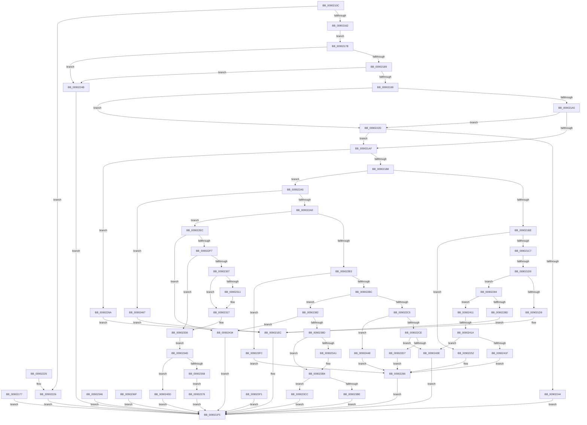

# PfQuerySuperfetchInformation

- RVA: `0x0090210C`–`0x00902481` (길이 `885` bytes)
- VA: `0x000000014090210C`
- 실행 섹션: `PAGE`
- PDB 이름 있음: `예`; PDB Function 태그: `예`
- unwind 정보 RVA: `0x00088724`
- 디코드: `218`개 명령, `885/885` bytes 표시
- 미해석 바이트: `0` (있으면 어셈블리에 `.byte`로 보존)

> 이 문서는 커널 이미지의 기계어와 PDB 기호를 분석해 생성했습니다. 4번과 5번은 함수 원형과 자료형을 바이너리 사용 방식에서 추정한 C 해석이며 원본 소스 복구 결과는 아닙니다.

## 1. Dependencies

- 직접 호출 지점: **15**; 고유 호출 대상: **15**
- 직접 호출자로 확인된 함수: **1**
- RIP 상대 이미지 참조: **3**

### Outgoing calls
- `0x009021E4` → [PfpPfnPrioRequest](PfpPfnPrioRequest_function_00902488.md) (function, `0x00902488`)
- `0x009021F0` → [EtwTiLogSyscallUsage](EtwTiLogSyscallUsage_function_00903890.md) (function, `0x00903890`)
- `0x00902202` → [_security_check_cookie](../../text/6A/_security_check_cookie_function_006AC640.md) (function, `0x006AC640`)
- `0x00902237` → [SeSinglePrivilegeCheck](../87/SeSinglePrivilegeCheck_function_00871E20.md) (function, `0x00871E20`)
- `0x00902261` → [PfGetCompletedTrace](PfGetCompletedTrace_function_00902950.md) (function, `0x00902950`)
- `0x00902275` → [PfpMemoryListQuery](../../text/3B/PfpMemoryListQuery_function_003B9DB8.md) (function, `0x003B9DB8`)
- `0x00902298` → [PfpPrivSourceEnum](../91/PfpPrivSourceEnum_function_0091BF00.md) (function, `0x0091BF00`)
- `0x009022E2` → [PfpQueryGpuUtilization](PfpQueryGpuUtilization_function_00903974.md) (function, `0x00903974`)
- `0x00902311` → [ExRaiseDatatypeMisalignment](../89/ExRaiseDatatypeMisalignment_function_00899FD0.md) (function, `0x00899FD0`)
- `0x00902396` → [MmLogQueryCombineStats](MmLogQueryCombineStats_function_00901D04.md) (function, `0x00901D04`)
- `0x009023AF` → [ProbeForWrite](../8E/ProbeForWrite_function_008E91C0.md) (function, `0x008E91C0`)
- `0x00902407` → [PfpVirtualQuery](PfpVirtualQuery_function_00901C1C.md) (function, `0x00901C1C`)
- `0x0090242A` → [PfpQueryScenarioInformation](../AD/PfpQueryScenarioInformation_function_00AD5324.md) (function, `0x00AD5324`)
- `0x00902453` → [PfpQueryFileExtentsRequest](../75/PfpQueryFileExtentsRequest_function_007508E8.md) (function, `0x007508E8`)
- `0x00902472` → [PfpMemoryRangesQuery](../../text/4D/PfpMemoryRangesQuery_function_004D1D54.md) (function, `0x004D1D54`)

### Direct callers
- [ExpQuerySystemInformation](../A5/ExpQuerySystemInformation_function_00A57858.md) at `0x00A58D1D`

### Static image references
- `0x00902128` → RVA `0x00E0A740` (`.data`; read)
- `0x00902230` → RVA `0x00FD9B08` (`PAGEDATA`; read)
- `0x00902358` → RVA `0x00E67220` (`.data`; read)

## 2. Other-region calls and transfers

- 다른 실행 섹션으로 향하는 call: **3**
  - `0x00902202` → [_security_check_cookie](../../text/6A/_security_check_cookie_function_006AC640.md) (`PAGE` → `.text`)
  - `0x00902275` → [PfpMemoryListQuery](../../text/3B/PfpMemoryListQuery_function_003B9DB8.md) (`PAGE` → `.text`)
  - `0x00902472` → [PfpMemoryRangesQuery](../../text/4D/PfpMemoryRangesQuery_function_004D1D54.md) (`PAGE` → `.text`)
- call이 아닌 외부 분기/꼬리 이동: **2**
  - `0x009021CA` → [sub_00B206FE + 0x67](../B2/Unknown_function_00B206FE.md) (`tail-transfer`)
  - `0x00902414` → [sub_00B206FE](../B2/Unknown_function_00B206FE.md) (`tail-transfer`)

## 3. Assembly (complete function range)

```asm
0090210C  4C 8B DC                        mov r11, rsp
0090210F  49 89 5B 08                     mov qword ptr [r11 + 8], rbx
00902113  56                              push rsi
00902114  57                              push rdi
00902115  41 56                           push r14
00902117  48 81 EC C0 00 00 00            sub rsp, 0xc0
0090211E  41 0F 29 73 D8                  movaps xmmword ptr [r11 - 0x28], xmm6
00902123  41 0F 29 7B C8                  movaps xmmword ptr [r11 - 0x38], xmm7
00902128  48 8B 05 11 86 50 00            mov rax, qword ptr [rip + 0x508611]
0090212F  48 33 C4                        xor rax, rsp
00902132  48 89 84 24 98 00 00 00         mov qword ptr [rsp + 0x98], rax
0090213A  41 8A F1                        mov sil, r9b
0090213D  4C 8B B4 24 00 01 00 00         mov r14, qword ptr [rsp + 0x100]
00902145  33 C0                           xor eax, eax
00902147  89 44 24 4C                     mov dword ptr [rsp + 0x4c], eax
0090214B  0F 57 C0                        xorps xmm0, xmm0
0090214E  0F 11 44 24 78                  movups xmmword ptr [rsp + 0x78], xmm0
00902153  41 0F 11 43 B0                  movups xmmword ptr [r11 - 0x50], xmm0
00902158  41 83 F8 20                     cmp r8d, 0x20
0090215C  0F 85 C4 00 00 00               jne 0x140902226
00902162  33 DB                           xor ebx, ebx
00902164  0F 10 02                        movups xmm0, xmmword ptr [rdx]
00902167  0F 11 44 24 28                  movups xmmword ptr [rsp + 0x28], xmm0
0090216C  0F 10 4A 10                     movups xmm1, xmmword ptr [rdx + 0x10]
00902170  0F 11 4C 24 38                  movups xmmword ptr [rsp + 0x38], xmm1
00902175  EB 04                           jmp 0x14090217b
00902177  8B D8                           mov ebx, eax
00902179  EB 7A                           jmp 0x1409021f5
0090217B  48 8B 44 24 28                  mov rax, qword ptr [rsp + 0x28]
00902180  83 F8 2D                        cmp eax, 0x2d
00902183  0F 85 C2 00 00 00               jne 0x14090224b
00902189  48 C1 E8 20                     shr rax, 0x20
0090218D  3D 43 68 75 6B                  cmp eax, 0x6b756843
00902192  0F 85 B3 00 00 00               jne 0x14090224b
00902198  8B 7C 24 30                     mov edi, dword ptr [rsp + 0x30]
0090219C  83 FF 1C                        cmp edi, 0x1c
0090219F  0F 87 88 00 00 00               ja 0x14090222d
009021A5  B8 00 01 01 10                  mov eax, 0x10010100
009021AA  0F A3 F8                        bt eax, edi
009021AD  73 7E                           jae 0x14090222d
009021AF  83 FF 10                        cmp edi, 0x10
009021B2  0F 84 B2 00 00 00               je 0x14090226a
009021B8  0F 8F E7 00 00 00               jg 0x1409022a5
009021BE  83 EF 01                        sub edi, 1
009021C1  0F 84 8B 00 00 00               je 0x140902252
009021C7  83 EF 01                        sub edi, 1
009021CA  0F 84 95 E5 21 00               je 0x140b20765
009021D0  83 EF 04                        sub edi, 4
009021D3  0F 85 AB 00 00 00               jne 0x140902284
009021D9  4D 8B C6                        mov r8, r14
009021DC  40 8A D6                        mov dl, sil
009021DF  48 8D 4C 24 28                  lea rcx, [rsp + 0x28]
009021E4  E8 9F 02 00 00                  call 0x140902488
009021E9  8D 57 12                        lea edx, [rdi + 0x12]
009021EC  8B D8                           mov ebx, eax
009021EE  8B C8                           mov ecx, eax
009021F0  E8 9B 16 00 00                  call 0x140903890
009021F5  8B C3                           mov eax, ebx
009021F7  48 8B 8C 24 98 00 00 00         mov rcx, qword ptr [rsp + 0x98]
009021FF  48 33 CC                        xor rcx, rsp
00902202  E8 39 A4 DA FF                  call 0x1406ac640
00902207  4C 8D 9C 24 C0 00 00 00         lea r11, [rsp + 0xc0]
0090220F  49 8B 5B 20                     mov rbx, qword ptr [r11 + 0x20]
00902213  41 0F 28 73 F0                  movaps xmm6, xmmword ptr [r11 - 0x10]
00902218  41 0F 28 7B E0                  movaps xmm7, xmmword ptr [r11 - 0x20]
0090221D  49 8B E3                        mov rsp, r11
00902220  41 5E                           pop r14
00902222  5F                              pop rdi
00902223  5E                              pop rsi
00902224  C3                              ret
00902225  CC                              int3
00902226  BB 04 00 00 C0                  mov ebx, 0xc0000004
0090222B  EB C8                           jmp 0x1409021f5
0090222D  40 8A D6                        mov dl, sil
00902230  48 8B 0D D1 78 6D 00            mov rcx, qword ptr [rip + 0x6d78d1]
00902237  E8 E4 FB F6 FF                  call 0x140871e20
0090223C  84 C0                           test al, al
0090223E  0F 85 6B FF FF FF               jne 0x1409021af
00902244  BB 22 00 00 C0                  mov ebx, 0xc0000022
00902249  EB AA                           jmp 0x1409021f5
0090224B  BB 0D 00 00 C0                  mov ebx, 0xc000000d
00902250  EB A3                           jmp 0x1409021f5
00902252  4D 8B CE                        mov r9, r14
00902255  44 8A C6                        mov r8b, sil
00902258  8B 54 24 40                     mov edx, dword ptr [rsp + 0x40]
0090225C  48 8B 4C 24 38                  mov rcx, qword ptr [rsp + 0x38]
00902261  E8 EA 06 00 00                  call 0x140902950
00902266  8B D8                           mov ebx, eax
00902268  EB 8B                           jmp 0x1409021f5
0090226A  4D 8B C6                        mov r8, r14
0090226D  40 8A D6                        mov dl, sil
00902270  48 8D 4C 24 28                  lea rcx, [rsp + 0x28]
00902275  E8 3E 7B AB FF                  call 0x1403b9db8
0090227A  BA 14 00 00 00                  mov edx, 0x14
0090227F  E9 68 FF FF FF                  jmp 0x1409021ec
00902284  83 EF 02                        sub edi, 2
00902287  0F 85 84 01 00 00               jne 0x140902411
0090228D  4D 8B C6                        mov r8, r14
00902290  40 8A D6                        mov dl, sil
00902293  48 8D 4C 24 28                  lea rcx, [rsp + 0x28]
00902298  E8 63 9C 01 00                  call 0x14091bf00
0090229D  8D 57 13                        lea edx, [rdi + 0x13]
009022A0  E9 47 FF FF FF                  jmp 0x1409021ec
009022A5  83 EF 11                        sub edi, 0x11
009022A8  0F 84 B9 01 00 00               je 0x140902467
009022AE  83 EF 03                        sub edi, 3
009022B1  74 39                           je 0x1409022ec
009022B3  83 EF 03                        sub edi, 3
009022B6  0F 84 40 01 00 00               je 0x1409023fc
009022BC  83 EF 01                        sub edi, 1
009022BF  0F 84 BD 00 00 00               je 0x140902382
009022C5  83 EF 03                        sub edi, 3
009022C8  0F 84 7A 01 00 00               je 0x140902448
009022CE  83 FF 01                        cmp edi, 1
009022D1  0F 85 67 01 00 00               jne 0x14090243e
009022D7  4D 8B C6                        mov r8, r14
009022DA  40 8A D6                        mov dl, sil
009022DD  48 8D 4C 24 28                  lea rcx, [rsp + 0x28]
009022E2  E8 8D 16 00 00                  call 0x140903974
009022E7  E9 7A FF FF FF                  jmp 0x140902266
009022EC  83 7C 24 40 10                  cmp dword ptr [rsp + 0x40], 0x10
009022F1  0F 85 3D 01 00 00               jne 0x140902434
009022F7  33 DB                           xor ebx, ebx
009022F9  89 5C 24 20                     mov dword ptr [rsp + 0x20], ebx
009022FD  48 89 5C 24 48                  mov qword ptr [rsp + 0x48], rbx
00902302  40 84 F6                        test sil, sil
00902305  74 2F                           je 0x140902336
00902307  48 8B 4C 24 38                  mov rcx, qword ptr [rsp + 0x38]
0090230C  F6 C1 07                        test cl, 7
0090230F  74 06                           je 0x140902317
00902311  E8 BA 7C F9 FF                  call 0x140899fd0
00902316  CC                              int3
00902317  48 B8 00 00 FF FF FF 7F 00 00   movabs rax, 0x7fffffff0000
00902321  48 3B C8                        cmp rcx, rax
00902324  48 0F 43 C8                     cmovae rcx, rax
00902328  8A 01                           mov al, byte ptr [rcx]
0090232A  88 01                           mov byte ptr [rcx], al
0090232C  8A 41 0F                        mov al, byte ptr [rcx + 0xf]
0090232F  88 41 0F                        mov byte ptr [rcx + 0xf], al
00902332  8B 5C 24 20                     mov ebx, dword ptr [rsp + 0x20]
00902336  48 8B 4C 24 38                  mov rcx, qword ptr [rsp + 0x38]
0090233B  0F 10 01                        movups xmm0, xmmword ptr [rcx]
0090233E  F3 0F 7F 44 24 48               movdqu xmmword ptr [rsp + 0x48], xmm0
00902344  EB 07                           jmp 0x14090234d
00902346  8B D8                           mov ebx, eax
00902348  E9 A8 FE FF FF                  jmp 0x1409021f5
0090234D  83 7C 24 48 01                  cmp dword ptr [rsp + 0x48], 1
00902352  0F 85 05 01 00 00               jne 0x14090245d
00902358  48 8B 05 C1 4E 56 00            mov rax, qword ptr [rip + 0x564ec1]
0090235F  48 89 44 24 50                  mov qword ptr [rsp + 0x50], rax
00902364  0F 10 44 24 48                  movups xmm0, xmmword ptr [rsp + 0x48]
00902369  F3 0F 7F 01                     movdqu xmmword ptr [rcx], xmm0
0090236D  EB 07                           jmp 0x140902376
0090236F  8B D8                           mov ebx, eax
00902371  E9 7F FE FF FF                  jmp 0x1409021f5
00902376  41 C7 06 10 00 00 00            mov dword ptr [r14], 0x10
0090237D  E9 73 FE FF FF                  jmp 0x1409021f5
00902382  83 7C 24 40 10                  cmp dword ptr [rsp + 0x40], 0x10
00902387  0F 85 A7 00 00 00               jne 0x140902434
0090238D  4C 8D 44 24 78                  lea r8, [rsp + 0x78]
00902392  33 D2                           xor edx, edx
00902394  33 C9                           xor ecx, ecx
00902396  E8 69 F9 FF FF                  call 0x140901d04
0090239B  90                              nop
0090239C  40 84 F6                        test sil, sil
0090239F  74 13                           je 0x1409023b4
009023A1  BA 10 00 00 00                  mov edx, 0x10
009023A6  44 8D 42 F4                     lea r8d, [rdx - 0xc]
009023AA  48 8B 4C 24 38                  mov rcx, qword ptr [rsp + 0x38]
009023AF  E8 0C 6E FE FF                  call 0x1408e91c0
009023B4  48 8B 44 24 38                  mov rax, qword ptr [rsp + 0x38]
009023B9  83 38 01                        cmp dword ptr [rax], 1
009023BC  74 0E                           je 0x1409023cc
009023BE  BB 0D 00 00 C0                  mov ebx, 0xc000000d
009023C3  89 5C 24 20                     mov dword ptr [rsp + 0x20], ebx
009023C7  E9 29 FE FF FF                  jmp 0x1409021f5
009023CC  8B 44 24 7C                     mov eax, dword ptr [rsp + 0x7c]
009023D0  48 8B 4C 24 38                  mov rcx, qword ptr [rsp + 0x38]
009023D5  89 41 04                        mov dword ptr [rcx + 4], eax
009023D8  8B 84 24 90 00 00 00            mov eax, dword ptr [rsp + 0x90]
009023DF  89 41 08                        mov dword ptr [rcx + 8], eax
009023E2  8B 84 24 94 00 00 00            mov eax, dword ptr [rsp + 0x94]
009023E9  89 41 0C                        mov dword ptr [rcx + 0xc], eax
009023EC  E9 04 FE FF FF                  jmp 0x1409021f5
009023F1  8B D8                           mov ebx, eax
009023F3  89 44 24 20                     mov dword ptr [rsp + 0x20], eax
009023F7  E9 F9 FD FF FF                  jmp 0x1409021f5
009023FC  4D 8B C6                        mov r8, r14
009023FF  40 8A D6                        mov dl, sil
00902402  48 8D 4C 24 28                  lea rcx, [rsp + 0x28]
00902407  E8 10 F8 FF FF                  call 0x140901c1c
0090240C  E9 55 FE FF FF                  jmp 0x140902266
00902411  83 EF 01                        sub edi, 1
00902414  0F 84 E4 E2 21 00               je 0x140b206fe
0090241A  83 FF 03                        cmp edi, 3
0090241D  75 1F                           jne 0x14090243e
0090241F  4D 8B C6                        mov r8, r14
00902422  40 8A D6                        mov dl, sil
00902425  48 8D 4C 24 28                  lea rcx, [rsp + 0x28]
0090242A  E8 F5 2E 1D 00                  call 0x140ad5324
0090242F  E9 32 FE FF FF                  jmp 0x140902266
00902434  BB 06 02 00 C0                  mov ebx, 0xc0000206
00902439  E9 B7 FD FF FF                  jmp 0x1409021f5
0090243E  BB 03 00 00 C0                  mov ebx, 0xc0000003
00902443  E9 AD FD FF FF                  jmp 0x1409021f5
00902448  4D 8B C6                        mov r8, r14
0090244B  40 8A D6                        mov dl, sil
0090244E  48 8D 4C 24 28                  lea rcx, [rsp + 0x28]
00902453  E8 90 E4 E4 FF                  call 0x1407508e8
00902458  E9 09 FE FF FF                  jmp 0x140902266
0090245D  BB 59 00 00 C0                  mov ebx, 0xc0000059
00902462  E9 8E FD FF FF                  jmp 0x1409021f5
00902467  4D 8B C6                        mov r8, r14
0090246A  40 8A D6                        mov dl, sil
0090246D  48 8D 4C 24 28                  lea rcx, [rsp + 0x28]
00902472  E8 DD F8 BC FF                  call 0x1404d1d54
00902477  BA 15 00 00 00                  mov edx, 0x15
0090247C  E9 6B FD FF FF                  jmp 0x1409021ec
```

## 4. C-style interpretation (structured pseudocode)

```c
__int64 __fastcall PfQuerySuperfetchInformation(__int64 a1, __int64 a2, int a3, unsigned __int8 a4, __int64 a5)
{
    __int64 result;
    __int64 v_rbx;
    __int64 v_rdi;
    __int64 v_rsp;
    unsigned __int64 v_stack_m18;
    unsigned int v_stack_m2C;
    unsigned int v_stack_m30;
    unsigned __int64 v_stack_m40;
    unsigned int v_stack_m44;
    unsigned __int64 v_stack_m48;
    unsigned __int64 v_stack_m60;
    unsigned __int64 v_stack_m70;
    unsigned __int64 v_stack_m78;
    unsigned int v_stack_m80;
    unsigned __int64 v_stack_m88;
    unsigned int v_stack_m8C;
    unsigned __int64 v_stack_m98;
    unsigned __int64 v_stack_mA0;
    unsigned int v_stack_mA8;
    unsigned __int64 v_stack_mB0;

    *(unsigned __int64 *)(v_rsp + 8) = v_rbx;
    v_rsp = (v_rsp) - (192);
    *(unsigned __int64 *)(v_rsp - 40) = v_xmm6;
    *(unsigned __int64 *)(v_rsp - 56) = v_xmm7;
    result = (*(unsigned __int64 *)(v_rip + 5277201)) ^ (v_rsp);
    v_stack_m40 = result;
    result = 0;
    v_stack_m8C = 0;
    v_stack_m60 = v_xmm0;
    *(unsigned __int64 *)(v_rsp - 80) = v_xmm0;
    if (a3 != 32) goto loc_00902226;
    v_rbx = 0;
    v_stack_mB0 = v_xmm0;
    v_stack_mA0 = v_xmm1;
    goto loc_0090217B;
loc_0090217B:
    if (((unsigned int)(v_stack_mB0)) != 45) goto loc_0090224B;
    result = (v_stack_mB0) >> (32);
    if (((unsigned int)(result)) != 0x6B756843ULL) goto loc_0090224B;
    if (((unsigned int)((unsigned int)(v_stack_mA8))) > 28) goto loc_0090222D;
    if (((unsigned int)((unsigned int)(v_stack_mA8))) >= 28) goto loc_0090222D;
loc_009021AF:
    if (((unsigned int)((unsigned int)(v_stack_mA8))) == 16) goto loc_0090226A;
    if (((unsigned int)((unsigned int)(v_stack_mA8))) > 16) goto loc_009022A5;
    v_rdi = (unsigned int)(((unsigned int)(v_stack_mA8)) - (1));
    if (condition_is_equal) goto loc_00902252;
    v_rdi = (unsigned int)((v_rdi) - (1));
    v_rdi = (unsigned int)((v_rdi) - (4));
    if (condition_is_not_equal) goto loc_00902284;
    result = PfpPfnPrioRequest(v_stack_mB0, a4, a5, a4);
loc_009021EC:
    result = EtwTiLogSyscallUsage((unsigned int)((unsigned int)(result)), v_rdi + 18, a5, a4);
loc_009021F5:
    a1 = (v_stack_m40) ^ (v_rsp);
    result = _security_check_cookie(a1, v_rdi + 18, a5, a4);
    return result;
loc_00902226:
    goto loc_009021F5;
loc_0090222D:
    result = SeSinglePrivilegeCheck(*(unsigned __int64 *)(v_rip + 7174353), a4, a5, a4);
    if ((unsigned __int8)(result) != 0) goto loc_009021AF;
    goto loc_009021F5;
loc_0090224B:
    goto loc_009021F5;
loc_00902252:
    result = PfGetCompletedTrace(v_stack_m88, (unsigned int)(v_stack_m80), a4, a5);
loc_00902266:
    goto loc_009021F5;
loc_0090226A:
    result = PfpMemoryListQuery(v_stack_m98, a4, a5, a5);
    goto loc_009021EC;
loc_00902284:
    v_rdi = (unsigned int)((v_rdi) - (2));
    if (condition_is_not_equal) goto loc_00902411;
    result = PfpPrivSourceEnum(v_stack_m98, a4, a5, a5);
    goto loc_009021EC;
loc_009022A5:
    v_rdi = (unsigned int)((v_rdi) - (17));
    if (condition_is_equal) goto loc_00902467;
    v_rdi = (unsigned int)((v_rdi) - (3));
    if (condition_is_equal) goto loc_009022EC;
    v_rdi = (unsigned int)((v_rdi) - (3));
    if (condition_is_equal) goto loc_009023FC;
    v_rdi = (unsigned int)((v_rdi) - (1));
    if (condition_is_equal) goto loc_00902382;
    v_rdi = (unsigned int)((v_rdi) - (3));
    if (condition_is_equal) goto loc_00902448;
    if (((unsigned int)(v_rdi)) != 1) goto loc_0090243E;
    result = PfpQueryGpuUtilization(v_stack_m98, a4, a5, a5);
    goto loc_00902266;
loc_009022EC:
    if (v_stack_m80 != 16) goto loc_00902434;
    v_rbx = 0;
    v_stack_mA0 = 0;
    v_stack_m78 = 0;
    if (a4 == 0) goto loc_00902336;
    if ((((unsigned __int8)(v_stack_m88)) & (7)) != 0) {
        result = ExRaiseDatatypeMisalignment(v_stack_m88, a4, a5, a5);
    }
    a1 = v_stack_m88;
    if (v_stack_m88 >= result) { a1 = result; }
    *(unsigned __int8 *)(a1) = (unsigned __int8)(*(unsigned __int8 *)(a1));
    *(unsigned __int8 *)(a1 + 15) = (unsigned __int8)(*(unsigned __int8 *)(a1 + 15));
loc_00902336:
    v_stack_m78 = v_xmm0;
    goto loc_0090234D;
loc_0090234D:
    if (v_stack_m78 != 1) goto loc_0090245D;
    v_stack_m70 = *(unsigned __int64 *)(v_rip + 5656257);
    *(unsigned __int64 *)(v_stack_m88) = v_xmm0;
    goto loc_00902376;
loc_00902376:
    *(unsigned int *)(a5) = 16;
    goto loc_009021F5;
loc_00902382:
    if (v_stack_m80 != 16) goto loc_00902434;
    a2 = 0;
    a1 = 0;
    result = MmLogQueryCombineStats(a1, a2, v_stack_m48, a5);
    if (a4 != 0) {
        a2 = 16;
        a3 = a2 - 12;
        a1 = v_stack_m88;
        result = ProbeForWrite(a1, a2, a3, a5);
    }
    if ((*(unsigned int *)(v_stack_m88)) == 1) goto loc_009023CC;
    v_stack_mA0 = (unsigned int)((unsigned int)(0xC000000DULL));
    goto loc_009021F5;
loc_009023CC:
    *(unsigned int *)(v_stack_m88 + 4) = (unsigned int)((unsigned int)(v_stack_m44));
    *(unsigned int *)(v_stack_m88 + 8) = (unsigned int)((unsigned int)(v_stack_m30));
    *(unsigned int *)(v_stack_m88 + 12) = (unsigned int)((unsigned int)(v_stack_m2C));
    goto loc_009021F5;
loc_009023FC:
    result = PfpVirtualQuery(v_stack_m98, a4, a5, a5);
    goto loc_00902266;
loc_00902411:
    v_rdi = (unsigned int)((v_rdi) - (1));
    if (((unsigned int)(v_rdi)) != 3) goto loc_0090243E;
    result = PfpQueryScenarioInformation(v_stack_m98, a4, a5, a5);
    goto loc_00902266;
loc_00902434:
    goto loc_009021F5;
loc_0090243E:
    goto loc_009021F5;
loc_00902448:
    result = PfpQueryFileExtentsRequest(v_stack_m98, a4, a5, a5);
    goto loc_00902266;
loc_0090245D:
    goto loc_009021F5;
loc_00902467:
    result = PfpMemoryRangesQuery(v_stack_m98, a4, a5, a5);
    goto loc_009021EC;
}
```

## 5. (Beta) C Style

```c
int64_t PfQuerySuperfetchInformation(int64_t Arg1, void *Arg2, int32_t Arg3, uint8_t Arg4, void *Arg5)
{
    uint8_t *arg2 = (uint8_t *)Arg2;
    uint8_t *arg5 = (uint8_t *)Arg5;

    int64_t result;
    int64_t local_rbx;
    int64_t local_rdi;
    int64_t local_rsp;
    uint64_t v_stack_m18;
    uint32_t v_stack_m2C;
    uint32_t v_stack_m30;
    uint64_t v_stack_m40;
    uint32_t v_stack_m44;
    uint64_t v_stack_m48;
    uint64_t v_stack_m60;
    uint64_t v_stack_m70;
    uint64_t v_stack_m78;
    uint32_t v_stack_m80;
    uint64_t v_stack_m88;
    uint32_t v_stack_m8C;
    uint64_t v_stack_m98;
    uint64_t v_stack_mA0;
    uint32_t v_stack_mA8;
    uint64_t v_stack_mB0;

    *(uint64_t *)(local_rsp + 0x8) = local_rbx;
    local_rsp = (local_rsp) - (192);
    *(uint64_t *)(local_rsp - 0x28) = v_xmm6;
    *(uint64_t *)(local_rsp - 0x38) = v_xmm7;
    result = (*(uint64_t *)(v_rip + 0x508611)) ^ (local_rsp);
    v_stack_m40 = result;
    result = 0;
    v_stack_m8C = 0;
    v_stack_m60 = v_xmm0;
    *(uint64_t *)(local_rsp - 0x50) = v_xmm0;
    if (Arg3 != 32) goto loc_00902226;
    local_rbx = 0;
    v_stack_mB0 = v_xmm0;
    v_stack_mA0 = v_xmm1;
    goto loc_0090217B;
loc_0090217B:
    if (((uint32_t)(v_stack_mB0)) != 45) goto loc_0090224B;
    result = (v_stack_mB0) >> (32);
    if (((uint32_t)(result)) != 0x6B756843ULL) goto loc_0090224B;
    if (((uint32_t)((uint32_t)(v_stack_mA8))) > 28) goto loc_0090222D;
    if (((uint32_t)((uint32_t)(v_stack_mA8))) >= 28) goto loc_0090222D;
loc_009021AF:
    if (((uint32_t)((uint32_t)(v_stack_mA8))) == 16) goto loc_0090226A;
    if (((uint32_t)((uint32_t)(v_stack_mA8))) > 16) goto loc_009022A5;
    local_rdi = (uint32_t)(((uint32_t)(v_stack_mA8)) - (1));
    if (condition_is_equal) goto loc_00902252;
    local_rdi = (uint32_t)((local_rdi) - (1));
    local_rdi = (uint32_t)((local_rdi) - (4));
    if (condition_is_not_equal) goto loc_00902284;
    result = PfpPfnPrioRequest(v_stack_mB0, Arg4, Arg5, Arg4);
loc_009021EC:
    result = EtwTiLogSyscallUsage((uint32_t)((uint32_t)(result)), local_rdi + 18, Arg5, Arg4);
loc_009021F5:
    Arg1 = (v_stack_m40) ^ (local_rsp);
    result = _security_check_cookie(Arg1, local_rdi + 18, Arg5, Arg4);
    return result;
loc_00902226:
    goto loc_009021F5;
loc_0090222D:
    result = SeSinglePrivilegeCheck(*(uint64_t *)(v_rip + 0x6D78D1), Arg4, Arg5, Arg4);
    if ((uint8_t)(result) != 0) goto loc_009021AF;
    goto loc_009021F5;
loc_0090224B:
    goto loc_009021F5;
loc_00902252:
    result = PfGetCompletedTrace(v_stack_m88, (uint32_t)(v_stack_m80), Arg4, Arg5);
loc_00902266:
    goto loc_009021F5;
loc_0090226A:
    result = PfpMemoryListQuery(v_stack_m98, Arg4, Arg5, Arg5);
    goto loc_009021EC;
loc_00902284:
    local_rdi = (uint32_t)((local_rdi) - (2));
    if (condition_is_not_equal) goto loc_00902411;
    result = PfpPrivSourceEnum(v_stack_m98, Arg4, Arg5, Arg5);
    goto loc_009021EC;
loc_009022A5:
    local_rdi = (uint32_t)((local_rdi) - (17));
    if (condition_is_equal) goto loc_00902467;
    local_rdi = (uint32_t)((local_rdi) - (3));
    if (condition_is_equal) goto loc_009022EC;
    local_rdi = (uint32_t)((local_rdi) - (3));
    if (condition_is_equal) goto loc_009023FC;
    local_rdi = (uint32_t)((local_rdi) - (1));
    if (condition_is_equal) goto loc_00902382;
    local_rdi = (uint32_t)((local_rdi) - (3));
    if (condition_is_equal) goto loc_00902448;
    if (((uint32_t)(local_rdi)) != 1) goto loc_0090243E;
    result = PfpQueryGpuUtilization(v_stack_m98, Arg4, Arg5, Arg5);
    goto loc_00902266;
loc_009022EC:
    if (v_stack_m80 != 16) goto loc_00902434;
    local_rbx = 0;
    v_stack_mA0 = 0;
    v_stack_m78 = 0;
    if (Arg4 == 0) goto loc_00902336;
    if ((((uint8_t)(v_stack_m88)) & (7)) != 0) {
        result = ExRaiseDatatypeMisalignment(v_stack_m88, Arg4, Arg5, Arg5);
    }
    Arg1 = v_stack_m88;
    if (v_stack_m88 >= result) { Arg1 = result; }
    *(uint8_t *)(Arg1) = (uint8_t)(*(uint8_t *)(Arg1));
    *(uint8_t *)(Arg1 + 0xF) = (uint8_t)(*(uint8_t *)(Arg1 + 0xF));
loc_00902336:
    v_stack_m78 = v_xmm0;
    goto loc_0090234D;
loc_0090234D:
    if (v_stack_m78 != 1) goto loc_0090245D;
    v_stack_m70 = *(uint64_t *)(v_rip + 0x564EC1);
    *(uint64_t *)(v_stack_m88) = v_xmm0;
    goto loc_00902376;
loc_00902376:
    *(uint32_t *)(arg5) = 16;
    goto loc_009021F5;
loc_00902382:
    if (v_stack_m80 != 16) goto loc_00902434;
    Arg2 = 0;
    Arg1 = 0;
    result = MmLogQueryCombineStats(Arg1, Arg2, v_stack_m48, Arg5);
    if (Arg4 != 0) {
        Arg2 = 16;
        Arg3 = Arg2 - 12;
        Arg1 = v_stack_m88;
        result = ProbeForWrite(Arg1, Arg2, Arg3, Arg5);
    }
    if ((*(uint32_t *)(v_stack_m88)) == 1) goto loc_009023CC;
    v_stack_mA0 = (uint32_t)((uint32_t)(0xC000000DULL));
    goto loc_009021F5;
loc_009023CC:
    *(uint32_t *)(v_stack_m88 + 0x4) = (uint32_t)((uint32_t)(v_stack_m44));
    *(uint32_t *)(v_stack_m88 + 0x8) = (uint32_t)((uint32_t)(v_stack_m30));
    *(uint32_t *)(v_stack_m88 + 0xC) = (uint32_t)((uint32_t)(v_stack_m2C));
    goto loc_009021F5;
loc_009023FC:
    result = PfpVirtualQuery(v_stack_m98, Arg4, Arg5, Arg5);
    goto loc_00902266;
loc_00902411:
    local_rdi = (uint32_t)((local_rdi) - (1));
    if (((uint32_t)(local_rdi)) != 3) goto loc_0090243E;
    result = PfpQueryScenarioInformation(v_stack_m98, Arg4, Arg5, Arg5);
    goto loc_00902266;
loc_00902434:
    goto loc_009021F5;
loc_0090243E:
    goto loc_009021F5;
loc_00902448:
    result = PfpQueryFileExtentsRequest(v_stack_m98, Arg4, Arg5, Arg5);
    goto loc_00902266;
loc_0090245D:
    goto loc_009021F5;
loc_00902467:
    result = PfpMemoryRangesQuery(v_stack_m98, Arg4, Arg5, Arg5);
    goto loc_009021EC;
}
```

### 관측된 메모리 오프셋

구조체 형식이 확인되지 않은 접근은 인자 기준의 오프셋으로만 기록했습니다.

| 기준 인자 | 오프셋 표현 | 폭 (bit) | 접근 |
|---|---:|---:|---|
| `Arg2` | `+ 0x0` | `128` | `R` |
| `Arg2` | `+ 0x10` | `128` | `R` |
| `Arg5` | `+ 0x0` | `32` | `W` |

## 6. Execution-region graph

[열기: 2D/3D 그래프와 함수 탐색 컨트롤 패널](../../../control-panel.html?section=page&rva=0x0090210C&view=graph)

- 2D 그래프는 위에서 아래로 흐르고, 3D 그래프는 빈 공간을 드래그해 회전합니다. Shift+드래그는 이동, 휠은 확대·축소, 함수 노드 선택은 대상 보고서 이동입니다.

### Static fallback


