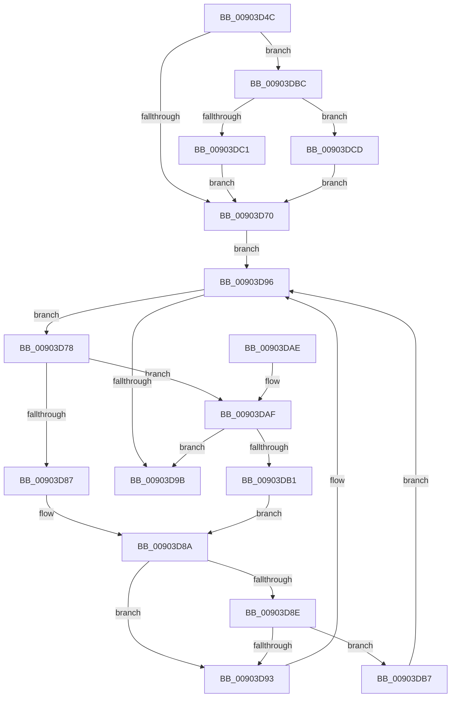

# PfSnAltProfileFindByProcess

- RVA: `0x00903D4C`–`0x00903DCF` (길이 `131` bytes)
- VA: `0x0000000140903D4C`
- 실행 섹션: `PAGE`
- PDB 이름 있음: `예`; PDB Function 태그: `아니요`
- unwind 정보 RVA: `0x00065748`
- 디코드: `43`개 명령, `131/131` bytes 표시
- 미해석 바이트: `0` (있으면 어셈블리에 `.byte`로 보존)

> 이 문서는 커널 이미지의 기계어와 PDB 기호를 분석해 생성했습니다. 4번과 5번은 함수 원형과 자료형을 바이너리 사용 방식에서 추정한 C 해석이며 원본 소스 복구 결과는 아닙니다.

## 1. Dependencies

- 직접 호출 지점: **1**; 고유 호출 대상: **1**
- 직접 호출자로 확인된 함수: **2**
- RIP 상대 이미지 참조: **2**

### Outgoing calls
- `0x00903D7E` → [PfSnAltProfileTreeCompareByProcess](PfSnAltProfileTreeCompareByProcess_function_00903DD8.md) (function, `0x00903DD8`)

### Direct callers
- [PfSnSetAltPrefetchParam](../75/PfSnSetAltPrefetchParam_function_00752424.md) at `0x007526E1`
- [PfProcessExitNotification](PfProcessExitNotification_function_00903CA4.md) at `0x00903CCA`

### Static image references
- `0x00903D5B` → RVA `0x00E67370` (`.data`; read)
- `0x00903D65` → RVA `0x00E67368` (`.data`; read)

## 2. Other-region calls and transfers

- 다른 실행 섹션으로 향하는 call: **0**
- 별도 외부 분기/꼬리 이동을 확인하지 못했습니다.

## 3. Assembly (complete function range)

```asm
00903D4C  48 89 5C 24 08                  mov qword ptr [rsp + 8], rbx
00903D51  48 89 74 24 10                  mov qword ptr [rsp + 0x10], rsi
00903D56  57                              push rdi
00903D57  48 83 EC 20                     sub rsp, 0x20
00903D5B  48 8B 05 0E 36 56 00            mov rax, qword ptr [rip + 0x56360e]
00903D62  48 8B F1                        mov rsi, rcx
00903D65  48 8B 1D FC 35 56 00            mov rbx, qword ptr [rip + 0x5635fc]
00903D6C  A8 01                           test al, 1
00903D6E  75 4C                           jne 0x140903dbc
00903D70  0F B6 F8                        movzx edi, al
00903D73  83 E7 01                        and edi, 1
00903D76  EB 1E                           jmp 0x140903d96
00903D78  48 8B D3                        mov rdx, rbx
00903D7B  48 8B CE                        mov rcx, rsi
00903D7E  E8 55 00 00 00                  call 0x140903dd8
00903D83  85 C0                           test eax, eax
00903D85  79 28                           jns 0x140903daf
00903D87  48 8B 03                        mov rax, qword ptr [rbx]
00903D8A  85 FF                           test edi, edi
00903D8C  74 05                           je 0x140903d93
00903D8E  48 85 C0                        test rax, rax
00903D91  75 24                           jne 0x140903db7
00903D93  48 8B D8                        mov rbx, rax
00903D96  48 85 DB                        test rbx, rbx
00903D99  75 DD                           jne 0x140903d78
00903D9B  48 8B 74 24 38                  mov rsi, qword ptr [rsp + 0x38]
00903DA0  48 8B C3                        mov rax, rbx
00903DA3  48 8B 5C 24 30                  mov rbx, qword ptr [rsp + 0x30]
00903DA8  48 83 C4 20                     add rsp, 0x20
00903DAC  5F                              pop rdi
00903DAD  C3                              ret
00903DAE  CC                              int3
00903DAF  7E EA                           jle 0x140903d9b
00903DB1  48 8B 43 08                     mov rax, qword ptr [rbx + 8]
00903DB5  EB D3                           jmp 0x140903d8a
00903DB7  48 33 D8                        xor rbx, rax
00903DBA  EB DA                           jmp 0x140903d96
00903DBC  48 85 DB                        test rbx, rbx
00903DBF  74 0C                           je 0x140903dcd
00903DC1  48 8D 0D A0 35 56 00            lea rcx, [rip + 0x5635a0]
00903DC8  48 33 D9                        xor rbx, rcx
00903DCB  EB A3                           jmp 0x140903d70
00903DCD  EB A1                           jmp 0x140903d70
```

## 4. C-style interpretation (structured pseudocode)

```c
__int64 __fastcall PfSnAltProfileFindByProcess(__int64 a1)
{
    __int64 result;
    __int64 v_rbx;
    __int64 v_rdi;
    __int64 v_rsp;
    unsigned __int64 v_stack_p10;
    unsigned __int64 v_stack_p8;

    v_stack_p8 = v_rbx;
    v_stack_p10 = v_rsi;
    v_rsp = (v_rsp) - (32);
    if ((((unsigned __int8)(*(unsigned __int64 *)(v_rip + 5649934))) & (1)) != 0) goto loc_00903DBC;
loc_00903D70:
    v_rdi = (unsigned int)(((unsigned __int8)(*(unsigned __int64 *)(v_rip + 5649934))) & (1));
    goto loc_00903D96;
loc_00903D78:
    result = PfSnAltProfileTreeCompareByProcess(a1, *(unsigned __int64 *)(v_rip + 5649916), a3, a4);
    if (!sign_flag) goto loc_00903DAF;
loc_00903D8A:
    if ((unsigned int)(v_rdi) == 0) goto loc_00903D93;
    if (*(unsigned __int64 *)(*(unsigned __int64 *)(v_rip + 5649916)) != 0) goto loc_00903DB7;
loc_00903D93:
loc_00903D96:
    if (*(unsigned __int64 *)(*(unsigned __int64 *)(v_rip + 5649916)) != 0) goto loc_00903D78;
loc_00903D9B:
    v_rsp = (v_rsp) + (32);
    return *(unsigned __int64 *)(*(unsigned __int64 *)(v_rip + 5649916));
loc_00903DAF:
    if (condition_is_less_or_equal) goto loc_00903D9B;
    goto loc_00903D8A;
loc_00903DB7:
    v_rbx = (v_stack_p8) ^ (*(unsigned __int64 *)(v_stack_p8 + 8));
    goto loc_00903D96;
loc_00903DBC:
    if (v_rbx == 0) goto loc_00903DCD;
    v_rbx = (v_rbx) ^ (v_rip + 5649824);
    goto loc_00903D70;
loc_00903DCD:
    goto loc_00903D70;
}
```

## 5. (Beta) C Style

```c
int64_t PfSnAltProfileFindByProcess(int64_t Arg1)
{
    int64_t result;
    int64_t local_rbx;
    int64_t local_rdi;
    int64_t local_rsp;
    uint64_t v_stack_p10;
    uint64_t v_stack_p8;

    v_stack_p8 = local_rbx;
    v_stack_p10 = local_rsi;
    local_rsp = (local_rsp) - (32);
    if ((((uint8_t)(*(uint64_t *)(v_rip + 0x56360E))) & (1)) != 0) goto loc_00903DBC;
loc_00903D70:
    local_rdi = (uint32_t)(((uint8_t)(*(uint64_t *)(v_rip + 0x56360E))) & (1));
    goto loc_00903D96;
loc_00903D78:
    result = PfSnAltProfileTreeCompareByProcess(Arg1, *(uint64_t *)(v_rip + 0x5635FC), a3, a4);
    if (!sign_flag) goto loc_00903DAF;
loc_00903D8A:
    if ((uint32_t)(local_rdi) == 0) goto loc_00903D93;
    if (*(uint64_t *)(*(uint64_t *)(v_rip + 0x5635FC)) != 0) goto loc_00903DB7;
loc_00903D93:
loc_00903D96:
    if (*(uint64_t *)(*(uint64_t *)(v_rip + 0x5635FC)) != 0) goto loc_00903D78;
loc_00903D9B:
    local_rsp = (local_rsp) + (32);
    return *(uint64_t *)(*(uint64_t *)(v_rip + 0x5635FC));
loc_00903DAF:
    if (condition_is_less_or_equal) goto loc_00903D9B;
    goto loc_00903D8A;
loc_00903DB7:
    local_rbx = (v_stack_p8) ^ (*(uint64_t *)(v_stack_p8 + 0x8));
    goto loc_00903D96;
loc_00903DBC:
    if (local_rbx == 0) goto loc_00903DCD;
    local_rbx = (local_rbx) ^ (v_rip + 5649824);
    goto loc_00903D70;
loc_00903DCD:
    goto loc_00903D70;
}
```

## 6. Execution-region graph

[열기: 2D/3D 그래프와 함수 탐색 컨트롤 패널](../../../control-panel.html?section=page&rva=0x00903D4C&view=graph)

- 2D 그래프는 위에서 아래로 흐르고, 3D 그래프는 빈 공간을 드래그해 회전합니다. Shift+드래그는 이동, 휠은 확대·축소, 함수 노드 선택은 대상 보고서 이동입니다.

### Static fallback


