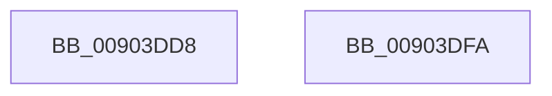

# PfSnAltProfileTreeCompareByProcess

- RVA: `0x00903DD8`–`0x00903DFB` (길이 `35` bytes)
- VA: `0x0000000140903DD8`
- 실행 섹션: `PAGE`
- PDB 이름 있음: `예`; PDB Function 태그: `아니요`
- unwind 정보 RVA: `0x0005C788`
- 디코드: `9`개 명령, `35/35` bytes 표시
- 미해석 바이트: `0` (있으면 어셈블리에 `.byte`로 보존)

> 이 문서는 커널 이미지의 기계어와 PDB 기호를 분석해 생성했습니다. 4번과 5번은 함수 원형과 자료형을 바이너리 사용 방식에서 추정한 C 해석이며 원본 소스 복구 결과는 아닙니다.

## 1. Dependencies

- 직접 호출 지점: **1**; 고유 호출 대상: **1**
- 직접 호출자로 확인된 함수: **2**
- RIP 상대 이미지 참조: **0**

### Outgoing calls
- `0x00903DF0` → [memcmp](../../text/6C/memcmp_function_006C6B10.md) (function, `0x006C6B10`)

### Direct callers
- [PfSnSetAltPrefetchParam](../75/PfSnSetAltPrefetchParam_function_00752424.md) at `0x00752727`
- [PfSnAltProfileFindByProcess](PfSnAltProfileFindByProcess_function_00903D4C.md) at `0x00903D7E`

### Static image references
- 디코드된 RIP-relative 메모리 참조가 없습니다.

## 2. Other-region calls and transfers

- 다른 실행 섹션으로 향하는 call: **1**
  - `0x00903DF0` → [memcmp](../../text/6C/memcmp_function_006C6B10.md) (`PAGE` → `.text`)
- 별도 외부 분기/꼬리 이동을 확인하지 못했습니다.

## 3. Assembly (complete function range)

```asm
00903DD8  48 83 EC 28                     sub rsp, 0x28
00903DDC  48 89 4C 24 30                  mov qword ptr [rsp + 0x30], rcx
00903DE1  48 83 C2 30                     add rdx, 0x30
00903DE5  48 8D 4C 24 30                  lea rcx, [rsp + 0x30]
00903DEA  41 B8 08 00 00 00               mov r8d, 8
00903DF0  E8 1B 2D DC FF                  call 0x1406c6b10
00903DF5  48 83 C4 28                     add rsp, 0x28
00903DF9  C3                              ret
00903DFA  CC                              int3
```

## 4. C-style interpretation (structured pseudocode)

```c
__int64 __fastcall PfSnAltProfileTreeCompareByProcess(__int64 a1, __int64 a2)
{
    __int64 result;
    __int64 v_rsp;
    unsigned __int64 v_stack_p8;

    v_rsp = (v_rsp) - (40);
    v_stack_p8 = a1;
    a2 = (a2) + (48);
    result = memcmp(v_stack_p8, a2, 8, a4);
    v_rsp = (v_rsp) + (40);
    return result;
}
```

## 5. (Beta) C Style

```c
int64_t PfSnAltProfileTreeCompareByProcess(int64_t Arg1, int64_t Arg2)
{
    int64_t result;
    int64_t local_rsp;
    uint64_t v_stack_p8;

    local_rsp = (local_rsp) - (40);
    v_stack_p8 = Arg1;
    Arg2 = (Arg2) + (48);
    result = memcmp(v_stack_p8, Arg2, 8, a4);
    local_rsp = (local_rsp) + (40);
    return result;
}
```

## 6. Execution-region graph

[열기: 2D/3D 그래프와 함수 탐색 컨트롤 패널](../../../control-panel.html?section=page&rva=0x00903DD8&view=graph)

- 2D 그래프는 위에서 아래로 흐르고, 3D 그래프는 빈 공간을 드래그해 회전합니다. Shift+드래그는 이동, 휠은 확대·축소, 함수 노드 선택은 대상 보고서 이동입니다.

### Static fallback


