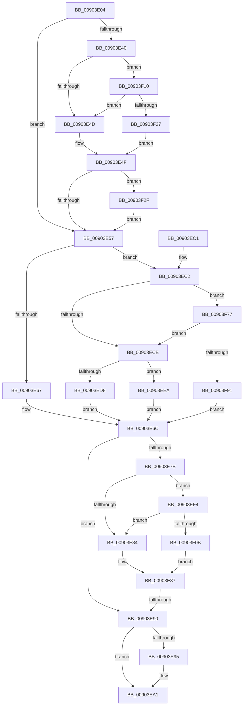

# PfSnEndProcessTrace

- RVA: `0x00903E04`–`0x00903F9B` (길이 `407` bytes)
- VA: `0x0000000140903E04`
- 실행 섹션: `PAGE`
- PDB 이름 있음: `예`; PDB Function 태그: `예`
- unwind 정보 RVA: `0x00088A40`
- 디코드: `100`개 명령, `407/407` bytes 표시
- 미해석 바이트: `0` (있으면 어셈블리에 `.byte`로 보존)

> 이 문서는 커널 이미지의 기계어와 PDB 기호를 분석해 생성했습니다. 4번과 5번은 함수 원형과 자료형을 바이너리 사용 방식에서 추정한 C 해석이며 원본 소스 복구 결과는 아닙니다.

## 1. Dependencies

- 직접 호출 지점: **6**; 고유 호출 대상: **6**
- 직접 호출자로 확인된 함수: **3**
- RIP 상대 이미지 참조: **5**

### Outgoing calls
- `0x00903E5A` → [PfSnReferenceProcessTrace](../../text/34/PfSnReferenceProcessTrace_function_00344A80.md) (function, `0x00344A80`)
- `0x00903E9C` → [ExReleaseRundownProtection](../../text/34/ExReleaseRundownProtection_function_00349E80.md) (function, `0x00349E80`)
- `0x00903EAA` → [_security_check_cookie](../../text/6A/_security_check_cookie_function_006AC640.md) (function, `0x006AC640`)
- `0x00903EE1` → [ExQueueWorkItem](../../text/2F/ExQueueWorkItem_function_002F9520.md) (function, `0x002F9520`)
- `0x00903F6D` → [tlgWriteTransfer_EtwWriteTransfer](../../text/42/tlgWriteTransfer_EtwWriteTransfer_function_004260E0.md) (function, `0x004260E0`)
- `0x00903F84` → [memcmp](../../text/6C/memcmp_function_006C6B10.md) (function, `0x006C6B10`)

### Direct callers
- [PfProcessExitNotification](PfProcessExitNotification_function_00903CA4.md) at `0x00903CFB`
- [PfSnFailProcessTrace](../96/PfSnFailProcessTrace_function_00960DB0.md) at `0x00960DD6`
- [PfSnOperationProcess](../96/PfSnOperationProcess_function_009615A4.md) at `0x009616EC`

### Static image references
- `0x00903E1B` → RVA `0x00E0A740` (`.data`; read)
- `0x00903E29` → RVA `0x00E074D8` (`.data`; read)
- `0x00903E40` → RVA `0x00E074E8` (`.data`; reference)
- `0x00903EF4` → RVA `0x00E074F0` (`.data`; read)
- `0x00903F3C` → RVA `0x00048C0A` (`.rdata`; read)

## 2. Other-region calls and transfers

- 다른 실행 섹션으로 향하는 call: **6**
  - `0x00903E5A` → [PfSnReferenceProcessTrace](../../text/34/PfSnReferenceProcessTrace_function_00344A80.md) (`PAGE` → `.text`)
  - `0x00903E9C` → [ExReleaseRundownProtection](../../text/34/ExReleaseRundownProtection_function_00349E80.md) (`PAGE` → `.text`)
  - `0x00903EAA` → [_security_check_cookie](../../text/6A/_security_check_cookie_function_006AC640.md) (`PAGE` → `.text`)
  - `0x00903EE1` → [ExQueueWorkItem](../../text/2F/ExQueueWorkItem_function_002F9520.md) (`PAGE` → `.text`)
  - `0x00903F6D` → [tlgWriteTransfer_EtwWriteTransfer](../../text/42/tlgWriteTransfer_EtwWriteTransfer_function_004260E0.md) (`PAGE` → `.text`)
  - `0x00903F84` → [memcmp](../../text/6C/memcmp_function_006C6B10.md) (`PAGE` → `.text`)
- call이 아닌 외부 분기/꼬리 이동: **1**
  - `0x00903E8A` → [sub_00B20B3E](../B2/Unknown_function_00B20B3E.md) (`tail-transfer`)

## 3. Assembly (complete function range)

```asm
00903E04  40 55                           push rbp
00903E06  53                              push rbx
00903E07  56                              push rsi
00903E08  57                              push rdi
00903E09  41 54                           push r12
00903E0B  41 56                           push r14
00903E0D  41 57                           push r15
00903E0F  48 8D 6C 24 E0                  lea rbp, [rsp - 0x20]
00903E14  48 81 EC 20 01 00 00            sub rsp, 0x120
00903E1B  48 8B 05 1E 69 50 00            mov rax, qword ptr [rip + 0x50691e]
00903E22  48 33 C4                        xor rax, rsp
00903E25  48 89 45 10                     mov qword ptr [rbp + 0x10], rax
00903E29  83 3D A8 36 50 00 04            cmp dword ptr [rip + 0x5036a8], 4
00903E30  4D 8B F0                        mov r14, r8
00903E33  44 8B E2                        mov r12d, edx
00903E36  4C 8B F9                        mov r15, rcx
00903E39  BF 01 00 00 00                  mov edi, 1
00903E3E  76 17                           jbe 0x140903e57
00903E40  40 84 3D A1 36 50 00            test byte ptr [rip + 0x5036a1], dil
00903E47  0F 85 C3 00 00 00               jne 0x140903f10
00903E4D  32 C0                           xor al, al
00903E4F  84 C0                           test al, al
00903E51  0F 85 D8 00 00 00               jne 0x140903f2f
00903E57  49 8B CF                        mov rcx, r15
00903E5A  E8 21 0C A4 FF                  call 0x140344a80
00903E5F  48 8B D8                        mov rbx, rax
00903E62  48 85 C0                        test rax, rax
00903E65  75 5B                           jne 0x140903ec2
00903E67  BE 25 02 00 C0                  mov esi, 0xc0000225
00903E6C  41 BA 04 00 00 00               mov r10d, 4
00903E72  44 39 15 5F 36 50 00            cmp dword ptr [rip + 0x50365f], r10d
00903E79  76 15                           jbe 0x140903e90
00903E7B  40 84 3D 66 36 50 00            test byte ptr [rip + 0x503666], dil
00903E82  75 70                           jne 0x140903ef4
00903E84  40 32 FF                        xor dil, dil
00903E87  40 84 FF                        test dil, dil
00903E8A  0F 85 AE CC 21 00               jne 0x140b20b3e
00903E90  48 85 DB                        test rbx, rbx
00903E93  74 0C                           je 0x140903ea1
00903E95  48 8D 8B 68 01 00 00            lea rcx, [rbx + 0x168]
00903E9C  E8 DF 5F A4 FF                  call 0x140349e80
00903EA1  8B C6                           mov eax, esi
00903EA3  48 8B 4D 10                     mov rcx, qword ptr [rbp + 0x10]
00903EA7  48 33 CC                        xor rcx, rsp
00903EAA  E8 91 87 DA FF                  call 0x1406ac640
00903EAF  48 81 C4 20 01 00 00            add rsp, 0x120
00903EB6  41 5F                           pop r15
00903EB8  41 5E                           pop r14
00903EBA  41 5C                           pop r12
00903EBC  5F                              pop rdi
00903EBD  5E                              pop rsi
00903EBE  5B                              pop rbx
00903EBF  5D                              pop rbp
00903EC0  C3                              ret
00903EC1  CC                              int3
00903EC2  4D 85 F6                        test r14, r14
00903EC5  0F 85 AC 00 00 00               jne 0x140903f77
00903ECB  33 C0                           xor eax, eax
00903ECD  F0 44 0F B1 A3 90 01 00 00      lock cmpxchg dword ptr [rbx + 0x190], r12d
00903ED6  75 12                           jne 0x140903eea
00903ED8  48 8D 8B 70 01 00 00            lea rcx, [rbx + 0x170]
00903EDF  8B D7                           mov edx, edi
00903EE1  E8 3A 56 9F FF                  call 0x1402f9520
00903EE6  33 F6                           xor esi, esi
00903EE8  EB 82                           jmp 0x140903e6c
00903EEA  BE 89 01 00 C0                  mov esi, 0xc0000189
00903EEF  E9 78 FF FF FF                  jmp 0x140903e6c
00903EF4  48 8B 05 F5 35 50 00            mov rax, qword ptr [rip + 0x5035f5]
00903EFB  48 23 C7                        and rax, rdi
00903EFE  48 3B 05 EB 35 50 00            cmp rax, qword ptr [rip + 0x5035eb]
00903F05  0F 85 79 FF FF FF               jne 0x140903e84
00903F0B  E9 77 FF FF FF                  jmp 0x140903e87
00903F10  48 8B 05 D9 35 50 00            mov rax, qword ptr [rip + 0x5035d9]
00903F17  48 23 C7                        and rax, rdi
00903F1A  48 3B 05 CF 35 50 00            cmp rax, qword ptr [rip + 0x5035cf]
00903F21  0F 85 26 FF FF FF               jne 0x140903e4d
00903F27  40 8A C7                        mov al, dil
00903F2A  E9 20 FF FF FF                  jmp 0x140903e4f
00903F2F  83 65 0C 00                     and dword ptr [rbp + 0xc], 0
00903F33  48 8D 44 24 40                  lea rax, [rsp + 0x40]
00903F38  48 89 45 00                     mov qword ptr [rbp], rax
00903F3C  48 8D 15 C7 4C 74 FF            lea rdx, [rip - 0x8bb339]
00903F43  48 8D 45 E0                     lea rax, [rbp - 0x20]
00903F47  4C 89 7C 24 40                  mov qword ptr [rsp + 0x40], r15
00903F4C  48 89 44 24 28                  mov qword ptr [rsp + 0x28], rax
00903F51  48 8D 0D 80 35 50 00            lea rcx, [rip + 0x503580]
00903F58  45 33 C9                        xor r9d, r9d
00903F5B  C7 44 24 20 03 00 00 00         mov dword ptr [rsp + 0x20], 3
00903F63  45 33 C0                        xor r8d, r8d
00903F66  C7 45 08 08 00 00 00            mov dword ptr [rbp + 8], 8
00903F6D  E8 6E 21 B2 FF                  call 0x1404260e0
00903F72  E9 E0 FE FF FF                  jmp 0x140903e57
00903F77  48 8D 50 18                     lea rdx, [rax + 0x18]
00903F7B  41 B8 40 00 00 00               mov r8d, 0x40
00903F81  49 8B CE                        mov rcx, r14
00903F84  E8 87 2B DC FF                  call 0x1406c6b10
00903F89  85 C0                           test eax, eax
00903F8B  0F 84 3A FF FF FF               je 0x140903ecb
00903F91  BE 72 02 00 C0                  mov esi, 0xc0000272
00903F96  E9 D1 FE FF FF                  jmp 0x140903e6c
```

## 4. C-style interpretation (structured pseudocode)

```c
__int64 __fastcall PfSnEndProcessTrace(__int64 a1, int a2, __int64 a3, int a4)
{
    __int64 result;
    __int64 v_rdi;
    __int64 v_rsi;
    __int64 v_rsp;
    unsigned __int64 v_stack_m48;
    unsigned int v_stack_m4C;
    unsigned int v_stack_m50;
    unsigned __int64 v_stack_m58;
    unsigned __int64 v_stack_m78;
    unsigned int v_stack_p20;
    unsigned __int64 v_stack_p28;
    unsigned __int64 v_stack_p40;

    v_rsp = (v_rsp) - (288);
    result = (*(unsigned __int64 *)(v_rip + 5269790)) ^ (v_rsp);
    v_stack_m48 = result;
    if ((*(unsigned int *)(v_rip + 5256872)) <= 4) goto loc_00903E57;
    if (((*(unsigned __int8 *)(v_rip + 5256865)) & (1)) != 0) goto loc_00903F10;
loc_00903E4D:
    result = 0;
loc_00903E4F:
    if (0 != 0) goto loc_00903F2F;
loc_00903E57:
    result = PfSnReferenceProcessTrace(a1, a2, a3, a4);
    if (result != 0) goto loc_00903EC2;
loc_00903E6C:
    if ((*(unsigned int *)(v_rip + 5256799)) <= 4) goto loc_00903E90;
    if (((*(unsigned __int8 *)(v_rip + 5256806)) & (1)) != 0) goto loc_00903EF4;
loc_00903E84:
    v_rdi = 0;
loc_00903E87:
loc_00903E90:
    if (result != 0) {
        a1 = result + 360;
        result = ExReleaseRundownProtection(a1, a2, a3, a4);
    }
    a1 = (v_stack_m48) ^ (v_rsp);
    result = _security_check_cookie(a1, a2, a3, a4);
    v_rsp = (v_rsp) + (288);
    return result;
loc_00903EC2:
    if (a3 != 0) goto loc_00903F77;
loc_00903ECB:
    result = 0;
    if (condition_is_not_equal) goto loc_00903EEA;
    result = ExQueueWorkItem(result + 368, 0, a3, a4);
    v_rsi = 0;
    goto loc_00903E6C;
loc_00903EEA:
    goto loc_00903E6C;
loc_00903EF4:
    result = (*(unsigned __int64 *)(v_rip + 5256693)) & (0);
    if (result != (*(unsigned __int64 *)(v_rip + 5256683))) goto loc_00903E84;
    goto loc_00903E87;
loc_00903F10:
    result = (*(unsigned __int64 *)(v_rip + 5256665)) & (0);
    if (result != (*(unsigned __int64 *)(v_rip + 5256655))) goto loc_00903E4D;
    goto loc_00903E4F;
loc_00903F2F:
    v_stack_m58 = v_stack_p40;
    v_stack_p40 = a1;
    v_stack_p28 = v_stack_m78;
    a4 = 0;
    v_stack_p20 = 3;
    a3 = 0;
    v_stack_m50 = 8;
    result = tlgWriteTransfer_EtwWriteTransfer(v_rip + 5256576, v_rip - 9155385, a3, a4);
    goto loc_00903E57;
loc_00903F77:
    result = memcmp(0, result + 24, 64, a4);
    if ((unsigned int)(result) == 0) goto loc_00903ECB;
    goto loc_00903E6C;
}
```

## 5. (Beta) C Style

```c
int64_t PfSnEndProcessTrace(int64_t Arg1, int32_t Arg2, int64_t Arg3, int32_t Arg4)
{
    int64_t result;
    int64_t local_rdi;
    int64_t local_rsi;
    int64_t local_rsp;
    uint64_t v_stack_m48;
    uint32_t v_stack_m4C;
    uint32_t v_stack_m50;
    uint64_t v_stack_m58;
    uint64_t v_stack_m78;
    uint32_t v_stack_p20;
    uint64_t v_stack_p28;
    uint64_t v_stack_p40;

    local_rsp = (local_rsp) - (288);
    result = (*(uint64_t *)(v_rip + 0x50691E)) ^ (local_rsp);
    v_stack_m48 = result;
    if ((*(uint32_t *)(v_rip + 0x5036A8)) <= 4) goto loc_00903E57;
    if (((*(uint8_t *)(v_rip + 0x5036A1)) & (1)) != 0) goto loc_00903F10;
loc_00903E4D:
    result = 0;
loc_00903E4F:
    if (0 != 0) goto loc_00903F2F;
loc_00903E57:
    result = PfSnReferenceProcessTrace(Arg1, Arg2, Arg3, Arg4);
    if (result != 0) goto loc_00903EC2;
loc_00903E6C:
    if ((*(uint32_t *)(v_rip + 0x50365F)) <= 4) goto loc_00903E90;
    if (((*(uint8_t *)(v_rip + 0x503666)) & (1)) != 0) goto loc_00903EF4;
loc_00903E84:
    local_rdi = 0;
loc_00903E87:
loc_00903E90:
    if (result != 0) {
        Arg1 = result + 360;
        result = ExReleaseRundownProtection(Arg1, Arg2, Arg3, Arg4);
    }
    Arg1 = (v_stack_m48) ^ (local_rsp);
    result = _security_check_cookie(Arg1, Arg2, Arg3, Arg4);
    local_rsp = (local_rsp) + (288);
    return result;
loc_00903EC2:
    if (Arg3 != 0) goto loc_00903F77;
loc_00903ECB:
    result = 0;
    if (condition_is_not_equal) goto loc_00903EEA;
    result = ExQueueWorkItem(result + 368, 0, Arg3, Arg4);
    local_rsi = 0;
    goto loc_00903E6C;
loc_00903EEA:
    goto loc_00903E6C;
loc_00903EF4:
    result = (*(uint64_t *)(v_rip + 0x5035F5)) & (0);
    if (result != (*(uint64_t *)(v_rip + 0x5035EB))) goto loc_00903E84;
    goto loc_00903E87;
loc_00903F10:
    result = (*(uint64_t *)(v_rip + 0x5035D9)) & (0);
    if (result != (*(uint64_t *)(v_rip + 0x5035CF))) goto loc_00903E4D;
    goto loc_00903E4F;
loc_00903F2F:
    v_stack_m58 = v_stack_p40;
    v_stack_p40 = Arg1;
    v_stack_p28 = v_stack_m78;
    Arg4 = 0;
    v_stack_p20 = 3;
    Arg3 = 0;
    v_stack_m50 = 8;
    result = tlgWriteTransfer_EtwWriteTransfer(v_rip + 5256576, v_rip - 9155385, Arg3, Arg4);
    goto loc_00903E57;
loc_00903F77:
    result = memcmp(0, result + 24, 64, Arg4);
    if ((uint32_t)(result) == 0) goto loc_00903ECB;
    goto loc_00903E6C;
}
```

## 6. Execution-region graph

[열기: 2D/3D 그래프와 함수 탐색 컨트롤 패널](../../../control-panel.html?section=page&rva=0x00903E04&view=graph)

- 2D 그래프는 위에서 아래로 흐르고, 3D 그래프는 빈 공간을 드래그해 회전합니다. Shift+드래그는 이동, 휠은 확대·축소, 함수 노드 선택은 대상 보고서 이동입니다.

### Static fallback


