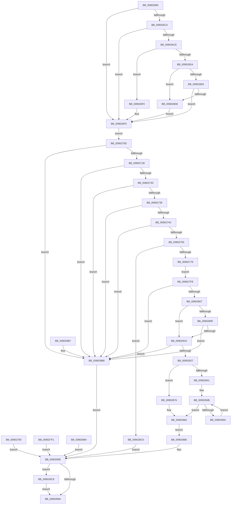

# PfpCopyUserPfnPrioRequest

- RVA: `0x00902690`–`0x009028D4` (길이 `580` bytes)
- VA: `0x0000000140902690`
- 실행 섹션: `PAGE`
- PDB 이름 있음: `예`; PDB Function 태그: `아니요`
- unwind 정보 RVA: `0x00088810`
- 디코드: `143`개 명령, `580/580` bytes 표시
- 미해석 바이트: `0` (있으면 어셈블리에 `.byte`로 보존)

> 이 문서는 커널 이미지의 기계어와 PDB 기호를 분석해 생성했습니다. 4번과 5번은 함수 원형과 자료형을 바이너리 사용 방식에서 추정한 C 해석이며 원본 소스 복구 결과는 아닙니다.

## 1. Dependencies

- 직접 호출 지점: **6**; 고유 호출 대상: **6**
- 직접 호출자로 확인된 함수: **1**
- RIP 상대 이미지 참조: **0**

### Outgoing calls
- `0x009026F0` → [ExRaiseDatatypeMisalignment](../89/ExRaiseDatatypeMisalignment_function_00899FD0.md) (function, `0x00899FD0`)
- `0x0090273B` → [MmGetHighestPhysicalPage](../../text/47/MmGetHighestPhysicalPage_function_00479040.md) (function, `0x00479040`)
- `0x00902763` → [ExAllocatePool2](../../poolcode/B8/ExAllocatePool2_function_00B820F0.md) (function, `0x00B820F0`)
- `0x00902843` → [memset](../../text/6C/memset_function_006C6C40.md) (function, `0x006C6C40`)
- `0x0090287D` → [memcpy](../../text/6C/memcpy_function_006C6840.md) (function, `0x006C6840`)
- `0x009028CD` → [ExFreePoolWithTag](../../poolcode/B8/ExFreePoolWithTag_function_00B82870.md) (function, `0x00B82870`)

### Direct callers
- [PfpPfnPrioRequest](PfpPfnPrioRequest_function_00902488.md) at `0x009024E1`
- [PfpPfnPrioRequest](PfpPfnPrioRequest_function_00902488.md) at `0x009025EE`

### Static image references
- 디코드된 RIP-relative 메모리 참조가 없습니다.

## 2. Other-region calls and transfers

- 다른 실행 섹션으로 향하는 call: **5**
  - `0x0090273B` → [MmGetHighestPhysicalPage](../../text/47/MmGetHighestPhysicalPage_function_00479040.md) (`PAGE` → `.text`)
  - `0x00902763` → [ExAllocatePool2](../../poolcode/B8/ExAllocatePool2_function_00B820F0.md) (`PAGE` → `POOLCODE`)
  - `0x00902843` → [memset](../../text/6C/memset_function_006C6C40.md) (`PAGE` → `.text`)
  - `0x0090287D` → [memcpy](../../text/6C/memcpy_function_006C6840.md) (`PAGE` → `.text`)
  - `0x009028CD` → [ExFreePoolWithTag](../../poolcode/B8/ExFreePoolWithTag_function_00B82870.md) (`PAGE` → `POOLCODE`)
- 별도 외부 분기/꼬리 이동을 확인하지 못했습니다.

## 3. Assembly (complete function range)

```asm
00902690  48 89 5C 24 08                  mov qword ptr [rsp + 8], rbx
00902695  48 89 74 24 10                  mov qword ptr [rsp + 0x10], rsi
0090269A  48 89 7C 24 18                  mov qword ptr [rsp + 0x18], rdi
0090269F  41 54                           push r12
009026A1  41 56                           push r14
009026A3  41 57                           push r15
009026A5  48 83 EC 40                     sub rsp, 0x40
009026A9  4D 8B E1                        mov r12, r9
009026AC  41 8B D8                        mov ebx, r8d
009026AF  44 8B D2                        mov r10d, edx
009026B2  48 8B F1                        mov rsi, rcx
009026B5  45 33 FF                        xor r15d, r15d
009026B8  45 8B F7                        mov r14d, r15d
009026BB  4C 89 7C 24 20                  mov qword ptr [rsp + 0x20], r15
009026C0  44 38 BC 24 80 00 00 00         cmp byte ptr [rsp + 0x80], r15b
009026C8  74 2B                           je 0x1409026f5
009026CA  85 D2                           test edx, edx
009026CC  74 27                           je 0x1409026f5
009026CE  40 F6 C6 07                     test sil, 7
009026D2  75 1C                           jne 0x1409026f0
009026D4  49 03 CA                        add rcx, r10
009026D7  48 B8 00 00 FF FF FF 7F 00 00   movabs rax, 0x7fffffff0000
009026E1  48 3B C8                        cmp rcx, rax
009026E4  77 05                           ja 0x1409026eb
009026E6  48 3B CE                        cmp rcx, rsi
009026E9  73 0A                           jae 0x1409026f5
009026EB  0F B6 00                        movzx eax, byte ptr [rax]
009026EE  EB 05                           jmp 0x1409026f5
009026F0  E8 DB 78 F9 FF                  call 0x140899fd0
009026F5  48 8B 7E 08                     mov rdi, qword ptr [rsi + 8]
009026F9  48 89 7C 24 30                  mov qword ptr [rsp + 0x30], rdi
009026FE  EB 0D                           jmp 0x14090270d
00902700  44 8B F8                        mov r15d, eax
00902703  4C 8B 74 24 20                  mov r14, qword ptr [rsp + 0x20]
00902708  E9 88 01 00 00                  jmp 0x140902895
0090270D  B8 FF FF FF FF                  mov eax, 0xffffffff
00902712  48 3B F8                        cmp rdi, rax
00902715  0F 87 9D 01 00 00               ja 0x1409028b8
0090271B  4C 8D 47 08                     lea r8, [rdi + 8]
0090271F  4F 8D 04 40                     lea r8, [r8 + r8*2]
00902723  49 C1 E0 03                     shl r8, 3
00902727  4C 3B C0                        cmp r8, rax
0090272A  0F 87 88 01 00 00               ja 0x1409028b8
00902730  48 85 FF                        test rdi, rdi
00902733  0F 84 7F 01 00 00               je 0x1409028b8
00902739  33 C9                           xor ecx, ecx
0090273B  E8 00 69 B7 FF                  call 0x140479040
00902740  48 FF C0                        inc rax
00902743  48 3B F8                        cmp rdi, rax
00902746  0F 87 6C 01 00 00               ja 0x1409028b8
0090274C  45 3B C2                        cmp r8d, r10d
0090274F  0F 87 63 01 00 00               ja 0x1409028b8
00902755  41 8B D0                        mov edx, r8d
00902758  B9 40 00 00 00                  mov ecx, 0x40
0090275D  41 B8 50 66 50 42               mov r8d, 0x42506650
00902763  E8 88 F9 27 00                  call 0x140b820f0
00902768  4C 8B F0                        mov r14, rax
0090276B  48 89 44 24 20                  mov qword ptr [rsp + 0x20], rax
00902770  48 85 C0                        test rax, rax
00902773  0F 84 47 01 00 00               je 0x1409028c0
00902779  0F 10 06                        movups xmm0, xmmword ptr [rsi]
0090277C  0F 11 00                        movups xmmword ptr [rax], xmm0
0090277F  0F 10 4E 10                     movups xmm1, xmmword ptr [rsi + 0x10]
00902783  0F 11 48 10                     movups xmmword ptr [rax + 0x10], xmm1
00902787  0F 10 46 20                     movups xmm0, xmmword ptr [rsi + 0x20]
0090278B  0F 11 40 20                     movups xmmword ptr [rax + 0x20], xmm0
0090278F  0F 10 4E 30                     movups xmm1, xmmword ptr [rsi + 0x30]
00902793  0F 11 48 30                     movups xmmword ptr [rax + 0x30], xmm1
00902797  0F 10 46 40                     movups xmm0, xmmword ptr [rsi + 0x40]
0090279B  0F 11 40 40                     movups xmmword ptr [rax + 0x40], xmm0
0090279F  0F 10 4E 50                     movups xmm1, xmmword ptr [rsi + 0x50]
009027A3  0F 11 48 50                     movups xmmword ptr [rax + 0x50], xmm1
009027A7  0F 10 46 60                     movups xmm0, xmmword ptr [rsi + 0x60]
009027AB  0F 11 40 60                     movups xmmword ptr [rax + 0x60], xmm0
009027AF  0F 10 46 70                     movups xmm0, xmmword ptr [rsi + 0x70]
009027B3  0F 11 40 70                     movups xmmword ptr [rax + 0x70], xmm0
009027B7  0F 10 8E 80 00 00 00            movups xmm1, xmmword ptr [rsi + 0x80]
009027BE  0F 11 88 80 00 00 00            movups xmmword ptr [rax + 0x80], xmm1
009027C5  0F 10 86 90 00 00 00            movups xmm0, xmmword ptr [rsi + 0x90]
009027CC  0F 11 80 90 00 00 00            movups xmmword ptr [rax + 0x90], xmm0
009027D3  0F 10 8E A0 00 00 00            movups xmm1, xmmword ptr [rsi + 0xa0]
009027DA  0F 11 88 A0 00 00 00            movups xmmword ptr [rax + 0xa0], xmm1
009027E1  0F 10 86 B0 00 00 00            movups xmm0, xmmword ptr [rsi + 0xb0]
009027E8  0F 11 80 B0 00 00 00            movups xmmword ptr [rax + 0xb0], xmm0
009027EF  EB 0D                           jmp 0x1409027fe
009027F1  44 8B F8                        mov r15d, eax
009027F4  4C 8B 74 24 20                  mov r14, qword ptr [rsp + 0x20]
009027F9  E9 97 00 00 00                  jmp 0x140902895
009027FE  83 38 01                        cmp dword ptr [rax], 1
00902801  0F 85 B1 00 00 00               jne 0x1409028b8
00902807  8D 43 FA                        lea eax, [rbx - 6]
0090280A  83 F8 01                        cmp eax, 1
0090280D  77 0E                           ja 0x14090281d
0090280F  41 F7 46 04 FE FF FF FF         test dword ptr [r14 + 4], 0xfffffffe
00902817  0F 85 9B 00 00 00               jne 0x1409028b8
0090281D  49 39 7E 08                     cmp qword ptr [r14 + 8], rdi
00902821  0F 85 91 00 00 00               jne 0x1409028b8
00902827  8D 04 7F                        lea eax, [rdi + rdi*2]
0090282A  C1 E0 03                        shl eax, 3
0090282D  44 8B C0                        mov r8d, eax
00902830  49 8D 8E C0 00 00 00            lea rcx, [r14 + 0xc0]
00902837  83 BC 24 88 00 00 00 00         cmp dword ptr [rsp + 0x88], 0
0090283F  74 35                           je 0x140902876
00902841  33 D2                           xor edx, edx
00902843  E8 F8 43 DC FF                  call 0x1406c6c40
00902848  49 8B D7                        mov rdx, r15
0090284B  48 89 54 24 28                  mov qword ptr [rsp + 0x28], rdx
00902850  48 3B D7                        cmp rdx, rdi
00902853  73 2D                           jae 0x140902882
00902855  48 8D 04 52                     lea rax, [rdx + rdx*2]
00902859  48 8D 0C C5 00 00 00 00         lea rcx, [rax*8]
00902861  48 8B 84 31 C8 00 00 00         mov rax, qword ptr [rcx + rsi + 0xc8]
00902869  4A 89 84 31 C8 00 00 00         mov qword ptr [rcx + r14 + 0xc8], rax
00902871  48 FF C2                        inc rdx
00902874  EB D5                           jmp 0x14090284b
00902876  48 8D 96 C0 00 00 00            lea rdx, [rsi + 0xc0]
0090287D  E8 BE 3F DC FF                  call 0x1406c6840
00902882  EB 0A                           jmp 0x14090288e
00902884  44 8B F8                        mov r15d, eax
00902887  4C 8B 74 24 20                  mov r14, qword ptr [rsp + 0x20]
0090288C  EB 07                           jmp 0x140902895
0090288E  4D 89 34 24                     mov qword ptr [r12], r14
00902892  4D 8B F7                        mov r14, r15
00902895  4D 85 F6                        test r14, r14
00902898  75 2E                           jne 0x1409028c8
0090289A  41 8B C7                        mov eax, r15d
0090289D  48 8B 5C 24 60                  mov rbx, qword ptr [rsp + 0x60]
009028A2  48 8B 74 24 68                  mov rsi, qword ptr [rsp + 0x68]
009028A7  48 8B 7C 24 70                  mov rdi, qword ptr [rsp + 0x70]
009028AC  48 83 C4 40                     add rsp, 0x40
009028B0  41 5F                           pop r15
009028B2  41 5E                           pop r14
009028B4  41 5C                           pop r12
009028B6  C3                              ret
009028B7  CC                              int3
009028B8  41 BF 0D 00 00 C0               mov r15d, 0xc000000d
009028BE  EB D5                           jmp 0x140902895
009028C0  41 BF 9A 00 00 C0               mov r15d, 0xc000009a
009028C6  EB CD                           jmp 0x140902895
009028C8  33 D2                           xor edx, edx
009028CA  49 8B CE                        mov rcx, r14
009028CD  E8 9E FF 27 00                  call 0x140b82870
009028D2  EB C6                           jmp 0x14090289a
```

## 4. C-style interpretation (structured pseudocode)

```c
__int64 __fastcall PfpCopyUserPfnPrioRequest(__int64 a1, int a2, int a3, __int64 a4, unsigned __int8 a5, unsigned int a6)
{
    __int64 result;
    __int64 v_r15;
    __int64 v_rsp;
    unsigned __int64 v_stack_m28;
    unsigned __int64 v_stack_m30;
    unsigned __int64 v_stack_m38;
    unsigned __int64 v_stack_p10;
    unsigned __int64 v_stack_p18;
    unsigned __int64 v_stack_p8;

    v_stack_p8 = v_rbx;
    v_stack_p10 = v_rsi;
    v_stack_p18 = v_rdi;
    v_rsp = (v_rsp) - (64);
    v_r15 = 0;
    v_stack_m38 = 0;
    if (a5 == 0) goto loc_009026F5;
    if (a2 == 0) goto loc_009026F5;
    if ((((unsigned __int8)(a1)) & (7)) != 0) goto loc_009026F0;
    a1 = (a1) + ((unsigned int)(a2));
    if (a1 > result) goto loc_009026EB;
    if (a1 >= a1) goto loc_009026F5;
loc_009026EB:
    goto loc_009026F5;
loc_009026F0:
    result = ExRaiseDatatypeMisalignment(a1, a2, a3, a4);
loc_009026F5:
    v_stack_m28 = *(unsigned __int64 *)(a1 + 8);
    goto loc_0090270D;
loc_0090270D:
    if ((*(unsigned __int64 *)(a1 + 8)) > ((unsigned int)(0xFFFFFFFFULL))) goto loc_009028B8;
    a3 = (*(unsigned __int64 *)(a1 + 8) + 8 + *(unsigned __int64 *)(a1 + 8) + 8 * 2) << (3);
    if (a3 > ((unsigned int)(0xFFFFFFFFULL))) goto loc_009028B8;
    if (*(unsigned __int64 *)(a1 + 8) == 0) goto loc_009028B8;
    a1 = 0;
    result = MmGetHighestPhysicalPage(a1, a2, a3, a4);
    result = (result) + 1;
    if ((*(unsigned __int64 *)(a1 + 8)) > result) goto loc_009028B8;
    if (a3 > ((unsigned int)((unsigned int)(a2)))) goto loc_009028B8;
    result = ExAllocatePool2(64, (unsigned int)(a3), (unsigned int)(0x42506650ULL), a4);
    v_stack_m38 = result;
    if (result == 0) goto loc_009028C0;
    *(unsigned __int64 *)(result) = v_xmm0;
    *(unsigned __int64 *)(result + 16) = v_xmm1;
    *(unsigned __int64 *)(result + 32) = v_xmm0;
    *(unsigned __int64 *)(result + 48) = v_xmm1;
    *(unsigned __int64 *)(result + 64) = v_xmm0;
    *(unsigned __int64 *)(result + 80) = v_xmm1;
    *(unsigned __int64 *)(result + 96) = v_xmm0;
    *(unsigned __int64 *)(result + 112) = v_xmm0;
    *(unsigned __int64 *)(result + 128) = v_xmm1;
    *(unsigned __int64 *)(result + 144) = v_xmm0;
    *(unsigned __int64 *)(result + 160) = v_xmm1;
    *(unsigned __int64 *)(result + 176) = v_xmm0;
    goto loc_009027FE;
loc_009027FE:
    if ((*(unsigned int *)(result)) != 1) goto loc_009028B8;
    if (((unsigned int)((unsigned int)(a3) - 6)) > 1) goto loc_0090281D;
    if (((*(unsigned int *)(result + 4)) & (0xFFFFFFFEULL)) != 0) goto loc_009028B8;
loc_0090281D:
    if ((*(unsigned __int64 *)(result + 8)) != (*(unsigned __int64 *)(a1 + 8))) goto loc_009028B8;
    result = (unsigned int)((*(unsigned __int64 *)(a1 + 8) + *(unsigned __int64 *)(a1 + 8) * 2) << (3));
    if (a6 == 0) goto loc_00902876;
    a2 = 0;
    result = memset(result + 192, a2, (unsigned int)((unsigned int)(result)), a4);
loc_0090284B:
    v_stack_m30 = 0;
    if (0 >= (*(unsigned __int64 *)(a1 + 8))) goto loc_00902882;
    *(unsigned __int64 *)(0 + 0 * 2 * 8 + result * 1 + 200) = *(unsigned __int64 *)(0 + 0 * 2 * 8 + a1 * 1 + 200);
    a2 = (0) + 1;
    goto loc_0090284B;
loc_00902876:
    result = memcpy(0 + 0 * 2 * 8, a1 + 192, (unsigned int)((unsigned int)(result)), a4);
loc_00902882:
    goto loc_0090288E;
loc_0090288E:
    *(unsigned __int64 *)(a4) = result;
loc_00902895:
    if (0 != 0) goto loc_009028C8;
loc_0090289A:
    v_rsp = (v_rsp) + (64);
    return 0;
loc_009028B8:
    goto loc_00902895;
loc_009028C0:
    goto loc_00902895;
loc_009028C8:
    a2 = 0;
    result = ExFreePoolWithTag(0, a2, (unsigned int)((unsigned int)(result)), a4);
    goto loc_0090289A;
}
```

## 5. (Beta) C Style

```c
int64_t PfpCopyUserPfnPrioRequest(int64_t Arg1, int32_t Arg2, void *Arg3, void *Arg4, uint8_t Arg5, uint32_t Arg6)
{
    uint8_t *arg3 = (uint8_t *)Arg3;
    uint8_t *arg4 = (uint8_t *)Arg4;

    int64_t result;
    int64_t local_r15;
    int64_t local_rsp;
    uint64_t v_stack_m28;
    uint64_t v_stack_m30;
    uint64_t v_stack_m38;
    uint64_t v_stack_p10;
    uint64_t v_stack_p18;
    uint64_t v_stack_p8;

    v_stack_p8 = local_rbx;
    v_stack_p10 = local_rsi;
    v_stack_p18 = local_rdi;
    local_rsp = (local_rsp) - (64);
    local_r15 = 0;
    v_stack_m38 = 0;
    if (Arg5 == 0) goto loc_009026F5;
    if (Arg2 == 0) goto loc_009026F5;
    if ((((uint8_t)(Arg1)) & (7)) != 0) goto loc_009026F0;
    Arg1 = (Arg1) + ((uint32_t)(Arg2));
    if (Arg1 > result) goto loc_009026EB;
    if (Arg1 >= Arg1) goto loc_009026F5;
loc_009026EB:
    goto loc_009026F5;
loc_009026F0:
    result = ExRaiseDatatypeMisalignment(Arg1, Arg2, Arg3, Arg4);
loc_009026F5:
    v_stack_m28 = *(uint64_t *)(Arg1 + 0x8);
    goto loc_0090270D;
loc_0090270D:
    if ((*(uint64_t *)(Arg1 + 0x8)) > ((uint32_t)(0xFFFFFFFFULL))) goto loc_009028B8;
    Arg3 = (*(uint64_t *)(Arg1 + 0x8) + 8 + *(uint64_t *)(Arg1 + 0x8) + 8 * 2) << (3);
    if (Arg3 > ((uint32_t)(0xFFFFFFFFULL))) goto loc_009028B8;
    if (*(uint64_t *)(Arg1 + 0x8) == 0) goto loc_009028B8;
    Arg1 = 0;
    result = MmGetHighestPhysicalPage(Arg1, Arg2, Arg3, Arg4);
    result = (result) + 1;
    if ((*(uint64_t *)(Arg1 + 0x8)) > result) goto loc_009028B8;
    if (Arg3 > ((uint32_t)((uint32_t)(Arg2)))) goto loc_009028B8;
    result = ExAllocatePool2(64, (uint32_t)(Arg3), (uint32_t)(0x42506650ULL), Arg4);
    v_stack_m38 = result;
    if (result == 0) goto loc_009028C0;
    *(uint64_t *)(result) = v_xmm0;
    *(uint64_t *)(result + 0x10) = v_xmm1;
    *(uint64_t *)(result + 0x20) = v_xmm0;
    *(uint64_t *)(result + 0x30) = v_xmm1;
    *(uint64_t *)(result + 0x40) = v_xmm0;
    *(uint64_t *)(result + 0x50) = v_xmm1;
    *(uint64_t *)(result + 0x60) = v_xmm0;
    *(uint64_t *)(result + 0x70) = v_xmm0;
    *(uint64_t *)(result + 0x80) = v_xmm1;
    *(uint64_t *)(result + 0x90) = v_xmm0;
    *(uint64_t *)(result + 0xA0) = v_xmm1;
    *(uint64_t *)(result + 0xB0) = v_xmm0;
    goto loc_009027FE;
loc_009027FE:
    if ((*(uint32_t *)(result)) != 1) goto loc_009028B8;
    if (((uint32_t)((uint32_t)(Arg3) - 6)) > 1) goto loc_0090281D;
    if (((*(uint32_t *)(result + 0x4)) & (0xFFFFFFFEULL)) != 0) goto loc_009028B8;
loc_0090281D:
    if ((*(uint64_t *)(result + 0x8)) != (*(uint64_t *)(Arg1 + 0x8))) goto loc_009028B8;
    result = (uint32_t)((*(uint64_t *)(Arg1 + 0x8) + *(uint64_t *)(Arg1 + 0x8) * 2) << (3));
    if (Arg6 == 0) goto loc_00902876;
    Arg2 = 0;
    result = memset(result + 192, Arg2, (uint32_t)((uint32_t)(result)), Arg4);
loc_0090284B:
    v_stack_m30 = 0;
    if (0 >= (*(uint64_t *)(Arg1 + 0x8))) goto loc_00902882;
    *(uint64_t *)(0 + 0x0 * 2 * 8 + result * 1 + 0xC8) = *(uint64_t *)(0 + 0x0 * 2 * 8 + Arg1 * 1 + 0xC8);
    Arg2 = (0) + 1;
    goto loc_0090284B;
loc_00902876:
    result = memcpy(0 + 0 * 2 * 8, Arg1 + 192, (uint32_t)((uint32_t)(result)), Arg4);
loc_00902882:
    goto loc_0090288E;
loc_0090288E:
    *(uint64_t *)(arg4) = result;
loc_00902895:
    if (0 != 0) goto loc_009028C8;
loc_0090289A:
    local_rsp = (local_rsp) + (64);
    return 0;
loc_009028B8:
    goto loc_00902895;
loc_009028C0:
    goto loc_00902895;
loc_009028C8:
    Arg2 = 0;
    result = ExFreePoolWithTag(0, Arg2, (uint32_t)((uint32_t)(result)), Arg4);
    goto loc_0090289A;
}
```

### 관측된 메모리 오프셋

구조체 형식이 확인되지 않은 접근은 인자 기준의 오프셋으로만 기록했습니다.

| 기준 인자 | 오프셋 표현 | 폭 (bit) | 접근 |
|---|---:|---:|---|
| `Arg3` | `- 0x6` | `32` | `R` |
| `Arg4` | `+ 0x0` | `64` | `W` |

## 6. Execution-region graph

[열기: 2D/3D 그래프와 함수 탐색 컨트롤 패널](../../../control-panel.html?section=page&rva=0x00902690&view=graph)

- 2D 그래프는 위에서 아래로 흐르고, 3D 그래프는 빈 공간을 드래그해 회전합니다. Shift+드래그는 이동, 휠은 확대·축소, 함수 노드 선택은 대상 보고서 이동입니다.

### Static fallback


