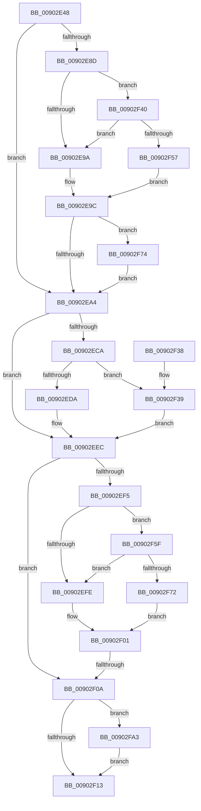

# PfpPartitionFindByHandle

- RVA: `0x00902E48`–`0x00902FB0` (길이 `360` bytes)
- VA: `0x0000000140902E48`
- 실행 섹션: `PAGE`
- PDB 이름 있음: `예`; PDB Function 태그: `예`
- unwind 정보 RVA: `0x000888CC`
- 디코드: `93`개 명령, `360/360` bytes 표시
- 미해석 바이트: `0` (있으면 어셈블리에 `.byte`로 보존)

> 이 문서는 커널 이미지의 기계어와 PDB 기호를 분석해 생성했습니다. 4번과 5번은 함수 원형과 자료형을 바이너리 사용 방식에서 추정한 C 해석이며 원본 소스 복구 결과는 아닙니다.

## 1. Dependencies

- 직접 호출 지점: **6**; 고유 호출 대상: **6**
- 직접 호출자로 확인된 함수: **2**
- RIP 상대 이미지 참조: **5**

### Outgoing calls
- `0x00902EBB` → [PsReferencePartitionByHandle](PsReferencePartitionByHandle_function_0090337C.md) (function, `0x0090337C`)
- `0x00902ECD` → [MiReadReverseMapAttributes](../../text/4A/MiReadReverseMapAttributes_function_004A32D4.md) (function, `0x004A32D4`)
- `0x00902EDD` → [PfpPartitionRundownProtectionAcquire](../../text/48/PfpPartitionRundownProtectionAcquire_function_0048402C.md) (function, `0x0048402C`)
- `0x00902F1C` → [_security_check_cookie](../../text/6A/_security_check_cookie_function_006AC640.md) (function, `0x006AC640`)
- `0x00902F99` → [tlgWriteTransfer_EtwWriteTransfer](../../text/42/tlgWriteTransfer_EtwWriteTransfer_function_004260E0.md) (function, `0x004260E0`)
- `0x00902FA6` → [PfpPartitionDereferenceParent](../../text/34/PfpPartitionDereferenceParent_function_00341CDC.md) (function, `0x00341CDC`)

### Direct callers
- [PfGetCompletedTrace](PfGetCompletedTrace_function_00902950.md) at `0x00902A99`
- [PfSetSuperfetchInformation](../AD/PfSetSuperfetchInformation_function_00ADE6E8.md) at `0x00ADE970`
- [PfSetSuperfetchInformation](../AD/PfSetSuperfetchInformation_function_00ADE6E8.md) at `0x00ADEABB`
- [PfSetSuperfetchInformation](../AD/PfSetSuperfetchInformation_function_00ADE6E8.md) at `0x00ADEBE1`

### Static image references
- `0x00902E60` → RVA `0x00E0A740` (`.data`; read)
- `0x00902E76` → RVA `0x00E074D8` (`.data`; read)
- `0x00902E8D` → RVA `0x00E074E8` (`.data`; reference)
- `0x00902F40` → RVA `0x00E074F0` (`.data`; read)
- `0x00902F80` → RVA `0x00048AC9` (`.rdata`; read)

## 2. Other-region calls and transfers

- 다른 실행 섹션으로 향하는 call: **5**
  - `0x00902ECD` → [MiReadReverseMapAttributes](../../text/4A/MiReadReverseMapAttributes_function_004A32D4.md) (`PAGE` → `.text`)
  - `0x00902EDD` → [PfpPartitionRundownProtectionAcquire](../../text/48/PfpPartitionRundownProtectionAcquire_function_0048402C.md) (`PAGE` → `.text`)
  - `0x00902F1C` → [_security_check_cookie](../../text/6A/_security_check_cookie_function_006AC640.md) (`PAGE` → `.text`)
  - `0x00902F99` → [tlgWriteTransfer_EtwWriteTransfer](../../text/42/tlgWriteTransfer_EtwWriteTransfer_function_004260E0.md) (`PAGE` → `.text`)
  - `0x00902FA6` → [PfpPartitionDereferenceParent](../../text/34/PfpPartitionDereferenceParent_function_00341CDC.md) (`PAGE` → `.text`)
- call이 아닌 외부 분기/꼬리 이동: **1**
  - `0x00902F04` → [sub_00B208F8](../B2/Unknown_function_00B208F8.md) (`tail-transfer`)

## 3. Assembly (complete function range)

```asm
00902E48  48 89 5C 24 20                  mov qword ptr [rsp + 0x20], rbx
00902E4D  55                              push rbp
00902E4E  56                              push rsi
00902E4F  57                              push rdi
00902E50  41 56                           push r14
00902E52  41 57                           push r15
00902E54  48 8D 6C 24 C9                  lea rbp, [rsp - 0x37]
00902E59  48 81 EC 90 00 00 00            sub rsp, 0x90
00902E60  48 8B 05 D9 78 50 00            mov rax, qword ptr [rip + 0x5078d9]
00902E67  48 33 C4                        xor rax, rsp
00902E6A  48 89 45 27                     mov qword ptr [rbp + 0x27], rax
00902E6E  48 83 65 D7 00                  and qword ptr [rbp - 0x29], 0
00902E73  41 8A D9                        mov bl, r9b
00902E76  83 3D 5B 46 50 00 04            cmp dword ptr [rip + 0x50465b], 4
00902E7D  49 8B F0                        mov rsi, r8
00902E80  4C 8B FA                        mov r15, rdx
00902E83  4C 8B F1                        mov r14, rcx
00902E86  BF 01 00 00 00                  mov edi, 1
00902E8B  76 17                           jbe 0x140902ea4
00902E8D  40 84 3D 54 46 50 00            test byte ptr [rip + 0x504654], dil
00902E94  0F 85 A6 00 00 00               jne 0x140902f40
00902E9A  32 C0                           xor al, al
00902E9C  84 C0                           test al, al
00902E9E  0F 85 D0 00 00 00               jne 0x140902f74
00902EA4  48 8D 45 D7                     lea rax, [rbp - 0x29]
00902EA8  41 B9 50 66 50 74               mov r9d, 0x74506650
00902EAE  44 8A C3                        mov r8b, bl
00902EB1  48 89 44 24 20                  mov qword ptr [rsp + 0x20], rax
00902EB6  8B D7                           mov edx, edi
00902EB8  48 8B CE                        mov rcx, rsi
00902EBB  E8 BC 04 00 00                  call 0x14090337c
00902EC0  48 8B 5D D7                     mov rbx, qword ptr [rbp - 0x29]
00902EC4  8B F0                           mov esi, eax
00902EC6  85 C0                           test eax, eax
00902EC8  78 22                           js 0x140902eec
00902ECA  48 8B CB                        mov rcx, rbx
00902ECD  E8 02 04 BA FF                  call 0x1404a32d4
00902ED2  48 8B F0                        mov rsi, rax
00902ED5  48 85 C0                        test rax, rax
00902ED8  74 5F                           je 0x140902f39
00902EDA  48 8B C8                        mov rcx, rax
00902EDD  E8 4A 11 B8 FF                  call 0x14048402c
00902EE2  49 89 36                        mov qword ptr [r14], rsi
00902EE5  49 89 1F                        mov qword ptr [r15], rbx
00902EE8  33 DB                           xor ebx, ebx
00902EEA  33 F6                           xor esi, esi
00902EEC  83 3D E5 45 50 00 04            cmp dword ptr [rip + 0x5045e5], 4
00902EF3  76 15                           jbe 0x140902f0a
00902EF5  40 84 3D EC 45 50 00            test byte ptr [rip + 0x5045ec], dil
00902EFC  75 61                           jne 0x140902f5f
00902EFE  40 32 FF                        xor dil, dil
00902F01  40 84 FF                        test dil, dil
00902F04  0F 85 EE D9 21 00               jne 0x140b208f8
00902F0A  48 85 DB                        test rbx, rbx
00902F0D  0F 85 90 00 00 00               jne 0x140902fa3
00902F13  8B C6                           mov eax, esi
00902F15  48 8B 4D 27                     mov rcx, qword ptr [rbp + 0x27]
00902F19  48 33 CC                        xor rcx, rsp
00902F1C  E8 1F 97 DA FF                  call 0x1406ac640
00902F21  48 8B 9C 24 D8 00 00 00         mov rbx, qword ptr [rsp + 0xd8]
00902F29  48 81 C4 90 00 00 00            add rsp, 0x90
00902F30  41 5F                           pop r15
00902F32  41 5E                           pop r14
00902F34  5F                              pop rdi
00902F35  5E                              pop rsi
00902F36  5D                              pop rbp
00902F37  C3                              ret
00902F38  CC                              int3
00902F39  BE 25 02 00 C0                  mov esi, 0xc0000225
00902F3E  EB AC                           jmp 0x140902eec
00902F40  48 8B 05 A9 45 50 00            mov rax, qword ptr [rip + 0x5045a9]
00902F47  48 23 C7                        and rax, rdi
00902F4A  48 3B 05 9F 45 50 00            cmp rax, qword ptr [rip + 0x50459f]
00902F51  0F 85 43 FF FF FF               jne 0x140902e9a
00902F57  40 8A C7                        mov al, dil
00902F5A  E9 3D FF FF FF                  jmp 0x140902e9c
00902F5F  48 8B 05 8A 45 50 00            mov rax, qword ptr [rip + 0x50458a]
00902F66  48 23 C7                        and rax, rdi
00902F69  48 3B 05 80 45 50 00            cmp rax, qword ptr [rip + 0x504580]
00902F70  75 8C                           jne 0x140902efe
00902F72  EB 8D                           jmp 0x140902f01
00902F74  48 8D 45 E7                     lea rax, [rbp - 0x19]
00902F78  45 33 C9                        xor r9d, r9d
00902F7B  48 89 44 24 28                  mov qword ptr [rsp + 0x28], rax
00902F80  48 8D 15 42 5B 74 FF            lea rdx, [rip - 0x8ba4be]
00902F87  45 33 C0                        xor r8d, r8d
00902F8A  C7 44 24 20 02 00 00 00         mov dword ptr [rsp + 0x20], 2
00902F92  48 8D 0D 3F 45 50 00            lea rcx, [rip + 0x50453f]
00902F99  E8 42 31 B2 FF                  call 0x1404260e0
00902F9E  E9 01 FF FF FF                  jmp 0x140902ea4
00902FA3  48 8B CB                        mov rcx, rbx
00902FA6  E8 31 ED A3 FF                  call 0x140341cdc
00902FAB  E9 63 FF FF FF                  jmp 0x140902f13
```

## 4. C-style interpretation (structured pseudocode)

```c
__int64 __fastcall PfpPartitionFindByHandle(__int64 a1, __int64 a2, __int64 a3, unsigned __int8 a4)
{
    __int64 result;
    __int64 v_rbx;
    __int64 v_rdi;
    __int64 v_rsi;
    __int64 v_rsp;
    unsigned __int64 v_stack_m38;
    unsigned __int64 v_stack_m5F;
    unsigned __int64 v_stack_m78;
    unsigned __int64 v_stack_m88;
    unsigned __int64 v_stack_m98;
    unsigned __int64 v_stack_p20;
    unsigned __int64 v_stack_p28;

    v_stack_p20 = v_rbx;
    v_rsp = (v_rsp) - (144);
    result = (*(unsigned __int64 *)(v_rip + 5273817)) ^ (v_rsp);
    v_stack_m38 = result;
    if ((*(unsigned int *)(v_rip + 5260891)) <= 4) goto loc_00902EA4;
    if (((*(unsigned __int8 *)(v_rip + 5260884)) & (1)) != 0) goto loc_00902F40;
loc_00902E9A:
    result = 0;
loc_00902E9C:
    if (0 != 0) goto loc_00902F74;
loc_00902EA4:
    v_stack_m98 = v_stack_m88;
    result = PsReferencePartitionByHandle(a3, 1, a4, (unsigned int)(0x74506650ULL));
    if (sign_flag) goto loc_00902EEC;
    result = MiReadReverseMapAttributes(v_stack_m88, 1, a4, (unsigned int)(0x74506650ULL));
    if (result == 0) goto loc_00902F39;
    result = PfpPartitionRundownProtectionAcquire(result, 1, a4, (unsigned int)(0x74506650ULL));
    *(unsigned __int64 *)(a1) = result;
    *(unsigned __int64 *)(a2) = v_stack_m88;
    v_rbx = 0;
    v_rsi = 0;
loc_00902EEC:
    if ((*(unsigned int *)(v_rip + 5260773)) <= 4) goto loc_00902F0A;
    if (((*(unsigned __int8 *)(v_rip + 5260780)) & (1)) != 0) goto loc_00902F5F;
loc_00902EFE:
    v_rdi = 0;
loc_00902F01:
loc_00902F0A:
    if (0 != 0) goto loc_00902FA3;
loc_00902F13:
    a1 = (v_stack_m38) ^ (v_rsp);
    result = _security_check_cookie(a1, 1, a4, (unsigned int)(0x74506650ULL));
    v_rsp = (v_rsp) + (144);
    return result;
loc_00902F39:
    goto loc_00902EEC;
loc_00902F40:
    result = (*(unsigned __int64 *)(v_rip + 5260713)) & (0);
    if (result != (*(unsigned __int64 *)(v_rip + 5260703))) goto loc_00902E9A;
    goto loc_00902E9C;
loc_00902F5F:
    result = (*(unsigned __int64 *)(v_rip + 5260682)) & (0);
    if (result != (*(unsigned __int64 *)(v_rip + 5260672))) goto loc_00902EFE;
    goto loc_00902F01;
loc_00902F74:
    a4 = 0;
    v_stack_p28 = v_stack_m78;
    a3 = 0;
    v_stack_p20 = 2;
    result = tlgWriteTransfer_EtwWriteTransfer(v_rip + 5260607, v_rip - 9151678, a3, a4);
    goto loc_00902EA4;
loc_00902FA3:
    result = PfpPartitionDereferenceParent(v_stack_p20, v_rip - 9151678, a3, a4);
    goto loc_00902F13;
}
```

## 5. (Beta) C Style

```c
int64_t PfpPartitionFindByHandle(void *Arg1, void *Arg2, int64_t Arg3, uint8_t Arg4)
{
    uint8_t *arg1 = (uint8_t *)Arg1;
    uint8_t *arg2 = (uint8_t *)Arg2;

    int64_t result;
    int64_t local_rbx;
    int64_t local_rdi;
    int64_t local_rsi;
    int64_t local_rsp;
    uint64_t v_stack_m38;
    uint64_t v_stack_m5F;
    uint64_t v_stack_m78;
    uint64_t v_stack_m88;
    uint64_t v_stack_m98;
    uint64_t v_stack_p20;
    uint64_t v_stack_p28;

    v_stack_p20 = local_rbx;
    local_rsp = (local_rsp) - (144);
    result = (*(uint64_t *)(v_rip + 0x5078D9)) ^ (local_rsp);
    v_stack_m38 = result;
    if ((*(uint32_t *)(v_rip + 0x50465B)) <= 4) goto loc_00902EA4;
    if (((*(uint8_t *)(v_rip + 0x504654)) & (1)) != 0) goto loc_00902F40;
loc_00902E9A:
    result = 0;
loc_00902E9C:
    if (0 != 0) goto loc_00902F74;
loc_00902EA4:
    v_stack_m98 = v_stack_m88;
    result = PsReferencePartitionByHandle(Arg3, 1, Arg4, (uint32_t)(0x74506650ULL));
    if (sign_flag) goto loc_00902EEC;
    result = MiReadReverseMapAttributes(v_stack_m88, 1, Arg4, (uint32_t)(0x74506650ULL));
    if (result == 0) goto loc_00902F39;
    result = PfpPartitionRundownProtectionAcquire(result, 1, Arg4, (uint32_t)(0x74506650ULL));
    *(uint64_t *)(arg1) = result;
    *(uint64_t *)(arg2) = v_stack_m88;
    local_rbx = 0;
    local_rsi = 0;
loc_00902EEC:
    if ((*(uint32_t *)(v_rip + 0x5045E5)) <= 4) goto loc_00902F0A;
    if (((*(uint8_t *)(v_rip + 0x5045EC)) & (1)) != 0) goto loc_00902F5F;
loc_00902EFE:
    local_rdi = 0;
loc_00902F01:
loc_00902F0A:
    if (0 != 0) goto loc_00902FA3;
loc_00902F13:
    Arg1 = (v_stack_m38) ^ (local_rsp);
    result = _security_check_cookie(Arg1, 1, Arg4, (uint32_t)(0x74506650ULL));
    local_rsp = (local_rsp) + (144);
    return result;
loc_00902F39:
    goto loc_00902EEC;
loc_00902F40:
    result = (*(uint64_t *)(v_rip + 0x5045A9)) & (0);
    if (result != (*(uint64_t *)(v_rip + 0x50459F))) goto loc_00902E9A;
    goto loc_00902E9C;
loc_00902F5F:
    result = (*(uint64_t *)(v_rip + 0x50458A)) & (0);
    if (result != (*(uint64_t *)(v_rip + 0x504580))) goto loc_00902EFE;
    goto loc_00902F01;
loc_00902F74:
    Arg4 = 0;
    v_stack_p28 = v_stack_m78;
    Arg3 = 0;
    v_stack_p20 = 2;
    result = tlgWriteTransfer_EtwWriteTransfer(v_rip + 5260607, v_rip - 9151678, Arg3, Arg4);
    goto loc_00902EA4;
loc_00902FA3:
    result = PfpPartitionDereferenceParent(v_stack_p20, v_rip - 9151678, Arg3, Arg4);
    goto loc_00902F13;
}
```

### 관측된 메모리 오프셋

구조체 형식이 확인되지 않은 접근은 인자 기준의 오프셋으로만 기록했습니다.

| 기준 인자 | 오프셋 표현 | 폭 (bit) | 접근 |
|---|---:|---:|---|
| `Arg1` | `+ 0x0` | `64` | `W` |
| `Arg2` | `+ 0x0` | `64` | `W` |

## 6. Execution-region graph

[열기: 2D/3D 그래프와 함수 탐색 컨트롤 패널](../../../control-panel.html?section=page&rva=0x00902E48&view=graph)

- 2D 그래프는 위에서 아래로 흐르고, 3D 그래프는 빈 공간을 드래그해 회전합니다. Shift+드래그는 이동, 휠은 확대·축소, 함수 노드 선택은 대상 보고서 이동입니다.

### Static fallback


