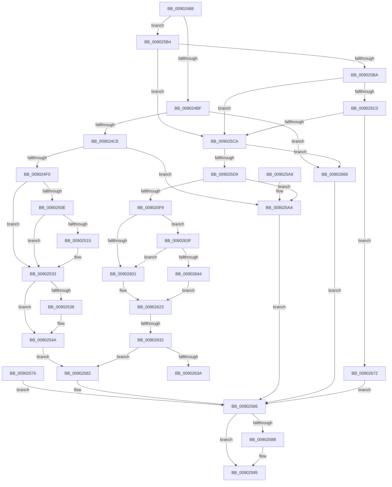

# PfpPfnPrioRequest

- RVA: `0x00902488`–`0x0090267C` (길이 `500` bytes)
- VA: `0x0000000140902488`
- 실행 섹션: `PAGE`
- PDB 이름 있음: `예`; PDB Function 태그: `예`
- unwind 정보 RVA: `0x000887C0`
- 디코드: `131`개 명령, `500/500` bytes 표시
- 미해석 바이트: `0` (있으면 어셈블리에 `.byte`로 보존)

> 이 문서는 커널 이미지의 기계어와 PDB 기호를 분석해 생성했습니다. 4번과 5번은 함수 원형과 자료형을 바이너리 사용 방식에서 추정한 C 해석이며 원본 소스 복구 결과는 아닙니다.

## 1. Dependencies

- 직접 호출 지점: **9**; 고유 호출 대상: **8**
- 직접 호출자로 확인된 함수: **2**
- RIP 상대 이미지 참조: **0**

### Outgoing calls
- `0x009024E1` → [PfpCopyUserPfnPrioRequest](PfpCopyUserPfnPrioRequest_function_00902690.md) (function, `0x00902690`)
- `0x00902503` → [MmQueryPfnList](MmQueryPfnList_function_009028E0.md) (function, `0x009028E0`)
- `0x0090252D` → [MmQueryMemoryListInformation](../../text/3B/MmQueryMemoryListInformation_function_003B9EDC.md) (function, `0x003B9EDC`)
- `0x00902545` → [ProbeForWrite](../8E/ProbeForWrite_function_008E91C0.md) (function, `0x008E91C0`)
- `0x0090256F` → [memcpy](../../text/6C/memcpy_function_006C6840.md) (function, `0x006C6840`)
- `0x00902590` → [ExFreePoolWithTag](../../poolcode/B8/ExFreePoolWithTag_function_00B82870.md) (function, `0x00B82870`)
- `0x009025EE` → [PfpCopyUserPfnPrioRequest](PfpCopyUserPfnPrioRequest_function_00902690.md) (function, `0x00902690`)
- `0x0090261E` → [MmSetPfnListInfo](../../text/31/MmSetPfnListInfo_function_0031D61C.md) (function, `0x0031D61C`)
- `0x00902661` → [MmRelocatePfnList](MmRelocatePfnList_function_00901E70.md) (function, `0x00901E70`)

### Direct callers
- [PfQuerySuperfetchInformation](PfQuerySuperfetchInformation_function_0090210C.md) at `0x009021E4`
- [PfSetSuperfetchInformation](../AD/PfSetSuperfetchInformation_function_00ADE6E8.md) at `0x00ADED9D`

### Static image references
- 디코드된 RIP-relative 메모리 참조가 없습니다.

## 2. Other-region calls and transfers

- 다른 실행 섹션으로 향하는 call: **4**
  - `0x0090252D` → [MmQueryMemoryListInformation](../../text/3B/MmQueryMemoryListInformation_function_003B9EDC.md) (`PAGE` → `.text`)
  - `0x0090256F` → [memcpy](../../text/6C/memcpy_function_006C6840.md) (`PAGE` → `.text`)
  - `0x00902590` → [ExFreePoolWithTag](../../poolcode/B8/ExFreePoolWithTag_function_00B82870.md) (`PAGE` → `POOLCODE`)
  - `0x0090261E` → [MmSetPfnListInfo](../../text/31/MmSetPfnListInfo_function_0031D61C.md) (`PAGE` → `.text`)
- call이 아닌 외부 분기/꼬리 이동: **2**
  - `0x0090262C` → [sub_00B2081E](../B2/Unknown_function_00B2081E.md) (`tail-transfer`)
  - `0x0090263A` → [sub_00B2081E](../B2/Unknown_function_00B2081E.md) (`tail-transfer`)

## 3. Assembly (complete function range)

```asm
00902488  48 8B C4                        mov rax, rsp
0090248B  48 89 58 10                     mov qword ptr [rax + 0x10], rbx
0090248F  56                              push rsi
00902490  57                              push rdi
00902491  41 54                           push r12
00902493  41 56                           push r14
00902495  41 57                           push r15
00902497  48 83 EC 40                     sub rsp, 0x40
0090249B  4D 8B E0                        mov r12, r8
0090249E  44 8A FA                        mov r15b, dl
009024A1  48 8B F1                        mov rsi, rcx
009024A4  83 60 08 00                     and dword ptr [rax + 8], 0
009024A8  33 DB                           xor ebx, ebx
009024AA  48 89 58 20                     mov qword ptr [rax + 0x20], rbx
009024AE  44 8B 41 08                     mov r8d, dword ptr [rcx + 8]
009024B2  45 8B C8                        mov r9d, r8d
009024B5  41 83 E9 06                     sub r9d, 6
009024B9  0F 85 F5 00 00 00               jne 0x1409025b4
009024BF  8B 51 18                        mov edx, dword ptr [rcx + 0x18]
009024C2  81 FA D8 00 00 00               cmp edx, 0xd8
009024C8  0F 82 9A 01 00 00               jb 0x140902668
009024CE  C7 40 C0 01 00 00 00            mov dword ptr [rax - 0x40], 1
009024D5  44 88 78 B8                     mov byte ptr [rax - 0x48], r15b
009024D9  4C 8D 48 20                     lea r9, [rax + 0x20]
009024DD  48 8B 49 10                     mov rcx, qword ptr [rcx + 0x10]
009024E1  E8 AA 01 00 00                  call 0x140902690
009024E6  8B F8                           mov edi, eax
009024E8  85 C0                           test eax, eax
009024EA  0F 88 BA 00 00 00               js 0x1409025aa
009024F0  48 8B 9C 24 88 00 00 00         mov rbx, qword ptr [rsp + 0x88]
009024F8  48 8D 93 C0 00 00 00            lea rdx, [rbx + 0xc0]
009024FF  48 8B 4B 08                     mov rcx, qword ptr [rbx + 8]
00902503  E8 D8 03 00 00                  call 0x1409028e0
00902508  8B F8                           mov edi, eax
0090250A  85 C0                           test eax, eax
0090250C  78 25                           js 0x140902533
0090250E  8B 43 04                        mov eax, dword ptr [rbx + 4]
00902511  A8 01                           test al, 1
00902513  74 1E                           je 0x140902533
00902515  48 8D 53 10                     lea rdx, [rbx + 0x10]
00902519  48 8D 44 24 70                  lea rax, [rsp + 0x70]
0090251E  48 89 44 24 20                  mov qword ptr [rsp + 0x20], rax
00902523  41 B8 B0 00 00 00               mov r8d, 0xb0
00902529  48 83 C9 FF                     or rcx, 0xffffffffffffffff
0090252D  E8 AA 79 AB FF                  call 0x1403b9edc
00902532  90                              nop
00902533  45 84 FF                        test r15b, r15b
00902536  74 12                           je 0x14090254a
00902538  8B 56 18                        mov edx, dword ptr [rsi + 0x18]
0090253B  41 B8 08 00 00 00               mov r8d, 8
00902541  48 8B 4E 10                     mov rcx, qword ptr [rsi + 0x10]
00902545  E8 76 6C FE FF                  call 0x1408e91c0
0090254A  C7 44 24 30 C0 00 00 00         mov dword ptr [rsp + 0x30], 0xc0
00902552  8B 43 08                        mov eax, dword ptr [rbx + 8]
00902555  83 C0 08                        add eax, 8
00902558  44 8D 34 40                     lea r14d, [rax + rax*2]
0090255C  41 C1 E6 03                     shl r14d, 3
00902560  44 89 74 24 30                  mov dword ptr [rsp + 0x30], r14d
00902565  45 8B C6                        mov r8d, r14d
00902568  48 8B D3                        mov rdx, rbx
0090256B  48 8B 4E 10                     mov rcx, qword ptr [rsi + 0x10]
0090256F  E8 CC 42 DC FF                  call 0x1406c6840
00902574  EB 0C                           jmp 0x140902582
00902576  8B F8                           mov edi, eax
00902578  48 8B 9C 24 88 00 00 00         mov rbx, qword ptr [rsp + 0x88]
00902580  EB 04                           jmp 0x140902586
00902582  45 89 34 24                     mov dword ptr [r12], r14d
00902586  48 85 DB                        test rbx, rbx
00902589  74 0A                           je 0x140902595
0090258B  33 D2                           xor edx, edx
0090258D  48 8B CB                        mov rcx, rbx
00902590  E8 DB 02 28 00                  call 0x140b82870
00902595  8B C7                           mov eax, edi
00902597  48 8B 5C 24 78                  mov rbx, qword ptr [rsp + 0x78]
0090259C  48 83 C4 40                     add rsp, 0x40
009025A0  41 5F                           pop r15
009025A2  41 5E                           pop r14
009025A4  41 5C                           pop r12
009025A6  5F                              pop rdi
009025A7  5E                              pop rsi
009025A8  C3                              ret
009025A9  CC                              int3
009025AA  48 8B 9C 24 88 00 00 00         mov rbx, qword ptr [rsp + 0x88]
009025B2  EB D2                           jmp 0x140902586
009025B4  41 83 E9 01                     sub r9d, 1
009025B8  74 10                           je 0x1409025ca
009025BA  41 83 E9 0F                     sub r9d, 0xf
009025BE  74 0A                           je 0x1409025ca
009025C0  41 83 F9 07                     cmp r9d, 7
009025C4  0F 85 A8 00 00 00               jne 0x140902672
009025CA  8B 51 18                        mov edx, dword ptr [rcx + 0x18]
009025CD  81 FA D8 00 00 00               cmp edx, 0xd8
009025D3  0F 82 8F 00 00 00               jb 0x140902668
009025D9  21 5C 24 28                     and dword ptr [rsp + 0x28], ebx
009025DD  44 88 7C 24 20                  mov byte ptr [rsp + 0x20], r15b
009025E2  4C 8D 8C 24 88 00 00 00         lea r9, [rsp + 0x88]
009025EA  48 8B 49 10                     mov rcx, qword ptr [rcx + 0x10]
009025EE  E8 9D 00 00 00                  call 0x140902690
009025F3  8B F8                           mov edi, eax
009025F5  85 C0                           test eax, eax
009025F7  78 B1                           js 0x1409025aa
009025F9  8B 46 08                        mov eax, dword ptr [rsi + 8]
009025FC  83 F8 07                        cmp eax, 7
009025FF  75 3E                           jne 0x14090263f
00902601  45 33 C0                        xor r8d, r8d
00902604  83 F8 1D                        cmp eax, 0x1d
00902607  41 0F 94 C0                     sete r8b
0090260B  48 8B 9C 24 88 00 00 00         mov rbx, qword ptr [rsp + 0x88]
00902613  48 8D 93 C0 00 00 00            lea rdx, [rbx + 0xc0]
0090261A  48 8B 4B 08                     mov rcx, qword ptr [rbx + 8]
0090261E  E8 F9 AF A1 FF                  call 0x14031d61c
00902623  8B F8                           mov edi, eax
00902625  45 33 F6                        xor r14d, r14d
00902628  83 7E 08 16                     cmp dword ptr [rsi + 8], 0x16
0090262C  0F 84 EC E1 21 00               je 0x140b2081e
00902632  85 C0                           test eax, eax
00902634  0F 89 48 FF FF FF               jns 0x140902582
0090263A  E9 DF E1 21 00                  jmp 0x140b2081e
0090263F  83 F8 1D                        cmp eax, 0x1d
00902642  74 BD                           je 0x140902601
00902644  48 8B 9C 24 88 00 00 00         mov rbx, qword ptr [rsp + 0x88]
0090264C  44 0F B7 4B 06                  movzx r9d, word ptr [rbx + 6]
00902651  44 0F B7 43 04                  movzx r8d, word ptr [rbx + 4]
00902656  48 8D 93 C0 00 00 00            lea rdx, [rbx + 0xc0]
0090265D  48 8B 4B 08                     mov rcx, qword ptr [rbx + 8]
00902661  E8 0A F8 FF FF                  call 0x140901e70
00902666  EB BB                           jmp 0x140902623
00902668  BF 06 02 00 C0                  mov edi, 0xc0000206
0090266D  E9 14 FF FF FF                  jmp 0x140902586
00902672  BF 03 00 00 C0                  mov edi, 0xc0000003
00902677  E9 0A FF FF FF                  jmp 0x140902586
```

## 4. C-style interpretation (structured pseudocode)

```c
__int64 __fastcall PfpPfnPrioRequest(__int64 a1, unsigned __int8 a2, __int64 a3)
{
    __int64 result;
    __int64 v_r14;
    __int64 v_rbx;
    __int64 v_rsp;
    unsigned int v_stack_m38;
    unsigned __int64 v_stack_m48;
    unsigned __int64 v_stack_p10;
    unsigned __int64 v_stack_p20;
    unsigned int v_stack_p28;
    unsigned __int64 v_stack_p8;
    unsigned __int64 v_stack_p88;

    *(unsigned __int64 *)(v_rsp + 16) = v_rbx;
    v_rsp = (v_rsp) - (64);
    v_rbx = 0;
    *(unsigned __int64 *)(v_rsp + 32) = 0;
    a4 = (unsigned int)(((unsigned int)((unsigned int)((unsigned int)(*(unsigned int *)(a1 + 8))))) - (6));
    if (condition_is_not_equal) goto loc_009025B4;
    if (((unsigned int)((unsigned int)(*(unsigned int *)(a1 + 24)))) < 216) goto loc_00902668;
    *(unsigned int *)(v_rsp - 64) = 1;
    *(unsigned __int8 *)(v_rsp - 72) = a2;
    result = PfpCopyUserPfnPrioRequest(*(unsigned __int64 *)(a1 + 16), (unsigned int)(*(unsigned int *)(a1 + 24)), (unsigned int)(*(unsigned int *)(a1 + 8)), v_rsp + 32);
    if (sign_flag) goto loc_009025AA;
    result = MmQueryPfnList(*(unsigned __int64 *)(v_stack_p20 + 8), v_stack_p20 + 192, (unsigned int)(*(unsigned int *)(a1 + 8)), v_rsp + 32);
    if (sign_flag) goto loc_00902533;
    result = (unsigned int)(*(unsigned int *)(v_stack_p20 + 4));
    if ((((unsigned __int8)((unsigned int)(*(unsigned int *)(v_stack_p20 + 4)))) & (1)) != 0) {
        a2 = v_stack_p20 + 16;
        result = v_stack_p8;
        v_stack_m48 = result;
        a3 = 176;
        a1 = (*(unsigned __int64 *)(v_stack_p20 + 8)) | (-1);
        result = MmQueryMemoryListInformation(a1, a2, a3, v_rsp + 32);
    }
    if (a2 != 0) {
        a2 = *(unsigned int *)(a1 + 24);
        a3 = 8;
        a1 = *(unsigned __int64 *)(a1 + 16);
        result = ProbeForWrite(a1, a2, a3, v_rsp + 32);
    }
    v_stack_m38 = 192;
    result = (unsigned int)(((unsigned int)(*(unsigned int *)(v_stack_p20 + 8))) + (8));
    v_r14 = (unsigned int)((result + result * 2) << (3));
    v_stack_m38 = (unsigned int)(v_r14);
    result = memcpy(*(unsigned __int64 *)(a1 + 16), v_stack_p20, (unsigned int)((unsigned int)(v_r14)), v_rsp + 32);
    goto loc_00902582;
loc_00902582:
    *(unsigned int *)(a3) = (unsigned int)(v_r14);
loc_00902586:
    if (v_stack_p20 != 0) {
        a2 = 0;
        a1 = v_stack_p20;
        result = ExFreePoolWithTag(a1, a2, (unsigned int)((unsigned int)(v_r14)), v_rsp + 32);
    }
    v_rsp = (v_rsp) + (64);
    return (unsigned int)((unsigned int)((unsigned int)((unsigned int)(result))));
loc_009025AA:
    goto loc_00902586;
loc_009025B4:
    a4 = (unsigned int)((v_rsp + 32) - (1));
    if (condition_is_equal) goto loc_009025CA;
    a4 = (unsigned int)((a4) - (15));
    if (condition_is_equal) goto loc_009025CA;
    if (((unsigned int)(a4)) != 7) goto loc_00902672;
loc_009025CA:
    if (((unsigned int)((unsigned int)(*(unsigned int *)(a1 + 24)))) < 216) goto loc_00902668;
    v_stack_p20 = 0;
    result = PfpCopyUserPfnPrioRequest(*(unsigned __int64 *)(a1 + 16), (unsigned int)(*(unsigned int *)(a1 + 24)), (unsigned int)((unsigned int)(v_r14)), v_stack_p88);
    if (sign_flag) goto loc_009025AA;
    if (((unsigned int)((unsigned int)(*(unsigned int *)(a1 + 8)))) != 7) goto loc_0090263F;
loc_00902601:
    a3 = 0;
    a3 = (((unsigned int)((unsigned int)(*(unsigned int *)(a1 + 8)))) == 29) ? 1 : 0;
    result = MmSetPfnListInfo(*(unsigned __int64 *)(v_stack_p88 + 8), v_stack_p88 + 192, a3, v_stack_p88);
loc_00902623:
    v_r14 = 0;
    if (!sign_flag) goto loc_00902582;
loc_0090263F:
    if (((unsigned int)(result)) == 29) goto loc_00902601;
    result = MmRelocatePfnList(*(unsigned __int64 *)(v_stack_p88 + 8), v_stack_p88 + 192, *(unsigned __int16 *)(v_stack_p88 + 4), *(unsigned __int16 *)(v_stack_p88 + 6));
    goto loc_00902623;
loc_00902668:
    goto loc_00902586;
loc_00902672:
    goto loc_00902586;
}
```

## 5. (Beta) C Style

```c
int64_t PfpPfnPrioRequest(void *Arg1, uint8_t Arg2, void *Arg3)
{
    uint8_t *arg1 = (uint8_t *)Arg1;
    uint8_t *arg3 = (uint8_t *)Arg3;

    int64_t result;
    int64_t local_r14;
    int64_t local_rbx;
    int64_t local_rsp;
    uint32_t v_stack_m38;
    uint64_t v_stack_m48;
    uint64_t v_stack_p10;
    uint64_t v_stack_p20;
    uint32_t v_stack_p28;
    uint64_t v_stack_p8;
    uint64_t v_stack_p88;

    *(uint64_t *)(local_rsp + 0x10) = local_rbx;
    local_rsp = (local_rsp) - (64);
    local_rbx = 0;
    *(uint64_t *)(local_rsp + 0x20) = 0;
    a4 = (uint32_t)(((uint32_t)((uint32_t)((uint32_t)(*(uint32_t *)(arg1 + 0x8))))) - (6));
    if (condition_is_not_equal) goto loc_009025B4;
    if (((uint32_t)((uint32_t)(*(uint32_t *)(arg1 + 0x18)))) < 216) goto loc_00902668;
    *(uint32_t *)(local_rsp - 0x40) = 1;
    *(uint8_t *)(local_rsp - 0x48) = Arg2;
    result = PfpCopyUserPfnPrioRequest(*(uint64_t *)(arg1 + 0x10), (uint32_t)(*(uint32_t *)(arg1 + 0x18)), (uint32_t)(*(uint32_t *)(arg1 + 0x8)), local_rsp + 32);
    if (sign_flag) goto loc_009025AA;
    result = MmQueryPfnList(*(uint64_t *)(v_stack_p20 + 0x8), v_stack_p20 + 192, (uint32_t)(*(uint32_t *)(arg1 + 0x8)), local_rsp + 32);
    if (sign_flag) goto loc_00902533;
    result = (uint32_t)(*(uint32_t *)(v_stack_p20 + 0x4));
    if ((((uint8_t)((uint32_t)(*(uint32_t *)(v_stack_p20 + 0x4)))) & (1)) != 0) {
        Arg2 = v_stack_p20 + 16;
        result = v_stack_p8;
        v_stack_m48 = result;
        Arg3 = 176;
        Arg1 = (*(uint64_t *)(v_stack_p20 + 0x8)) | (-1);
        result = MmQueryMemoryListInformation(Arg1, Arg2, Arg3, local_rsp + 32);
    }
    if (Arg2 != 0) {
        Arg2 = *(uint32_t *)(arg1 + 0x18);
        Arg3 = 8;
        Arg1 = *(uint64_t *)(arg1 + 0x10);
        result = ProbeForWrite(Arg1, Arg2, Arg3, local_rsp + 32);
    }
    v_stack_m38 = 192;
    result = (uint32_t)(((uint32_t)(*(uint32_t *)(v_stack_p20 + 0x8))) + (8));
    local_r14 = (uint32_t)((result + result * 2) << (3));
    v_stack_m38 = (uint32_t)(local_r14);
    result = memcpy(*(uint64_t *)(arg1 + 0x10), v_stack_p20, (uint32_t)((uint32_t)(local_r14)), local_rsp + 32);
    goto loc_00902582;
loc_00902582:
    *(uint32_t *)(arg3) = (uint32_t)(local_r14);
loc_00902586:
    if (v_stack_p20 != 0) {
        Arg2 = 0;
        Arg1 = v_stack_p20;
        result = ExFreePoolWithTag(Arg1, Arg2, (uint32_t)((uint32_t)(local_r14)), local_rsp + 32);
    }
    local_rsp = (local_rsp) + (64);
    return (uint32_t)((uint32_t)((uint32_t)((uint32_t)(result))));
loc_009025AA:
    goto loc_00902586;
loc_009025B4:
    a4 = (uint32_t)((local_rsp + 32) - (1));
    if (condition_is_equal) goto loc_009025CA;
    a4 = (uint32_t)((a4) - (15));
    if (condition_is_equal) goto loc_009025CA;
    if (((uint32_t)(a4)) != 7) goto loc_00902672;
loc_009025CA:
    if (((uint32_t)((uint32_t)(*(uint32_t *)(arg1 + 0x18)))) < 216) goto loc_00902668;
    v_stack_p20 = 0;
    result = PfpCopyUserPfnPrioRequest(*(uint64_t *)(arg1 + 0x10), (uint32_t)(*(uint32_t *)(arg1 + 0x18)), (uint32_t)((uint32_t)(local_r14)), v_stack_p88);
    if (sign_flag) goto loc_009025AA;
    if (((uint32_t)((uint32_t)(*(uint32_t *)(arg1 + 0x8)))) != 7) goto loc_0090263F;
loc_00902601:
    Arg3 = 0;
    Arg3 = (((uint32_t)((uint32_t)(*(uint32_t *)(arg1 + 0x8)))) == 29) ? 1 : 0;
    result = MmSetPfnListInfo(*(uint64_t *)(v_stack_p88 + 0x8), v_stack_p88 + 192, Arg3, v_stack_p88);
loc_00902623:
    local_r14 = 0;
    if (!sign_flag) goto loc_00902582;
loc_0090263F:
    if (((uint32_t)(result)) == 29) goto loc_00902601;
    result = MmRelocatePfnList(*(uint64_t *)(v_stack_p88 + 0x8), v_stack_p88 + 192, *(uint16_t *)(v_stack_p88 + 0x4), *(uint16_t *)(v_stack_p88 + 0x6));
    goto loc_00902623;
loc_00902668:
    goto loc_00902586;
loc_00902672:
    goto loc_00902586;
}
```

### 관측된 메모리 오프셋

구조체 형식이 확인되지 않은 접근은 인자 기준의 오프셋으로만 기록했습니다.

| 기준 인자 | 오프셋 표현 | 폭 (bit) | 접근 |
|---|---:|---:|---|
| `Arg1` | `+ 0x8` | `32` | `R` |
| `Arg1` | `+ 0x10` | `64` | `R` |
| `Arg1` | `+ 0x18` | `32` | `R` |
| `Arg3` | `+ 0x0` | `32` | `W` |

## 6. Execution-region graph

[열기: 2D/3D 그래프와 함수 탐색 컨트롤 패널](../../../control-panel.html?section=page&rva=0x00902488&view=graph)

- 2D 그래프는 위에서 아래로 흐르고, 3D 그래프는 빈 공간을 드래그해 회전합니다. Shift+드래그는 이동, 휠은 확대·축소, 함수 노드 선택은 대상 보고서 이동입니다.

### Static fallback


