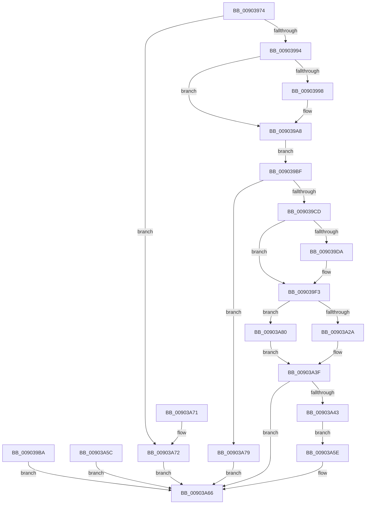

# PfpQueryGpuUtilization

- RVA: `0x00903974`–`0x00903A87` (길이 `275` bytes)
- VA: `0x0000000140903974`
- 실행 섹션: `PAGE`
- PDB 이름 있음: `예`; PDB Function 태그: `아니요`
- unwind 정보 RVA: `0x000889D8`
- 디코드: `73`개 명령, `275/275` bytes 표시
- 미해석 바이트: `0` (있으면 어셈블리에 `.byte`로 보존)

> 이 문서는 커널 이미지의 기계어와 PDB 기호를 분석해 생성했습니다. 4번과 5번은 함수 원형과 자료형을 바이너리 사용 방식에서 추정한 C 해석이며 원본 소스 복구 결과는 아닙니다.

## 1. Dependencies

- 직접 호출 지점: **5**; 고유 호출 대상: **5**
- 직접 호출자로 확인된 함수: **1**
- RIP 상대 이미지 참조: **0**

### Outgoing calls
- `0x009039A3` → [ProbeForWrite](../8E/ProbeForWrite_function_008E91C0.md) (function, `0x008E91C0`)
- `0x009039EA` → [PsGetProcessSessionIdEx](../../text/22/PsGetProcessSessionIdEx_function_0022F8F0.md) (function, `0x0022F8F0`)
- `0x00903A21` → [PspUpdateCalloutParameters](../../text/49/PspUpdateCalloutParameters_function_0049BBA4.md) (function, `0x0049BBA4`)
- `0x00903A2A` → [PsSessionGetWin32Callouts](../../text/47/PsSessionGetWin32Callouts_function_00474F98.md) (function, `0x00474F98`)
- `0x00903A3A` → [ExCallCallBack](ExCallCallBack_function_009054B4.md) (function, `0x009054B4`)

### Direct callers
- [PfQuerySuperfetchInformation](PfQuerySuperfetchInformation_function_0090210C.md) at `0x009022E2`

### Static image references
- 디코드된 RIP-relative 메모리 참조가 없습니다.

## 2. Other-region calls and transfers

- 다른 실행 섹션으로 향하는 call: **3**
  - `0x009039EA` → [PsGetProcessSessionIdEx](../../text/22/PsGetProcessSessionIdEx_function_0022F8F0.md) (`PAGE` → `.text`)
  - `0x00903A21` → [PspUpdateCalloutParameters](../../text/49/PspUpdateCalloutParameters_function_0049BBA4.md) (`PAGE` → `.text`)
  - `0x00903A2A` → [PsSessionGetWin32Callouts](../../text/47/PsSessionGetWin32Callouts_function_00474F98.md) (`PAGE` → `.text`)
- 별도 외부 분기/꼬리 이동을 확인하지 못했습니다.

## 3. Assembly (complete function range)

```asm
00903974  48 89 5C 24 10                  mov qword ptr [rsp + 0x10], rbx
00903979  57                              push rdi
0090397A  48 83 EC 60                     sub rsp, 0x60
0090397E  49 8B F8                        mov rdi, r8
00903981  48 8B D9                        mov rbx, rcx
00903984  33 C0                           xor eax, eax
00903986  89 44 24 44                     mov dword ptr [rsp + 0x44], eax
0090398A  83 79 18 10                     cmp dword ptr [rcx + 0x18], 0x10
0090398E  0F 82 DE 00 00 00               jb 0x140903a72
00903994  84 D2                           test dl, dl
00903996  74 10                           je 0x1409039a8
00903998  8D 50 10                        lea edx, [rax + 0x10]
0090399B  44 8D 40 08                     lea r8d, [rax + 8]
0090399F  48 8B 49 10                     mov rcx, qword ptr [rcx + 0x10]
009039A3  E8 18 58 FE FF                  call 0x1408e91c0
009039A8  48 8B C3                        mov rax, rbx
009039AB  48 8B 43 10                     mov rax, qword ptr [rbx + 0x10]
009039AF  0F 10 00                        movups xmm0, xmmword ptr [rax]
009039B2  F3 0F 7F 44 24 20               movdqu xmmword ptr [rsp + 0x20], xmm0
009039B8  EB 05                           jmp 0x1409039bf
009039BA  E9 A7 00 00 00                  jmp 0x140903a66
009039BF  48 8B 44 24 20                  mov rax, qword ptr [rsp + 0x20]
009039C4  83 F8 01                        cmp eax, 1
009039C7  0F 85 AC 00 00 00               jne 0x140903a79
009039CD  48 C1 E8 20                     shr rax, 0x20
009039D1  89 44 24 70                     mov dword ptr [rsp + 0x70], eax
009039D5  83 F8 FF                        cmp eax, -1
009039D8  75 19                           jne 0x1409039f3
009039DA  65 48 8B 0C 25 88 01 00 00      mov rcx, qword ptr gs:[0x188]
009039E3  48 8B 89 B8 00 00 00            mov rcx, qword ptr [rcx + 0xb8]
009039EA  E8 01 BF 92 FF                  call 0x14022f8f0
009039EF  89 44 24 70                     mov dword ptr [rsp + 0x70], eax
009039F3  0F 57 C0                        xorps xmm0, xmm0
009039F6  33 C0                           xor eax, eax
009039F8  0F 11 44 24 40                  movups xmmword ptr [rsp + 0x40], xmm0
009039FD  48 89 44 24 50                  mov qword ptr [rsp + 0x50], rax
00903A02  48 89 44 24 34                  mov qword ptr [rsp + 0x34], rax
00903A07  48 89 44 24 30                  mov qword ptr [rsp + 0x30], rax
00903A0C  4C 8D 4C 24 70                  lea r9, [rsp + 0x70]
00903A11  44 8D 40 01                     lea r8d, [rax + 1]
00903A15  48 8D 54 24 40                  lea rdx, [rsp + 0x40]
00903A1A  44 8D 50 19                     lea r10d, [rax + 0x19]
00903A1E  41 8B CA                        mov ecx, r10d
00903A21  E8 7E 81 B9 FF                  call 0x14049bba4
00903A26  85 C0                           test eax, eax
00903A28  74 56                           je 0x140903a80
00903A2A  E8 69 15 B7 FF                  call 0x140474f98
00903A2F  48 8B C8                        mov rcx, rax
00903A32  4C 8D 44 24 40                  lea r8, [rsp + 0x40]
00903A37  41 8B D2                        mov edx, r10d
00903A3A  E8 75 1A 00 00                  call 0x1409054b4
00903A3F  85 C0                           test eax, eax
00903A41  78 23                           js 0x140903a66
00903A43  48 8B 44 24 50                  mov rax, qword ptr [rsp + 0x50]
00903A48  48 89 44 24 28                  mov qword ptr [rsp + 0x28], rax
00903A4D  48 8B 43 10                     mov rax, qword ptr [rbx + 0x10]
00903A51  0F 10 44 24 20                  movups xmm0, xmmword ptr [rsp + 0x20]
00903A56  F3 0F 7F 00                     movdqu xmmword ptr [rax], xmm0
00903A5A  EB 02                           jmp 0x140903a5e
00903A5C  EB 08                           jmp 0x140903a66
00903A5E  C7 07 10 00 00 00               mov dword ptr [rdi], 0x10
00903A64  33 C0                           xor eax, eax
00903A66  48 8B 5C 24 78                  mov rbx, qword ptr [rsp + 0x78]
00903A6B  48 83 C4 60                     add rsp, 0x60
00903A6F  5F                              pop rdi
00903A70  C3                              ret
00903A71  CC                              int3
00903A72  B8 06 02 00 C0                  mov eax, 0xc0000206
00903A77  EB ED                           jmp 0x140903a66
00903A79  B8 59 00 00 C0                  mov eax, 0xc0000059
00903A7E  EB E6                           jmp 0x140903a66
00903A80  B8 0D 00 00 C0                  mov eax, 0xc000000d
00903A85  EB B8                           jmp 0x140903a3f
```

## 4. C-style interpretation (structured pseudocode)

```c
__int64 __fastcall PfpQueryGpuUtilization(__int64 a1, unsigned __int8 a2, __int64 a3)
{
    __int64 result;
    __int64 v_rsp;
    unsigned __int64 v_stack_m18;
    unsigned int v_stack_m24;
    unsigned __int64 v_stack_m28;
    unsigned __int64 v_stack_m34;
    unsigned __int64 v_stack_m38;
    unsigned __int64 v_stack_m40;
    unsigned __int64 v_stack_m48;
    unsigned __int64 v_stack_p10;
    unsigned int v_stack_p8;

    v_stack_p10 = v_rbx;
    v_rsp = (v_rsp) - (96);
    result = 0;
    v_stack_m24 = 0;
    if ((*(unsigned int *)(a1 + 24)) < 16) goto loc_00903A72;
    if (a2 != 0) {
        a2 = result + 16;
        a3 = result + 8;
        a1 = *(unsigned __int64 *)(a1 + 16);
        result = ProbeForWrite(a1, a2, a3, a4);
    }
    v_stack_m48 = v_xmm0;
    goto loc_009039BF;
loc_009039BF:
    if (((unsigned int)(v_stack_m48)) != 1) goto loc_00903A79;
    result = (v_stack_m48) >> (32);
    v_stack_p8 = (unsigned int)(result);
    if (((unsigned int)(result)) == -1) {
        a1 = *(unsigned __int64 *)(gs_base + (0 + 392));
        a1 = *(unsigned __int64 *)(a1 + 184);
        result = PsGetProcessSessionIdEx(a1, a2, a3, a4);
        v_stack_p8 = (unsigned int)(result);
    }
    result = 0;
    v_stack_m28 = v_xmm0;
    v_stack_m18 = 0;
    v_stack_m34 = 0;
    v_stack_m38 = 0;
    result = PspUpdateCalloutParameters((unsigned int)((unsigned int)(result + 25)), v_stack_m28, result + 1, v_stack_p8);
    if ((unsigned int)(result) == 0) goto loc_00903A80;
    result = PsSessionGetWin32Callouts((unsigned int)((unsigned int)(result + 25)), v_stack_m28, result + 1, v_stack_p8);
    result = ExCallCallBack(result, (unsigned int)((unsigned int)(result + 25)), v_stack_m28, v_stack_p8);
loc_00903A3F:
    if (sign_flag) goto loc_00903A66;
    v_stack_m40 = v_stack_m18;
    *(unsigned __int64 *)(*(unsigned __int64 *)(a1 + 16)) = v_xmm0;
    goto loc_00903A5E;
loc_00903A5E:
    *(unsigned int *)(a3) = 16;
    result = 0;
loc_00903A66:
    v_rsp = (v_rsp) + (96);
    return result;
loc_00903A72:
    goto loc_00903A66;
loc_00903A79:
    goto loc_00903A66;
loc_00903A80:
    goto loc_00903A3F;
}
```

## 5. (Beta) C Style

```c
int64_t PfpQueryGpuUtilization(void *Arg1, uint8_t Arg2, void *Arg3)
{
    uint8_t *arg1 = (uint8_t *)Arg1;
    uint8_t *arg3 = (uint8_t *)Arg3;

    int64_t result;
    int64_t local_rsp;
    uint64_t v_stack_m18;
    uint32_t v_stack_m24;
    uint64_t v_stack_m28;
    uint64_t v_stack_m34;
    uint64_t v_stack_m38;
    uint64_t v_stack_m40;
    uint64_t v_stack_m48;
    uint64_t v_stack_p10;
    uint32_t v_stack_p8;

    v_stack_p10 = local_rbx;
    local_rsp = (local_rsp) - (96);
    result = 0;
    v_stack_m24 = 0;
    if ((*(uint32_t *)(arg1 + 0x18)) < 16) goto loc_00903A72;
    if (Arg2 != 0) {
        Arg2 = result + 16;
        Arg3 = result + 8;
        Arg1 = *(uint64_t *)(arg1 + 0x10);
        result = ProbeForWrite(Arg1, Arg2, Arg3, a4);
    }
    v_stack_m48 = v_xmm0;
    goto loc_009039BF;
loc_009039BF:
    if (((uint32_t)(v_stack_m48)) != 1) goto loc_00903A79;
    result = (v_stack_m48) >> (32);
    v_stack_p8 = (uint32_t)(result);
    if (((uint32_t)(result)) == -1) {
        Arg1 = *(uint64_t *)(gs_base + (0 + 0x188));
        Arg1 = *(uint64_t *)(arg1 + 0xB8);
        result = PsGetProcessSessionIdEx(Arg1, Arg2, Arg3, a4);
        v_stack_p8 = (uint32_t)(result);
    }
    result = 0;
    v_stack_m28 = v_xmm0;
    v_stack_m18 = 0;
    v_stack_m34 = 0;
    v_stack_m38 = 0;
    result = PspUpdateCalloutParameters((uint32_t)((uint32_t)(result + 25)), v_stack_m28, result + 1, v_stack_p8);
    if ((uint32_t)(result) == 0) goto loc_00903A80;
    result = PsSessionGetWin32Callouts((uint32_t)((uint32_t)(result + 25)), v_stack_m28, result + 1, v_stack_p8);
    result = ExCallCallBack(result, (uint32_t)((uint32_t)(result + 25)), v_stack_m28, v_stack_p8);
loc_00903A3F:
    if (sign_flag) goto loc_00903A66;
    v_stack_m40 = v_stack_m18;
    *(uint64_t *)(*(uint64_t *)(arg1 + 0x10)) = v_xmm0;
    goto loc_00903A5E;
loc_00903A5E:
    *(uint32_t *)(arg3) = 16;
    result = 0;
loc_00903A66:
    local_rsp = (local_rsp) + (96);
    return result;
loc_00903A72:
    goto loc_00903A66;
loc_00903A79:
    goto loc_00903A66;
loc_00903A80:
    goto loc_00903A3F;
}
```

### 관측된 메모리 오프셋

구조체 형식이 확인되지 않은 접근은 인자 기준의 오프셋으로만 기록했습니다.

| 기준 인자 | 오프셋 표현 | 폭 (bit) | 접근 |
|---|---:|---:|---|
| `Arg1` | `+ 0x10` | `64` | `R` |
| `Arg1` | `+ 0x18` | `32` | `R` |
| `Arg3` | `+ 0x0` | `32` | `W` |

## 6. Execution-region graph

[열기: 2D/3D 그래프와 함수 탐색 컨트롤 패널](../../../control-panel.html?section=page&rva=0x00903974&view=graph)

- 2D 그래프는 위에서 아래로 흐르고, 3D 그래프는 빈 공간을 드래그해 회전합니다. Shift+드래그는 이동, 휠은 확대·축소, 함수 노드 선택은 대상 보고서 이동입니다.

### Static fallback


