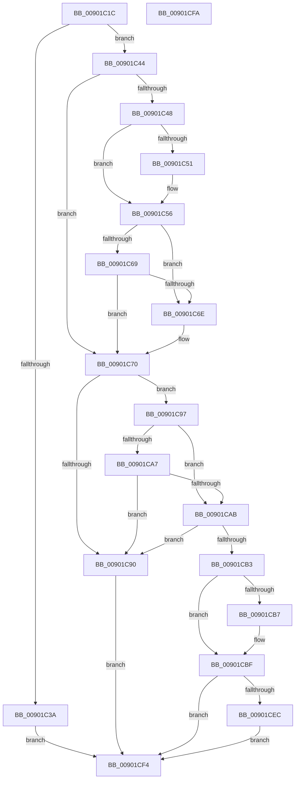

# PfpVirtualQuery

- RVA: `0x00901C1C`–`0x00901CFB` (길이 `223` bytes)
- VA: `0x0000000140901C1C`
- 실행 섹션: `PAGE`
- PDB 이름 있음: `예`; PDB Function 태그: `아니요`
- unwind 정보 RVA: `0x000886C4`
- 디코드: `65`개 명령, `223/223` bytes 표시
- 미해석 바이트: `0` (있으면 어셈블리에 `.byte`로 보존)

> 이 문서는 커널 이미지의 기계어와 PDB 기호를 분석해 생성했습니다. 4번과 5번은 함수 원형과 자료형을 바이너리 사용 방식에서 추정한 C 해석이며 원본 소스 복구 결과는 아닙니다.

## 1. Dependencies

- 직접 호출 지점: **3**; 고유 호출 대상: **3**
- 직접 호출자로 확인된 함수: **1**
- RIP 상대 이미지 참조: **0**

### Outgoing calls
- `0x00901C51` → [ExRaiseDatatypeMisalignment](../89/ExRaiseDatatypeMisalignment_function_00899FD0.md) (function, `0x00899FD0`)
- `0x00901C7D` → [memcpy](../../text/6C/memcpy_function_006C6840.md) (function, `0x006C6840`)
- `0x00901CE3` → [MmQueryVirtualMemory](../9D/MmQueryVirtualMemory_function_009D9280.md) (function, `0x009D9280`)

### Direct callers
- [PfQuerySuperfetchInformation](PfQuerySuperfetchInformation_function_0090210C.md) at `0x00902407`

### Static image references
- 디코드된 RIP-relative 메모리 참조가 없습니다.

## 2. Other-region calls and transfers

- 다른 실행 섹션으로 향하는 call: **1**
  - `0x00901C7D` → [memcpy](../../text/6C/memcpy_function_006C6840.md) (`PAGE` → `.text`)
- 별도 외부 분기/꼬리 이동을 확인하지 못했습니다.

## 3. Assembly (complete function range)

```asm
00901C1C  40 53                           push rbx
00901C1E  48 83 EC 60                     sub rsp, 0x60
00901C22  49 8B D8                        mov rbx, r8
00901C25  0F 57 C0                        xorps xmm0, xmm0
00901C28  0F 11 44 24 40                  movups xmmword ptr [rsp + 0x40], xmm0
00901C2D  0F 11 44 24 50                  movups xmmword ptr [rsp + 0x50], xmm0
00901C32  8B 41 18                        mov eax, dword ptr [rcx + 0x18]
00901C35  83 F8 20                        cmp eax, 0x20
00901C38  74 0A                           je 0x140901c44
00901C3A  B8 06 02 00 C0                  mov eax, 0xc0000206
00901C3F  E9 B0 00 00 00                  jmp 0x140901cf4
00901C44  84 D2                           test dl, dl
00901C46  74 28                           je 0x140901c70
00901C48  48 8B 51 10                     mov rdx, qword ptr [rcx + 0x10]
00901C4C  F6 C2 07                        test dl, 7
00901C4F  74 05                           je 0x140901c56
00901C51  E8 7A 83 F9 FF                  call 0x140899fd0
00901C56  4C 8D 04 02                     lea r8, [rdx + rax]
00901C5A  48 B8 00 00 FF FF FF 7F 00 00   movabs rax, 0x7fffffff0000
00901C64  4C 3B C0                        cmp r8, rax
00901C67  77 05                           ja 0x140901c6e
00901C69  4C 3B C2                        cmp r8, rdx
00901C6C  73 02                           jae 0x140901c70
00901C6E  8A 00                           mov al, byte ptr [rax]
00901C70  44 8B 41 18                     mov r8d, dword ptr [rcx + 0x18]
00901C74  48 8B 51 10                     mov rdx, qword ptr [rcx + 0x10]
00901C78  48 8D 4C 24 40                  lea rcx, [rsp + 0x40]
00901C7D  E8 BE 4B DC FF                  call 0x1406c6840
00901C82  90                              nop
00901C83  41 B8 01 00 00 00               mov r8d, 1
00901C89  44 39 44 24 40                  cmp dword ptr [rsp + 0x40], r8d
00901C8E  74 07                           je 0x140901c97
00901C90  B8 0D 00 00 C0                  mov eax, 0xc000000d
00901C95  EB 5D                           jmp 0x140901cf4
00901C97  8B 4C 24 44                     mov ecx, dword ptr [rsp + 0x44]
00901C9B  8B D1                           mov edx, ecx
00901C9D  41 23 D0                        and edx, r8d
00901CA0  B8 02 00 00 00                  mov eax, 2
00901CA5  74 04                           je 0x140901cab
00901CA7  84 C8                           test al, cl
00901CA9  75 E5                           jne 0x140901c90
00901CAB  F7 C1 FC FF FF FF               test ecx, 0xfffffffc
00901CB1  75 DD                           jne 0x140901c90
00901CB3  85 D2                           test edx, edx
00901CB5  75 08                           jne 0x140901cbf
00901CB7  84 C8                           test al, cl
00901CB9  8B C2                           mov eax, edx
00901CBB  41 0F 45 C0                     cmovne eax, r8d
00901CBF  89 44 24 30                     mov dword ptr [rsp + 0x30], eax
00901CC3  48 83 64 24 28 00               and qword ptr [rsp + 0x28], 0
00901CC9  48 8B 44 24 50                  mov rax, qword ptr [rsp + 0x50]
00901CCE  48 89 44 24 20                  mov qword ptr [rsp + 0x20], rax
00901CD3  4C 8B 4C 24 48                  mov r9, qword ptr [rsp + 0x48]
00901CD8  33 D2                           xor edx, edx
00901CDA  44 8D 42 04                     lea r8d, [rdx + 4]
00901CDE  48 8B 4C 24 58                  mov rcx, qword ptr [rsp + 0x58]
00901CE3  E8 98 75 0D 00                  call 0x1409d9280
00901CE8  85 C0                           test eax, eax
00901CEA  78 08                           js 0x140901cf4
00901CEC  C7 03 20 00 00 00               mov dword ptr [rbx], 0x20
00901CF2  EB 00                           jmp 0x140901cf4
00901CF4  48 83 C4 60                     add rsp, 0x60
00901CF8  5B                              pop rbx
00901CF9  C3                              ret
00901CFA  CC                              int3
```

## 4. C-style interpretation (structured pseudocode)

```c
__int64 __fastcall PfpVirtualQuery(__int64 a1, unsigned __int8 a2, __int64 a3)
{
    __int64 result;
    __int64 v_rsp;
    unsigned __int64 v_stack_m10;
    unsigned __int64 v_stack_m18;
    unsigned __int64 v_stack_m20;
    unsigned int v_stack_m24;
    unsigned __int64 v_stack_m28;
    unsigned int v_stack_m38;
    unsigned __int64 v_stack_m40;
    unsigned __int64 v_stack_m48;

    v_rsp = (v_rsp) - (96);
    v_stack_m28 = v_xmm0;
    v_stack_m18 = v_xmm0;
    if (((unsigned int)((unsigned int)(*(unsigned int *)(a1 + 24)))) == 32) goto loc_00901C44;
    goto loc_00901CF4;
loc_00901C44:
    if (a2 == 0) goto loc_00901C70;
    result = (unsigned int)(0xC0000206ULL);
    if ((((unsigned __int8)(*(unsigned __int64 *)(a1 + 16))) & (7)) != 0) {
        result = ExRaiseDatatypeMisalignment(a1, *(unsigned __int64 *)(a1 + 16), a3, a4);
    }
    if ((*(unsigned __int64 *)(a1 + 16) + result * 1) > result) goto loc_00901C6E;
    if ((*(unsigned __int64 *)(a1 + 16) + result * 1) < (*(unsigned __int64 *)(a1 + 16))) {
        result = *(unsigned __int8 *)(result);
    }
    result = memcpy(v_stack_m28, *(unsigned __int64 *)(a1 + 16), (unsigned int)(*(unsigned int *)(a1 + 24)), a4);
    if (v_stack_m28 == 1) goto loc_00901C97;
loc_00901C90:
    goto loc_00901CF4;
loc_00901C97:
    a2 = (unsigned int)(((unsigned int)((unsigned int)((unsigned int)(v_stack_m24)))) & (1));
    if (condition_is_equal) goto loc_00901CAB;
    if (((2) & ((unsigned __int8)((unsigned int)(v_stack_m24)))) != 0) goto loc_00901C90;
loc_00901CAB:
    if ((((unsigned int)((unsigned int)(v_stack_m24))) & (0xFFFFFFFCULL)) != 0) goto loc_00901C90;
    result = 2;
    if (a2 == 0) {
        result = a2;
        if (((2) & ((unsigned __int8)((unsigned int)(v_stack_m24)))) != 0) { result = 1; }
    }
    v_stack_m38 = (unsigned int)(result);
    v_stack_m48 = v_stack_m18;
    a2 = 0;
    result = MmQueryVirtualMemory(v_stack_m10, a2, a2 + 4, v_stack_m20);
    if (sign_flag) goto loc_00901CF4;
    *(unsigned int *)(a3) = 32;
    goto loc_00901CF4;
loc_00901CF4:
    v_rsp = (v_rsp) + (96);
    return result;
}
```

## 5. (Beta) C Style

```c
int64_t PfpVirtualQuery(void *Arg1, uint8_t Arg2, void *Arg3)
{
    uint8_t *arg1 = (uint8_t *)Arg1;
    uint8_t *arg3 = (uint8_t *)Arg3;

    int64_t result;
    int64_t local_rsp;
    uint64_t v_stack_m10;
    uint64_t v_stack_m18;
    uint64_t v_stack_m20;
    uint32_t v_stack_m24;
    uint64_t v_stack_m28;
    uint32_t v_stack_m38;
    uint64_t v_stack_m40;
    uint64_t v_stack_m48;

    local_rsp = (local_rsp) - (96);
    v_stack_m28 = v_xmm0;
    v_stack_m18 = v_xmm0;
    if (((uint32_t)((uint32_t)(*(uint32_t *)(arg1 + 0x18)))) == 32) goto loc_00901C44;
    goto loc_00901CF4;
loc_00901C44:
    if (Arg2 == 0) goto loc_00901C70;
    result = (uint32_t)(0xC0000206ULL);
    if ((((uint8_t)(*(uint64_t *)(arg1 + 0x10))) & (7)) != 0) {
        result = ExRaiseDatatypeMisalignment(Arg1, *(uint64_t *)(arg1 + 0x10), Arg3, a4);
    }
    if ((*(uint64_t *)(arg1 + 0x10) + result * 1) > result) goto loc_00901C6E;
    if ((*(uint64_t *)(arg1 + 0x10) + result * 1) < (*(uint64_t *)(arg1 + 0x10))) {
        result = *(uint8_t *)(result);
    }
    result = memcpy(v_stack_m28, *(uint64_t *)(arg1 + 0x10), (uint32_t)(*(uint32_t *)(arg1 + 0x18)), a4);
    if (v_stack_m28 == 1) goto loc_00901C97;
loc_00901C90:
    goto loc_00901CF4;
loc_00901C97:
    Arg2 = (uint32_t)(((uint32_t)((uint32_t)((uint32_t)(v_stack_m24)))) & (1));
    if (condition_is_equal) goto loc_00901CAB;
    if (((2) & ((uint8_t)((uint32_t)(v_stack_m24)))) != 0) goto loc_00901C90;
loc_00901CAB:
    if ((((uint32_t)((uint32_t)(v_stack_m24))) & (0xFFFFFFFCULL)) != 0) goto loc_00901C90;
    result = 2;
    if (Arg2 == 0) {
        result = Arg2;
        if (((2) & ((uint8_t)((uint32_t)(v_stack_m24)))) != 0) { result = 1; }
    }
    v_stack_m38 = (uint32_t)(result);
    v_stack_m48 = v_stack_m18;
    Arg2 = 0;
    result = MmQueryVirtualMemory(v_stack_m10, Arg2, Arg2 + 4, v_stack_m20);
    if (sign_flag) goto loc_00901CF4;
    *(uint32_t *)(arg3) = 32;
    goto loc_00901CF4;
loc_00901CF4:
    local_rsp = (local_rsp) + (96);
    return result;
}
```

### 관측된 메모리 오프셋

구조체 형식이 확인되지 않은 접근은 인자 기준의 오프셋으로만 기록했습니다.

| 기준 인자 | 오프셋 표현 | 폭 (bit) | 접근 |
|---|---:|---:|---|
| `Arg1` | `+ 0x10` | `64` | `R` |
| `Arg1` | `+ 0x18` | `32` | `R` |
| `Arg3` | `+ 0x0` | `32` | `W` |

## 6. Execution-region graph

[열기: 2D/3D 그래프와 함수 탐색 컨트롤 패널](../../../control-panel.html?section=page&rva=0x00901C1C&view=graph)

- 2D 그래프는 위에서 아래로 흐르고, 3D 그래프는 빈 공간을 드래그해 회전합니다. Shift+드래그는 이동, 휠은 확대·축소, 함수 노드 선택은 대상 보고서 이동입니다.

### Static fallback


