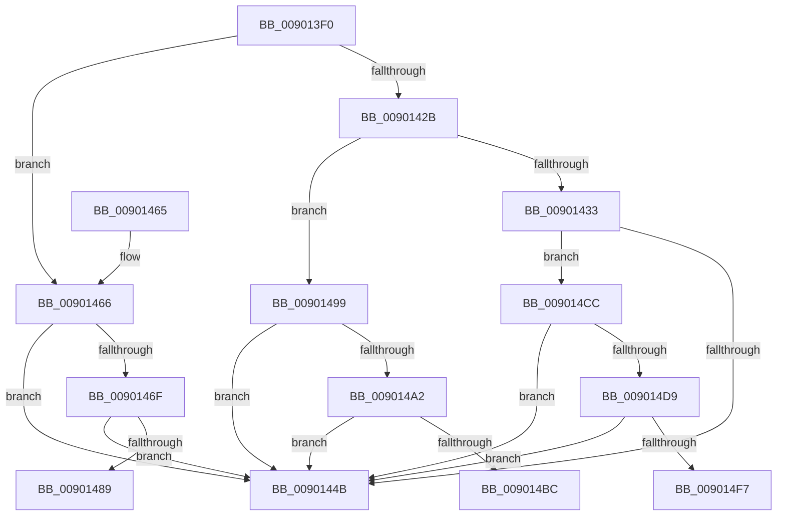

# PnpCompareInterruptInformation

- RVA: `0x009013F0`–`0x00901507` (길이 `279` bytes)
- VA: `0x00000001409013F0`
- 실행 섹션: `PAGE`
- PDB 이름 있음: `예`; PDB Function 태그: `예`
- unwind 정보 RVA: `0x000885F8`
- 디코드: `67`개 명령, `279/279` bytes 표시
- 미해석 바이트: `0` (있으면 어셈블리에 `.byte`로 보존)

> 이 문서는 커널 이미지의 기계어와 PDB 기호를 분석해 생성했습니다. 4번과 5번은 함수 원형과 자료형을 바이너리 사용 방식에서 추정한 C 해석이며 원본 소스 복구 결과는 아닙니다.

## 1. Dependencies

- 직접 호출 지점: **5**; 고유 호출 대상: **3**
- 직접 호출자로 확인된 함수: **1**
- RIP 상대 이미지 참조: **5**

### Outgoing calls
- `0x0090143A` → [RtlCompareMemory](../../text/6B/RtlCompareMemory_function_006BA670.md) (function, `0x006BA670`)
- `0x00901452` → [_security_check_cookie](../../text/6A/_security_check_cookie_function_006AC640.md) (function, `0x006AC640`)
- `0x00901480` → [tlgKeywordOn](../../text/42/tlgKeywordOn_function_0042EAA0.md) (function, `0x0042EAA0`)
- `0x009014B3` → [tlgKeywordOn](../../text/42/tlgKeywordOn_function_0042EAA0.md) (function, `0x0042EAA0`)
- `0x009014EA` → [tlgKeywordOn](../../text/42/tlgKeywordOn_function_0042EAA0.md) (function, `0x0042EAA0`)

### Direct callers
- [PnpGetDevicePropertyData](PnpGetDevicePropertyData_function_009006D0.md) at `0x0090081D`

### Static image references
- `0x00901403` → RVA `0x00E0A740` (`.data`; read)
- `0x00901466` → RVA `0x00E06F90` (`.data`; read)
- `0x00901489` → RVA `0x00AFDFB0` (` ?? ::NNGAKEGL::`string'`; read)
- `0x009014BC` → RVA `0x00AFDFC0` (` ?? ::NNGAKEGL::`string'`; read)
- `0x009014F7` → RVA `0x00AFDFD0` (` ?? ::NNGAKEGL::`string'`; read)

## 2. Other-region calls and transfers

- 다른 실행 섹션으로 향하는 call: **5**
  - `0x0090143A` → [RtlCompareMemory](../../text/6B/RtlCompareMemory_function_006BA670.md) (`PAGE` → `.text`)
  - `0x00901452` → [_security_check_cookie](../../text/6A/_security_check_cookie_function_006AC640.md) (`PAGE` → `.text`)
  - `0x00901480` → [tlgKeywordOn](../../text/42/tlgKeywordOn_function_0042EAA0.md) (`PAGE` → `.text`)
  - `0x009014B3` → [tlgKeywordOn](../../text/42/tlgKeywordOn_function_0042EAA0.md) (`PAGE` → `.text`)
  - `0x009014EA` → [tlgKeywordOn](../../text/42/tlgKeywordOn_function_0042EAA0.md) (`PAGE` → `.text`)
- call이 아닌 외부 분기/꼬리 이동: **3**
  - `0x00901494` → [sub_00B205EA](../B2/Unknown_function_00B205EA.md) (`tail-transfer`)
  - `0x009014C7` → [sub_00B205EA + 0x52](../B2/Unknown_function_00B205EA.md) (`tail-transfer`)
  - `0x00901502` → [sub_00B205EA + 0x7C](../B2/Unknown_function_00B205EA.md) (`tail-transfer`)

## 3. Assembly (complete function range)

```asm
009013F0  40 55                           push rbp
009013F2  53                              push rbx
009013F3  56                              push rsi
009013F4  57                              push rdi
009013F5  41 56                           push r14
009013F7  48 8D 6C 24 C9                  lea rbp, [rsp - 0x37]
009013FC  48 81 EC C0 00 00 00            sub rsp, 0xc0
00901403  48 8B 05 36 93 50 00            mov rax, qword ptr [rip + 0x509336]
0090140A  48 33 C4                        xor rax, rsp
0090140D  48 89 45 27                     mov qword ptr [rbp + 0x27], rax
00901411  48 8B 81 38 01 00 00            mov rax, qword ptr [rcx + 0x138]
00901418  45 33 F6                        xor r14d, r14d
0090141B  41 8B F8                        mov edi, r8d
0090141E  48 8B 48 58                     mov rcx, qword ptr [rax + 0x58]
00901422  48 8B 70 28                     mov rsi, qword ptr [rax + 0x28]
00901426  48 85 C9                        test rcx, rcx
00901429  74 3B                           je 0x140901466
0090142B  44 8B 01                        mov r8d, dword ptr [rcx]
0090142E  44 3B C7                        cmp r8d, edi
00901431  75 66                           jne 0x140901499
00901433  48 83 C1 04                     add rcx, 4
00901437  44 8B C7                        mov r8d, edi
0090143A  E8 31 92 DB FF                  call 0x1406ba670
0090143F  4C 8B C0                        mov r8, rax
00901442  48 3B C7                        cmp rax, rdi
00901445  0F 85 81 00 00 00               jne 0x1409014cc
0090144B  48 8B 4D 27                     mov rcx, qword ptr [rbp + 0x27]
0090144F  48 33 CC                        xor rcx, rsp
00901452  E8 E9 B1 DA FF                  call 0x1406ac640
00901457  48 81 C4 C0 00 00 00            add rsp, 0xc0
0090145E  41 5E                           pop r14
00901460  5F                              pop rdi
00901461  5E                              pop rsi
00901462  5B                              pop rbx
00901463  5D                              pop rbp
00901464  C3                              ret
00901465  CC                              int3
00901466  83 3D 23 5B 50 00 05            cmp dword ptr [rip + 0x505b23], 5
0090146D  76 DC                           jbe 0x14090144b
0090146F  48 BA 00 00 00 00 00 40 00 00   movabs rdx, 0x400000000000
00901479  48 8D 0D 10 5B 50 00            lea rcx, [rip + 0x505b10]
00901480  E8 1B D6 B2 FF                  call 0x14042eaa0
00901485  84 C0                           test al, al
00901487  74 C2                           je 0x14090144b
00901489  48 8D 0D 20 CB 1F 00            lea rcx, [rip + 0x1fcb20]
00901490  48 83 C8 FF                     or rax, 0xffffffffffffffff
00901494  E9 51 F1 21 00                  jmp 0x140b205ea
00901499  83 3D F0 5A 50 00 05            cmp dword ptr [rip + 0x505af0], 5
009014A0  76 A9                           jbe 0x14090144b
009014A2  48 BA 00 00 00 00 00 40 00 00   movabs rdx, 0x400000000000
009014AC  48 8D 0D DD 5A 50 00            lea rcx, [rip + 0x505add]
009014B3  E8 E8 D5 B2 FF                  call 0x14042eaa0
009014B8  84 C0                           test al, al
009014BA  74 8F                           je 0x14090144b
009014BC  48 8D 0D FD CA 1F 00            lea rcx, [rip + 0x1fcafd]
009014C3  48 83 C8 FF                     or rax, 0xffffffffffffffff
009014C7  E9 70 F1 21 00                  jmp 0x140b2063c
009014CC  83 3D BD 5A 50 00 05            cmp dword ptr [rip + 0x505abd], 5
009014D3  0F 86 72 FF FF FF               jbe 0x14090144b
009014D9  48 BA 00 00 00 00 00 40 00 00   movabs rdx, 0x400000000000
009014E3  48 8D 0D A6 5A 50 00            lea rcx, [rip + 0x505aa6]
009014EA  E8 B1 D5 B2 FF                  call 0x14042eaa0
009014EF  84 C0                           test al, al
009014F1  0F 84 54 FF FF FF               je 0x14090144b
009014F7  48 8D 0D D2 CA 1F 00            lea rcx, [rip + 0x1fcad2]
009014FE  48 83 C8 FF                     or rax, 0xffffffffffffffff
00901502  E9 5F F1 21 00                  jmp 0x140b20666
```

## 4. C-style interpretation (structured pseudocode)

```c
__int64 __fastcall PnpCompareInterruptInformation(__int64 a1, __int64 a2, int a3)
{
    __int64 result;
    __int64 v_r14;
    __int64 v_rsp;
    unsigned __int64 v_stack_m38;
    unsigned __int64 v_stack_m5F;

    v_rsp = (v_rsp) - (192);
    result = (*(unsigned __int64 *)(v_rip + 5280566)) ^ (v_rsp);
    v_stack_m38 = result;
    v_r14 = 0;
    if (*(unsigned __int64 *)(*(unsigned __int64 *)(a1 + 312) + 88) == 0) goto loc_00901466;
    if (((unsigned int)((unsigned int)(*(unsigned int *)(*(unsigned __int64 *)(*(unsigned __int64 *)(a1 + 312) + 88))))) != ((unsigned int)((unsigned int)(a3)))) goto loc_00901499;
    a1 = (*(unsigned __int64 *)(*(unsigned __int64 *)(a1 + 312) + 88)) + (4);
    result = RtlCompareMemory(a1, a2, (unsigned int)((unsigned int)((unsigned int)(a3))), a4);
    if (result != ((unsigned int)(a3))) goto loc_009014CC;
loc_0090144B:
    a1 = (v_stack_m38) ^ (v_rsp);
    result = _security_check_cookie(a1, a2, result, a4);
    v_rsp = (v_rsp) + (192);
    return result;
loc_00901466:
    if ((*(unsigned int *)(v_rip + 5266211)) <= 5) goto loc_0090144B;
    result = tlgKeywordOn(v_rip + 5266192, a2, result, a4);
    if ((unsigned __int8)(result) == 0) goto loc_0090144B;
    result = (result) | (-1);
loc_00901499:
    if ((*(unsigned int *)(v_rip + 5266160)) <= 5) goto loc_0090144B;
    result = tlgKeywordOn(v_rip + 5266141, a2, result, a4);
    if ((unsigned __int8)(result) == 0) goto loc_0090144B;
    result = (result) | (-1);
loc_009014CC:
    if ((*(unsigned int *)(v_rip + 5266109)) <= 5) goto loc_0090144B;
    result = tlgKeywordOn(v_rip + 5266086, a2, result, a4);
    if ((unsigned __int8)(result) == 0) goto loc_0090144B;
    result = (result) | (-1);
}
```

## 5. (Beta) C Style

```c
int64_t PnpCompareInterruptInformation(void *Arg1, int64_t Arg2, int32_t Arg3)
{
    uint8_t *arg1 = (uint8_t *)Arg1;

    int64_t result;
    int64_t local_r14;
    int64_t local_rsp;
    uint64_t v_stack_m38;
    uint64_t v_stack_m5F;

    local_rsp = (local_rsp) - (192);
    result = (*(uint64_t *)(v_rip + 0x509336)) ^ (local_rsp);
    v_stack_m38 = result;
    local_r14 = 0;
    if (*(uint64_t *)(*(uint64_t *)(arg1 + 0x138) + 0x58) == 0) goto loc_00901466;
    if (((uint32_t)((uint32_t)(*(uint32_t *)(*(uint64_t *)(*(uint64_t *)(arg1 + 0x138) + 0x58))))) != ((uint32_t)((uint32_t)(Arg3)))) goto loc_00901499;
    Arg1 = (*(uint64_t *)(*(uint64_t *)(arg1 + 0x138) + 0x58)) + (4);
    result = RtlCompareMemory(Arg1, Arg2, (uint32_t)((uint32_t)((uint32_t)(Arg3))), a4);
    if (result != ((uint32_t)(Arg3))) goto loc_009014CC;
loc_0090144B:
    Arg1 = (v_stack_m38) ^ (local_rsp);
    result = _security_check_cookie(Arg1, Arg2, result, a4);
    local_rsp = (local_rsp) + (192);
    return result;
loc_00901466:
    if ((*(uint32_t *)(v_rip + 0x505B23)) <= 5) goto loc_0090144B;
    result = tlgKeywordOn(v_rip + 5266192, Arg2, result, a4);
    if ((uint8_t)(result) == 0) goto loc_0090144B;
    result = (result) | (-1);
loc_00901499:
    if ((*(uint32_t *)(v_rip + 0x505AF0)) <= 5) goto loc_0090144B;
    result = tlgKeywordOn(v_rip + 5266141, Arg2, result, a4);
    if ((uint8_t)(result) == 0) goto loc_0090144B;
    result = (result) | (-1);
loc_009014CC:
    if ((*(uint32_t *)(v_rip + 0x505ABD)) <= 5) goto loc_0090144B;
    result = tlgKeywordOn(v_rip + 5266086, Arg2, result, a4);
    if ((uint8_t)(result) == 0) goto loc_0090144B;
    result = (result) | (-1);
}
```

### 관측된 메모리 오프셋

구조체 형식이 확인되지 않은 접근은 인자 기준의 오프셋으로만 기록했습니다.

| 기준 인자 | 오프셋 표현 | 폭 (bit) | 접근 |
|---|---:|---:|---|
| `Arg1` | `+ 0x138` | `64` | `R` |

## 6. Execution-region graph

[열기: 2D/3D 그래프와 함수 탐색 컨트롤 패널](../../../control-panel.html?section=page&rva=0x009013F0&view=graph)

- 2D 그래프는 위에서 아래로 흐르고, 3D 그래프는 빈 공간을 드래그해 회전합니다. Shift+드래그는 이동, 휠은 확대·축소, 함수 노드 선택은 대상 보고서 이동입니다.

### Static fallback


