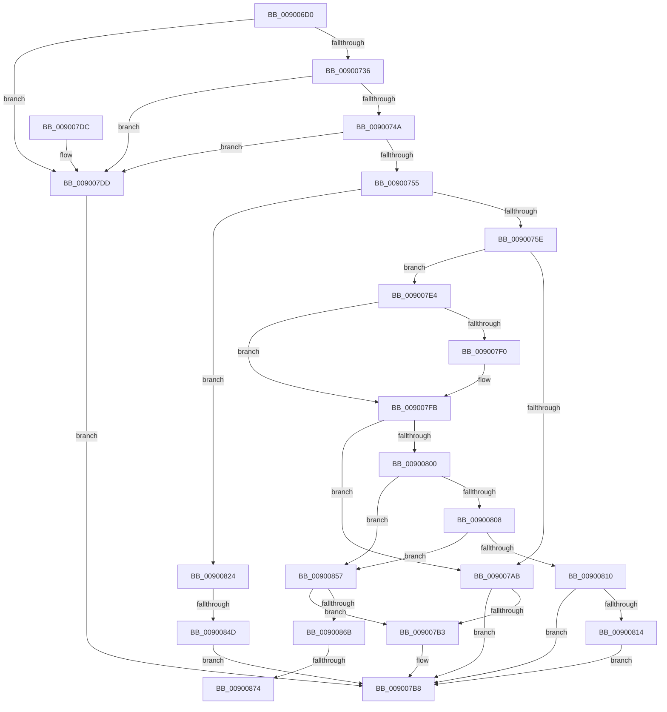

# PnpGetDevicePropertyData

- RVA: `0x009006D0`–`0x0090087D` (길이 `429` bytes)
- VA: `0x00000001409006D0`
- 실행 섹션: `PAGE`
- PDB 이름 있음: `예`; PDB Function 태그: `예`
- unwind 정보 RVA: `0x000884E0`
- 디코드: `106`개 명령, `429/429` bytes 표시
- 미해석 바이트: `0` (있으면 어셈블리에 `.byte`로 보존)

> 이 문서는 커널 이미지의 기계어와 PDB 기호를 분석해 생성했습니다. 4번과 5번은 함수 원형과 자료형을 바이너리 사용 방식에서 추정한 C 해석이며 원본 소스 복구 결과는 아닙니다.

## 1. Dependencies

- 직접 호출 지점: **5**; 고유 호출 대상: **5**
- 직접 호출자로 확인된 함수: **1**
- RIP 상대 이미지 참조: **4**

### Outgoing calls
- `0x00900722` → [memset](../../text/6C/memset_function_006C6C40.md) (function, `0x006C6C40`)
- `0x0090079D` → [PnpGetObjectProperty](../8E/PnpGetObjectProperty_function_008E2180.md) (function, `0x008E2180`)
- `0x009007C5` → [_security_check_cookie](../../text/6A/_security_check_cookie_function_006AC640.md) (function, `0x006AC640`)
- `0x0090081D` → [PnpCompareInterruptInformation](PnpCompareInterruptInformation_function_009013F0.md) (function, `0x009013F0`)
- `0x00900840` → [RtlLCIDToCultureName](../AD/RtlLCIDToCultureName_function_00AD3010.md) (function, `0x00AD3010`)

### Direct callers
- [IoGetDevicePropertyData](IoGetDevicePropertyData_function_009005E0.md) at `0x00900648`

### Static image references
- `0x009006E2` → RVA `0x00E0A740` (`.data`; read)
- `0x00900774` → RVA `0x00E66398` (`.data`; read)
- `0x009007E7` → RVA `0x00011710` (`.rdata`; read)
- `0x009007F4` → RVA `0x00011718` (`.rdata`; read)

## 2. Other-region calls and transfers

- 다른 실행 섹션으로 향하는 call: **2**
  - `0x00900722` → [memset](../../text/6C/memset_function_006C6C40.md) (`PAGE` → `.text`)
  - `0x009007C5` → [_security_check_cookie](../../text/6A/_security_check_cookie_function_006AC640.md) (`PAGE` → `.text`)
- call이 아닌 외부 분기/꼬리 이동: **3**
  - `0x00900847` → [sub_00B2012E](../B2/Unknown_function_00B2012E.md) (`tail-transfer`)
  - `0x0090086E` → [sub_00B2012E + 0xA](../B2/Unknown_function_00B2012E.md) (`tail-transfer`)
  - `0x00900878` → [sub_00B2012E + 0xA](../B2/Unknown_function_00B2012E.md) (`tail-transfer`)

## 3. Assembly (complete function range)

```asm
009006D0  40 53                           push rbx
009006D2  55                              push rbp
009006D3  56                              push rsi
009006D4  57                              push rdi
009006D5  41 54                           push r12
009006D7  41 56                           push r14
009006D9  41 57                           push r15
009006DB  48 81 EC 30 01 00 00            sub rsp, 0x130
009006E2  48 8B 05 57 A0 50 00            mov rax, qword ptr [rip + 0x50a057]
009006E9  48 33 C4                        xor rax, rsp
009006EC  48 89 84 24 20 01 00 00         mov qword ptr [rsp + 0x120], rax
009006F4  48 8B AC 24 98 01 00 00         mov rbp, qword ptr [rsp + 0x198]
009006FC  45 8B F8                        mov r15d, r8d
009006FF  48 8B BC 24 A0 01 00 00         mov rdi, qword ptr [rsp + 0x1a0]
00900707  4C 8B F2                        mov r14, rdx
0090070A  4C 8B A4 24 A8 01 00 00         mov r12, qword ptr [rsp + 0x1a8]
00900712  48 8B F1                        mov rsi, rcx
00900715  33 D2                           xor edx, edx
00900717  48 8D 4C 24 70                  lea rcx, [rsp + 0x70]
0090071C  41 B8 AA 00 00 00               mov r8d, 0xaa
00900722  E8 19 65 DC FF                  call 0x1406c6c40
00900727  48 83 64 24 60 00               and qword ptr [rsp + 0x60], 0
0090072D  48 85 F6                        test rsi, rsi
00900730  0F 84 A7 00 00 00               je 0x1409007dd
00900736  48 8B 86 38 01 00 00            mov rax, qword ptr [rsi + 0x138]
0090073D  48 8B 58 28                     mov rbx, qword ptr [rax + 0x28]
00900741  48 85 DB                        test rbx, rbx
00900744  0F 84 93 00 00 00               je 0x1409007dd
0090074A  48 83 7B 30 00                  cmp qword ptr [rbx + 0x30], 0
0090074F  0F 84 88 00 00 00               je 0x1409007dd
00900755  45 85 FF                        test r15d, r15d
00900758  0F 85 C6 00 00 00               jne 0x140900824
0090075E  33 C0                           xor eax, eax
00900760  83 64 24 50 00                  and dword ptr [rsp + 0x50], 0
00900765  45 33 C9                        xor r9d, r9d
00900768  44 8B BC 24 90 01 00 00         mov r15d, dword ptr [rsp + 0x190]
00900770  48 8B 53 30                     mov rdx, qword ptr [rbx + 0x30]
00900774  48 8B 0D 1D 5C 56 00            mov rcx, qword ptr [rip + 0x565c1d]
0090077B  48 89 7C 24 48                  mov qword ptr [rsp + 0x48], rdi
00900780  45 8D 41 01                     lea r8d, [r9 + 1]
00900784  44 89 7C 24 40                  mov dword ptr [rsp + 0x40], r15d
00900789  48 89 6C 24 38                  mov qword ptr [rsp + 0x38], rbp
0090078E  4C 89 64 24 30                  mov qword ptr [rsp + 0x30], r12
00900793  4C 89 74 24 28                  mov qword ptr [rsp + 0x28], r14
00900798  48 89 44 24 20                  mov qword ptr [rsp + 0x20], rax
0090079D  E8 DE 19 FE FF                  call 0x1408e2180
009007A2  41 83 7E 10 02                  cmp dword ptr [r14 + 0x10], 2
009007A7  8B D8                           mov ebx, eax
009007A9  74 39                           je 0x1409007e4
009007AB  81 FB 25 02 00 C0               cmp ebx, 0xc0000225
009007B1  75 05                           jne 0x1409007b8
009007B3  BB 34 00 00 C0                  mov ebx, 0xc0000034
009007B8  8B C3                           mov eax, ebx
009007BA  48 8B 8C 24 20 01 00 00         mov rcx, qword ptr [rsp + 0x120]
009007C2  48 33 CC                        xor rcx, rsp
009007C5  E8 76 BE DA FF                  call 0x1406ac640
009007CA  48 81 C4 30 01 00 00            add rsp, 0x130
009007D1  41 5F                           pop r15
009007D3  41 5E                           pop r14
009007D5  41 5C                           pop r12
009007D7  5F                              pop rdi
009007D8  5E                              pop rsi
009007D9  5D                              pop rbp
009007DA  5B                              pop rbx
009007DB  C3                              ret
009007DC  CC                              int3
009007DD  BB 10 00 00 C0                  mov ebx, 0xc0000010
009007E2  EB D4                           jmp 0x1409007b8
009007E4  49 8B 06                        mov rax, qword ptr [r14]
009007E7  48 2B 05 22 0F 71 FF            sub rax, qword ptr [rip - 0x8ef0de]
009007EE  75 0B                           jne 0x1409007fb
009007F0  49 8B 46 08                     mov rax, qword ptr [r14 + 8]
009007F4  48 2B 05 1D 0F 71 FF            sub rax, qword ptr [rip - 0x8ef0e3]
009007FB  48 85 C0                        test rax, rax
009007FE  75 AB                           jne 0x1409007ab
00900800  81 FB 34 00 00 C0               cmp ebx, 0xc0000034
00900806  74 4F                           je 0x140900857
00900808  81 FB 25 02 00 C0               cmp ebx, 0xc0000225
0090080E  74 47                           je 0x140900857
00900810  85 DB                           test ebx, ebx
00900812  75 A4                           jne 0x1409007b8
00900814  44 8B 07                        mov r8d, dword ptr [rdi]
00900817  48 8B D5                        mov rdx, rbp
0090081A  48 8B CE                        mov rcx, rsi
0090081D  E8 CE 0B 00 00                  call 0x1409013f0
00900822  EB 94                           jmp 0x1409007b8
00900824  48 8D 44 24 70                  lea rax, [rsp + 0x70]
00900829  41 8B CF                        mov ecx, r15d
0090082C  48 89 44 24 68                  mov qword ptr [rsp + 0x68], rax
00900831  48 8D 54 24 60                  lea rdx, [rsp + 0x60]
00900836  B8 AA 00 00 00                  mov eax, 0xaa
0090083B  66 89 44 24 62                  mov word ptr [rsp + 0x62], ax
00900840  E8 CB 27 1D 00                  call 0x140ad3010
00900845  84 C0                           test al, al
00900847  0F 85 E1 F8 21 00               jne 0x140b2012e
0090084D  BB 01 00 00 C0                  mov ebx, 0xc0000001
00900852  E9 61 FF FF FF                  jmp 0x1409007b8
00900857  48 8B 86 38 01 00 00            mov rax, qword ptr [rsi + 0x138]
0090085E  48 8B 50 58                     mov rdx, qword ptr [rax + 0x58]
00900862  48 85 D2                        test rdx, rdx
00900865  0F 84 48 FF FF FF               je 0x1409007b3
0090086B  48 85 FF                        test rdi, rdi
0090086E  0F 84 C4 F8 21 00               je 0x140b20138
00900874  8B 02                           mov eax, dword ptr [rdx]
00900876  89 07                           mov dword ptr [rdi], eax
00900878  E9 BB F8 21 00                  jmp 0x140b20138
```

## 4. C-style interpretation (structured pseudocode)

```c
__int64 __fastcall PnpGetDevicePropertyData(__int64 a1, __int64 a2, int a3, int a4, unsigned int a5, __int64 a6, __int64 a7, __int64 a8)
{
    __int64 result;
    __int64 v_rbx;
    __int64 v_rsp;
    unsigned __int64 v_stack_m108;
    unsigned int v_stack_m118;
    unsigned __int64 v_stack_m120;
    unsigned int v_stack_m128;
    unsigned __int64 v_stack_m130;
    unsigned __int64 v_stack_m138;
    unsigned __int64 v_stack_m140;
    unsigned __int64 v_stack_m148;
    unsigned __int64 v_stack_m48;
    unsigned __int64 v_stack_mF8;
    unsigned __int64 v_stack_p60;
    unsigned __int16 v_stack_p62;
    unsigned __int64 v_stack_p68;
    unsigned __int64 v_stack_p70;

    v_rsp = (v_rsp) - (304);
    result = (*(unsigned __int64 *)(v_rip + 5283927)) ^ (v_rsp);
    v_stack_m48 = result;
    a2 = 0;
    result = memset(v_stack_mF8, a2, 170, a4);
    if (a1 == 0) goto loc_009007DD;
    if (*(unsigned __int64 *)(*(unsigned __int64 *)(a1 + 312) + 40) == 0) goto loc_009007DD;
    if ((*(unsigned __int64 *)(*(unsigned __int64 *)(*(unsigned __int64 *)(a1 + 312) + 40) + 48)) == 0) goto loc_009007DD;
    if ((unsigned int)((unsigned int)(a3)) != 0) goto loc_00900824;
    result = 0;
    a4 = 0;
    v_stack_m120 = a7;
    v_stack_m128 = (unsigned int)((unsigned int)(a5));
    v_stack_m130 = a6;
    v_stack_m138 = a8;
    v_stack_m140 = 0;
    v_stack_m148 = 0;
    result = PnpGetObjectProperty(*(unsigned __int64 *)(v_rip + 5659677), *(unsigned __int64 *)(*(unsigned __int64 *)(*(unsigned __int64 *)(a1 + 312) + 40) + 48), a4 + 1, a4);
    if ((*(unsigned int *)(a2 + 16)) == 2) goto loc_009007E4;
loc_009007AB:
    v_rbx = (unsigned int)((unsigned int)(result));
    if (((unsigned int)((unsigned int)((unsigned int)(result)))) == 0xC0000225ULL) {
        v_rbx = 0xC0000034ULL;
    }
    a1 = (v_stack_m48) ^ (v_rsp);
    result = _security_check_cookie(a1, *(unsigned __int64 *)(*(unsigned __int64 *)(*(unsigned __int64 *)(a1 + 312) + 40) + 48), a4 + 1, a4);
    v_rsp = (v_rsp) + (304);
    return result;
loc_009007DD:
    goto loc_009007B8;
loc_009007E4:
    result = (*(unsigned __int64 *)(a2)) - (*(unsigned __int64 *)(v_rip - 9367774));
    if (!(condition_is_not_equal)) {
        result = *(unsigned __int64 *)(a2 + 8);
        result = (result) - (*(unsigned __int64 *)(v_rip - 9367779));
    }
    if (result != 0) goto loc_009007AB;
    if (((unsigned int)((unsigned int)(0xC0000010ULL))) == 0xC0000034ULL) goto loc_00900857;
    if (((unsigned int)((unsigned int)(0xC0000010ULL))) == 0xC0000225ULL) goto loc_00900857;
    if ((unsigned int)((unsigned int)(0xC0000010ULL)) != 0) goto loc_009007B8;
    result = PnpCompareInterruptInformation(a1, a6, (unsigned int)(*(unsigned int *)(a7)), a4);
    goto loc_009007B8;
loc_00900824:
    v_stack_p68 = v_stack_p70;
    v_stack_p62 = 170;
    result = RtlLCIDToCultureName((unsigned int)((unsigned int)((unsigned int)(a5))), v_stack_p60, (unsigned int)(*(unsigned int *)(a7)), a4);
    goto loc_009007B8;
loc_00900857:
    if (*(unsigned __int64 *)(*(unsigned __int64 *)(a1 + 312) + 88) == 0) goto loc_009007B3;
    *(unsigned int *)(a7) = (unsigned int)((unsigned int)(*(unsigned int *)(*(unsigned __int64 *)(*(unsigned __int64 *)(a1 + 312) + 88))));
}
```

## 5. (Beta) C Style

```c
int64_t PnpGetDevicePropertyData(int64_t Arg1, void *Arg2, int32_t Arg3, int32_t Arg4, uint32_t Arg5, int64_t Arg6, void *Arg7, int64_t Arg8)
{
    uint8_t *arg2 = (uint8_t *)Arg2;
    uint8_t *arg7 = (uint8_t *)Arg7;

    int64_t result;
    int64_t local_rbx;
    int64_t local_rsp;
    uint64_t v_stack_m108;
    uint32_t v_stack_m118;
    uint64_t v_stack_m120;
    uint32_t v_stack_m128;
    uint64_t v_stack_m130;
    uint64_t v_stack_m138;
    uint64_t v_stack_m140;
    uint64_t v_stack_m148;
    uint64_t v_stack_m48;
    uint64_t v_stack_mF8;
    uint64_t v_stack_p60;
    uint16_t v_stack_p62;
    uint64_t v_stack_p68;
    uint64_t v_stack_p70;

    local_rsp = (local_rsp) - (304);
    result = (*(uint64_t *)(v_rip + 0x50A057)) ^ (local_rsp);
    v_stack_m48 = result;
    Arg2 = 0;
    result = memset(v_stack_mF8, Arg2, 170, Arg4);
    if (Arg1 == 0) goto loc_009007DD;
    if (*(uint64_t *)(*(uint64_t *)(Arg1 + 0x138) + 0x28) == 0) goto loc_009007DD;
    if ((*(uint64_t *)(*(uint64_t *)(*(uint64_t *)(Arg1 + 0x138) + 0x28) + 0x30)) == 0) goto loc_009007DD;
    if ((uint32_t)((uint32_t)(Arg3)) != 0) goto loc_00900824;
    result = 0;
    Arg4 = 0;
    v_stack_m120 = Arg7;
    v_stack_m128 = (uint32_t)((uint32_t)(Arg5));
    v_stack_m130 = Arg6;
    v_stack_m138 = Arg8;
    v_stack_m140 = 0;
    v_stack_m148 = 0;
    result = PnpGetObjectProperty(*(uint64_t *)(v_rip + 0x565C1D), *(uint64_t *)(*(uint64_t *)(*(uint64_t *)(Arg1 + 0x138) + 0x28) + 0x30), Arg4 + 1, Arg4);
    if ((*(uint32_t *)(arg2 + 0x10)) == 2) goto loc_009007E4;
loc_009007AB:
    local_rbx = (uint32_t)((uint32_t)(result));
    if (((uint32_t)((uint32_t)((uint32_t)(result)))) == 0xC0000225ULL) {
        local_rbx = 0xC0000034ULL;
    }
    Arg1 = (v_stack_m48) ^ (local_rsp);
    result = _security_check_cookie(Arg1, *(uint64_t *)(*(uint64_t *)(*(uint64_t *)(Arg1 + 0x138) + 0x28) + 0x30), Arg4 + 1, Arg4);
    local_rsp = (local_rsp) + (304);
    return result;
loc_009007DD:
    goto loc_009007B8;
loc_009007E4:
    result = (*(uint64_t *)(arg2)) - (*(uint64_t *)(v_rip - 0x8EF0DE));
    if (!(condition_is_not_equal)) {
        result = *(uint64_t *)(arg2 + 0x8);
        result = (result) - (*(uint64_t *)(v_rip - 0x8EF0E3));
    }
    if (result != 0) goto loc_009007AB;
    if (((uint32_t)((uint32_t)(0xC0000010ULL))) == 0xC0000034ULL) goto loc_00900857;
    if (((uint32_t)((uint32_t)(0xC0000010ULL))) == 0xC0000225ULL) goto loc_00900857;
    if ((uint32_t)((uint32_t)(0xC0000010ULL)) != 0) goto loc_009007B8;
    result = PnpCompareInterruptInformation(Arg1, Arg6, (uint32_t)(*(uint32_t *)(arg7)), Arg4);
    goto loc_009007B8;
loc_00900824:
    v_stack_p68 = v_stack_p70;
    v_stack_p62 = 170;
    result = RtlLCIDToCultureName((uint32_t)((uint32_t)((uint32_t)(Arg5))), v_stack_p60, (uint32_t)(*(uint32_t *)(arg7)), Arg4);
    goto loc_009007B8;
loc_00900857:
    if (*(uint64_t *)(*(uint64_t *)(Arg1 + 0x138) + 0x58) == 0) goto loc_009007B3;
    *(uint32_t *)(arg7) = (uint32_t)((uint32_t)(*(uint32_t *)(*(uint64_t *)(*(uint64_t *)(Arg1 + 0x138) + 0x58))));
}
```

### 관측된 메모리 오프셋

구조체 형식이 확인되지 않은 접근은 인자 기준의 오프셋으로만 기록했습니다.

| 기준 인자 | 오프셋 표현 | 폭 (bit) | 접근 |
|---|---:|---:|---|
| `Arg2` | `+ 0x0` | `64` | `R` |
| `Arg2` | `+ 0x8` | `64` | `R` |
| `Arg2` | `+ 0x10` | `32` | `R` |
| `Arg7` | `+ 0x0` | `32` | `R` |

## 6. Execution-region graph

[열기: 2D/3D 그래프와 함수 탐색 컨트롤 패널](../../../control-panel.html?section=page&rva=0x009006D0&view=graph)

- 2D 그래프는 위에서 아래로 흐르고, 3D 그래프는 빈 공간을 드래그해 회전합니다. Shift+드래그는 이동, 휠은 확대·축소, 함수 노드 선택은 대상 보고서 이동입니다.

### Static fallback


