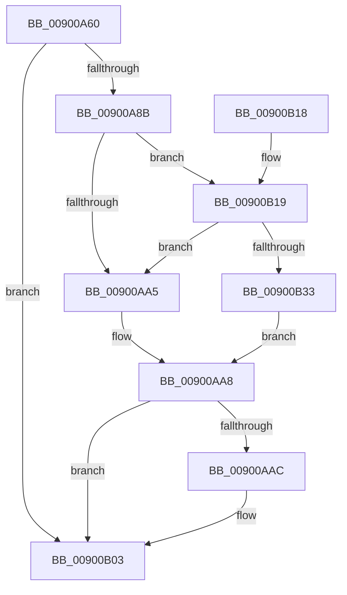

# PnpTraceInterruptConnection

- RVA: `0x00900A60`–`0x00900B38` (길이 `216` bytes)
- VA: `0x0000000140900A60`
- 실행 섹션: `PAGE`
- PDB 이름 있음: `예`; PDB Function 태그: `아니요`
- unwind 정보 RVA: `0x00088544`
- 디코드: `47`개 명령, `216/216` bytes 표시
- 미해석 바이트: `0` (있으면 어셈블리에 `.byte`로 보존)

> 이 문서는 커널 이미지의 기계어와 PDB 기호를 분석해 생성했습니다. 4번과 5번은 함수 원형과 자료형을 바이너리 사용 방식에서 추정한 C 해석이며 원본 소스 복구 결과는 아닙니다.

## 1. Dependencies

- 직접 호출 지점: **2**; 고유 호출 대상: **2**
- 직접 호출자로 확인된 함수: **2**
- RIP 상대 이미지 참조: **5**

### Outgoing calls
- `0x00900AFE` → [tlgWriteAgg](../../text/2F/tlgWriteAgg_function_002F0F7C.md) (function, `0x002F0F7C`)
- `0x00900B0A` → [_security_check_cookie](../../text/6A/_security_check_cookie_function_006AC640.md) (function, `0x006AC640`)

### Direct callers
- [IoDisconnectInterrupt](IoDisconnectInterrupt_function_00900890.md) at `0x00900A03`
- [IopConnectInterrupt](IopConnectInterrupt_function_00900B40.md) at `0x00900D68`

### Static image references
- `0x00900A6E` → RVA `0x00E0A740` (`.data`; read)
- `0x00900A82` → RVA `0x00E06F90` (`.data`; read)
- `0x00900A9C` → RVA `0x00E06FA0` (`.data`; read)
- `0x00900AB7` → RVA `0x00046EA9` (`.rdata`; read)
- `0x00900B19` → RVA `0x00E06FA8` (`.data`; read)

## 2. Other-region calls and transfers

- 다른 실행 섹션으로 향하는 call: **2**
  - `0x00900AFE` → [tlgWriteAgg](../../text/2F/tlgWriteAgg_function_002F0F7C.md) (`PAGE` → `.text`)
  - `0x00900B0A` → [_security_check_cookie](../../text/6A/_security_check_cookie_function_006AC640.md) (`PAGE` → `.text`)
- 별도 외부 분기/꼬리 이동을 확인하지 못했습니다.

## 3. Assembly (complete function range)

```asm
00900A60  40 55                           push rbp
00900A62  48 8D 6C 24 A9                  lea rbp, [rsp - 0x57]
00900A67  48 81 EC B0 00 00 00            sub rsp, 0xb0
00900A6E  48 8B 05 CB 9C 50 00            mov rax, qword ptr [rip + 0x509ccb]
00900A75  48 33 C4                        xor rax, rsp
00900A78  48 89 45 47                     mov qword ptr [rbp + 0x47], rax
00900A7C  41 B9 05 00 00 00               mov r9d, 5
00900A82  44 39 0D 07 65 50 00            cmp dword ptr [rip + 0x506507], r9d
00900A89  76 78                           jbe 0x140900b03
00900A8B  49 BA 00 00 00 00 00 40 00 00   movabs r10, 0x400000000000
00900A95  45 8D 59 FC                     lea r11d, [r9 - 4]
00900A99  45 33 C0                        xor r8d, r8d
00900A9C  4C 85 15 FD 64 50 00            test qword ptr [rip + 0x5064fd], r10
00900AA3  75 74                           jne 0x140900b19
00900AA5  41 8A C0                        mov al, r8b
00900AA8  84 C0                           test al, al
00900AAA  74 57                           je 0x140900b03
00900AAC  48 8D 45 DF                     lea rax, [rbp - 0x21]
00900AB0  88 4D D7                        mov byte ptr [rbp - 0x29], cl
00900AB3  48 89 45 17                     mov qword ptr [rbp + 0x17], rax
00900AB7  48 8D 15 EB 63 74 FF            lea rdx, [rip - 0x8b9c15]
00900ABE  48 8D 45 D7                     lea rax, [rbp - 0x29]
00900AC2  4C 89 5D DF                     mov qword ptr [rbp - 0x21], r11
00900AC6  48 89 45 27                     mov qword ptr [rbp + 0x27], rax
00900ACA  48 8D 0D BF 64 50 00            lea rcx, [rip + 0x5064bf]
00900AD1  48 8D 45 E7                     lea rax, [rbp - 0x19]
00900AD5  48 C7 45 1F 08 00 00 00         mov qword ptr [rbp + 0x1f], 8
00900ADD  48 89 45 37                     mov qword ptr [rbp + 0x37], rax
00900AE1  48 8D 45 F7                     lea rax, [rbp - 9]
00900AE5  48 89 44 24 20                  mov qword ptr [rsp + 0x20], rax
00900AEA  4C 89 5D 2F                     mov qword ptr [rbp + 0x2f], r11
00900AEE  48 C7 45 E7 00 00 00 01         mov qword ptr [rbp - 0x19], 0x1000000
00900AF6  48 C7 45 3F 08 00 00 00         mov qword ptr [rbp + 0x3f], 8
00900AFE  E8 79 04 9F FF                  call 0x1402f0f7c
00900B03  48 8B 4D 47                     mov rcx, qword ptr [rbp + 0x47]
00900B07  48 33 CC                        xor rcx, rsp
00900B0A  E8 31 BB DA FF                  call 0x1406ac640
00900B0F  48 81 C4 B0 00 00 00            add rsp, 0xb0
00900B16  5D                              pop rbp
00900B17  C3                              ret
00900B18  CC                              int3
00900B19  48 8B 05 88 64 50 00            mov rax, qword ptr [rip + 0x506488]
00900B20  49 23 C2                        and rax, r10
00900B23  48 3B 05 7E 64 50 00            cmp rax, qword ptr [rip + 0x50647e]
00900B2A  41 8A C3                        mov al, r11b
00900B2D  0F 85 72 FF FF FF               jne 0x140900aa5
00900B33  E9 70 FF FF FF                  jmp 0x140900aa8
```

## 4. C-style interpretation (structured pseudocode)

```c
__int64 __fastcall PnpTraceInterruptConnection(unsigned __int8 a1, __int64 a2, int a3)
{
    __int64 result;
    __int64 v_rsp;
    unsigned __int64 v_stack_m18;
    unsigned __int64 v_stack_m20;
    unsigned __int64 v_stack_m28;
    unsigned __int64 v_stack_m30;
    unsigned __int64 v_stack_m38;
    unsigned __int64 v_stack_m40;
    unsigned __int64 v_stack_m48;
    unsigned __int64 v_stack_m5F;
    unsigned __int64 v_stack_m68;
    unsigned __int64 v_stack_m78;
    unsigned __int64 v_stack_m80;
    unsigned __int8 v_stack_m88;
    unsigned __int64 v_stack_m98;

    v_rsp = (v_rsp) - (176);
    result = (*(unsigned __int64 *)(v_rip + 5283019)) ^ (v_rsp);
    v_stack_m18 = result;
    if ((*(unsigned int *)(v_rip + 5268743)) <= 5) goto loc_00900B03;
    a3 = 0;
    if (((*(unsigned __int64 *)(v_rip + 5268733)) & (v_r10)) != 0) goto loc_00900B19;
loc_00900AA5:
loc_00900AA8:
    result = 0;
    if (0 != 0) {
        result = v_stack_m80;
        v_stack_m88 = a1;
        v_stack_m48 = result;
        a2 = v_rip - 9149461;
        result = v_stack_m88;
        v_stack_m80 = 5 - 4;
        v_stack_m38 = result;
        a1 = v_rip + 5268671;
        result = v_stack_m78;
        v_stack_m40 = 8;
        v_stack_m28 = result;
        result = v_stack_m68;
        v_stack_m98 = result;
        v_stack_m30 = 5 - 4;
        v_stack_m78 = 0x1000000ULL;
        v_stack_m20 = 8;
        result = tlgWriteAgg(a1, a2, a3, 5);
    }
    a1 = (v_stack_m18) ^ (v_rsp);
    result = _security_check_cookie(a1, a2, a3, 5);
    v_rsp = (v_rsp) + (176);
    return result;
loc_00900B19:
    result = (*(unsigned __int64 *)(v_rip + 5268616)) & (v_r10);
    if (result != (*(unsigned __int64 *)(v_rip + 5268606))) goto loc_00900AA5;
    goto loc_00900AA8;
}
```

## 5. (Beta) C Style

```c
int64_t PnpTraceInterruptConnection(uint8_t Arg1, int64_t Arg2, int32_t Arg3)
{
    int64_t result;
    int64_t local_rsp;
    uint64_t v_stack_m18;
    uint64_t v_stack_m20;
    uint64_t v_stack_m28;
    uint64_t v_stack_m30;
    uint64_t v_stack_m38;
    uint64_t v_stack_m40;
    uint64_t v_stack_m48;
    uint64_t v_stack_m5F;
    uint64_t v_stack_m68;
    uint64_t v_stack_m78;
    uint64_t v_stack_m80;
    uint8_t v_stack_m88;
    uint64_t v_stack_m98;

    local_rsp = (local_rsp) - (176);
    result = (*(uint64_t *)(v_rip + 0x509CCB)) ^ (local_rsp);
    v_stack_m18 = result;
    if ((*(uint32_t *)(v_rip + 0x506507)) <= 5) goto loc_00900B03;
    Arg3 = 0;
    if (((*(uint64_t *)(v_rip + 0x5064FD)) & (local_r10)) != 0) goto loc_00900B19;
loc_00900AA5:
loc_00900AA8:
    result = 0;
    if (0 != 0) {
        result = v_stack_m80;
        v_stack_m88 = Arg1;
        v_stack_m48 = result;
        Arg2 = v_rip - 9149461;
        result = v_stack_m88;
        v_stack_m80 = 5 - 4;
        v_stack_m38 = result;
        Arg1 = v_rip + 5268671;
        result = v_stack_m78;
        v_stack_m40 = 8;
        v_stack_m28 = result;
        result = v_stack_m68;
        v_stack_m98 = result;
        v_stack_m30 = 5 - 4;
        v_stack_m78 = 0x1000000ULL;
        v_stack_m20 = 8;
        result = tlgWriteAgg(Arg1, Arg2, Arg3, 5);
    }
    Arg1 = (v_stack_m18) ^ (local_rsp);
    result = _security_check_cookie(Arg1, Arg2, Arg3, 5);
    local_rsp = (local_rsp) + (176);
    return result;
loc_00900B19:
    result = (*(uint64_t *)(v_rip + 0x506488)) & (local_r10);
    if (result != (*(uint64_t *)(v_rip + 0x50647E))) goto loc_00900AA5;
    goto loc_00900AA8;
}
```

## 6. Execution-region graph

[열기: 2D/3D 그래프와 함수 탐색 컨트롤 패널](../../../control-panel.html?section=page&rva=0x00900A60&view=graph)

- 2D 그래프는 위에서 아래로 흐르고, 3D 그래프는 빈 공간을 드래그해 회전합니다. Shift+드래그는 이동, 휠은 확대·축소, 함수 노드 선택은 대상 보고서 이동입니다.

### Static fallback


