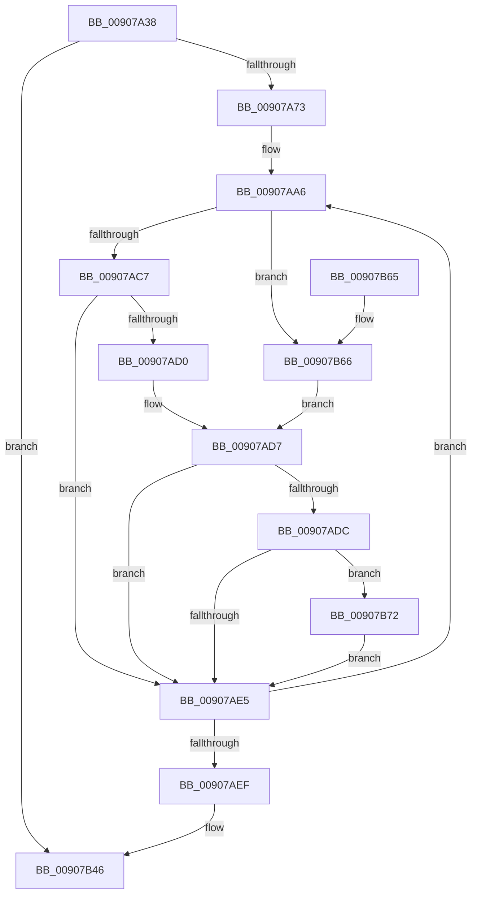

# PoEnergyContextCleanup

- RVA: `0x00907A38`–`0x00907B89` (길이 `337` bytes)
- VA: `0x0000000140907A38`
- 실행 섹션: `PAGE`
- PDB 이름 있음: `예`; PDB Function 태그: `아니요`
- unwind 정보 RVA: `0x00088DF8`
- 디코드: `83`개 명령, `337/337` bytes 표시
- 미해석 바이트: `0` (있으면 어셈블리에 `.byte`로 보존)

> 이 문서는 커널 이미지의 기계어와 PDB 기호를 분석해 생성했습니다. 4번과 5번은 함수 원형과 자료형을 바이너리 사용 방식에서 추정한 C 해석이며 원본 소스 복구 결과는 아닙니다.

## 1. Dependencies

- 직접 호출 지점: **8**; 고유 호출 대상: **7**
- 직접 호출자로 확인된 함수: **1**
- RIP 상대 이미지 참조: **0**

### Outgoing calls
- `0x00907A94` → [KeQueryTimelineBitmapTime](../../text/45/KeQueryTimelineBitmapTime_function_0045D2CC.md) (function, `0x0045D2CC`)
- `0x00907AB6` → [RtlStateDurationCapture](../../text/41/RtlStateDurationCapture_function_004173B0.md) (function, `0x004173B0`)
- `0x00907AFC` → [RtlStateDurationCapture](../../text/41/RtlStateDurationCapture_function_004173B0.md) (function, `0x004173B0`)
- `0x00907B27` → [PopAcquireRwLockExclusive](../../text/43/PopAcquireRwLockExclusive_function_00430B44.md) (function, `0x00430B44`)
- `0x00907B31` → [PopEtEnumEnergyTrackers](../98/PopEtEnumEnergyTrackers_function_0098D150.md) (function, `0x0098D150`)
- `0x00907B39` → [PopReleaseRwLock](../../text/2D/PopReleaseRwLock_function_002DFBBC.md) (function, `0x002DFBBC`)
- `0x00907B41` → [PopEtEnergyContextCleanup](../98/PopEtEnergyContextCleanup_function_0098C9B4.md) (function, `0x0098C9B4`)
- `0x00907B7F` → [RtlTimelineBitmapUpdateRange](../../text/43/RtlTimelineBitmapUpdateRange_function_00437C30.md) (function, `0x00437C30`)

### Direct callers
- [PspProcessDelete](PspProcessDelete_function_00907B90.md) at `0x00907E9E`

### Static image references
- 디코드된 RIP-relative 메모리 참조가 없습니다.

## 2. Other-region calls and transfers

- 다른 실행 섹션으로 향하는 call: **6**
  - `0x00907A94` → [KeQueryTimelineBitmapTime](../../text/45/KeQueryTimelineBitmapTime_function_0045D2CC.md) (`PAGE` → `.text`)
  - `0x00907AB6` → [RtlStateDurationCapture](../../text/41/RtlStateDurationCapture_function_004173B0.md) (`PAGE` → `.text`)
  - `0x00907AFC` → [RtlStateDurationCapture](../../text/41/RtlStateDurationCapture_function_004173B0.md) (`PAGE` → `.text`)
  - `0x00907B27` → [PopAcquireRwLockExclusive](../../text/43/PopAcquireRwLockExclusive_function_00430B44.md) (`PAGE` → `.text`)
  - `0x00907B39` → [PopReleaseRwLock](../../text/2D/PopReleaseRwLock_function_002DFBBC.md) (`PAGE` → `.text`)
  - `0x00907B7F` → [RtlTimelineBitmapUpdateRange](../../text/43/RtlTimelineBitmapUpdateRange_function_00437C30.md) (`PAGE` → `.text`)
- 별도 외부 분기/꼬리 이동을 확인하지 못했습니다.

## 3. Assembly (complete function range)

```asm
00907A38  48 8B C4                        mov rax, rsp
00907A3B  48 89 58 08                     mov qword ptr [rax + 8], rbx
00907A3F  48 89 68 10                     mov qword ptr [rax + 0x10], rbp
00907A43  48 89 70 18                     mov qword ptr [rax + 0x18], rsi
00907A47  48 89 78 20                     mov qword ptr [rax + 0x20], rdi
00907A4B  41 54                           push r12
00907A4D  41 56                           push r14
00907A4F  41 57                           push r15
00907A51  48 83 EC 40                     sub rsp, 0x40
00907A55  48 8B B9 68 06 00 00            mov rdi, qword ptr [rcx + 0x668]
00907A5C  0F 57 C0                        xorps xmm0, xmm0
00907A5F  48 8B E9                        mov rbp, rcx
00907A62  0F 11 40 C8                     movups xmmword ptr [rax - 0x38], xmm0
00907A66  0F 11 40 D8                     movups xmmword ptr [rax - 0x28], xmm0
00907A6A  48 85 FF                        test rdi, rdi
00907A6D  0F 84 D3 00 00 00               je 0x140907b46
00907A73  48 B8 20 03 00 00 80 F7 FF FF   movabs rax, 0xfffff78000000320
00907A7D  48 B9 04 00 00 00 80 F7 FF FF   movabs rcx, 0xfffff78000000004
00907A87  48 8B 00                        mov rax, qword ptr [rax]
00907A8A  8B 19                           mov ebx, dword ptr [rcx]
00907A8C  48 0F AF D8                     imul rbx, rax
00907A90  48 C1 EB 18                     shr rbx, 0x18
00907A94  E8 33 58 B5 FF                  call 0x14045d2cc
00907A99  33 F6                           xor esi, esi
00907A9B  4C 8D 67 68                     lea r12, [rdi + 0x68]
00907A9F  44 8B F8                        mov r15d, eax
00907AA2  44 8D 76 03                     lea r14d, [rsi + 3]
00907AA6  4C 8D 5F 68                     lea r11, [rdi + 0x68]
00907AAA  44 8B C3                        mov r8d, ebx
00907AAD  4C 03 DE                        add r11, rsi
00907AB0  49 8B D3                        mov rdx, r11
00907AB3  49 8B CB                        mov rcx, r11
00907AB6  E8 F5 F8 B0 FF                  call 0x1404173b0
00907ABB  44 8B C0                        mov r8d, eax
00907ABE  4D 3B DC                        cmp r11, r12
00907AC1  0F 84 9F 00 00 00               je 0x140907b66
00907AC7  48 8D 47 70                     lea rax, [rdi + 0x70]
00907ACB  4C 3B D8                        cmp r11, rax
00907ACE  75 15                           jne 0x140907ae5
00907AD0  48 8D 8F 38 01 00 00            lea rcx, [rdi + 0x138]
00907AD7  48 85 C9                        test rcx, rcx
00907ADA  74 09                           je 0x140907ae5
00907ADC  45 85 C0                        test r8d, r8d
00907ADF  0F 85 8D 00 00 00               jne 0x140907b72
00907AE5  48 83 C6 08                     add rsi, 8
00907AE9  49 83 EE 01                     sub r14, 1
00907AED  75 B7                           jne 0x140907aa6
00907AEF  48 8D 8F A0 01 00 00            lea rcx, [rdi + 0x1a0]
00907AF6  44 8B C3                        mov r8d, ebx
00907AF9  48 8B D1                        mov rdx, rcx
00907AFC  E8 AF F8 B0 FF                  call 0x1404173b0
00907B01  44 21 74 24 24                  and dword ptr [rsp + 0x24], r14d
00907B06  48 8D 9F B8 01 00 00            lea rbx, [rdi + 0x1b8]
00907B0D  4C 21 74 24 30                  and qword ptr [rsp + 0x30], r14
00907B12  48 8B CB                        mov rcx, rbx
00907B15  C7 44 24 20 04 00 00 00         mov dword ptr [rsp + 0x20], 4
00907B1D  48 89 7C 24 38                  mov qword ptr [rsp + 0x38], rdi
00907B22  48 89 6C 24 28                  mov qword ptr [rsp + 0x28], rbp
00907B27  E8 18 90 B2 FF                  call 0x140430b44
00907B2C  48 8D 54 24 20                  lea rdx, [rsp + 0x20]
00907B31  E8 1A 56 08 00                  call 0x14098d150
00907B36  48 8B CB                        mov rcx, rbx
00907B39  E8 7E 80 9D FF                  call 0x1402dfbbc
00907B3E  48 8B CF                        mov rcx, rdi
00907B41  E8 6E 4E 08 00                  call 0x14098c9b4
00907B46  48 8B 5C 24 60                  mov rbx, qword ptr [rsp + 0x60]
00907B4B  48 8B 6C 24 68                  mov rbp, qword ptr [rsp + 0x68]
00907B50  48 8B 74 24 70                  mov rsi, qword ptr [rsp + 0x70]
00907B55  48 8B 7C 24 78                  mov rdi, qword ptr [rsp + 0x78]
00907B5A  48 83 C4 40                     add rsp, 0x40
00907B5E  41 5F                           pop r15
00907B60  41 5E                           pop r14
00907B62  41 5C                           pop r12
00907B64  C3                              ret
00907B65  CC                              int3
00907B66  48 8D 8F 30 01 00 00            lea rcx, [rdi + 0x130]
00907B6D  E9 65 FF FF FF                  jmp 0x140907ad7
00907B72  41 C1 E8 0C                     shr r8d, 0xc
00907B76  41 8B D7                        mov edx, r15d
00907B79  41 2B D0                        sub edx, r8d
00907B7C  45 8B C7                        mov r8d, r15d
00907B7F  E8 AC 00 B3 FF                  call 0x140437c30
00907B84  E9 5C FF FF FF                  jmp 0x140907ae5
```

## 4. C-style interpretation (structured pseudocode)

```c
__int64 __fastcall PoEnergyContextCleanup(__int64 a1)
{
    __int64 result;
    __int64 v_r11;
    __int64 v_r14;
    __int64 v_rbx;
    __int64 v_rsi;
    __int64 v_rsp;
    unsigned __int64 v_stack_m20;
    unsigned __int64 v_stack_m28;
    unsigned __int64 v_stack_m30;
    unsigned int v_stack_m34;
    unsigned int v_stack_m38;
    unsigned __int64 v_stack_p10;
    unsigned __int64 v_stack_p18;
    unsigned __int64 v_stack_p20;
    unsigned __int64 v_stack_p8;

    *(unsigned __int64 *)(v_rsp + 8) = v_rbx;
    *(unsigned __int64 *)(v_rsp + 16) = v_rbp;
    *(unsigned __int64 *)(v_rsp + 24) = v_rsi;
    *(unsigned __int64 *)(v_rsp + 32) = v_rdi;
    v_rsp = (v_rsp) - (64);
    *(unsigned __int64 *)(v_rsp - 56) = v_xmm0;
    *(unsigned __int64 *)(v_rsp - 40) = v_xmm0;
    if (*(unsigned __int64 *)(a1 + 1640) == 0) goto loc_00907B46;
    v_rbx = ((unsigned int)(*(unsigned int *)(a1))) * (*(unsigned __int64 *)(v_rsp));
    v_rbx = (v_rbx) >> (24);
    result = KeQueryTimelineBitmapTime(a1, a2, a3, a4);
    v_rsi = 0;
loc_00907AA6:
    v_r11 = (*(unsigned __int64 *)(a1 + 1640) + 104) + (0);
    result = RtlStateDurationCapture(v_r11, v_r11, (unsigned int)((unsigned int)(v_rbx)), a4);
    if (v_r11 == (*(unsigned __int64 *)(a1 + 1640) + 104)) goto loc_00907B66;
    if (v_r11 != (*(unsigned __int64 *)(a1 + 1640) + 112)) goto loc_00907AE5;
loc_00907AD7:
    if (*(unsigned __int64 *)(a1 + 1640) + 312 == 0) goto loc_00907AE5;
    if ((unsigned int)((unsigned int)((unsigned int)(result))) != 0) goto loc_00907B72;
loc_00907AE5:
    v_rsi = (v_rsi) + (8);
    v_r14 = (v_rsi + 3) - (1);
    if (condition_is_not_equal) goto loc_00907AA6;
    result = RtlStateDurationCapture(*(unsigned __int64 *)(a1 + 1640) + 416, *(unsigned __int64 *)(a1 + 1640) + 416, (unsigned int)((unsigned int)(v_rbx)), a4);
    v_stack_m38 = 4;
    v_stack_m20 = *(unsigned __int64 *)(a1 + 1640);
    v_stack_m30 = a1;
    result = PopAcquireRwLockExclusive(*(unsigned __int64 *)(a1 + 1640) + 440, *(unsigned __int64 *)(a1 + 1640) + 416, (unsigned int)((unsigned int)(v_rbx)), a4);
    result = PopEtEnumEnergyTrackers(*(unsigned __int64 *)(a1 + 1640) + 440, v_stack_m38, (unsigned int)((unsigned int)(v_rbx)), a4);
    result = PopReleaseRwLock(*(unsigned __int64 *)(a1 + 1640) + 440, v_stack_m38, (unsigned int)((unsigned int)(v_rbx)), a4);
    result = PopEtEnergyContextCleanup(*(unsigned __int64 *)(a1 + 1640), v_stack_m38, (unsigned int)((unsigned int)(v_rbx)), a4);
loc_00907B46:
    v_rsp = (v_rsp) + (64);
    return result;
loc_00907B66:
    goto loc_00907AD7;
loc_00907B72:
    a3 = (unsigned int)(((unsigned int)((unsigned int)(v_rbx))) >> (12));
    a2 = (unsigned int)(((unsigned int)((unsigned int)((unsigned int)((unsigned int)(result))))) - ((unsigned int)(a3)));
    result = RtlTimelineBitmapUpdateRange(v_stack_p20 + 304, a2, (unsigned int)((unsigned int)((unsigned int)((unsigned int)(result)))), a4);
    goto loc_00907AE5;
}
```

## 5. (Beta) C Style

```c
int64_t PoEnergyContextCleanup(void *Arg1)
{
    uint8_t *arg1 = (uint8_t *)Arg1;

    int64_t result;
    int64_t local_r11;
    int64_t local_r14;
    int64_t local_rbx;
    int64_t local_rsi;
    int64_t local_rsp;
    uint64_t v_stack_m20;
    uint64_t v_stack_m28;
    uint64_t v_stack_m30;
    uint32_t v_stack_m34;
    uint32_t v_stack_m38;
    uint64_t v_stack_p10;
    uint64_t v_stack_p18;
    uint64_t v_stack_p20;
    uint64_t v_stack_p8;

    *(uint64_t *)(local_rsp + 0x8) = local_rbx;
    *(uint64_t *)(local_rsp + 0x10) = local_rbp;
    *(uint64_t *)(local_rsp + 0x18) = local_rsi;
    *(uint64_t *)(local_rsp + 0x20) = local_rdi;
    local_rsp = (local_rsp) - (64);
    *(uint64_t *)(local_rsp - 0x38) = v_xmm0;
    *(uint64_t *)(local_rsp - 0x28) = v_xmm0;
    if (*(uint64_t *)(arg1 + 0x668) == 0) goto loc_00907B46;
    local_rbx = ((uint32_t)(*(uint32_t *)(arg1))) * (*(uint64_t *)(local_rsp));
    local_rbx = (local_rbx) >> (24);
    result = KeQueryTimelineBitmapTime(Arg1, a2, a3, a4);
    local_rsi = 0;
loc_00907AA6:
    local_r11 = (*(uint64_t *)(arg1 + 0x668) + 104) + (0);
    result = RtlStateDurationCapture(local_r11, local_r11, (uint32_t)((uint32_t)(local_rbx)), a4);
    if (local_r11 == (*(uint64_t *)(arg1 + 0x668) + 104)) goto loc_00907B66;
    if (local_r11 != (*(uint64_t *)(arg1 + 0x668) + 112)) goto loc_00907AE5;
loc_00907AD7:
    if (*(uint64_t *)(arg1 + 0x668) + 312 == 0) goto loc_00907AE5;
    if ((uint32_t)((uint32_t)((uint32_t)(result))) != 0) goto loc_00907B72;
loc_00907AE5:
    local_rsi = (local_rsi) + (8);
    local_r14 = (local_rsi + 3) - (1);
    if (condition_is_not_equal) goto loc_00907AA6;
    result = RtlStateDurationCapture(*(uint64_t *)(arg1 + 0x668) + 416, *(uint64_t *)(arg1 + 0x668) + 416, (uint32_t)((uint32_t)(local_rbx)), a4);
    v_stack_m38 = 4;
    v_stack_m20 = *(uint64_t *)(arg1 + 0x668);
    v_stack_m30 = Arg1;
    result = PopAcquireRwLockExclusive(*(uint64_t *)(arg1 + 0x668) + 440, *(uint64_t *)(arg1 + 0x668) + 416, (uint32_t)((uint32_t)(local_rbx)), a4);
    result = PopEtEnumEnergyTrackers(*(uint64_t *)(arg1 + 0x668) + 440, v_stack_m38, (uint32_t)((uint32_t)(local_rbx)), a4);
    result = PopReleaseRwLock(*(uint64_t *)(arg1 + 0x668) + 440, v_stack_m38, (uint32_t)((uint32_t)(local_rbx)), a4);
    result = PopEtEnergyContextCleanup(*(uint64_t *)(arg1 + 0x668), v_stack_m38, (uint32_t)((uint32_t)(local_rbx)), a4);
loc_00907B46:
    local_rsp = (local_rsp) + (64);
    return result;
loc_00907B66:
    goto loc_00907AD7;
loc_00907B72:
    a3 = (uint32_t)(((uint32_t)((uint32_t)(local_rbx))) >> (12));
    a2 = (uint32_t)(((uint32_t)((uint32_t)((uint32_t)((uint32_t)(result))))) - ((uint32_t)(a3)));
    result = RtlTimelineBitmapUpdateRange(v_stack_p20 + 304, a2, (uint32_t)((uint32_t)((uint32_t)((uint32_t)(result)))), a4);
    goto loc_00907AE5;
}
```

### 관측된 메모리 오프셋

구조체 형식이 확인되지 않은 접근은 인자 기준의 오프셋으로만 기록했습니다.

| 기준 인자 | 오프셋 표현 | 폭 (bit) | 접근 |
|---|---:|---:|---|
| `Arg1` | `+ 0x668` | `64` | `R` |

## 6. Execution-region graph

[열기: 2D/3D 그래프와 함수 탐색 컨트롤 패널](../../../control-panel.html?section=page&rva=0x00907A38&view=graph)

- 2D 그래프는 위에서 아래로 흐르고, 3D 그래프는 빈 공간을 드래그해 회전합니다. Shift+드래그는 이동, 휠은 확대·축소, 함수 노드 선택은 대상 보고서 이동입니다.

### Static fallback


