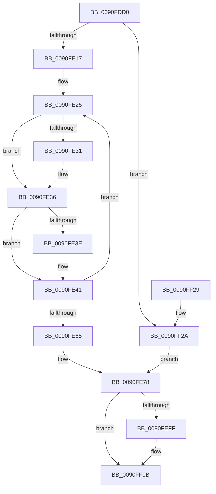

# PopBatteryUpdateCompositeInformation

- RVA: `0x0090FDD0`–`0x0090FF40` (길이 `368` bytes)
- VA: `0x000000014090FDD0`
- 실행 섹션: `PAGE`
- PDB 이름 있음: `예`; PDB Function 태그: `아니요`
- unwind 정보 RVA: `0x0008A07C`
- 디코드: `91`개 명령, `368/368` bytes 표시
- 미해석 바이트: `0` (있으면 어셈블리에 `.byte`로 보존)

> 이 문서는 커널 이미지의 기계어와 PDB 기호를 분석해 생성했습니다. 4번과 5번은 함수 원형과 자료형을 바이너리 사용 방식에서 추정한 C 해석이며 원본 소스 복구 결과는 아닙니다.

## 1. Dependencies

- 직접 호출 지점: **4**; 고유 호출 대상: **4**
- 직접 호출자로 확인된 함수: **1**
- RIP 상대 이미지 참조: **7**

### Outgoing calls
- `0x0090FEEC` → [DbgPrintEx](../../text/35/DbgPrintEx_function_00359290.md) (function, `0x00359290`)
- `0x0090FEF1` → [PopAcquirePolicyLock](../../pagelk/B7/PopAcquirePolicyLock_function_00B783C0.md) (function, `0x00B783C0`)
- `0x0090FF06` → [PopResetCurrentPolicies](PopResetCurrentPolicies_function_0090FF64.md) (function, `0x0090FF64`)
- `0x0090FF0B` → [PopReleasePolicyLock](../../pagelk/B7/PopReleasePolicyLock_function_00B78410.md) (function, `0x00B78410`)

### Direct callers
- [PopBatteryWorker](../AE/PopBatteryWorker_function_00AE1650.md) at `0x00AE1CAB`

### Static image references
- `0x0090FDEA` → RVA `0x00F0C050` (`.data`; read)
- `0x0090FE7B` → RVA `0x00F0C0B0` (`.data`; write)
- `0x0090FE82` → RVA `0x00F0C090` (`.data`; read)
- `0x0090FEDA` → RVA `0x00B02670` (` ?? ::NNGAKEGL::`string'`; read)
- `0x0090FEE1` → RVA `0x00F0C0A0` (`.data`; read)
- `0x0090FEF6` → RVA `0x00F0CEDF` (`.data`; read)
- `0x0090FEFF` → RVA `0x00F0CEDF` (`.data`; write)

## 2. Other-region calls and transfers

- 다른 실행 섹션으로 향하는 call: **3**
  - `0x0090FEEC` → [DbgPrintEx](../../text/35/DbgPrintEx_function_00359290.md) (`PAGE` → `.text`)
  - `0x0090FEF1` → [PopAcquirePolicyLock](../../pagelk/B7/PopAcquirePolicyLock_function_00B783C0.md) (`PAGE` → `PAGELK`)
  - `0x0090FF0B` → [PopReleasePolicyLock](../../pagelk/B7/PopReleasePolicyLock_function_00B78410.md) (`PAGE` → `PAGELK`)
- 별도 외부 분기/꼬리 이동을 확인하지 못했습니다.

## 3. Assembly (complete function range)

```asm
0090FDD0  48 89 5C 24 08                  mov qword ptr [rsp + 8], rbx
0090FDD5  48 89 74 24 10                  mov qword ptr [rsp + 0x10], rsi
0090FDDA  4C 89 74 24 18                  mov qword ptr [rsp + 0x18], r14
0090FDDF  55                              push rbp
0090FDE0  48 8B EC                        mov rbp, rsp
0090FDE3  48 81 EC 80 00 00 00            sub rsp, 0x80
0090FDEA  48 8B 0D 5F C2 5F 00            mov rcx, qword ptr [rip + 0x5fc25f]
0090FDF1  48 8D 35 58 C2 5F 00            lea rsi, [rip + 0x5fc258]
0090FDF8  0F 57 D2                        xorps xmm2, xmm2
0090FDFB  45 33 F6                        xor r14d, r14d
0090FDFE  0F 11 55 E0                     movups xmmword ptr [rbp - 0x20], xmm2
0090FE02  44 8B 55 E8                     mov r10d, dword ptr [rbp - 0x18]
0090FE06  44 8B 45 E0                     mov r8d, dword ptr [rbp - 0x20]
0090FE0A  0F 11 55 D0                     movups xmmword ptr [rbp - 0x30], xmm2
0090FE0E  48 3B CE                        cmp rcx, rsi
0090FE11  0F 84 13 01 00 00               je 0x14090ff2a
0090FE17  44 8B 5D EC                     mov r11d, dword ptr [rbp - 0x14]
0090FE1B  8B 5D E4                        mov ebx, dword ptr [rbp - 0x1c]
0090FE1E  8B 55 DC                        mov edx, dword ptr [rbp - 0x24]
0090FE21  44 8B 4D D0                     mov r9d, dword ptr [rbp - 0x30]
0090FE25  44 0B 49 30                     or r9d, dword ptr [rcx + 0x30]
0090FE29  8B 41 3C                        mov eax, dword ptr [rcx + 0x3c]
0090FE2C  83 F8 FF                        cmp eax, -1
0090FE2F  74 05                           je 0x14090fe36
0090FE31  03 D0                           add edx, eax
0090FE33  89 55 DC                        mov dword ptr [rbp - 0x24], edx
0090FE36  8B 41 40                        mov eax, dword ptr [rcx + 0x40]
0090FE39  83 F8 FF                        cmp eax, -1
0090FE3C  74 03                           je 0x14090fe41
0090FE3E  44 03 C0                        add r8d, eax
0090FE41  8B 41 44                        mov eax, dword ptr [rcx + 0x44]
0090FE44  3B D8                           cmp ebx, eax
0090FE46  0F 42 D8                        cmovb ebx, eax
0090FE49  8B 41 48                        mov eax, dword ptr [rcx + 0x48]
0090FE4C  44 3B D0                        cmp r10d, eax
0090FE4F  44 0F 42 D0                     cmovb r10d, eax
0090FE53  8B 41 4C                        mov eax, dword ptr [rcx + 0x4c]
0090FE56  48 8B 09                        mov rcx, qword ptr [rcx]
0090FE59  44 3B D8                        cmp r11d, eax
0090FE5C  44 0F 42 D8                     cmovb r11d, eax
0090FE60  48 3B CE                        cmp rcx, rsi
0090FE63  75 C0                           jne 0x14090fe25
0090FE65  44 89 4D D0                     mov dword ptr [rbp - 0x30], r9d
0090FE69  0F 10 55 D0                     movups xmm2, xmmword ptr [rbp - 0x30]
0090FE6D  44 89 55 E8                     mov dword ptr [rbp - 0x18], r10d
0090FE71  44 89 5D EC                     mov dword ptr [rbp - 0x14], r11d
0090FE75  89 5D E4                        mov dword ptr [rbp - 0x1c], ebx
0090FE78  45 85 C0                        test r8d, r8d
0090FE7B  44 89 35 2E C2 5F 00            mov dword ptr [rip + 0x5fc22e], r14d
0090FE82  0F 11 15 07 C2 5F 00            movups xmmword ptr [rip + 0x5fc207], xmm2
0090FE89  44 0F 44 C2                     cmove r8d, edx
0090FE8D  66 0F 73 DA 08                  psrldq xmm2, 8
0090FE92  44 89 45 E0                     mov dword ptr [rbp - 0x20], r8d
0090FE96  66 48 0F 7E D0                  movq rax, xmm2
0090FE9B  0F 10 4D E0                     movups xmm1, xmmword ptr [rbp - 0x20]
0090FE9F  48 C1 E8 20                     shr rax, 0x20
0090FEA3  66 0F 6F C1                     movdqa xmm0, xmm1
0090FEA7  66 48 0F 7E C9                  movq rcx, xmm1
0090FEAC  48 C1 E9 20                     shr rcx, 0x20
0090FEB0  66 0F 73 D8 08                  psrldq xmm0, 8
0090FEB5  66 48 0F 7E C2                  movq rdx, xmm0
0090FEBA  48 C1 EA 20                     shr rdx, 0x20
0090FEBE  89 54 24 40                     mov dword ptr [rsp + 0x40], edx
0090FEC2  BA 02 00 00 00                  mov edx, 2
0090FEC7  44 89 54 24 38                  mov dword ptr [rsp + 0x38], r10d
0090FECC  89 4C 24 30                     mov dword ptr [rsp + 0x30], ecx
0090FED0  B9 92 00 00 00                  mov ecx, 0x92
0090FED5  44 89 44 24 28                  mov dword ptr [rsp + 0x28], r8d
0090FEDA  4C 8D 05 8F 27 1F 00            lea r8, [rip + 0x1f278f]
0090FEE1  0F 11 0D B8 C1 5F 00            movups xmmword ptr [rip + 0x5fc1b8], xmm1
0090FEE8  89 44 24 20                     mov dword ptr [rsp + 0x20], eax
0090FEEC  E8 9F 93 A4 FF                  call 0x140359290
0090FEF1  E8 CA 84 26 00                  call 0x140b783c0
0090FEF6  44 38 35 E2 CF 5F 00            cmp byte ptr [rip + 0x5fcfe2], r14b
0090FEFD  74 0C                           je 0x14090ff0b
0090FEFF  44 88 35 D9 CF 5F 00            mov byte ptr [rip + 0x5fcfd9], r14b
0090FF06  E8 59 00 00 00                  call 0x14090ff64
0090FF0B  E8 00 85 26 00                  call 0x140b78410
0090FF10  4C 8D 9C 24 80 00 00 00         lea r11, [rsp + 0x80]
0090FF18  49 8B 5B 10                     mov rbx, qword ptr [r11 + 0x10]
0090FF1C  49 8B 73 18                     mov rsi, qword ptr [r11 + 0x18]
0090FF20  4D 8B 73 20                     mov r14, qword ptr [r11 + 0x20]
0090FF24  49 8B E3                        mov rsp, r11
0090FF27  5D                              pop rbp
0090FF28  C3                              ret
0090FF29  CC                              int3
0090FF2A  0F 57 C0                        xorps xmm0, xmm0
0090FF2D  66 41 0F 7E D1                  movd r9d, xmm2
0090FF32  66 0F 73 D8 0C                  psrldq xmm0, 0xc
0090FF37  66 0F 7E C2                     movd edx, xmm0
0090FF3B  E9 38 FF FF FF                  jmp 0x14090fe78
```

## 4. C-style interpretation (structured pseudocode)

```c
__int64 __fastcall PopBatteryUpdateCompositeInformation(void)
{
    __int64 result;
    __int64 v_r10;
    __int64 v_r11;
    __int64 v_r14;
    __int64 v_rbx;
    __int64 v_rsp;
    unsigned int v_stack_m1C;
    unsigned int v_stack_m20;
    unsigned int v_stack_m24;
    unsigned __int64 v_stack_m28;
    unsigned int v_stack_m2C;
    unsigned __int64 v_stack_m38;
    unsigned int v_stack_m48;
    unsigned int v_stack_m50;
    unsigned int v_stack_m58;
    unsigned int v_stack_m60;
    unsigned int v_stack_m68;
    unsigned __int64 v_stack_m8;
    unsigned __int64 v_stack_p10;
    unsigned __int64 v_stack_p18;
    unsigned __int64 v_stack_p8;

    v_stack_p8 = v_rbx;
    v_stack_p10 = v_rsi;
    v_stack_p18 = v_r14;
    v_rsp = (v_rsp) - (128);
    v_r14 = 0;
    v_stack_m28 = v_xmm2;
    v_stack_m38 = v_xmm2;
    if ((*(unsigned __int64 *)(v_rip + 6275679)) == (v_rip + 6275672)) goto loc_0090FF2A;
loc_0090FE25:
    a4 = (unsigned int)(((unsigned int)(v_stack_m38)) | (*(unsigned int *)(*(unsigned __int64 *)(v_rip + 6275679) + 48)));
    if (((unsigned int)((unsigned int)(*(unsigned int *)(*(unsigned __int64 *)(v_rip + 6275679) + 60)))) != -1) {
        a2 = (unsigned int)(((unsigned int)(v_stack_m2C)) + ((unsigned int)((unsigned int)(*(unsigned int *)(*(unsigned __int64 *)(v_rip + 6275679) + 60)))));
        v_stack_m2C = (unsigned int)(a2);
    }
    if (((unsigned int)((unsigned int)(*(unsigned int *)(*(unsigned __int64 *)(v_rip + 6275679) + 64)))) != -1) {
        a3 = (unsigned int)(((unsigned int)(v_stack_m28)) + ((unsigned int)((unsigned int)(*(unsigned int *)(*(unsigned __int64 *)(v_rip + 6275679) + 64)))));
    }
    v_rbx = (unsigned int)(v_stack_m24);
    if (((unsigned int)((unsigned int)(v_stack_m24))) < ((unsigned int)((unsigned int)(*(unsigned int *)(*(unsigned __int64 *)(v_rip + 6275679) + 68))))) { v_rbx = (unsigned int)((unsigned int)(*(unsigned int *)(*(unsigned __int64 *)(v_rip + 6275679) + 68))); }
    v_r10 = (unsigned int)(v_stack_m20);
    if (((unsigned int)((unsigned int)(v_stack_m20))) < ((unsigned int)((unsigned int)(*(unsigned int *)(*(unsigned __int64 *)(v_rip + 6275679) + 72))))) { v_r10 = (unsigned int)((unsigned int)(*(unsigned int *)(*(unsigned __int64 *)(v_rip + 6275679) + 72))); }
    v_r11 = (unsigned int)(v_stack_m1C);
    if (((unsigned int)((unsigned int)(v_stack_m1C))) < ((unsigned int)((unsigned int)(*(unsigned int *)(*(unsigned __int64 *)(v_rip + 6275679) + 76))))) { v_r11 = (unsigned int)((unsigned int)(*(unsigned int *)(*(unsigned __int64 *)(v_rip + 6275679) + 76))); }
    if ((*(unsigned __int64 *)(*(unsigned __int64 *)(v_rip + 6275679))) != (v_rip + 6275672)) goto loc_0090FE25;
    v_stack_m38 = (unsigned int)(a4);
    v_stack_m20 = (unsigned int)(v_r10);
    v_stack_m1C = (unsigned int)(v_r11);
    v_stack_m24 = (unsigned int)(v_rbx);
loc_0090FE78:
    *(unsigned int *)(v_rip + 6275630) = 0;
    *(unsigned __int64 *)(v_rip + 6275591) = v_xmm2;
    if ((unsigned int)(a3) == 0) { a3 = (unsigned int)(a2); }
    v_stack_m28 = (unsigned int)(a3);
    result = ((unsigned int)(*(unsigned int *)(*(unsigned __int64 *)(v_rip + 6275679) + 76))) >> (32);
    a1 = (*(unsigned __int64 *)(*(unsigned __int64 *)(v_rip + 6275679))) >> (32);
    a2 = (a2) >> (32);
    v_stack_m48 = (unsigned int)(a2);
    v_stack_m50 = (unsigned int)(v_r10);
    v_stack_m58 = (unsigned int)(a1);
    v_stack_m60 = (unsigned int)(a3);
    *(unsigned __int64 *)(v_rip + 6275512) = v_xmm1;
    v_stack_m68 = (unsigned int)(result);
    result = DbgPrintEx(146, 2, v_rip + 2041743, a4);
    result = PopAcquirePolicyLock(146, 2, v_rip + 2041743, a4);
    if ((*(unsigned __int8 *)(v_rip + 6279138)) != 0) {
        *(unsigned __int8 *)(v_rip + 6279129) = 0;
        result = PopResetCurrentPolicies(146, 2, v_rip + 2041743, a4);
    }
    result = PopReleasePolicyLock(146, 2, v_rip + 2041743, a4);
    return result;
loc_0090FF2A:
    goto loc_0090FE78;
}
```

## 5. (Beta) C Style

```c
void PopBatteryUpdateCompositeInformation(void)
{
    int64_t result;
    int64_t local_r10;
    int64_t local_r11;
    int64_t local_r14;
    int64_t local_rbx;
    int64_t local_rsp;
    uint32_t v_stack_m1C;
    uint32_t v_stack_m20;
    uint32_t v_stack_m24;
    uint64_t v_stack_m28;
    uint32_t v_stack_m2C;
    uint64_t v_stack_m38;
    uint32_t v_stack_m48;
    uint32_t v_stack_m50;
    uint32_t v_stack_m58;
    uint32_t v_stack_m60;
    uint32_t v_stack_m68;
    uint64_t v_stack_m8;
    uint64_t v_stack_p10;
    uint64_t v_stack_p18;
    uint64_t v_stack_p8;

    v_stack_p8 = local_rbx;
    v_stack_p10 = local_rsi;
    v_stack_p18 = local_r14;
    local_rsp = (local_rsp) - (128);
    local_r14 = 0;
    v_stack_m28 = v_xmm2;
    v_stack_m38 = v_xmm2;
    if ((*(uint64_t *)(v_rip + 0x5FC25F)) == (v_rip + 6275672)) goto loc_0090FF2A;
loc_0090FE25:
    a4 = (uint32_t)(((uint32_t)(v_stack_m38)) | (*(uint32_t *)(*(uint64_t *)(v_rip + 0x5FC25F) + 0x30)));
    if (((uint32_t)((uint32_t)(*(uint32_t *)(*(uint64_t *)(v_rip + 0x5FC25F) + 0x3C)))) != -1) {
        a2 = (uint32_t)(((uint32_t)(v_stack_m2C)) + ((uint32_t)((uint32_t)(*(uint32_t *)(*(uint64_t *)(v_rip + 0x5FC25F) + 0x3C)))));
        v_stack_m2C = (uint32_t)(a2);
    }
    if (((uint32_t)((uint32_t)(*(uint32_t *)(*(uint64_t *)(v_rip + 0x5FC25F) + 0x40)))) != -1) {
        a3 = (uint32_t)(((uint32_t)(v_stack_m28)) + ((uint32_t)((uint32_t)(*(uint32_t *)(*(uint64_t *)(v_rip + 0x5FC25F) + 0x40)))));
    }
    local_rbx = (uint32_t)(v_stack_m24);
    if (((uint32_t)((uint32_t)(v_stack_m24))) < ((uint32_t)((uint32_t)(*(uint32_t *)(*(uint64_t *)(v_rip + 0x5FC25F) + 0x44))))) { local_rbx = (uint32_t)((uint32_t)(*(uint32_t *)(*(uint64_t *)(v_rip + 0x5FC25F) + 0x44))); }
    local_r10 = (uint32_t)(v_stack_m20);
    if (((uint32_t)((uint32_t)(v_stack_m20))) < ((uint32_t)((uint32_t)(*(uint32_t *)(*(uint64_t *)(v_rip + 0x5FC25F) + 0x48))))) { local_r10 = (uint32_t)((uint32_t)(*(uint32_t *)(*(uint64_t *)(v_rip + 0x5FC25F) + 0x48))); }
    local_r11 = (uint32_t)(v_stack_m1C);
    if (((uint32_t)((uint32_t)(v_stack_m1C))) < ((uint32_t)((uint32_t)(*(uint32_t *)(*(uint64_t *)(v_rip + 0x5FC25F) + 0x4C))))) { local_r11 = (uint32_t)((uint32_t)(*(uint32_t *)(*(uint64_t *)(v_rip + 0x5FC25F) + 0x4C))); }
    if ((*(uint64_t *)(*(uint64_t *)(v_rip + 0x5FC25F))) != (v_rip + 6275672)) goto loc_0090FE25;
    v_stack_m38 = (uint32_t)(a4);
    v_stack_m20 = (uint32_t)(local_r10);
    v_stack_m1C = (uint32_t)(local_r11);
    v_stack_m24 = (uint32_t)(local_rbx);
loc_0090FE78:
    *(uint32_t *)(v_rip + 0x5FC22E) = 0;
    *(uint64_t *)(v_rip + 0x5FC207) = v_xmm2;
    if ((uint32_t)(a3) == 0) { a3 = (uint32_t)(a2); }
    v_stack_m28 = (uint32_t)(a3);
    result = ((uint32_t)(*(uint32_t *)(*(uint64_t *)(v_rip + 0x5FC25F) + 0x4C))) >> (32);
    a1 = (*(uint64_t *)(*(uint64_t *)(v_rip + 0x5FC25F))) >> (32);
    a2 = (a2) >> (32);
    v_stack_m48 = (uint32_t)(a2);
    v_stack_m50 = (uint32_t)(local_r10);
    v_stack_m58 = (uint32_t)(a1);
    v_stack_m60 = (uint32_t)(a3);
    *(uint64_t *)(v_rip + 0x5FC1B8) = v_xmm1;
    v_stack_m68 = (uint32_t)(result);
    result = DbgPrintEx(146, 2, v_rip + 2041743, a4);
    result = PopAcquirePolicyLock(146, 2, v_rip + 2041743, a4);
    if ((*(uint8_t *)(v_rip + 0x5FCFE2)) != 0) {
        *(uint8_t *)(v_rip + 0x5FCFD9) = 0;
        result = PopResetCurrentPolicies(146, 2, v_rip + 2041743, a4);
    }
    result = PopReleasePolicyLock(146, 2, v_rip + 2041743, a4);
    return result;
loc_0090FF2A:
    goto loc_0090FE78;
}
```

## 6. Execution-region graph

[열기: 2D/3D 그래프와 함수 탐색 컨트롤 패널](../../../control-panel.html?section=page&rva=0x0090FDD0&view=graph)

- 2D 그래프는 위에서 아래로 흐르고, 3D 그래프는 빈 공간을 드래그해 회전합니다. Shift+드래그는 이동, 휠은 확대·축소, 함수 노드 선택은 대상 보고서 이동입니다.

### Static fallback


