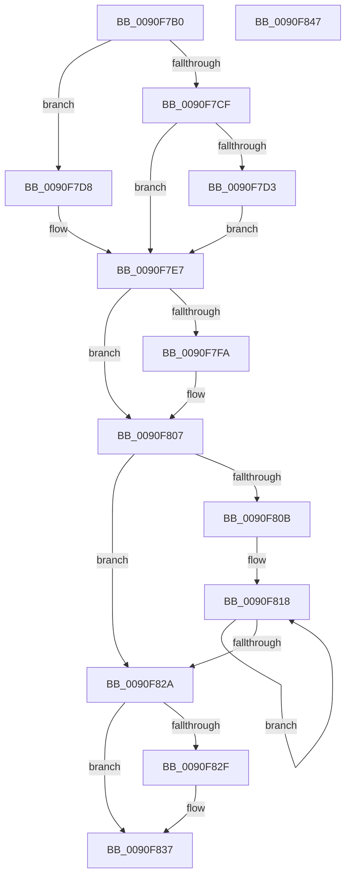

# PopHibernateEvaluation

- RVA: `0x0090F7B0`–`0x0090F848` (길이 `152` bytes)
- VA: `0x000000014090F7B0`
- 실행 섹션: `PAGE`
- PDB 이름 있음: `예`; PDB Function 태그: `아니요`
- unwind 정보 RVA: `0x0005CF00`
- 디코드: `47`개 명령, `152/152` bytes 표시
- 미해석 바이트: `0` (있으면 어셈블리에 `.byte`로 보존)

> 이 문서는 커널 이미지의 기계어와 PDB 기호를 분석해 생성했습니다. 4번과 5번은 함수 원형과 자료형을 바이너리 사용 방식에서 추정한 C 해석이며 원본 소스 복구 결과는 아닙니다.

## 1. Dependencies

- 직접 호출 지점: **1**; 고유 호출 대상: **1**
- 직접 호출자로 확인된 함수: **3**
- RIP 상대 이미지 참조: **5**

### Outgoing calls
- `0x0090F83C` → [PopEnableHiberFile](PopEnableHiberFile_function_0090F850.md) (function, `0x0090F850`)

### Direct callers
- [PoInitHiberServices](../75/PoInitHiberServices_function_007537C4.md) at `0x0075382B`
- [PopWnfHibernatePolicyCallback](../75/PopWnfHibernatePolicyCallback_function_0075E3C0.md) at `0x0075E40A`
- [NtPowerInformation](../95/NtPowerInformation_function_00955D80.md) at `0x00956619`

### Static image references
- `0x0090F7B6` → RVA `0x00FC5104` (`ALMOSTRO`; read)
- `0x0090F7D8` → RVA `0x00FC5288` (`ALMOSTRO`; read)
- `0x0090F7E7` → RVA `0x00FC510C` (`ALMOSTRO`; read)
- `0x0090F7FA` → RVA `0x00FC6BA5` (`ALMOSTRO`; read)
- `0x0090F80B` → RVA `0x00FC7240` (`ALMOSTRO`; read)

## 2. Other-region calls and transfers

- 다른 실행 섹션으로 향하는 call: **0**
- 별도 외부 분기/꼬리 이동을 확인하지 못했습니다.

## 3. Assembly (complete function range)

```asm
0090F7B0  40 53                           push rbx
0090F7B2  48 83 EC 20                     sub rsp, 0x20
0090F7B6  8B 05 48 59 6B 00               mov eax, dword ptr [rip + 0x6b5948]
0090F7BC  45 33 C9                        xor r9d, r9d
0090F7BF  BB 01 00 00 00                  mov ebx, 1
0090F7C4  44 8A D9                        mov r11b, cl
0090F7C7  44 8B D3                        mov r10d, ebx
0090F7CA  83 F8 FF                        cmp eax, -1
0090F7CD  74 09                           je 0x14090f7d8
0090F7CF  85 C0                           test eax, eax
0090F7D1  74 14                           je 0x14090f7e7
0090F7D3  45 8A D1                        mov r10b, r9b
0090F7D6  EB 0F                           jmp 0x14090f7e7
0090F7D8  8B 05 AA 5A 6B 00               mov eax, dword ptr [rip + 0x6b5aaa]
0090F7DE  FF C8                           dec eax
0090F7E0  83 F8 FD                        cmp eax, -3
0090F7E3  45 0F 46 D1                     cmovbe r10d, r9d
0090F7E7  44 39 0D 1E 59 6B 00            cmp dword ptr [rip + 0x6b591e], r9d
0090F7EE  41 0F B6 CA                     movzx ecx, r10b
0090F7F2  0F 44 CB                        cmove ecx, ebx
0090F7F5  45 84 DB                        test r11b, r11b
0090F7F8  74 0D                           je 0x14090f807
0090F7FA  44 38 0D A4 73 6B 00            cmp byte ptr [rip + 0x6b73a4], r9b
0090F801  0F B6 C9                        movzx ecx, cl
0090F804  0F 45 CB                        cmovne ecx, ebx
0090F807  84 D2                           test dl, dl
0090F809  74 1F                           je 0x14090f82a
0090F80B  48 8D 15 2E 7A 6B 00            lea rdx, [rip + 0x6b7a2e]
0090F812  41 BA 02 00 00 00               mov r10d, 2
0090F818  44 39 0A                        cmp dword ptr [rdx], r9d
0090F81B  48 8D 52 04                     lea rdx, [rdx + 4]
0090F81F  0F B6 C9                        movzx ecx, cl
0090F822  0F 45 CB                        cmovne ecx, ebx
0090F825  4C 2B D3                        sub r10, rbx
0090F828  75 EE                           jne 0x14090f818
0090F82A  4D 85 C0                        test r8, r8
0090F82D  74 08                           je 0x14090f837
0090F82F  84 C9                           test cl, cl
0090F831  0F 94 C0                        sete al
0090F834  41 88 00                        mov byte ptr [r8], al
0090F837  84 C9                           test cl, cl
0090F839  0F 94 C1                        sete cl
0090F83C  E8 0F 00 00 00                  call 0x14090f850
0090F841  48 83 C4 20                     add rsp, 0x20
0090F845  5B                              pop rbx
0090F846  C3                              ret
0090F847  CC                              int3
```

## 4. C-style interpretation (structured pseudocode)

```c
__int64 __fastcall PopHibernateEvaluation(unsigned __int8 a1, unsigned __int8 a2, __int64 a3, int a4)
{
    __int64 result;
    __int64 v_r10;
    __int64 v_rsp;

    v_rsp = (v_rsp) - (32);
    a4 = 0;
    if (((unsigned int)((unsigned int)(*(unsigned int *)(v_rip + 7035208)))) == -1) goto loc_0090F7D8;
    if ((unsigned int)((unsigned int)(*(unsigned int *)(v_rip + 7035208))) == 0) goto loc_0090F7E7;
    goto loc_0090F7E7;
loc_0090F7D8:
    result = (unsigned int)(((unsigned int)(*(unsigned int *)(v_rip + 7035562))) - 1);
    v_r10 = 0;
    if (((unsigned int)(result)) <= -3) { v_r10 = 0; }
loc_0090F7E7:
    a1 = (unsigned __int8)(v_r10);
    if ((*(unsigned int *)(v_rip + 7035166)) == 0) { a1 = 1; }
    if (a1 != 0) {
        a1 = a1;
        if ((*(unsigned __int8 *)(v_rip + 7041956)) != 0) { a1 = 1; }
    }
    if (a2 == 0) goto loc_0090F82A;
loc_0090F818:
    if ((*(unsigned int *)(v_rip + 7043630)) != 0) { a1 = 1; }
    v_r10 = (2) - (1);
    if (condition_is_not_equal) goto loc_0090F818;
loc_0090F82A:
    if (a3 != 0) {
        result = (a1 == 0) ? 1 : 0;
        *(unsigned __int8 *)(a3) = (unsigned __int8)(result);
    }
    a1 = (a1 == 0) ? 1 : 0;
    result = PopEnableHiberFile(a1, v_rip + 7043630 + 4, a3, a4);
    v_rsp = (v_rsp) + (32);
    return result;
}
```

## 5. (Beta) C Style

```c
int64_t PopHibernateEvaluation(uint8_t Arg1, uint8_t Arg2, int64_t Arg3, int32_t Arg4)
{
    int64_t result;
    int64_t local_r10;
    int64_t local_rsp;

    local_rsp = (local_rsp) - (32);
    Arg4 = 0;
    if (((uint32_t)((uint32_t)(*(uint32_t *)(v_rip + 0x6B5948)))) == -1) goto loc_0090F7D8;
    if ((uint32_t)((uint32_t)(*(uint32_t *)(v_rip + 0x6B5948))) == 0) goto loc_0090F7E7;
    goto loc_0090F7E7;
loc_0090F7D8:
    result = (uint32_t)(((uint32_t)(*(uint32_t *)(v_rip + 0x6B5AAA))) - 1);
    local_r10 = 0;
    if (((uint32_t)(result)) <= -3) { local_r10 = 0; }
loc_0090F7E7:
    Arg1 = (uint8_t)(local_r10);
    if ((*(uint32_t *)(v_rip + 0x6B591E)) == 0) { Arg1 = 1; }
    if (Arg1 != 0) {
        Arg1 = Arg1;
        if ((*(uint8_t *)(v_rip + 0x6B73A4)) != 0) { Arg1 = 1; }
    }
    if (Arg2 == 0) goto loc_0090F82A;
loc_0090F818:
    if ((*(uint32_t *)(v_rip + 0x6B7A2E)) != 0) { Arg1 = 1; }
    local_r10 = (2) - (1);
    if (condition_is_not_equal) goto loc_0090F818;
loc_0090F82A:
    if (Arg3 != 0) {
        result = (Arg1 == 0) ? 1 : 0;
        *(uint8_t *)(Arg3) = (uint8_t)(result);
    }
    Arg1 = (Arg1 == 0) ? 1 : 0;
    result = PopEnableHiberFile(Arg1, v_rip + 7043630 + 4, Arg3, Arg4);
    local_rsp = (local_rsp) + (32);
    return result;
}
```

## 6. Execution-region graph

[열기: 2D/3D 그래프와 함수 탐색 컨트롤 패널](../../../control-panel.html?section=page&rva=0x0090F7B0&view=graph)

- 2D 그래프는 위에서 아래로 흐르고, 3D 그래프는 빈 공간을 드래그해 회전합니다. Shift+드래그는 이동, 휠은 확대·축소, 함수 노드 선택은 대상 보고서 이동입니다.

### Static fallback


