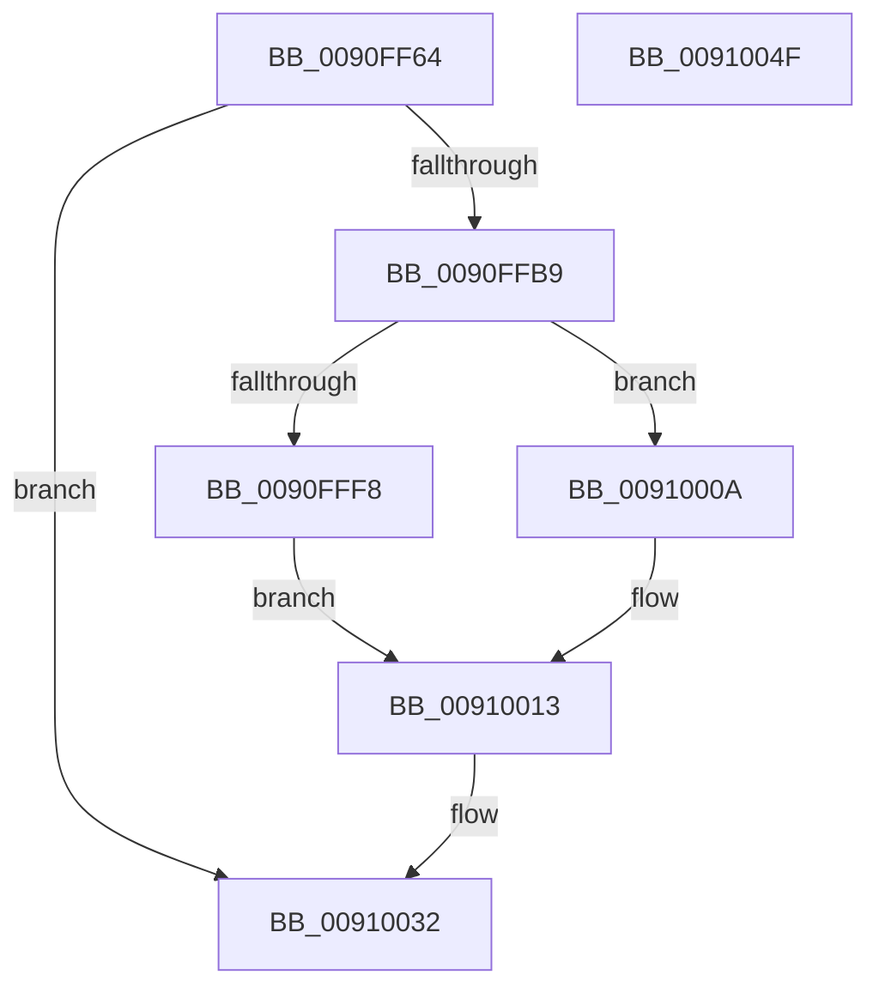

# PopResetCurrentPolicies

- RVA: `0x0090FF64`–`0x00910050` (길이 `236` bytes)
- VA: `0x000000014090FF64`
- 실행 섹션: `PAGE`
- PDB 이름 있음: `예`; PDB Function 태그: `아니요`
- unwind 정보 RVA: `0x0008A094`
- 디코드: `56`개 명령, `236/236` bytes 표시
- 미해석 바이트: `0` (있으면 어셈블리에 `.byte`로 보존)

> 이 문서는 커널 이미지의 기계어와 PDB 기호를 분석해 생성했습니다. 4번과 5번은 함수 원형과 자료형을 바이너리 사용 방식에서 추정한 C 해석이며 원본 소스 복구 결과는 아닙니다.

## 1. Dependencies

- 직접 호출 지점: **8**; 고유 호출 대상: **8**
- 직접 호출자로 확인된 함수: **5**
- RIP 상대 이미지 참조: **2**

### Outgoing calls
- `0x0090FFA6` → [memset](../../text/6C/memset_function_006C6C40.md) (function, `0x006C6C40`)
- `0x0090FFB0` → [PopOpenPowerKey](../../text/4B/PopOpenPowerKey_function_004B4314.md) (function, `0x004B4314`)
- `0x0090FFC5` → [RtlInitUnicodeString](../../text/42/RtlInitUnicodeString_function_0042A780.md) (function, `0x0042A780`)
- `0x0090FFED` → [ZwQueryValueKey](../../text/6A/ZwQueryValueKey_function_006AD3B0.md) (function, `0x006AD3B0`)
- `0x0090FFFD` → [PopDefaultPolicy](../75/PopDefaultPolicy_function_00753924.md) (function, `0x00753924`)
- `0x00910021` → [PopApplyPolicy](../91/PopApplyPolicy_function_009107B0.md) (function, `0x009107B0`)
- `0x0091002B` → [ZwClose](../../text/6A/ZwClose_function_006AD2B0.md) (function, `0x006AD2B0`)
- `0x00910039` → [_security_check_cookie](../../text/6A/_security_check_cookie_function_006AC640.md) (function, `0x006AC640`)

### Direct callers
- [PopEnableHiberFile](PopEnableHiberFile_function_0090F850.md) at `0x0090FA16`
- [PopEnableHiberFile](PopEnableHiberFile_function_0090F850.md) at `0x0090FCFA`
- [PopBatteryUpdateCompositeInformation](PopBatteryUpdateCompositeInformation_function_0090FDD0.md) at `0x0090FF06`
- [PopChangeCapability](PopChangeCapability_function_0090FF48.md) at `0x0090FF52`
- [NtPowerInformation](../95/NtPowerInformation_function_00955D80.md) at `0x009562EA`
- [NtPowerInformation](../95/NtPowerInformation_function_00955D80.md) at `0x00956665`
- [PoInitSystem](../../init/C7/PoInitSystem_function_00C72358.md) at `0x00C730F5`

### Static image references
- `0x0090FF76` → RVA `0x00E0A740` (`.data`; read)
- `0x0090FFB9` → RVA `0x00011940` (`.rdata`; read)

## 2. Other-region calls and transfers

- 다른 실행 섹션으로 향하는 call: **6**
  - `0x0090FFA6` → [memset](../../text/6C/memset_function_006C6C40.md) (`PAGE` → `.text`)
  - `0x0090FFB0` → [PopOpenPowerKey](../../text/4B/PopOpenPowerKey_function_004B4314.md) (`PAGE` → `.text`)
  - `0x0090FFC5` → [RtlInitUnicodeString](../../text/42/RtlInitUnicodeString_function_0042A780.md) (`PAGE` → `.text`)
  - `0x0090FFED` → [ZwQueryValueKey](../../text/6A/ZwQueryValueKey_function_006AD3B0.md) (`PAGE` → `.text`)
  - `0x0091002B` → [ZwClose](../../text/6A/ZwClose_function_006AD2B0.md) (`PAGE` → `.text`)
  - `0x00910039` → [_security_check_cookie](../../text/6A/_security_check_cookie_function_006AC640.md) (`PAGE` → `.text`)
- 별도 외부 분기/꼬리 이동을 확인하지 못했습니다.

## 3. Assembly (complete function range)

```asm
0090FF64  48 89 5C 24 08                  mov qword ptr [rsp + 8], rbx
0090FF69  55                              push rbp
0090FF6A  48 8D 6C 24 A0                  lea rbp, [rsp - 0x60]
0090FF6F  48 81 EC 60 01 00 00            sub rsp, 0x160
0090FF76  48 8B 05 C3 A7 4F 00            mov rax, qword ptr [rip + 0x4fa7c3]
0090FF7D  48 33 C4                        xor rax, rsp
0090FF80  48 89 45 50                     mov qword ptr [rbp + 0x50], rax
0090FF84  48 83 64 24 38 00               and qword ptr [rsp + 0x38], 0
0090FF8A  48 8D 4C 24 50                  lea rcx, [rsp + 0x50]
0090FF8F  83 64 24 30 00                  and dword ptr [rsp + 0x30], 0
0090FF94  0F 57 C0                        xorps xmm0, xmm0
0090FF97  BB F8 00 00 00                  mov ebx, 0xf8
0090FF9C  33 D2                           xor edx, edx
0090FF9E  44 8B C3                        mov r8d, ebx
0090FFA1  0F 11 44 24 40                  movups xmmword ptr [rsp + 0x40], xmm0
0090FFA6  E8 95 6C DB FF                  call 0x1406c6c40
0090FFAB  48 8D 4C 24 38                  lea rcx, [rsp + 0x38]
0090FFB0  E8 5F 43 BA FF                  call 0x1404b4314
0090FFB5  85 C0                           test eax, eax
0090FFB7  78 79                           js 0x140910032
0090FFB9  48 8D 15 80 19 70 FF            lea rdx, [rip - 0x8fe680]
0090FFC0  48 8D 4C 24 40                  lea rcx, [rsp + 0x40]
0090FFC5  E8 B6 A7 B1 FF                  call 0x14042a780
0090FFCA  48 8B 4C 24 38                  mov rcx, qword ptr [rsp + 0x38]
0090FFCF  48 8D 44 24 30                  lea rax, [rsp + 0x30]
0090FFD4  48 89 44 24 28                  mov qword ptr [rsp + 0x28], rax
0090FFD9  4C 8D 4C 24 50                  lea r9, [rsp + 0x50]
0090FFDE  41 B8 02 00 00 00               mov r8d, 2
0090FFE4  89 5C 24 20                     mov dword ptr [rsp + 0x20], ebx
0090FFE8  48 8D 54 24 40                  lea rdx, [rsp + 0x40]
0090FFED  E8 BE D3 D9 FF                  call 0x1406ad3b0
0090FFF2  8B D8                           mov ebx, eax
0090FFF4  85 C0                           test eax, eax
0090FFF6  79 12                           jns 0x14091000a
0090FFF8  48 8D 4C 24 5C                  lea rcx, [rsp + 0x5c]
0090FFFD  E8 22 39 E4 FF                  call 0x140753924
00910002  41 B9 E8 00 00 00               mov r9d, 0xe8
00910008  EB 09                           jmp 0x140910013
0091000A  44 8B 4C 24 30                  mov r9d, dword ptr [rsp + 0x30]
0091000F  41 83 C1 F4                     add r9d, -0xc
00910013  4C 8D 44 24 5C                  lea r8, [rsp + 0x5c]
00910018  44 89 4C 24 30                  mov dword ptr [rsp + 0x30], r9d
0091001D  33 D2                           xor edx, edx
0091001F  33 C9                           xor ecx, ecx
00910021  E8 8A 07 00 00                  call 0x1409107b0
00910026  48 8B 4C 24 38                  mov rcx, qword ptr [rsp + 0x38]
0091002B  E8 80 D2 D9 FF                  call 0x1406ad2b0
00910030  8B C3                           mov eax, ebx
00910032  48 8B 4D 50                     mov rcx, qword ptr [rbp + 0x50]
00910036  48 33 CC                        xor rcx, rsp
00910039  E8 02 C6 D9 FF                  call 0x1406ac640
0091003E  48 8B 9C 24 70 01 00 00         mov rbx, qword ptr [rsp + 0x170]
00910046  48 81 C4 60 01 00 00            add rsp, 0x160
0091004D  5D                              pop rbp
0091004E  C3                              ret
0091004F  CC                              int3
```

## 4. C-style interpretation (structured pseudocode)

```c
__int64 __fastcall PopResetCurrentPolicies(__int64 a1, int a2)
{
    __int64 result;
    __int64 v_rsp;
    unsigned __int64 v_stack_m10C;
    unsigned __int64 v_stack_m118;
    unsigned __int64 v_stack_m128;
    unsigned __int64 v_stack_m130;
    unsigned int v_stack_m138;
    unsigned __int64 v_stack_m140;
    unsigned int v_stack_m148;
    unsigned __int64 v_stack_m18;
    unsigned __int64 v_stack_m68;
    unsigned __int64 v_stack_p8;

    v_stack_p8 = v_rbx;
    v_rsp = (v_rsp) - (352);
    result = (*(unsigned __int64 *)(v_rip + 5220291)) ^ (v_rsp);
    v_stack_m18 = result;
    a2 = 0;
    v_stack_m128 = v_xmm0;
    result = memset(v_stack_m118, a2, 248, a4);
    result = PopOpenPowerKey(v_stack_m130, a2, 248, a4);
    if (sign_flag) goto loc_00910032;
    result = RtlInitUnicodeString(v_stack_m128, v_rip - 9430656, 248, a4);
    v_stack_m140 = v_stack_m138;
    v_stack_m148 = 248;
    result = ZwQueryValueKey(v_stack_m130, v_stack_m128, 2, v_stack_m118);
    if (!sign_flag) goto loc_0091000A;
    result = PopDefaultPolicy(v_stack_m10C, v_stack_m128, 2, v_stack_m118);
    goto loc_00910013;
loc_0091000A:
    a4 = (unsigned int)(((unsigned int)(v_stack_m138)) + (-12));
loc_00910013:
    v_stack_m138 = (unsigned int)(a4);
    a2 = 0;
    a1 = 0;
    result = PopApplyPolicy(a1, a2, v_stack_m10C, a4);
    result = ZwClose(v_stack_m130, a2, v_stack_m10C, a4);
loc_00910032:
    a1 = (v_stack_m18) ^ (v_rsp);
    result = _security_check_cookie(a1, a2, v_stack_m10C, a4);
    v_rsp = (v_rsp) + (352);
    return result;
}
```

## 5. (Beta) C Style

```c
int64_t PopResetCurrentPolicies(int64_t Arg1, int32_t Arg2)
{
    int64_t result;
    int64_t local_rsp;
    uint64_t v_stack_m10C;
    uint64_t v_stack_m118;
    uint64_t v_stack_m128;
    uint64_t v_stack_m130;
    uint32_t v_stack_m138;
    uint64_t v_stack_m140;
    uint32_t v_stack_m148;
    uint64_t v_stack_m18;
    uint64_t v_stack_m68;
    uint64_t v_stack_p8;

    v_stack_p8 = local_rbx;
    local_rsp = (local_rsp) - (352);
    result = (*(uint64_t *)(v_rip + 0x4FA7C3)) ^ (local_rsp);
    v_stack_m18 = result;
    Arg2 = 0;
    v_stack_m128 = v_xmm0;
    result = memset(v_stack_m118, Arg2, 248, a4);
    result = PopOpenPowerKey(v_stack_m130, Arg2, 248, a4);
    if (sign_flag) goto loc_00910032;
    result = RtlInitUnicodeString(v_stack_m128, v_rip - 9430656, 248, a4);
    v_stack_m140 = v_stack_m138;
    v_stack_m148 = 248;
    result = ZwQueryValueKey(v_stack_m130, v_stack_m128, 2, v_stack_m118);
    if (!sign_flag) goto loc_0091000A;
    result = PopDefaultPolicy(v_stack_m10C, v_stack_m128, 2, v_stack_m118);
    goto loc_00910013;
loc_0091000A:
    a4 = (uint32_t)(((uint32_t)(v_stack_m138)) + (-12));
loc_00910013:
    v_stack_m138 = (uint32_t)(a4);
    Arg2 = 0;
    Arg1 = 0;
    result = PopApplyPolicy(Arg1, Arg2, v_stack_m10C, a4);
    result = ZwClose(v_stack_m130, Arg2, v_stack_m10C, a4);
loc_00910032:
    Arg1 = (v_stack_m18) ^ (local_rsp);
    result = _security_check_cookie(Arg1, Arg2, v_stack_m10C, a4);
    local_rsp = (local_rsp) + (352);
    return result;
}
```

## 6. Execution-region graph

[열기: 2D/3D 그래프와 함수 탐색 컨트롤 패널](../../../control-panel.html?section=page&rva=0x0090FF64&view=graph)

- 2D 그래프는 위에서 아래로 흐르고, 3D 그래프는 빈 공간을 드래그해 회전합니다. Shift+드래그는 이동, 휠은 확대·축소, 함수 노드 선택은 대상 보고서 이동입니다.

### Static fallback


