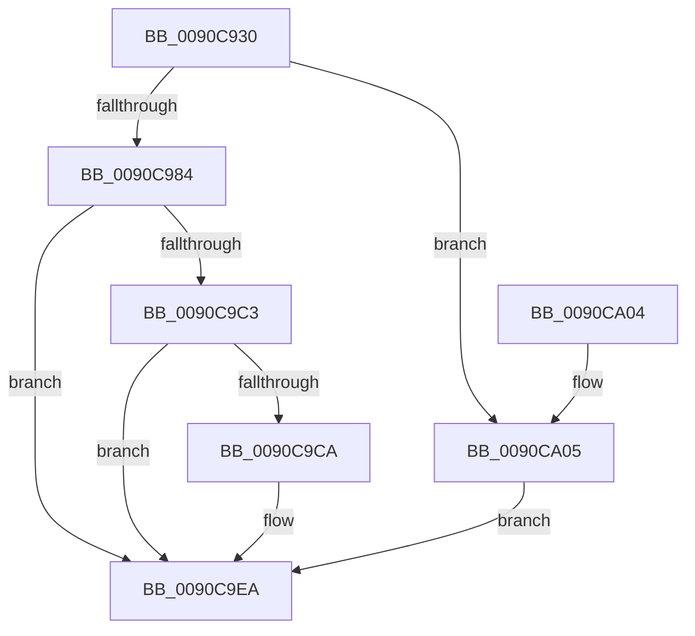

# PopWnfSprActiveSessionChangeCallback

- RVA: `0x0090C930`–`0x0090CA11` (길이 `225` bytes)
- VA: `0x000000014090C930`
- 실행 섹션: `PAGE`
- PDB 이름 있음: `예`; PDB Function 태그: `아니요`
- unwind 정보 RVA: `0x000892B0`
- 디코드: `56`개 명령, `225/225` bytes 표시
- 미해석 바이트: `0` (있으면 어셈블리에 `.byte`로 보존)

> 이 문서는 커널 이미지의 기계어와 PDB 기호를 분석해 생성했습니다. 4번과 5번은 함수 원형과 자료형을 바이너리 사용 방식에서 추정한 C 해석이며 원본 소스 복구 결과는 아닙니다.

## 1. Dependencies

- 직접 호출 지점: **9**; 고유 호출 대상: **8**
- 직접 호출자로 확인된 함수: **1**
- RIP 상대 이미지 참조: **2**

### Outgoing calls
- `0x0090C973` → [ExpWnfAcquireSubscriptionNameInstance](../A4/ExpWnfAcquireSubscriptionNameInstance_function_00A4A51C.md) (function, `0x00A4A51C`)
- `0x0090C9A1` → [ExpWnfReadStateData](ExpWnfReadStateData_function_00909C50.md) (function, `0x00909C50`)
- `0x0090C9AC` → [ExReleaseRundownProtection](../../text/34/ExReleaseRundownProtection_function_00349E80.md) (function, `0x00349E80`)
- `0x0090C9B8` → [KeLeaveCriticalRegion](../../text/25/KeLeaveCriticalRegion_function_0025D8B0.md) (function, `0x0025D8B0`)
- `0x0090C9CA` → [PopAcquirePolicyLock](../../pagelk/B7/PopAcquirePolicyLock_function_00B783C0.md) (function, `0x00B783C0`)
- `0x0090C9E0` → [PopSetPowerSettingValueAcDc](../91/PopSetPowerSettingValueAcDc_function_00914D6C.md) (function, `0x00914D6C`)
- `0x0090C9E5` → [PopReleasePolicyLock](../../pagelk/B7/PopReleasePolicyLock_function_00B78410.md) (function, `0x00B78410`)
- `0x0090C9F4` → [_security_check_cookie](../../text/6A/_security_check_cookie_function_006AC640.md) (function, `0x006AC640`)
- `0x0090CA0A` → [KeLeaveCriticalRegion](../../text/25/KeLeaveCriticalRegion_function_0025D8B0.md) (function, `0x0025D8B0`)

### Direct callers
- [ExpWnfDispatchKernelSubscription](ExpWnfDispatchKernelSubscription_function_0090C520.md) at `0x0090C77C`

### Static image references
- `0x0090C93A` → RVA `0x00E0A740` (`.data`; read)
- `0x0090C9D9` → RVA `0x000118B8` (`.rdata`; read)

## 2. Other-region calls and transfers

- 다른 실행 섹션으로 향하는 call: **6**
  - `0x0090C9AC` → [ExReleaseRundownProtection](../../text/34/ExReleaseRundownProtection_function_00349E80.md) (`PAGE` → `.text`)
  - `0x0090C9B8` → [KeLeaveCriticalRegion](../../text/25/KeLeaveCriticalRegion_function_0025D8B0.md) (`PAGE` → `.text`)
  - `0x0090C9CA` → [PopAcquirePolicyLock](../../pagelk/B7/PopAcquirePolicyLock_function_00B783C0.md) (`PAGE` → `PAGELK`)
  - `0x0090C9E5` → [PopReleasePolicyLock](../../pagelk/B7/PopReleasePolicyLock_function_00B78410.md) (`PAGE` → `PAGELK`)
  - `0x0090C9F4` → [_security_check_cookie](../../text/6A/_security_check_cookie_function_006AC640.md) (`PAGE` → `.text`)
  - `0x0090CA0A` → [KeLeaveCriticalRegion](../../text/25/KeLeaveCriticalRegion_function_0025D8B0.md) (`PAGE` → `.text`)
- 별도 외부 분기/꼬리 이동을 확인하지 못했습니다.

## 3. Assembly (complete function range)

```asm
0090C930  48 89 5C 24 10                  mov qword ptr [rsp + 0x10], rbx
0090C935  57                              push rdi
0090C936  48 83 EC 60                     sub rsp, 0x60
0090C93A  48 8B 05 FF DD 4F 00            mov rax, qword ptr [rip + 0x4fddff]
0090C941  48 33 C4                        xor rax, rsp
0090C944  48 89 44 24 58                  mov qword ptr [rsp + 0x58], rax
0090C949  33 C0                           xor eax, eax
0090C94B  C7 44 24 30 14 00 00 00         mov dword ptr [rsp + 0x30], 0x14
0090C953  88 44 24 50                     mov byte ptr [rsp + 0x50], al
0090C957  0F 57 C0                        xorps xmm0, xmm0
0090C95A  65 48 8B 04 25 88 01 00 00      mov rax, qword ptr gs:[0x188]
0090C963  48 8B D1                        mov rdx, rcx
0090C966  0F 11 44 24 40                  movups xmmword ptr [rsp + 0x40], xmm0
0090C96B  66 FF 88 E4 01 00 00            dec word ptr [rax + 0x1e4]
0090C972  90                              nop
0090C973  E8 A4 DB 13 00                  call 0x140a4a51c
0090C978  48 8B F8                        mov rdi, rax
0090C97B  48 85 C0                        test rax, rax
0090C97E  0F 84 81 00 00 00               je 0x14090ca05
0090C984  48 8D 44 24 30                  lea rax, [rsp + 0x30]
0090C989  41 B9 14 00 00 00               mov r9d, 0x14
0090C98F  4C 8D 44 24 40                  lea r8, [rsp + 0x40]
0090C994  48 89 44 24 20                  mov qword ptr [rsp + 0x20], rax
0090C999  48 8D 54 24 38                  lea rdx, [rsp + 0x38]
0090C99E  48 8B CF                        mov rcx, rdi
0090C9A1  E8 AA D2 FF FF                  call 0x140909c50
0090C9A6  8B D8                           mov ebx, eax
0090C9A8  48 8D 4F 08                     lea rcx, [rdi + 8]
0090C9AC  E8 CF D4 A3 FF                  call 0x140349e80
0090C9B1  33 FF                           xor edi, edi
0090C9B3  85 DB                           test ebx, ebx
0090C9B5  0F 48 FB                        cmovs edi, ebx
0090C9B8  E8 F3 0E 95 FF                  call 0x14025d8b0
0090C9BD  8B DF                           mov ebx, edi
0090C9BF  85 FF                           test edi, edi
0090C9C1  78 27                           js 0x14090c9ea
0090C9C3  83 7C 24 30 14                  cmp dword ptr [rsp + 0x30], 0x14
0090C9C8  75 20                           jne 0x14090c9ea
0090C9CA  E8 F1 B9 26 00                  call 0x140b783c0
0090C9CF  4C 8D 44 24 40                  lea r8, [rsp + 0x40]
0090C9D4  BA 14 00 00 00                  mov edx, 0x14
0090C9D9  48 8D 0D D8 4E 70 FF            lea rcx, [rip - 0x8fb128]
0090C9E0  E8 87 83 00 00                  call 0x140914d6c
0090C9E5  E8 26 BA 26 00                  call 0x140b78410
0090C9EA  8B C3                           mov eax, ebx
0090C9EC  48 8B 4C 24 58                  mov rcx, qword ptr [rsp + 0x58]
0090C9F1  48 33 CC                        xor rcx, rsp
0090C9F4  E8 47 FC D9 FF                  call 0x1406ac640
0090C9F9  48 8B 5C 24 78                  mov rbx, qword ptr [rsp + 0x78]
0090C9FE  48 83 C4 60                     add rsp, 0x60
0090CA02  5F                              pop rdi
0090CA03  C3                              ret
0090CA04  CC                              int3
0090CA05  BB 34 00 00 C0                  mov ebx, 0xc0000034
0090CA0A  E8 A1 0E 95 FF                  call 0x14025d8b0
0090CA0F  EB D9                           jmp 0x14090c9ea
```

## 4. C-style interpretation (structured pseudocode)

```c
__int64 __fastcall PopWnfSprActiveSessionChangeCallback(__int64 a1)
{
    __int64 result;
    __int64 v_rdi;
    __int64 v_rsp;
    unsigned __int64 v_stack_m10;
    unsigned __int8 v_stack_m18;
    unsigned __int64 v_stack_m28;
    unsigned __int64 v_stack_m30;
    unsigned int v_stack_m38;
    unsigned __int64 v_stack_m48;
    unsigned __int64 v_stack_p10;

    v_stack_p10 = v_rbx;
    v_rsp = (v_rsp) - (96);
    result = (*(unsigned __int64 *)(v_rip + 5234175)) ^ (v_rsp);
    v_stack_m10 = result;
    result = 0;
    v_stack_m38 = 20;
    v_stack_m18 = 0;
    v_stack_m28 = v_xmm0;
    result = ExpWnfAcquireSubscriptionNameInstance(a1, a1, a3, a4);
    if (result == 0) goto loc_0090CA05;
    v_stack_m48 = v_stack_m38;
    result = ExpWnfReadStateData(result, v_stack_m30, v_stack_m28, 20);
    result = ExReleaseRundownProtection(result + 8, v_stack_m30, v_stack_m28, 20);
    v_rdi = 0;
    if (sign_flag) { v_rdi = (unsigned int)((unsigned int)((unsigned int)(result))); }
    result = KeLeaveCriticalRegion(result + 8, v_stack_m30, v_stack_m28, 20);
    if (sign_flag) goto loc_0090C9EA;
    if (v_stack_m38 == 20) {
        result = PopAcquirePolicyLock(result + 8, v_stack_m30, v_stack_m28, 20);
        a3 = v_stack_m28;
        a2 = 20;
        a1 = v_rip - 9417000;
        result = PopSetPowerSettingValueAcDc(a1, a2, a3, 20);
        result = PopReleasePolicyLock(a1, a2, a3, 20);
    }
    a1 = (v_stack_m10) ^ (v_rsp);
    result = _security_check_cookie(a1, a2, a3, 20);
    v_rsp = (v_rsp) + (96);
    return result;
loc_0090CA05:
    result = KeLeaveCriticalRegion(a1, a2, a3, 20);
    goto loc_0090C9EA;
}
```

## 5. (Beta) C Style

```c
int64_t PopWnfSprActiveSessionChangeCallback(int64_t Arg1)
{
    int64_t result;
    int64_t local_rdi;
    int64_t local_rsp;
    uint64_t v_stack_m10;
    uint8_t v_stack_m18;
    uint64_t v_stack_m28;
    uint64_t v_stack_m30;
    uint32_t v_stack_m38;
    uint64_t v_stack_m48;
    uint64_t v_stack_p10;

    v_stack_p10 = local_rbx;
    local_rsp = (local_rsp) - (96);
    result = (*(uint64_t *)(v_rip + 0x4FDDFF)) ^ (local_rsp);
    v_stack_m10 = result;
    result = 0;
    v_stack_m38 = 20;
    v_stack_m18 = 0;
    v_stack_m28 = v_xmm0;
    result = ExpWnfAcquireSubscriptionNameInstance(Arg1, Arg1, a3, a4);
    if (result == 0) goto loc_0090CA05;
    v_stack_m48 = v_stack_m38;
    result = ExpWnfReadStateData(result, v_stack_m30, v_stack_m28, 20);
    result = ExReleaseRundownProtection(result + 8, v_stack_m30, v_stack_m28, 20);
    local_rdi = 0;
    if (sign_flag) { local_rdi = (uint32_t)((uint32_t)((uint32_t)(result))); }
    result = KeLeaveCriticalRegion(result + 8, v_stack_m30, v_stack_m28, 20);
    if (sign_flag) goto loc_0090C9EA;
    if (v_stack_m38 == 20) {
        result = PopAcquirePolicyLock(result + 8, v_stack_m30, v_stack_m28, 20);
        a3 = v_stack_m28;
        a2 = 20;
        Arg1 = v_rip - 9417000;
        result = PopSetPowerSettingValueAcDc(Arg1, a2, a3, 20);
        result = PopReleasePolicyLock(Arg1, a2, a3, 20);
    }
    Arg1 = (v_stack_m10) ^ (local_rsp);
    result = _security_check_cookie(Arg1, a2, a3, 20);
    local_rsp = (local_rsp) + (96);
    return result;
loc_0090CA05:
    result = KeLeaveCriticalRegion(Arg1, a2, a3, 20);
    goto loc_0090C9EA;
}
```

## 6. Execution-region graph

[열기: 2D/3D 그래프와 함수 탐색 컨트롤 패널](../../../control-panel.html?section=page&rva=0x0090C930&view=graph)

- 2D 그래프는 위에서 아래로 흐르고, 3D 그래프는 빈 공간을 드래그해 회전합니다. Shift+드래그는 이동, 휠은 확대·축소, 함수 노드 선택은 대상 보고서 이동입니다.

### Static fallback


