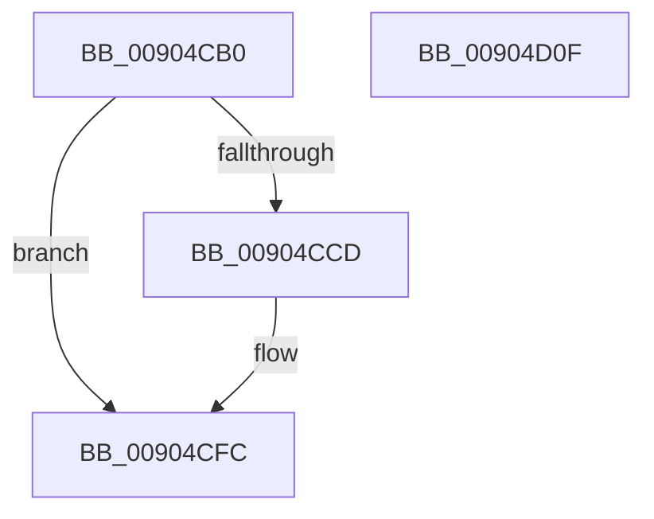

# PsCaptureExceptionPort

- RVA: `0x00904CB0`–`0x00904D10` (길이 `96` bytes)
- VA: `0x0000000140904CB0`
- 실행 섹션: `PAGE`
- PDB 이름 있음: `예`; PDB Function 태그: `아니요`
- unwind 정보 RVA: `0x00060BC4`
- 디코드: `25`개 명령, `96/96` bytes 표시
- 미해석 바이트: `0` (있으면 어셈블리에 `.byte`로 보존)

> 이 문서는 커널 이미지의 기계어와 PDB 기호를 분석해 생성했습니다. 4번과 5번은 함수 원형과 자료형을 바이너리 사용 방식에서 추정한 C 해석이며 원본 소스 복구 결과는 아닙니다.

## 1. Dependencies

- 직접 호출 지점: **3**; 고유 호출 대상: **3**
- 직접 호출자로 확인된 함수: **3**
- RIP 상대 이미지 참조: **0**

### Outgoing calls
- `0x00904CD9` → [PspLockProcessShared](../../text/40/PspLockProcessShared_function_004016D0.md) (function, `0x004016D0`)
- `0x00904CEC` → [ObfReferenceObject](../../text/20/ObfReferenceObject_function_0020FA20.md) (function, `0x0020FA20`)
- `0x00904CF7` → [PspUnlockProcessShared](../../text/26/PspUnlockProcessShared_function_00263950.md) (function, `0x00263950`)

### Direct callers
- [PspFreezeProcessWorker](../78/PspFreezeProcessWorker_function_007865B0.md) at `0x007865E7`
- [PspExitThread](PspExitThread_function_00905F60.md) at `0x009061A2`
- [ExpRaiseHardError](../A6/ExpRaiseHardError_function_00A64AD4.md) at `0x00A64BEB`

### Static image references
- 디코드된 RIP-relative 메모리 참조가 없습니다.

## 2. Other-region calls and transfers

- 다른 실행 섹션으로 향하는 call: **3**
  - `0x00904CD9` → [PspLockProcessShared](../../text/40/PspLockProcessShared_function_004016D0.md) (`PAGE` → `.text`)
  - `0x00904CEC` → [ObfReferenceObject](../../text/20/ObfReferenceObject_function_0020FA20.md) (`PAGE` → `.text`)
  - `0x00904CF7` → [PspUnlockProcessShared](../../text/26/PspUnlockProcessShared_function_00263950.md) (`PAGE` → `.text`)
- 별도 외부 분기/꼬리 이동을 확인하지 못했습니다.

## 3. Assembly (complete function range)

```asm
00904CB0  48 89 5C 24 08                  mov qword ptr [rsp + 8], rbx
00904CB5  48 89 74 24 10                  mov qword ptr [rsp + 0x10], rsi
00904CBA  57                              push rdi
00904CBB  48 83 EC 20                     sub rsp, 0x20
00904CBF  33 FF                           xor edi, edi
00904CC1  48 8B F1                        mov rsi, rcx
00904CC4  48 39 B9 40 02 00 00            cmp qword ptr [rcx + 0x240], rdi
00904CCB  74 2F                           je 0x140904cfc
00904CCD  65 48 8B 1C 25 88 01 00 00      mov rbx, qword ptr gs:[0x188]
00904CD6  48 8B D3                        mov rdx, rbx
00904CD9  E8 F2 C9 AF FF                  call 0x1404016d0
00904CDE  48 8B BE 40 02 00 00            mov rdi, qword ptr [rsi + 0x240]
00904CE5  48 83 E7 F8                     and rdi, 0xfffffffffffffff8
00904CE9  48 8B CF                        mov rcx, rdi
00904CEC  E8 2F AD 90 FF                  call 0x14020fa20
00904CF1  48 8B D3                        mov rdx, rbx
00904CF4  48 8B CE                        mov rcx, rsi
00904CF7  E8 54 EC 95 FF                  call 0x140263950
00904CFC  48 8B 5C 24 30                  mov rbx, qword ptr [rsp + 0x30]
00904D01  48 8B C7                        mov rax, rdi
00904D04  48 8B 74 24 38                  mov rsi, qword ptr [rsp + 0x38]
00904D09  48 83 C4 20                     add rsp, 0x20
00904D0D  5F                              pop rdi
00904D0E  C3                              ret
00904D0F  CC                              int3
```

## 4. C-style interpretation (structured pseudocode)

```c
__int64 __fastcall PsCaptureExceptionPort(__int64 a1)
{
    __int64 result;
    __int64 v_rbx;
    __int64 v_rdi;
    __int64 v_rsp;
    unsigned __int64 v_stack_p10;
    unsigned __int64 v_stack_p8;

    v_stack_p8 = v_rbx;
    v_stack_p10 = v_rsi;
    v_rsp = (v_rsp) - (32);
    v_rdi = 0;
    if ((*(unsigned __int64 *)(a1 + 576)) != 0) {
        v_rbx = *(unsigned __int64 *)(gs_base + (0 + 392));
        a2 = v_rbx;
        result = PspLockProcessShared(a1, a2, a3, a4);
        v_rdi = *(unsigned __int64 *)(a1 + 576);
        v_rdi = (v_rdi) & (-8);
        a1 = v_rdi;
        result = ObfReferenceObject(a1, a2, a3, a4);
        a2 = v_rbx;
        a1 = a1;
        result = PspUnlockProcessShared(a1, a2, a3, a4);
    }
    v_rsp = (v_rsp) + (32);
    return v_rdi;
}
```

## 5. (Beta) C Style

```c
int64_t PsCaptureExceptionPort(void *Arg1)
{
    uint8_t *arg1 = (uint8_t *)Arg1;

    int64_t result;
    int64_t local_rbx;
    int64_t local_rdi;
    int64_t local_rsp;
    uint64_t v_stack_p10;
    uint64_t v_stack_p8;

    v_stack_p8 = local_rbx;
    v_stack_p10 = local_rsi;
    local_rsp = (local_rsp) - (32);
    local_rdi = 0;
    if ((*(uint64_t *)(arg1 + 0x240)) != 0) {
        local_rbx = *(uint64_t *)(gs_base + (0 + 0x188));
        a2 = local_rbx;
        result = PspLockProcessShared(Arg1, a2, a3, a4);
        local_rdi = *(uint64_t *)(arg1 + 0x240);
        local_rdi = (local_rdi) & (-8);
        Arg1 = local_rdi;
        result = ObfReferenceObject(Arg1, a2, a3, a4);
        a2 = local_rbx;
        Arg1 = Arg1;
        result = PspUnlockProcessShared(Arg1, a2, a3, a4);
    }
    local_rsp = (local_rsp) + (32);
    return local_rdi;
}
```

### 관측된 메모리 오프셋

구조체 형식이 확인되지 않은 접근은 인자 기준의 오프셋으로만 기록했습니다.

| 기준 인자 | 오프셋 표현 | 폭 (bit) | 접근 |
|---|---:|---:|---|
| `Arg1` | `+ 0x240` | `64` | `R` |

## 6. Execution-region graph

[열기: 2D/3D 그래프와 함수 탐색 컨트롤 패널](../../../control-panel.html?section=page&rva=0x00904CB0&view=graph)

- 2D 그래프는 위에서 아래로 흐르고, 3D 그래프는 빈 공간을 드래그해 회전합니다. Shift+드래그는 이동, 휠은 확대·축소, 함수 노드 선택은 대상 보고서 이동입니다.

### Static fallback


