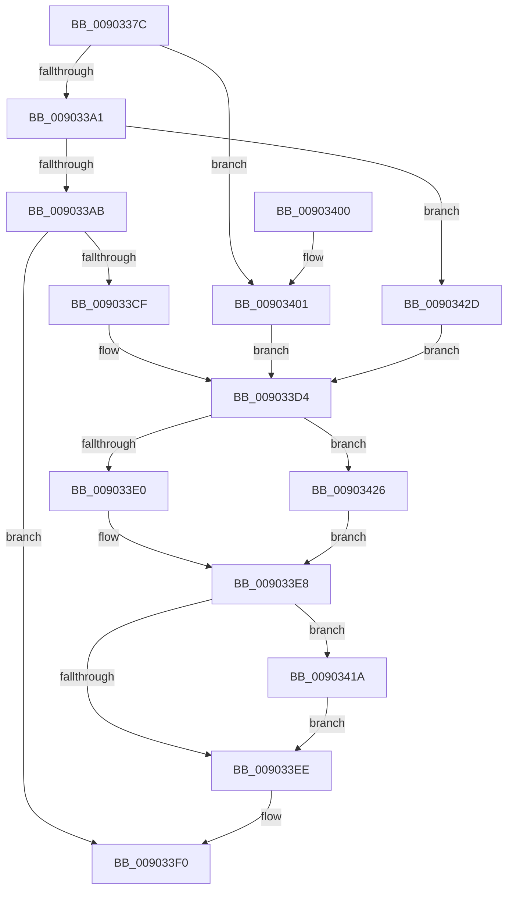

# PsReferencePartitionByHandle

- RVA: `0x0090337C`–`0x00903436` (길이 `186` bytes)
- VA: `0x000000014090337C`
- 실행 섹션: `PAGE`
- PDB 이름 있음: `예`; PDB Function 태그: `아니요`
- unwind 정보 RVA: `0x00088964`
- 디코드: `51`개 명령, `186/186` bytes 표시
- 미해석 바이트: `0` (있으면 어셈블리에 `.byte`로 보존)

> 이 문서는 커널 이미지의 기계어와 PDB 기호를 분석해 생성했습니다. 4번과 5번은 함수 원형과 자료형을 바이너리 사용 방식에서 추정한 C 해석이며 원본 소스 복구 결과는 아닙니다.

## 1. Dependencies

- 직접 호출 지점: **3**; 고유 호출 대상: **3**
- 직접 호출자로 확인된 함수: **20**
- RIP 상대 이미지 참조: **2**

### Outgoing calls
- `0x009033C6` → [ObpReferenceObjectByHandleWithTag](../86/ObpReferenceObjectByHandleWithTag_function_00869650.md) (function, `0x00869650`)
- `0x009033D7` → [PsReferencePartitionSafe](../../text/3B/PsReferencePartitionSafe_function_003BA6C0.md) (function, `0x003BA6C0`)
- `0x0090341F` → [ObfDereferenceObjectWithTag](../../text/2F/ObfDereferenceObjectWithTag_function_002F78E0.md) (function, `0x002F78E0`)

### Direct callers
- [EtwpSetPartitionContext](../../text/65/EtwpSetPartitionContext_function_00652C3C.md) at `0x00652C9D`
- [IopSetFileMemoryPartitionInformation](../71/IopSetFileMemoryPartitionInformation_function_0071E414.md) at `0x0071E4A5`
- [PspSetJobMemoryPartition](../78/PspSetJobMemoryPartition_function_00785574.md) at `0x007855AE`
- [PsCreatePartition](../78/PsCreatePartition_function_00787EB0.md) at `0x00787F62`
- [SmProcessCompressionAcceleratorRequest](../7A/SmProcessCompressionAcceleratorRequest_function_007A5EEC.md) at `0x007A6037`
- [SmProcessCompressionReadStatsRequest](../7A/SmProcessCompressionReadStatsRequest_function_007A6090.md) at `0x007A6277`
- [SmProcessConfigRequest](../7A/SmProcessConfigRequest_function_007A62E4.md) at `0x007A64FC`
- [SmProcessConfigRequest](../7A/SmProcessConfigRequest_function_007A62E4.md) at `0x007A665F`
- [SmProcessListRequest](../7A/SmProcessListRequest_function_007A67A8.md) at `0x007A69AD`
- [SmProcessStatsRequest](../7A/SmProcessStatsRequest_function_007A6E68.md) at `0x007A6F98`
- [MiInitializePartitionSpecialPurposeMemory](../80/MiInitializePartitionSpecialPurposeMemory_function_0080F704.md) at `0x0080F913`
- [PfpPartitionFindByHandle](PfpPartitionFindByHandle_function_00902E48.md) at `0x00902EBB`
- [NtManagePartition](NtManagePartition_function_00902FC0.md) at `0x009030F1`
- [MiInitializeCreateSectionPacket](../98/MiInitializeCreateSectionPacket_function_00984130.md) at `0x009843B0`
- [SmProcessCompressionInfoRequest](../A0/SmProcessCompressionInfoRequest_function_00A0E980.md) at `0x00A0ED87`
- [SmProcessSystemStoreTrimRequest](../A7/SmProcessSystemStoreTrimRequest_function_00A784E0.md) at `0x00A786CA`
- [PfSetSuperfetchInformation](../AD/PfSetSuperfetchInformation_function_00ADE6E8.md) at `0x00ADEFB1`
- [sub_00B18D64](../B1/Unknown_function_00B18D64.md) at `0x00B18D7B`
- [sub_00B18D94](../B1/Unknown_function_00B18D94.md) at `0x00B18DAF`
- [sub_00B18DCC](../B1/Unknown_function_00B18DCC.md) at `0x00B18DE5`
- [sub_00B2095C](../B2/Unknown_function_00B2095C.md) at `0x00B20976`

### Static image references
- `0x009033AB` → RVA `0x00FC6EB8` (`ALMOSTRO`; read)
- `0x0090342D` → RVA `0x00FC6EA0` (`ALMOSTRO`; read)

## 2. Other-region calls and transfers

- 다른 실행 섹션으로 향하는 call: **2**
  - `0x009033D7` → [PsReferencePartitionSafe](../../text/3B/PsReferencePartitionSafe_function_003BA6C0.md) (`PAGE` → `.text`)
  - `0x0090341F` → [ObfDereferenceObjectWithTag](../../text/2F/ObfDereferenceObjectWithTag_function_002F78E0.md) (`PAGE` → `.text`)
- 별도 외부 분기/꼬리 이동을 확인하지 못했습니다.

## 3. Assembly (complete function range)

```asm
0090337C  4C 8B DC                        mov r11, rsp
0090337F  49 89 5B 10                     mov qword ptr [r11 + 0x10], rbx
00903383  49 89 73 18                     mov qword ptr [r11 + 0x18], rsi
00903387  57                              push rdi
00903388  48 83 EC 40                     sub rsp, 0x40
0090338C  33 DB                           xor ebx, ebx
0090338E  41 8B F1                        mov esi, r9d
00903391  49 89 5B 08                     mov qword ptr [r11 + 8], rbx
00903395  45 8A C8                        mov r9b, r8b
00903398  48 8B F9                        mov rdi, rcx
0090339B  48 83 F9 FF                     cmp rcx, -1
0090339F  74 60                           je 0x140903401
009033A1  48 83 F9 FE                     cmp rcx, -2
009033A5  0F 84 82 00 00 00               je 0x14090342d
009033AB  4C 8B 05 06 3B 6C 00            mov r8, qword ptr [rip + 0x6c3b06]
009033B2  49 8D 43 08                     lea rax, [r11 + 8]
009033B6  49 89 5B F0                     mov qword ptr [r11 - 0x10], rbx
009033BA  49 89 5B E8                     mov qword ptr [r11 - 0x18], rbx
009033BE  49 89 43 E0                     mov qword ptr [r11 - 0x20], rax
009033C2  89 74 24 20                     mov dword ptr [rsp + 0x20], esi
009033C6  E8 85 62 F6 FF                  call 0x140869650
009033CB  85 C0                           test eax, eax
009033CD  78 21                           js 0x1409033f0
009033CF  4C 8B 44 24 50                  mov r8, qword ptr [rsp + 0x50]
009033D4  49 8B C8                        mov rcx, r8
009033D7  E8 E4 72 AB FF                  call 0x1403ba6c0
009033DC  84 C0                           test al, al
009033DE  74 46                           je 0x140903426
009033E0  48 8B 54 24 70                  mov rdx, qword ptr [rsp + 0x70]
009033E5  4C 89 02                        mov qword ptr [rdx], r8
009033E8  48 83 FF FD                     cmp rdi, -3
009033EC  76 2C                           jbe 0x14090341a
009033EE  8B C3                           mov eax, ebx
009033F0  48 8B 5C 24 58                  mov rbx, qword ptr [rsp + 0x58]
009033F5  48 8B 74 24 60                  mov rsi, qword ptr [rsp + 0x60]
009033FA  48 83 C4 40                     add rsp, 0x40
009033FE  5F                              pop rdi
009033FF  C3                              ret
00903400  CC                              int3
00903401  65 48 8B 04 25 88 01 00 00      mov rax, qword ptr gs:[0x188]
0090340A  48 8B 90 B8 00 00 00            mov rdx, qword ptr [rax + 0xb8]
00903411  4C 8B 82 58 07 00 00            mov r8, qword ptr [rdx + 0x758]
00903418  EB BA                           jmp 0x1409033d4
0090341A  8B D6                           mov edx, esi
0090341C  49 8B C8                        mov rcx, r8
0090341F  E8 BC 44 9F FF                  call 0x1402f78e0
00903424  EB C8                           jmp 0x1409033ee
00903426  BB A0 04 00 C0                  mov ebx, 0xc00004a0
0090342B  EB BB                           jmp 0x1409033e8
0090342D  4C 8B 05 6C 3A 6C 00            mov r8, qword ptr [rip + 0x6c3a6c]
00903434  EB 9E                           jmp 0x1409033d4
```

## 4. C-style interpretation (structured pseudocode)

```c
__int64 __fastcall PsReferencePartitionByHandle(__int64 a1, __int64 a2, unsigned __int8 a3, int a4, __int64 a5)
{
    __int64 result;
    __int64 v_rbx;
    __int64 v_rsp;
    unsigned int v_stack_m28;
    unsigned __int64 v_stack_p10;
    unsigned __int64 v_stack_p18;
    unsigned __int64 v_stack_p8;

    *(unsigned __int64 *)(v_rsp + 16) = v_rbx;
    *(unsigned __int64 *)(v_rsp + 24) = v_rsi;
    v_rsp = (v_rsp) - (64);
    v_rbx = 0;
    *(unsigned __int64 *)(v_rsp + 8) = 0;
    if (a1 == -1) goto loc_00903401;
    if (a1 == -2) goto loc_0090342D;
    *(unsigned __int64 *)(v_rsp - 16) = 0;
    *(unsigned __int64 *)(v_rsp - 24) = 0;
    *(unsigned __int64 *)(v_rsp - 32) = v_rsp + 8;
    v_stack_m28 = (unsigned int)((unsigned int)(a4));
    result = ObpReferenceObjectByHandleWithTag(a1, a2, *(unsigned __int64 *)(v_rip + 7092998), a3);
    if (sign_flag) goto loc_009033F0;
loc_009033D4:
    result = PsReferencePartitionSafe(v_stack_p8, a2, v_stack_p8, a3);
    if ((unsigned __int8)(result) == 0) goto loc_00903426;
    *(unsigned __int64 *)(a5) = v_stack_p8;
loc_009033E8:
    if (a1 <= -3) goto loc_0090341A;
loc_009033EE:
loc_009033F0:
    v_rsp = (v_rsp) + (64);
    return 0;
loc_00903401:
    goto loc_009033D4;
loc_0090341A:
    result = ObfDereferenceObjectWithTag(*(unsigned __int64 *)(*(unsigned __int64 *)(*(unsigned __int64 *)(gs_base + (0 + 392)) + 184) + 1880), (unsigned int)((unsigned int)(v_stack_p18)), *(unsigned __int64 *)(*(unsigned __int64 *)(*(unsigned __int64 *)(gs_base + (0 + 392)) + 184) + 1880), a3);
    goto loc_009033EE;
loc_00903426:
    goto loc_009033E8;
loc_0090342D:
    goto loc_009033D4;
}
```

## 5. (Beta) C Style

```c
int64_t PsReferencePartitionByHandle(int64_t Arg1, int64_t Arg2, uint8_t Arg3, int32_t Arg4, void *Arg5)
{
    uint8_t *arg5 = (uint8_t *)Arg5;

    int64_t result;
    int64_t local_rbx;
    int64_t local_rsp;
    uint32_t v_stack_m28;
    uint64_t v_stack_p10;
    uint64_t v_stack_p18;
    uint64_t v_stack_p8;

    *(uint64_t *)(local_rsp + 0x10) = local_rbx;
    *(uint64_t *)(local_rsp + 0x18) = local_rsi;
    local_rsp = (local_rsp) - (64);
    local_rbx = 0;
    *(uint64_t *)(local_rsp + 0x8) = 0;
    if (Arg1 == -1) goto loc_00903401;
    if (Arg1 == -2) goto loc_0090342D;
    *(uint64_t *)(local_rsp - 0x10) = 0;
    *(uint64_t *)(local_rsp - 0x18) = 0;
    *(uint64_t *)(local_rsp - 0x20) = local_rsp + 8;
    v_stack_m28 = (uint32_t)((uint32_t)(Arg4));
    result = ObpReferenceObjectByHandleWithTag(Arg1, Arg2, *(uint64_t *)(v_rip + 0x6C3B06), Arg3);
    if (sign_flag) goto loc_009033F0;
loc_009033D4:
    result = PsReferencePartitionSafe(v_stack_p8, Arg2, v_stack_p8, Arg3);
    if ((uint8_t)(result) == 0) goto loc_00903426;
    *(uint64_t *)(arg5) = v_stack_p8;
loc_009033E8:
    if (Arg1 <= -3) goto loc_0090341A;
loc_009033EE:
loc_009033F0:
    local_rsp = (local_rsp) + (64);
    return 0;
loc_00903401:
    goto loc_009033D4;
loc_0090341A:
    result = ObfDereferenceObjectWithTag(*(uint64_t *)(*(uint64_t *)(*(uint64_t *)(gs_base + (0 + 0x188)) + 0xB8) + 0x758), (uint32_t)((uint32_t)(v_stack_p18)), *(uint64_t *)(*(uint64_t *)(*(uint64_t *)(gs_base + (0 + 0x188)) + 0xB8) + 0x758), Arg3);
    goto loc_009033EE;
loc_00903426:
    goto loc_009033E8;
loc_0090342D:
    goto loc_009033D4;
}
```

### 관측된 메모리 오프셋

구조체 형식이 확인되지 않은 접근은 인자 기준의 오프셋으로만 기록했습니다.

| 기준 인자 | 오프셋 표현 | 폭 (bit) | 접근 |
|---|---:|---:|---|
| `Arg5` | `+ 0x0` | `64` | `W` |

## 6. Execution-region graph

[열기: 2D/3D 그래프와 함수 탐색 컨트롤 패널](../../../control-panel.html?section=page&rva=0x0090337C&view=graph)

- 2D 그래프는 위에서 아래로 흐르고, 3D 그래프는 빈 공간을 드래그해 회전합니다. Shift+드래그는 이동, 휠은 확대·축소, 함수 노드 선택은 대상 보고서 이동입니다.

### Static fallback


