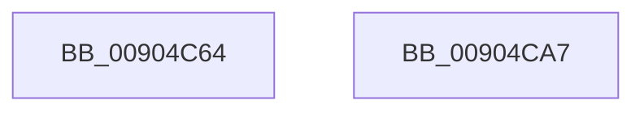

# PsTerminateProcess

- RVA: `0x00904C64`–`0x00904CA8` (길이 `68` bytes)
- VA: `0x0000000140904C64`
- 실행 섹션: `PAGE`
- PDB 이름 있음: `예`; PDB Function 태그: `아니요`
- unwind 정보 RVA: `0x0005CAAC`
- 디코드: `19`개 명령, `68/68` bytes 표시
- 미해석 바이트: `0` (있으면 어셈블리에 `.byte`로 보존)

> 이 문서는 커널 이미지의 기계어와 PDB 기호를 분석해 생성했습니다. 4번과 5번은 함수 원형과 자료형을 바이너리 사용 방식에서 추정한 C 해석이며 원본 소스 복구 결과는 아닙니다.

## 1. Dependencies

- 직접 호출 지점: **2**; 고유 호출 대상: **2**
- 직접 호출자로 확인된 함수: **14**
- RIP 상대 이미지 참조: **0**

### Outgoing calls
- `0x00904C8B` → [PspTerminateProcess](PspTerminateProcess_function_00903FFC.md) (function, `0x00903FFC`)
- `0x00904C95` → [KeLeaveCriticalRegionThread](../../text/25/KeLeaveCriticalRegionThread_function_0025EFF0.md) (function, `0x0025EFF0`)

### Direct callers
- [MiReAcquireCommitFailWorker](../../text/66/MiReAcquireCommitFailWorker_function_0066F560.md) at `0x0066F56E`
- [PspShutdownCsrProcess](../78/PspShutdownCsrProcess_function_00780214.md) at `0x007803DC`
- [PsShutdownSystem](../78/PsShutdownSystem_function_00785E94.md) at `0x00785F88`
- [PsShutdownSystem](../78/PsShutdownSystem_function_00785E94.md) at `0x0078605D`
- [PsCreateMinimalProcess](../78/PsCreateMinimalProcess_function_00786D14.md) at `0x007870A8`
- [RtlpTerminateCurrentProcess](../78/RtlpTerminateCurrentProcess_function_0078F7AC.md) at `0x0078F7C5`
- [WheaTerminateProcess](../7D/WheaTerminateProcess_function_007D7810.md) at `0x007D784B`
- [PspCallProcessNotifyRoutines](PspCallProcessNotifyRoutines_function_00904928.md) at `0x00904A99`
- [KiSchedulerApcTerminate](KiSchedulerApcTerminate_function_00905D40.md) at `0x00905D89`
- [PspRemoveProcessFromJobChain](PspRemoveProcessFromJobChain_function_00907288.md) at `0x0090732C`
- [PspProcessClose](../9F/PspProcessClose_function_009F64D0.md) at `0x009F6517`
- [MiForceCrashForInvalidAccess](../AC/MiForceCrashForInvalidAccess_function_00ACEFA4.md) at `0x00ACF1A2`
- [NtCreateUserProcess](../AE/NtCreateUserProcess_function_00AEA680.md) at `0x00AEB6A3`
- [sub_00B21BBC](../B2/Unknown_function_00B21BBC.md) at `0x00B21BE6`
- [ExpDebuggerWorker](../../pagekd/B8/ExpDebuggerWorker_function_00B89F70.md) at `0x00B8A03F`

### Static image references
- 디코드된 RIP-relative 메모리 참조가 없습니다.

## 2. Other-region calls and transfers

- 다른 실행 섹션으로 향하는 call: **1**
  - `0x00904C95` → [KeLeaveCriticalRegionThread](../../text/25/KeLeaveCriticalRegionThread_function_0025EFF0.md) (`PAGE` → `.text`)
- 별도 외부 분기/꼬리 이동을 확인하지 못했습니다.

## 3. Assembly (complete function range)

```asm
00904C64  48 89 5C 24 08                  mov qword ptr [rsp + 8], rbx
00904C69  57                              push rdi
00904C6A  48 83 EC 20                     sub rsp, 0x20
00904C6E  65 48 8B 3C 25 88 01 00 00      mov rdi, qword ptr gs:[0x188]
00904C77  44 8B C2                        mov r8d, edx
00904C7A  41 B9 01 00 00 00               mov r9d, 1
00904C80  48 8B D7                        mov rdx, rdi
00904C83  66 FF 8F E4 01 00 00            dec word ptr [rdi + 0x1e4]
00904C8A  90                              nop
00904C8B  E8 6C F3 FF FF                  call 0x140903ffc
00904C90  48 8B CF                        mov rcx, rdi
00904C93  8B D8                           mov ebx, eax
00904C95  E8 56 A3 95 FF                  call 0x14025eff0
00904C9A  8B C3                           mov eax, ebx
00904C9C  48 8B 5C 24 30                  mov rbx, qword ptr [rsp + 0x30]
00904CA1  48 83 C4 20                     add rsp, 0x20
00904CA5  5F                              pop rdi
00904CA6  C3                              ret
00904CA7  CC                              int3
```

## 4. C-style interpretation (structured pseudocode)

```c
__int64 __fastcall PsTerminateProcess(__int64 a1, int a2)
{
    __int64 result;
    __int64 v_rsp;
    unsigned __int64 v_stack_p8;

    v_stack_p8 = v_rbx;
    v_rsp = (v_rsp) - (32);
    result = PspTerminateProcess(a1, *(unsigned __int64 *)(gs_base + (0 + 392)), (unsigned int)(a2), 1);
    result = KeLeaveCriticalRegionThread(*(unsigned __int64 *)(gs_base + (0 + 392)), *(unsigned __int64 *)(gs_base + (0 + 392)), (unsigned int)(a2), 1);
    v_rsp = (v_rsp) + (32);
    return (unsigned int)((unsigned int)((unsigned int)((unsigned int)(result))));
}
```

## 5. (Beta) C Style

```c
int64_t PsTerminateProcess(int64_t Arg1, int32_t Arg2)
{
    int64_t result;
    int64_t local_rsp;
    uint64_t v_stack_p8;

    v_stack_p8 = local_rbx;
    local_rsp = (local_rsp) - (32);
    result = PspTerminateProcess(Arg1, *(uint64_t *)(gs_base + (0 + 0x188)), (uint32_t)(Arg2), 1);
    result = KeLeaveCriticalRegionThread(*(uint64_t *)(gs_base + (0 + 0x188)), *(uint64_t *)(gs_base + (0 + 0x188)), (uint32_t)(Arg2), 1);
    local_rsp = (local_rsp) + (32);
    return (uint32_t)((uint32_t)((uint32_t)((uint32_t)(result))));
}
```

## 6. Execution-region graph

[열기: 2D/3D 그래프와 함수 탐색 컨트롤 패널](../../../control-panel.html?section=page&rva=0x00904C64&view=graph)

- 2D 그래프는 위에서 아래로 흐르고, 3D 그래프는 빈 공간을 드래그해 회전합니다. Shift+드래그는 이동, 휠은 확대·축소, 함수 노드 선택은 대상 보고서 이동입니다.

### Static fallback


